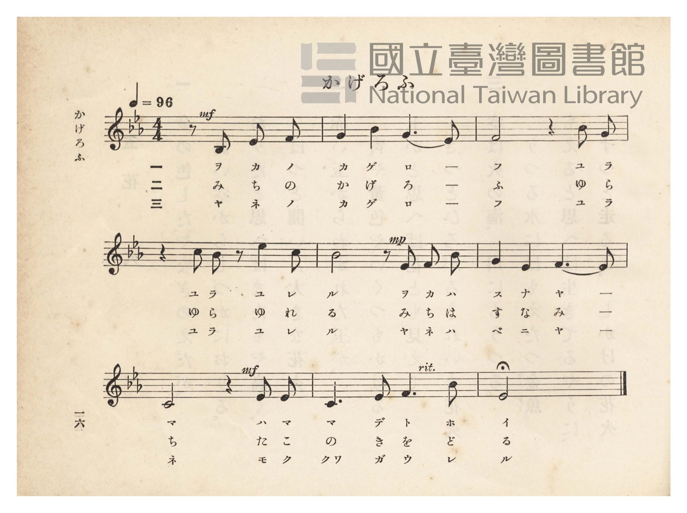
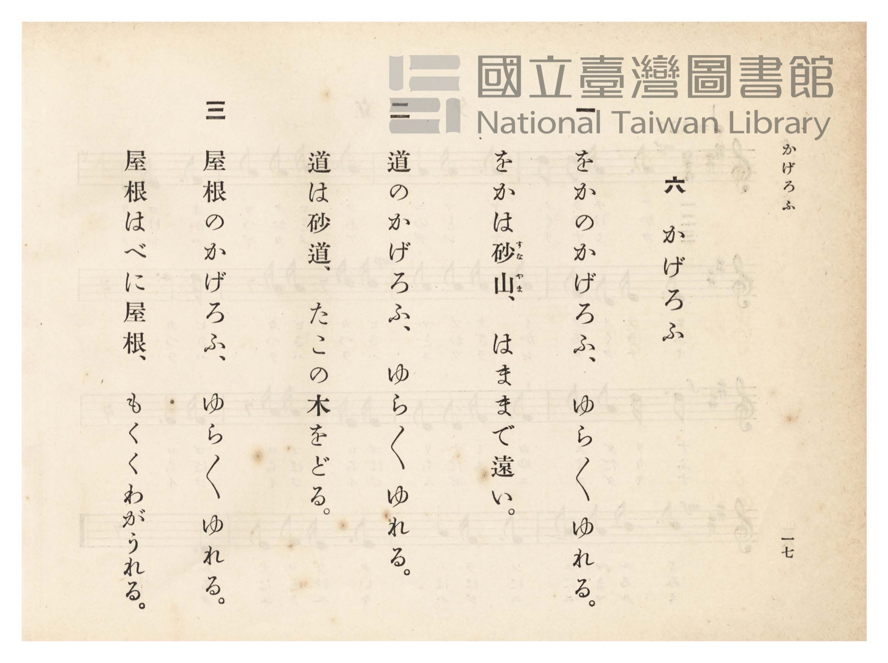

# かげろふ

> Re:Shōka 使用 AI 協助辨識與重建樂譜，可能會有錯誤。歡迎回報。

- **鋼琴伴奏版**：<br><audio controls src="kagerou.mp3"></audio>
- **NEUTRINO 歌聲合成版**：<br><audio controls src="kagerou_neutrino.mp3"></audio>

- 詞：吉村守（昭和八年臺灣總督府文教局懸賞募集入選）
- 臺灣總督府《公學校唱歌》第四學年用（昭和十一年，索書號 0729 73）

## 說明

原書資訊與歌詞全文（對應 P021.jpg–P022.jpg，原書 pp. 16–17）：
作詞：吉村守（臺南市鹽埕町一丁目五番地上信方，昭和八年臺灣總督府文教局公學校唱歌歌詞懸賞募集入選第 14 首）
調性與拍號：ホ變長調（Eb 大調）4/4 拍（弱起二拍），速度 ♩=96


## 歌詞

```text
一
岡（をか）のかげろふ
ゆらゆらゆれる。
岡は砂山（すなやま）、
はままで遠（とほ）い。

二
道（みち）のかげろふ
ゆらゆらゆれる。
道は砂道（すなみち）、
たこの木をどる。

三
屋根（やね）のかげろふ
ゆらゆらゆれる。
屋根はべに屋根、
もくくわがうれる。
```

## ABC

```abc
X:1
T:かげろふ
M:4/4
L:1/16
Q:1/4=96
K:Eb
V:V1 name="Piano" snm="Pia"
[V:V1]
!mf! z8 z2 B,2 E2 F2 | G4 B4 G6 F2 | F8 z4 B2 G2 | z4 c2 B2 z2 e4 c2 |
w: 1.~ヲ カ ノ | カ ゲ ロ _ | フ ユ ラ | ユ ラ ユ レ
w: 2.~み ち の | か げ ろ _ | ふ ゆ ら | ゆ ら ゆ れ
w: 3.~ヤ ネ ノ | カ ゲ ロ _ | フ ユ ラ | ユ ラ ユ レ
!mp! B8 z2 E2 F2 B2 | G4 E4 F6 E2 | !mf! C8 z4 E2 E2 | C6 E2 F6 B2 |
w: 1.~ル ヲ カ ハ | ス ナ ヤ _ | マ ハ マ | マ デ ト ホ
w: 2.~る み ち は | す な み _ | ち た こ | の き を ど
w: 3.~ル ヤ ネ ハ | ベ ニ ヤ _ | ネ モ ク | クヮ ガ ウ レ
F8 z8 |
w: 1.~イ
w: 2.~る
w: 3.~ル
```

## TMD 檔案連結

- [主旋律 TMD 檔案](kagerou.tmd) [[在 TMD Studio 編輯](https://tmdlang.github.io/Tmd-TS/#tmd=s7IKdvYPcrWy4qpTUCpJTLdSSM7PyUlNLsnMz7PKzk9PzM7Ojy_OyM9OVIKrKMvPKc1NtUovSkxJjTdBiBfnlxYlp1oVJ2fk5-fEl6RWlCTl52ejy8cXJKanWgUYGBkiZAqK8stS8xLzgLoLijLzSlJTwNoRClLLMlNSQdLFyYl58WWpRZlpmakpSE5KLSoGuRhqRUlRYl5xclFmAcgbCFX5RSUZ-UBnF2RUWmVkFpfkF2UmJ-bEZyfmIfmuJCMV6Lm8xJLSolR00ZLEzPJEJAMhogU5iXklxcjWZKZn5kEVx-enpWUmZybm4JJPzgf6t7gk3tDS2FiJS0tL4XFj9-PGSY-beh83blXQ0uJStFWwNOOyt1VwTeKyMdE3sQMZ9GLlvPd7Zj2d0Pls7sSn6zre7-l4NmPt00k9T1tXP9255UX7rueNi5_v2Pt87uKnu-Y8m9b-bOrMpxsbnrXveLF53tPu-S9ntz1tXfqyccf7PZ1gh6HpeNzQ9bR1zdO1O54tWPh0ysZna3seN3Q_X7Pm6ezZQEGgDc-nrEDY2dv4ZEcDUPD9np7nWxY9m73jxcz5CgbmRpYK5sZgC7j0tRRsqQW4FBQUnvbNB1mzuf3Fiq4XHe1A9wED5GnrCqBPgc56uqH3WXunAiiN6WUVpD9qmAxkGoGYQBdCtCoUFOgpGJoBpQzNgU4EhiXI2Cd752AGLDBonvZOf7qj6eXOvU_nT30-ZRfQt092ND6fve7JrinPp656OmfDkx1dT_YvfDZtJ9ACYiICLXAh7seMHWCIKxiaKLxcNg3oRpADX6za_6xhOcjH3b3AQAa69HHz7Bfrul5O3Q6UAjrWNUnh6ZLlYHYnMK0oANWBAmTPxhdbtz_Z1QPmAn3b87Jh_tNdyxQezVxpC0xcYL_vaACH7KaFQA2PmyYBkyFQ6ePGdcjpEaTicVPb46ZOJLLncVP344YmqO7HjeufL2h6unEjyJjGmY8bVz1uanncuA9kWEMj2IDG9UA-GC1_2bgArG7F48bdYOtaQCaB3bOrB0S9bJwMVrD_cSPQYaS6B6gb4h6YMWD3wA2DuWf-Y5C6dc_mrAB7fCXUAEiwgAP-6cbuZwuAsQsMGaBn1pIRMmADwF4HkquhXKgDmpoeN_aDUBOQ7HnciKqV8iwDBQpa-lxc3sDityi_1CogMzEv36FG17CmGmSJgo2Flh2YgS2vKgBTIjCBvFjYo6ABSUwKRqC0paANpJ9u6H--vkEHnt80segH2gwyu0bBQEEXDA0UqnPTahVM4xUMgUbUKBgDxUyBGETrgkWM4CpBMsYKNWATfAxrFOKhMvEKj5s3AUNvNZDuA-oAsXSB5CYQ2bwWqgoo3jwVrgMkswyIV8LMM0Ixr3E_EC8E4nUgfY3dIPWNk8Cm9iLMAxbMSOY1tQFxJ8w8Y1T3LQHiXjLdhz86dvWAo8OY9PA3A4angYJhHJhZAw52WJQU1ILjwxQaI4bguABJGqKFP8yVID8uA_PXgH0C8iF63PSD_b4TrKoLTC6B-R0lDmAhCdQLZIH4PWCdoFhAj5_14HiYCY6fVWByP6qZ0Hggxp2wOAK7sxlsZjM45pHcSSBrdJITF2awhAKKFHB2MASFM0wcFBEgGhQZyJkByZPAyHjcPA8l8fSDRRDij5vbgbgDyp4NDlCYt2D2I6IBFLhIpjXOB-LJ4KBeBzGhERhQTaAMAWIDEylK9KBHAChYkd22CKgaHHFN6x83Qw1sWgPEoJjBFjcwA2u5uHTtFKBFlwKQqcwFAA)]
- [鋼琴伴奏 TMD 檔案](kagerou_piano.tmd) [[在 TMD Studio 編輯](https://tmdlang.github.io/Tmd-TS/#tmd=s7IKdvYPcrWy4tLSUnjc2P24cdLjpt7HjVvf7-l42b3n-YQtT_Zsebq0_3lnx_s9nQpaWlyKtgqWZlz2tgquSVw2Jvomdlx1CkovVs57v2fW0wmdz-ZOfLoOqLTj2Yy1Tyf1PG1d_XTnlhftu543Ln6-Y-_zuYuf7przbFr7s6kzn25seNa-48XmeU-757-c3fa0denLxh1AO5TA5qHqeNzQ9bR1zdO1O54tWPh0ysZna3seN3Q_X7Pm6ezZQEGgDc-nrEDY2dv4ZEcDUPD9np7nWxY9m73jxcz5CgbmRpYK5sZgC7i8E9NTi_JLrQIyE_PygzwcanQNa6q5FIDAxkLLDsyoUTBQ0AVDA4Xq3LRaBdN4BUMFI6C4MVDMFIhBtC5YxAiuEiRjrFADNsHHsEYhHioTr_C4eZPC46bVQLoPqAPE0gWSm0Bk81qoKqB481S4DpDMMiBeCTPPCMW8xv1AvBCI14H0NXaD1DdOApvaizCvcSuyeU1tQNwJM88Y1X1LgLiXTPchBZkZMAgMFAzjwMwacEjBQrGgFhyEptBANAQHH0jSEC3IYAaDnLUMzF8DthzkKPTg7Ac7dydYVReYXAJzLkqwwTwP1Atkgfg9YJ2ggEMP0vXgoJsJDtJVYHI_qpnQoCPGnbBgBbuzGWxmMziykNwJDT4zWHSAwhGc6AxBQQMTB4UdiAaFH3KSQ3IXMPweN89DiaJ-sAhC_HFzOxB3QNmzwWEAcwnMfkTIgcIDybTG-UA8GRw66yAmNAL91gRKdiA2MCmghCh6mIFCAtlti4CqwWHdtP5xM9TApjVADApMbMEJM7AWLQ_7oORhE5Q8DMI1CobxCtGGsTAKmC7jgSzT-FgwwwDqxhoFE6CoSSyMQtYGVAPjgfWCTIHHG5BvFp8bC2aBFEL1wy1Bsg_sHJAHdO0UoH6I9gEahsw1QuUag7nKXAA)]

## 分析

```text
================================================================================
📊 TMD Song Profile: [ かげろふ ]
================================================================================
⏱  Duration:       0:20 (20.0s), 8 measures total
🎼 Key & Tempo:    首調基準 E,, != 96.0 BPM, <4/4>
   - 分析範圍：      由實際發聲的音符與和弦推測調性；播放脈絡另行呈現
🎤 人聲音域:    A#3 (MIDI 58) – D#5 (MIDI 75) [跨度: 17 個半音 / 1.4 個八度, 難度: challenging]
   - 最低音:  A#3 in [Kagerou #1 @ m.1, 0:01]
   - 最高音: D#5 in [Kagerou #1 @ m.4, 0:09]
   - 適合: soprano, mezzo-soprano, contralto, tenor, baritone, bass
🏛  結構:      Kagerou (20.0s)
⚡ 編曲密度:        Peak 1 軌道同時演奏
🗝  調性診斷：       A# 大調（純淨自然大調，未偵測到可信轉調）
   - 風格氣質:    純淨自然大調（陽光明朗、易唱易記，無明顯調外色彩）
   - 轉調歷程:    全曲維持單一推測調性（未偵測到可信轉調）
   - 核心骨幹音:  F, A#, D#, C, G
   - 調性數值:    A# 大調 [相關度: 0.77, 穩定度: Moderate, 自然音純度: 100.0%]
   - 候選調性 (K-S): A# 大調 (0.77), F 大調 (0.67), D# 大調 (0.64)
   - 五度圈歷程:   -2
   - 各段落調性細節:
     • [Kagerou #1]: A# 大調 (r: 0.78, 自然音純度: 100.0%)

  [ 五度圈游移軌跡 ]
               C  
         F            G  
     [Bb]*              D  
      Eb               A  
         Ab           E  
            Db       B  
               F# 
     (* = active key center)

  [ 十二半音累積音高分佈 ]
     C  : █████████████             16.4%
     C# :                            0.0%
     D  :                            0.0%
     D# : ██████████████            18.2%
     E  :                            0.0%
     F  : ████████████████████████  30.9%
     F# :                            0.0%
     G  : ███████████               14.5%
     G# :                            0.0%
     A  :                            0.0%
     A# : ████████████████          20.0%
     B  :                            0.0%
--------------------------------------------------------------------------------
Assignment 軌道音域：
  - Piano         : A#3 – D#5 (17 個半音 / 1.4 個八度, 30 個音符)
================================================================================
```


## 原書掃描頁






