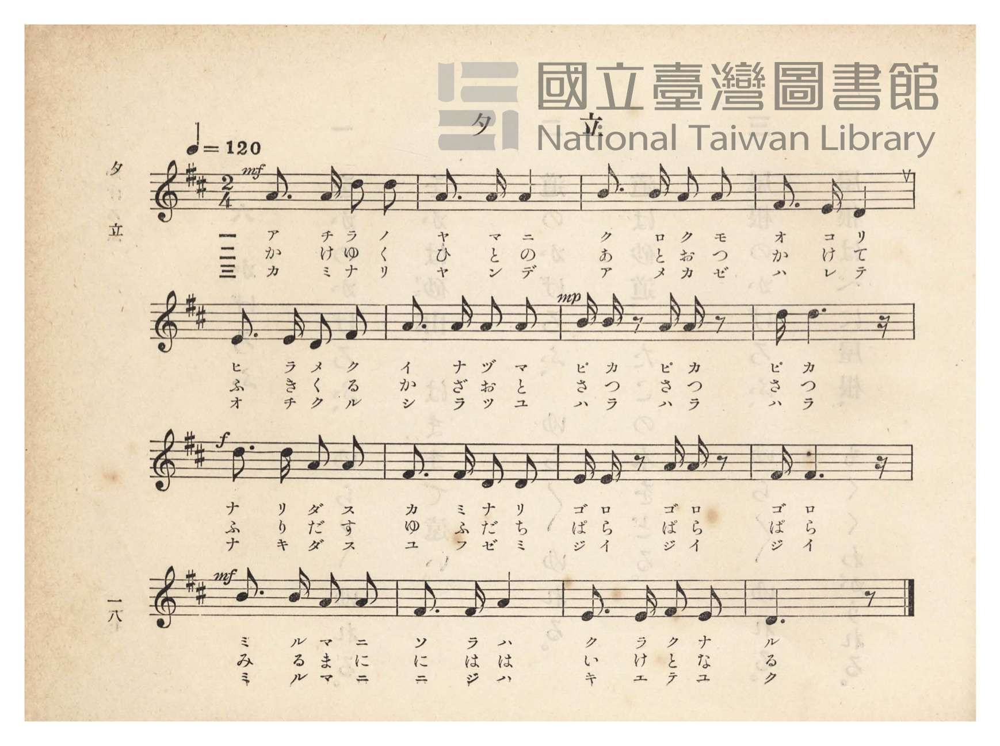
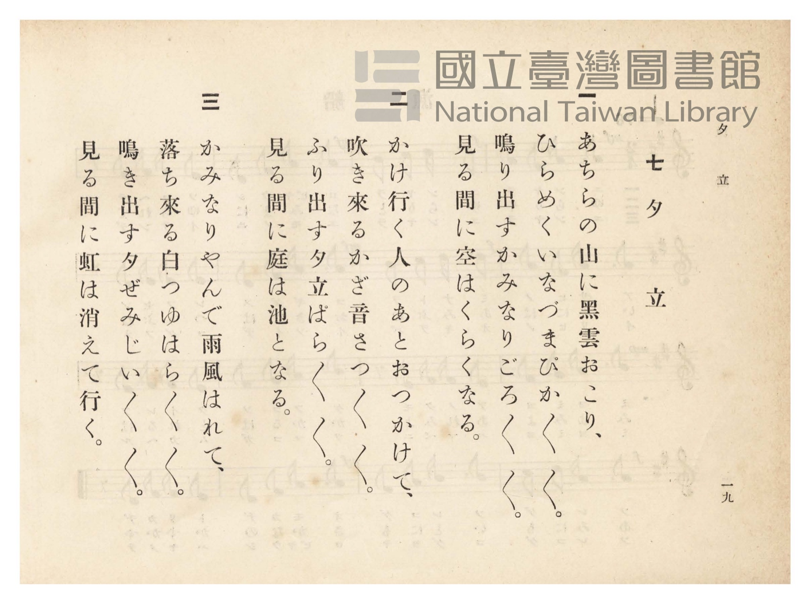

# 夕立

> Re:Shōka 使用 AI 協助辨識與重建樂譜，可能會有錯誤。歡迎回報。

- **鋼琴伴奏版**：<br><audio controls src="yudachi.mp3"></audio>
- **NEUTRINO 歌聲合成版**：<br><audio controls src="yudachi_neutrino.mp3"></audio>

- 詞：公學校用國民讀本
- 曲：宮島慎三郎
- 臺灣總督府《公學校唱歌》第四學年用（昭和十一年，索書號 0729 73）

## 說明

原書資訊與歌詞全文（對應 P023.jpg–P024.jpg，原書 pp. 18–19）：
作詞：臺灣總督府《公學校用國民讀本》
作曲：臺灣總督府國語學校助教授 宮島慎三郎（據大正四年《公學校唱歌集》緒言）
調性與拍號：ニ長調（D 大調）2/4 拍，速度 ♩=120


## 歌詞

```text
一
あちらの山に黑雲（くろくも）おこり、
ひらめくいなづま　ぴかぴかぴか、
なり出すかみなり　ごろごろごろ、
見る間に空は暗（くら）くなる。

二
かけ行く人のあと追（お）つかけて、
吹き來（く）る風音（かざおと）　さつさつさつ、
降り出す夕立（ゆふだち）　ぱらぱらぱら、
見る間に庭（には）は池（いけ）となる。

三
かみなりやんで、雨風（あめかぜ）はれて、
落ち來る白露（しらつゆ）　はらはらはら、
なき出す夕蟬（ゆふぜみ）　じいじいじい、
見る間に虹（にじ）は消（き）えて行く。
```

## ABC

```abc
X:1
T:夕立
C:曲：宮島慎三郎
M:2/4
L:1/16
Q:1/4=120
K:D
V:V1 name="Piano" snm="Pia"
[V:V1]
!mf! A3 A d2 d2 | A3 A A4 | B3 B A2 A2 | F3 E D4 |
w: 1.~ア チ ラ ノ | ヤ マ ニ | ク ロ ク モ | オ コ リ
w: 2.~か け ゆ く | ひ と の | あ と お っ | か け て
w: 3.~カ ミ ナ リ | ヤ ン デ | ア メ カ ゼ | ハ レ テ
E3 E D2 F2 | A3 A A2 A2 | !mp! B B z2 A A z2 | d d6 z |
w: 1.~ヒ ラ メ ク | イ ナ ヅ マ | ピ カ ピ カ | ピ カ
w: 2.~ふ き く る | か ざ お と | さ っ さ っ | さ っ
w: 3.~オ チ ク ル | シ ラ ツ ユ | ハ ラ ハ ラ | ハ ラ
!f! d3 d A2 A2 | F3 F D2 D2 | E E z2 A A z2 | F F6 z |
w: 1.~ナ リ ダ ス | カ ミ ナ リ | ゴ ロ ゴ ロ | ゴ ロ
w: 2.~ふ り だ す | ゆ ふ だ ち | ぱ ら ぱ ら | ぱ ら
w: 3.~ナ キ ダ ス | ユ フ ゼ ミ | ジ イ ジ イ | ジ イ
!mf! B3 B A2 A2 | F3 F A4 | E3 E F2 E2 | D6 z2 |
w: 1.~ミ ル マ ニ | ソ ラ ハ | ク ラ ク ナ | ル
w: 2.~み る ま に | に は は | い け と な | る
w: 3.~ミ ル マ ニ | ニ ジ ハ | キ エ テ ユ | ク
```

## TMD 檔案連結

- [主旋律 TMD 檔案](yudachi.tmd) [[在 TMD Studio 編輯](https://tmdlang.github.io/Tmd-TS/#tmd=s7IKdvYPcrWy4qpTUCpJTLdSSM7PyUlNLsnMz7PKzk9PzM7Ojy_OyM9OVIKrKMvPKc1NtUovSkxJjTdBiBfnlxYlp1oVJ2fk5-fEl6RWlCTl52ejy8cXJKanWgUYGBkjZAqK8stS8xLzgLoLijLzSlJTwNoRClLLMlNSQdLFyYl58WWpRZlpmakpSE5KLSoGuRhqRUlRYl5xclFmAcgbCFX5RSUZ-UBnF2RUWmVkFpfkF2UmJ-bEZyfmIfmuJCMV6Lny1EQgowhduDg1sTg_L764NDcXWRJoUHpmnlVJYmY50Hn5aWmZyZmJOUpcWloKT5dMfb66W0FLi0vRVsHQyIDL3lbBhcvGSN_EDqT9xcp57_fMetq65unaHc8WLHw-ZcXTOd3PNkx8sa7h2Zw1YBuezd4EUrJu3dPN25619j3Z0fmyuQ8s86J91_PGxc937H0-d_HTXXMeN3TBDXo6ZeOztT2PG7qfr1nzdPZsoODTnVuApr_f0_Fsxtqnk3qe9jY-2dEAFHy_p-f5lkXPZu94MXO-goG5kaWCufH7PZ1KXFz6Wgq21AJcCgoKT_vmg6zZ3P5iRdeLjnag-4C-f9q64tm0dqCznm7ofdbeqQBKGHpZBemPGiYDmSYgJtCFEK0KBQV6CoYWQClDS6ATgaECMvbJ3jmQUMQTHGjhCgwXqE5I4KLpBCp9sWoeNCC7Vj6bOvNZX4cCWgyAQnLyrKdLlj9buxgUwju3YIb_y9ltoCjYPunFigagg0F2vli1_1nDcpD3u3uBIQ60_HFz98up24HiQBNdgOllOZjZCUwhCkA1QM-_bJj_dNcyhUczV9qCEhDY5TsaQNTjxqbHjQsfN3U-blz3dOPGx42rX-6e-BLkpY7Hjf2Pm3rBZBPQtMeNXY8bJz9u6nrc0AjRuQmkrakRpKKx5XHjqseNSx837nvc0PC4ccvjxm4UEqZnFdCAp-27HjfOBMvth4iA9UwB24ZEQvS8WNb9uKn75bTJQLc9XwnUuf7ZrOkw5wFjEOgwoP1AU4CWNEG8tqsHYhnQgokvFvYAFTzZBdS4DuzZFS_27wVr7wLrXQJR9rhxGdS-pxN2Pm7sfbKvDWIHSBHQ-kUrXs7fDBYBqp4GDgtgTugEO3wq2BQkEmLQy5m9cM9C8jBIf1Pb48atjxsXAEMdpn8jOPiRSEyPP921Fmz5aqD3wc5e_2zjArAIMOAngkVWoAXCDnBiQQnlppbHTUDTlgMteDl7BdBPYBOawHEIVDYHYvLjJmCIwULjxYS9QJcCQwNo9POZe1_OgaSM6WDHLgH6BuYJoDaIZhiJiPHGXnggvJi_BikQ5gCdBtM_A-wVJBIzEF7M3AkLhBnQQNjWARYBpnEgF8hYBoluUCAANVNe6ECBgpY-F1dkaUpickamVUBmYl6-Q41BTTXIDgUbQzMtOzALW2mnACw9gVkN6CwFDROFpxv6n69v0IEXUZpYNACtAhlWo1Cdm1arYKqgC4SmCoZxQApM1MDFIDRIxAxMm4FFQLhGwRgsYqRgCFMDNtTHsEbhcdMisMjj5kYgXglm9YH1PG5eApWZB8TdcNMfN62Hiq-Fsh83g8wAyayCyDRtBopB2HC7jIDyjRBTgGkUqKYNzOqH6GzcBJVZAcTrEHY1NiGJd4FZi6EySGY1LkO1yxjkltVQV84HYrBOsIuQ_QVyZTuSv2AhsRCq-3HTHqgOkCtBMmuAGORuiF34o3lXDznRbIQUU6BYQ41fSGxW5xbUAqPXTMEAKgGia0DpAZwkYNAAOZqbJ0G9sBLsQZDnQFEH8jYsOLqAuBXMmgf19hRwQMSDxRBshAzCrniUaN4KjZpeaAQD8yxapE2DR-cKqMxUcNSC7UJiI2Sw2AWOZmiSAyVfaGIEuQsksx3Jxy1gFiiZQKITJArxF4KNkEG1i0Bu7iQrNwMzMzSygBR6RjUGRz8IgxKEEVo8G0NVYYtlUJhCkvrj5gZwyO-EhgbO7NC0BZyVwaGBxEbIEIjlJmC6aVwAjreZUH2QLAJSAZMBpTiQno1A2U5oLCPYCBkcsQzzVxOwyEH1FzhOQb4BphJwdgX5EOKKHeC0DfEXgo2QISGWge0xsstsXKWxMVKJDcv1IBkQG5iZUaIYpcQGexCS0CFZFVI6gzy2FyoDSvKQMgu1xAaKQzMJKEBBZqFmYtTSej800LuB7H3gKINmLTAN4q8HY7g9jaBsBiuTQRkbWN9DXQCrP9DsAUcuTv9Aax1whKH4B5IoHzcBawVweQzP2lCfIttTy8Wla6cAra4VgExlLgA)]
- [鋼琴伴奏 TMD 檔案](yudachi_piano.tmd) [[在 TMD Studio 編輯](https://tmdlang.github.io/Tmd-TS/#tmd=s7IKdvYPcrWy4tLSUni6ZOrz1d3v93S87N7zfMKWJ3u2PF3a_7yz4_2eTgUtLS5FWwVDIwMue1sFFy4bI30TO646BaUXK-e93zPraeuap2t3PFuw8PmUFU_ndD_bMPHFuoZnc9YogZQ8m70JpGTduqebtz1r7Xuyo_Nlcx9Y5kX7rueNi5_v2Pt87uKnu-Y8buiCG_R0ysZna3seN3Q_X7Pm6ezZQMGnO7cATQe67tmMtU8n9TztbXyyowEo-H5Pz_Mti57N3vFi5nwFA3MjSwVzY6CLlbi4IktTEpMzMq0CMhPz8oM8HGoMaqq5FIDAxtBMyw7MqlGozk2rVTBV0AVCUwXDOCAFJmrgYhAaJGIGps3AIiBco2AMFjFSMISpARvqY1ij8LhpEVjkcXMjEK8Es_rAeh43L4HKzAPibrjpj5vWQ8XXQtmPm0FmgGRWQWSaNgPFIGy4XUZA-UaIKY8bJwLVtIFZ_RCdjZugMiuAeB3CrsYmJPEuMGsxVAbJrMZlqHYZg9yyGurK-UAM1gl2EbK_QK5sR_IXLCQWQnU_btoD1QFyJUhmDRCD3A2xCxozRkiBCwpo1CiBREB1bkEtMEbMFAygEiC6BhSF4FiEQQPkmGmeBLV1JdhNIPeAQhvkUpgPuoC4FcyaB3XpFLDb48FiCDZCBmFXPErMbIWGZi80Th43gcIXOZynwWNgBVRmKjg2wHYhsREyWOwCxww0lYBSHDT9gNwFktmO5OMWMAsUs5AYAIlC_IVgI2RQ7YLlGWCWgYYvkELPDsbgGANhUBwaoUWNMVQVtogBBQMkQT1ubgAH1k6oB3AmuqYt4AwD9gASGyFDIGKagFHduAAc1DOh-iAJEaQCJgNKJCA9G4GyndCIQbARMjgiBuavJmDGRvUXOBpAvgFGLDhTgHwIccUOcHKE-AvBRshgjxhQYYarmDJGKspgeQskA2IDswxKrKAUZWA3QZITJENAii2QW_ZCZUAJC5KZUYsyoDg0KYLCAGQWalZBLcb2Q8OpG8jeBw5laAIG0yD-ejCG29MISsywwgqUfR43wtIFrGBFswccHzj9Ay2OwWGM4h9IOnrcBCwuwQUVPANBfYpsTy1azeODXPNYwCsew3iFaMNYGIXJNwEyTJD4pvFAlmk8QgRqDoY4NpMMQDxgZkOSg2U9wi4B2WAAJbGbgO5WbCaA3QhnoJsDDDRdOwVouEX7ACWQuUaoXGMwV5kLAA)]

## 分析

```text
================================================================================
📊 TMD Song Profile: [ 夕立 ]
================================================================================
⏱  Duration:       0:16 (16.0s), 16 measures total
🎼 Key & Tempo:    首調基準 D, != 120.0 BPM, <2/4>
   - 分析範圍：      由實際發聲的音符與和弦推測調性；播放脈絡另行呈現
🎤 人聲音域:    D4 (MIDI 62) – D5 (MIDI 74) [跨度: 12 個半音 / 1.0 個八度, 難度: easy]
   - 最低音:  D4 in [Yudachi #1 @ m.4, 0:03]
   - 最高音: D5 in [Yudachi #1 @ m.1, 0:00]
   - 適合: soprano, mezzo-soprano, contralto, tenor, baritone, bass
🏛  結構:      Yudachi (16.0s)
⚡ 編曲密度:        Peak 1 軌道同時演奏
🗝  調性診斷：       D 大調（純淨自然大調，未偵測到可信轉調）
   - 風格氣質:    純淨自然大調（陽光明朗、易唱易記，無明顯調外色彩）
   - 轉調歷程:    全曲維持單一推測調性（未偵測到可信轉調）
   - 核心骨幹音:  A, D, F#, E, B
   - 調性數值:    D 大調 [相關度: 0.87, 穩定度: Moderate, 自然音純度: 100.0%]
   - 候選調性 (K-S): D 大調 (0.87), A 大調 (0.78), F# 小調 (0.67)
   - 五度圈歷程:   +2
   - 各段落調性細節:
     • [Yudachi #1]: D 大調 (r: 0.87, 自然音純度: 100.0%)

  [ 五度圈游移軌跡 ]
               C  
         F            G  
      Bb              [D ]*
      Eb               A  
         Ab           E  
            Db       B  
               F# 
     (* = active key center)

  [ 十二半音累積音高分佈 ]
     C  :                            0.0%
     C# :                            0.0%
     D  : ███████████████████       26.7%
     D# :                            0.0%
     E  : ████████                  11.2%
     F  :                            0.0%
     F# : █████████████             19.0%
     G  :                            0.0%
     G# :                            0.0%
     A  : ████████████████████████  34.5%
     A# :                            0.0%
     B  : ██████                     8.6%
--------------------------------------------------------------------------------
Assignment 軌道音域：
  - Piano         : D4 – D5 (12 個半音 / 1.0 個八度, 54 個音符)
================================================================================
```


## 原書掃描頁






