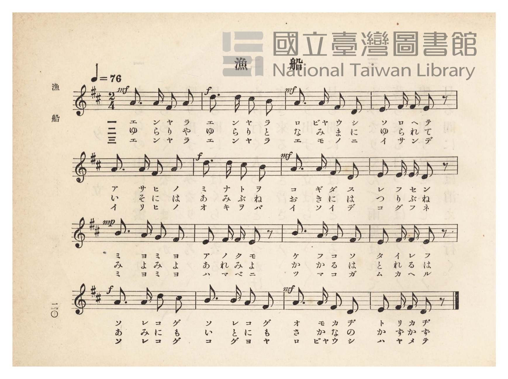
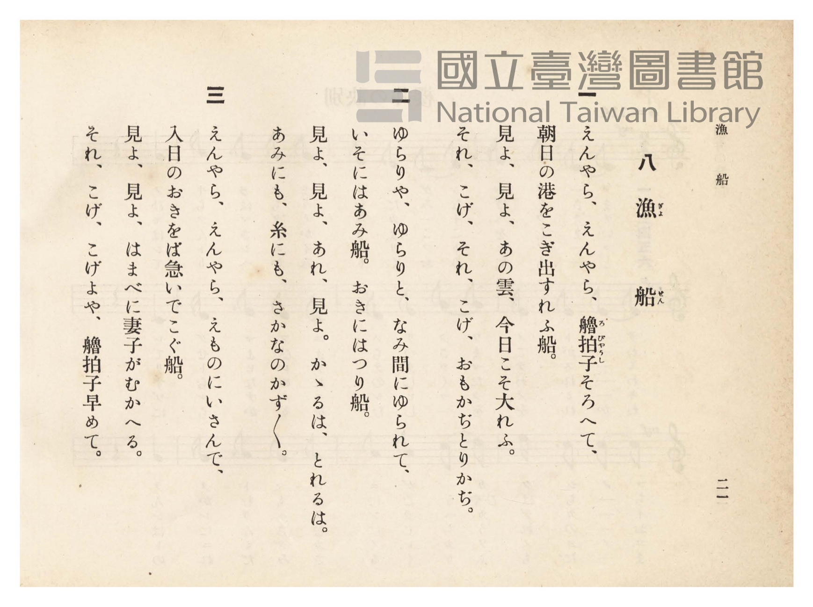

# 漁船

> Re:Shōka 使用 AI 協助辨識與重建樂譜，可能會有錯誤。歡迎回報。

- **NEUTRINO 歌聲合成版**：<br><audio controls src="gyosen_neutrino.mp3"></audio>
- **鋼琴伴奏版**：<br><audio controls src="gyosen.mp3"></audio>


- 詞：文部省（尋常小學唱歌）
- 曲：文部省（尋常小學唱歌）
- 臺灣總督府《公學校唱歌》第四學年用（昭和十一年，索書號 0729 73）

## 說明

原書資訊與歌詞全文（對應 P025.jpg–P026.jpg，原書 pp. 20–21）：
調性與拍號：ニ長調（D 大調）2/4 拍，速度 ♩=76


## 歌詞

```text
一
えんやらえんやら、櫓拍子（ろびゃうし）そろへて、
朝日の港（みなと）をこぎ出す漁船（れふせん）。
見よ見よ、あの雲、今日こそ大漁（たいれう）、
それこげ、それこげ、おもかぢ・とりかぢ。

二
ゆらりやゆらりと、波間（なみま）にゆられて、
いそには網船（あみぶね）、沖には釣船（つりぶね）。
見よ見よ、あれ見よ、かかるは、とれるは。
網にも絲（いと）にも、魚（さかな）のかずかず。

三
えんやらえんやら、獲物（えもの）にいさんで、
入日の沖をば急いでこぐ船。
見よ見よ、はまべに妻子（つまこ）がむかへる、
それこげ、こげよや、櫓拍子早めて。
```

## ABC

```abc
X:1
T:漁船
C:曲：文部省（尋常小學唱歌）
M:2/4
L:1/16
Q:1/4=76
K:D
V:V1 name="Piano" snm="Pia"
[V:V1]
!mf! A3 A F2 A2 | !f! d3 d c2 B2 | !mf! A3 A F2 D2 | E2 F F E2 z2 |
w: 1.~エ ン ヤ ラ | エ ン ヤ ラ | ロ ビャ ウ シ | ソ ロ ヘ テ
w: 2.~ゆ ら り や | ゆ ら り と | な み ま に | ゆ ら れ て
w: 3.~エ ン ヤ ラ | エ ン ヤ ラ | エ モ ノ ニ | イ サ ン デ
A3 A F2 A2 | !f! d3 d c2 B2 | !mf! A3 A F2 D2 | E2 E E D2 z2 |
w: 1.~ア サ ヒ ノ | ミ ナ ト ヲ | コ ギ ダ ス | レ フ セ ン
w: 2.~い そ に は | あ み ぶ ね | お き に は | つ り ぶ ね
w: 3.~イ リ ヒ ノ | オ キ ヲ バ | イ ソ イ デ | コ グ フ ネ
!mp! B3 A G2 F2 | E2 F F E2 z2 | B3 A G2 F2 | E2 F F E2 z2 |
w: 1.~ミ ヨ ミ ヨ | ア ノ ク モ | ケ フ コ ソ | タ イ レ フ
w: 2.~み よ み よ | あ れ み よ | か か る は | と れ る は
w: 3.~ミ ヨ ミ ヨ | ハ マ ベ ニ | ツ マ コ ガ | ム カ ヘ ル
!f! A3 A d2 c2 | B3 B A2 F2 | !mf! A3 A F2 D2 | E2 F F D2 z2 |
w: 1.~ソ レ コ ゲ | ソ レ コ ゲ | オ モ カ ヂ | ト リ カ ヂ
w: 2.~あ み に も | い と に も | さ か な の | か ず か ず
w: 3.~ソ レ コ ゲ | コ ゲ ヨ ヤ | ロ ビャ ウ シ | ハ ヤ メ テ
```

## TMD 檔案連結

- [主旋律 TMD 檔案](gyosen.tmd) [[在 TMD Studio 編輯](https://tmdlang.github.io/Tmd-TS/#tmd=s7IKdvYPcrWy4qpTUCpJTLdSSM7PyUlNLsnMz7PKzk9PzM7Ojy_OyM9OVIKrKMvPKc1NtUovSkxJjTdBiBfnlxYlp1oVJ2fk5-fEl6RWlCTl52ejy8cXJKanWgUYGJkiZAqK8stS8xLzgLoLijLzSlJTwNoRClLLMlNSQdLFyYl58WWpRZlpmakpSE5KLSoGuRhqRUlRYl5xclFmAcgbCFX5RSUZ-UBnF2RUWmVkFpfkF2UmJ-bEZyfmIfmuJCMV6LniVAwhsKEFQDOUuLS0FJ7taXzRsVNBS4tL0VbB3IzL3lbBhcvGSN_EDqTtxcp57_fMejat_WXziudzGt_v6Xi6ofvpjh1PN_Q_Xbvj6ZSNz9b2vN_TCbbi2exNRKt90b7reePi5zv2Pp-7-OmuOY8bup62rgGqerZgIUTh44bu52vWPJ09G6R155bnU1YAzXs2Y-3TST1Pexuf7GgACr7f0_N8y6Jns3e8mDlfwcDcyFLB3BhsAZe-loIttQCXgoLC0775IGs2t79Y0fWiox3oPmDAPG1dAfQs2Ju9z9o7FUBJQS-rIP1Rw2Qg0wzEBLoQolWhoEBPwcgAKGVkCHQiMJxAxr5Ytf9Zw3KQgd29QD8ARR83d7-cuh0oDjTWReHpkuVgZicwOhSAaoDGvWyY_3TXMoVHM1faAiMLZAgwLEDU48aOx02THze1PG7qRGE3ND5bPRmo-enaCUBDHzf1Pm7c_Lip-XFj2-PG6UCzHzfOBQvueNy4DKgYZNazOXOfTV_6uHHdsx3rQXoa9z9uXPW4ERgFnY-bJj1unPy4se9p-67HjTMhqQdsbs_jxq2PG2cDLQYpa2gCe3BZ9-OmDggJNPtxYxPQ0JezNwHZT3Z3ge0AmjUX6E-gQWCb5j9uBLoaaFYb2BSwc8AuBAoBlU4Cm4LG7XrcBDS3-3HjosfNu4HOfNzUBeUCXQEOol09YHOa2kABApQFhQyMDVQPDKLNi15OAzoc6AKgR4He3QcOmdUwZUDrYIEDciDQBUC5xvXPt22Ceh_kM6C2bY8b10Ic_mzTNIial-2LYWqWgO2Dq8EVRE09SFygP4BsILkezAV6rgfGBesHOgHszqbnW4HZD2gJ0HXgiAILAvW8XDsLLD4VbNYqsNQ6MHsWlISF0o5OAgnpee-m550rwaYBxUFxCbUIZOlUkMrG5dBQetq6FJqEgOEASjMbnjUAuUB1y8ExNwEYJrhCYD0w-B837gQa_HTZbmiyBYYdSBCcthqBIdAAdvsOUFDgSCRgBtBEoOORssCz6SsfNwFlgbEJtpzy8gEKFLT0ubjcK_OLU_OsAjIT8_IdagxqqkFWKNgYmmnZgVnYyiUFYDkHzMMvFvYoaJgoAAvL5-sbdOCFiSYWDUCbQIbVKFTnptUqmCroAqGpgjGY1AUJA0UN48DCQMocSJlBxNGVG4KFjYCkMRCCaAOQCNh0H8MaYIZZAVb9uHkzEC8Bs1aC9eCRaV4LlZn8uHkxUOEyEKdpO1TbXrDUWiCeAcRtQF48wkojkAqQGEhHJxB3gVktUL0YMo0gRwBlGldBZBr3A_E-MGs1kh6Ijh6gKMgtSPYZk-lFuMwiIO4Ds7qhMmB1TVuhutrh9uGP_l095EQ_VWLeCAhBPPSYXwQNbJBXJoG9CPIoKH7nQz3fBcQdYNYmqOc3Q_WsA4o1gFk7oXrWgNVNBYrsBgcNRrQ3giIZFHFzoZEHLAagkduEFLnbwCxQCgPJgBIBiN-LoQcSDUAXAnVA1KNHO0gFyE2r0P3XBE1MTaBECvLZ4-YJSJELktkLi2hwBMN8_rhpA8SPzb1ERvuOTvJyfUEtOF5BkWkCJEERiiUbE6MGEeHwaF0BZYNYEM-BkgIoeB43rQeneajngPyNUD2giIUEASh_g2T2g3lLwFEPkseMcJAKkJoOKBvEQkQ4JL8CoxwsCrWvEZTLQNHcDRQHsRERDnIrWA9QHCKKFuG4_dfcD-bNA-KZ0JwMta8ZmihBclD_gRIySGYBmLcaWo6BEh8REQ5szpIV4UiZF5y7QRkbFr1mYClI9BIo4LFlc1B8gXwIjCWoD2GZGbcMNIOASj9gCIBYoBgDhQqkOABmKXDIgETRYx05M4P1NkH1wgsAYPygyYBSDzTWwSU9sFWBlB6ALRio3CzMWMfjC1hhtQmaEiBlPKEKDJpYQAl7IRAjKrBaLi5dOwVIA0AByFLmAgA)]
- [鋼琴伴奏 TMD 檔案](gyosen_piano.tmd) [[在 TMD Studio 編輯](https://tmdlang.github.io/Tmd-TS/#tmd=s7IKdvYPcrWy4tLSUni2p_FFx873ezpedu95PmHLkz1bni7tf97Z8X5Pp4KWFpeirYK5GZe9rYILl42RvokdV52C0ouV897vmfVsWvvL5hXP5zQC9T7d0P10x46nG_qfrt3xdMrGZ2t7gNqVQGqfzd5EtNoX7bueNy5-vmPv87mLn-6a87ih62nrGqCqZwsWQhQ-buh-vmbN09mzQVp3bnk-ZQXQvGcz1j6d1PO0t_HJjgag4Ps9Pc-3LHo2e8eLmfMVDMyNLBXMjcEWcLlX5hen5lkFZCbm5Qd5ONQY1FRzKQCBjaGZlh2YVaNQnZtWq2CqoAuEpgrGYFIXJAwUNYwDCwMpcyBlBhFHV24IFjYCksZACKINQCJg030MaxQeN60Aq37cvBmIl4BZK8F68Mg0r4XKTH7cvBiocBmI07Qdqm0vWGotEM8A4jYgLx5hpRFIBUgMpKMTiLvArBaoXgyZRpAjgDKNqyAyjfuBeB-YtRpJD0RHD1AU5BYk-4zJ9CJcZhEQ94FZ3VAZsLqmrVBd7XD7oDFGlcgyAkIQDz2yFkHDB2T7JLCrQG4DRcl8qHu7gLgDzNoEde9mqJ51QLEGMGsnVM8asLqpQJHdYN9gxFQjKF5AYT0XGt6PG9dD46MJKT62gVmgRAGSAcUbiN-LoQcSckAXAnVA1KPHFEgFyE2r0P3XBI3_JlC6AvnscfMEpPgAyeyFxQ04TmA-f9y0AeLH5l70mKrOLagFRwUo_E2AJCgOsGQWYtQg4ggeEyugbBAL4h5Q7IF89LhpPThlQd0D5G-E6gHFBcTVoFwEktkP5i0BxxZIHjOOQCpAajqgbBALEUeQXAGMJbAo1L5GUFoGxUw3UBzERsQRyK1gPUBxiChaHOH2X3M_mDcPiGdC8wvUvmZoOgLJQf0HSnsgmQVg3mpoaQFKL6hxhJRFwHkIlH1gMWIGloLECIGSD1tmAgUxyFHAgIU6CpZlcMtAkyGoWAA6GsQCBTLII5BMB0y4YM-ARNEjCjnLgPU2QfXCsxkwSNFkQBEOjShwEfi4cR1SFD5unAWVm4UZUXh8ASsSNkEjD1L4ESrZofELSosLgRhRstei1mU-yHWZBbwqM4xXiDaMhVFwvgmQMkHiw-VN44Es0_hYMMMA6jMKjAGKIEyBKsdpGUEFmK4BSWLqI-QcYNjp2ilAgi_aB6gEiWeEwjMG85S5AA)]

## 分析

```text
================================================================================
📊 TMD Song Profile: [ 漁船 ]
================================================================================
⏱  Duration:       0:25 (25.3s), 16 measures total
🎼 Key & Tempo:    首調基準 D, != 76.0 BPM, <2/4>
   - 分析範圍：      由實際發聲的音符與和弦推測調性；播放脈絡另行呈現
🎤 人聲音域:    D4 (MIDI 62) – D5 (MIDI 74) [跨度: 12 個半音 / 1.0 個八度, 難度: easy]
   - 最低音:  D4 in [Gyosen #1 @ m.3, 0:04]
   - 最高音: D5 in [Gyosen #1 @ m.2, 0:01]
   - 適合: soprano, mezzo-soprano, contralto, tenor, baritone, bass
🏛  結構:      Gyosen (25.3s)
⚡ 編曲密度:        Peak 1 軌道同時演奏
🗝  調性診斷：       A 調性不明確（純淨自然大調，未偵測到可信轉調）
   - 風格氣質:    純淨自然大調（陽光明朗、易唱易記，無明顯調外色彩）
   - 轉調歷程:    全曲維持單一推測調性（未偵測到可信轉調）
   - 核心骨幹音:  A, F#, D, E, B
   - 調性數值:    A 調性不明確 [相關度: 0.85, 穩定度: Ambiguous, 自然音純度: 96.6%]
   - 候選調性 (K-S): A 大調 (0.85), D 大調 (0.82), F# 小調 (0.76)
   - 五度圈歷程:   +3
   - 各段落調性細節:
     • [Gyosen #1]: A 調性不明確 (r: 0.85, 自然音純度: 96.6%, 調外音: G)

  [ 五度圈游移軌跡 ]
               C  
         F            G  
      Bb               D  
      Eb              [A ]*
         Ab           E  
            Db       B  
               F# 
     (* = active key center)

  [ 十二半音累積音高分佈 ]
     C  :                            0.0%
     C# : █████                      5.1%
     D  : ███████████████           16.9%
     D# :                            0.0%
     E  : ██████████████            15.3%
     F  :                            0.0%
     F# : ██████████████████        20.3%
     G  : ███                        3.4%
     G# :                            0.0%
     A  : ████████████████████████  27.1%
     A# :                            0.0%
     B  : ███████████               11.9%
--------------------------------------------------------------------------------
Assignment 軌道音域：
  - Piano         : D4 – D5 (12 個半音 / 1.0 個八度, 64 個音符)
================================================================================
```


## 原書掃描頁






