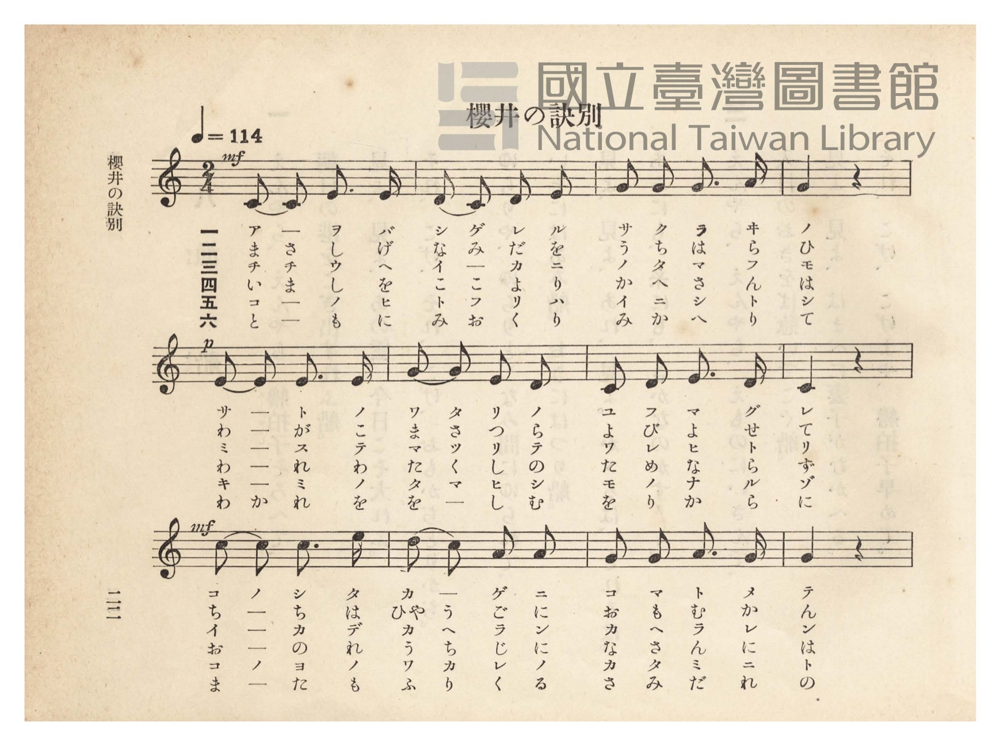
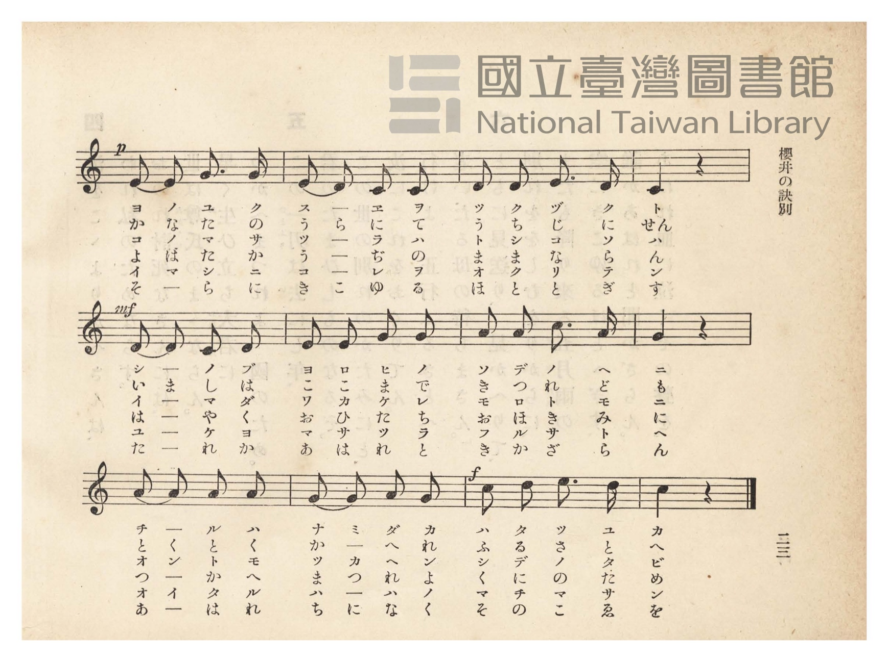
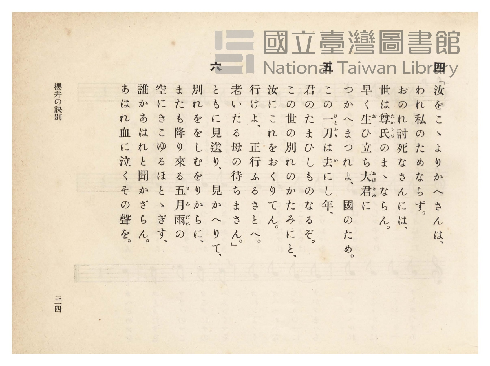
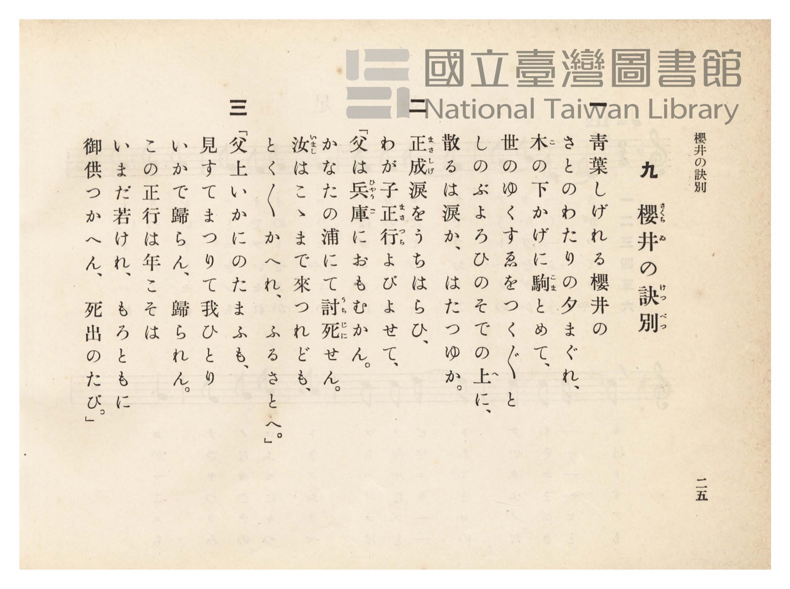

# 櫻井の訣別

> Re:Shōka 使用 AI 協助辨識與重建樂譜，可能會有錯誤。歡迎回報。

- **鋼琴伴奏版**：<br><audio controls src="sakurai_no_ketsubetsu.mp3"></audio>
- **NEUTRINO 歌聲合成版**：<br><audio controls src="sakurai_no_ketsubetsu_neutrino.mp3"></audio>

- 詞：落合直文
- 曲：奧山朝恭
- 臺灣總督府《公學校唱歌》第四學年用（昭和十一年，索書號 0729 73）

## 說明

原書資訊與歌詞全文（對應 P027.jpg–P030.jpg，原書 pp. 22–25）：
作詞：落合直文／作曲：奧山朝恭
調性與拍號：ハ長調（C 大調）2/4 拍，速度 ♩=114


## 歌詞

```text
一
青葉しげれる櫻井（さくらゐ）の
さとのわたりの夕まぐれ、
木（こ）の下かげに駒（こま）とめて、
世のゆくすゑをつくづくと
しのぶよろひのそでの上（うへ）に、
散るは涙か、はたつゆか。

二
正成（まさしげ）涙をうちはらひ、
わが子正行（まさつら）よびよせて、
「父は兵庫（ひゃうご）におもむかん。
かなたの浦にて討死（うちじに）せん。
汝（いまし）はここまで來つれども、
とくとくかへれ、ふるさとへ。」

三
「父上いかにのたまふも、
見すてまつりて我ひとり
いかで歸らん、歸られん。
この正行は年こそは
いまだ若けれ、もろともに
御供（おんとも）つかへん、死出のたび。」

四
「汝をここよりかへさんは、
われ私のためならず。
おのれ討死なさんには、
世は尊氏（たかうぢ）のままならん。
早く生（お）ひ立ち大君（おほきみ）に
つかへまつれよ、國のため。

五
この一刀（ひとふり）は去（い）にし年、
君のたまひしものなるぞ。
この世の別れのかたみにと、
汝にこれをおくりてん。
行けよ、正行ふるさとへ。
老いたる母の待ちまさん。」

六
ともに見送り、見かへりて、
別れををしむをりからに、
またも降り來る五月雨（さみだれ）の
空にきこゆるほととぎす、
誰かあはれと聞かざらん。
あはれ血に泣くその聲を。
```

## ABC

<div class="abc-score" data-abc-src="sakurai_no_ketsubetsu.abc" aria-label="五線譜載入中"></div>

[下載 ABC 原始檔](sakurai_no_ketsubetsu.abc)

## TMD 檔案連結

- [主旋律 TMD 檔案](sakurai_no_ketsubetsu.tmd) [[在 TMD Studio 編輯](https://tmdlang.github.io/Tmd-TS/#tmd=s7IKdvYPcrWy4qpTUCpJTLdSSM7PyUlNLsnMz7PKzk9PzM7Ojy_OyM9OVIKrKMvPKc1NtUovSkxJjTdBiBfnlxYlp1oVJ2fk5-fEl6RWlCTl52ejy8cXJKanWgUYGJkjZAqK8stS8xLzgLoLijLzSlJTwNoRClLLMlNSQdLFyYl58WWpRZlpmakpSE5KLSoGuRhqRUlRYl5xclFmAcgbCFX5RSUZ-UBnF2RUWmVkFpfkF2UmJ-bEZyfmIfmuJCMV6DmIdCW6cG5mTmZJIrI40Iz0zDyr3NTMrEwkP2tpKTxbvfvJrqmPG9e9WLH4acdSBS0tLkVbBUNDEy57WwVnLhsjfRM7kDEvVs57v2fWiwl7n07oeD57y7Np7WDTn83eBBR-unT5040bn82Z-6xxLVj4Rfuu542Ln-_Y-3zu4qe75jxu6Hrauubp2h3PFix8OmXjs7U9jxu6n69Z83T2bKDg051bnk9Z8X5Px7MZa59O6nna2_hkRwNQ8P2enudbFj2bvePFzPkKBuZGlgrmxu_3dCpxcelrKdhSC3ApKCg87ZsPsmZz-4sVXS862oHuA3r3aesKoC-Bznq6ofdZe6cCKDHoZRWkP2qYHGBgbABiAl0I0apQUKCnYGQElDIyBToRGCQgY5_snYMZbO_39APFMcMNpOHFqv3PGpaDXNDdC_Q0UMXj5v6XU7cDxYHucFZ4umQ5mNkJjBUFoBqg_S8b5j_dtUzh0cyVtqBIA1u7owFEvZw76cXEzseN0x83Tnrc1PO4qRsS10CTHjcCY7z_cVPn46YJQNOAsQ_SABZdAeQ8bup_3Dj_cVMXkP10CVBw3-PGCSAjGhpB6p7NAUXW48bJEK1PdnQ_bgSiSY8bV79cPgkiBdQDll3xuKnxceMyqM4nO6aBjW8D2d4483HTxMdNQG1LwNylYHIFxCVAR6973LjtcVPH46bex42bwNy5jxuXgy3sAlsCNGUH2JLVMIdNXQz05ePG9c-2zQQ5qQFo9XqQT4A2gOwEijRBQmhXD1j92sXPOoABADQL6EOgP0FBBTQRpB3kLqCWhSATgOEEdAHEDnDY9DxdOwGo-cXCHiTNQDuAEQ8MUqDIZjA5G-Hzxw09zzu2AQ172rr16a7VYG2bHjc1gy2ZAvVFY9fjpqbHTQ0glzZNBjkWHBZAH60C-2Lds63LwOqWvVjR92ztblgoAB05AygONmU2QuezjXPBKlrALpwOlgYGBzBuQNEDDMsn-4Cagc7uedy4EmQz1KmgNACKCTAJtHwHJOofN24Fhy4kkewAWvK4oRea4DoRfgTGDthKoEqgS4GxBnQ40DKgXpgFL5YB5YARBPQLUAJoP1DDsmcdE8HRDEwwXRBXQMxY_mwt0H5gqAJ91QhjAxMzIniAnlkHiQxQ8O7cAhYBJpX1cGOAtix40Q1MX8DkBvYJKJSBqQpoVxPQleASYN_CJ_tmg4MLGAlAA0By4BADJk5IGEAcsPtp-y6YtzYjhQGwKIOGATDYwakHHM6g9Av0HtgEYMiBTF6PlJKaep4vBwYs2DhQRlkFTmuz4H4D5UCgIkh0g5MBxAxgyMKMAeep9U83dD3b0A92P9BhQOuAMbsIkj_B_gcisNmIxDF9JTB-n08BFjIgP4OVbnq-GqhzIbCUeToBFhaNQGuBQQUqdKBBhQgSaPQBY6MD6Jinc4CCMJ_AM9oURCSBSvWOBmjSB6UhYJqAWLz-aR8kMbfAcsJ0UERCPAh0C1I6AuqcDo42oAjQR0Ar56GkBEgRA6zJwMkaqAioAqhzP9jUFbCCAhhFID4wfoCOB8YV0J_AyAClQ0QIgRMUMMWA_AZLX-g5AKwOlDWAqQzo7-5n64Fhte7pvlZwpgSXC2Dz4KmkFVzOw5MeMCu8BKXHLqAd4GwBSWpgh0B9D_EJ0JEgdwK93gBmg9MUKK3Ayj6wbUAnNL2c2QuUBmXtpm5g8D-b0_FyNqS8BjobGAwLgMYhyvznK4GpGRgSQGcDAwOkBxzjQO8BUR8om0Lz7KoNYMcBHQ0sD4EhseIFMOBBItNQkhVcxYuFwGJs9bPNi8GlCDC4170AFXiToOoor7ehQEFLn4srODG7tCgx0y_fO7WkuDQJRFgFZCbm5TvUGNRUg-xTsDE007IDs7A1HhSAjRFg8gTGsYKGicLTDf3P1zfowGt8TSwagNaCDKtRqM5Nq1UwVNAFY2MgBpE1CkZQERANEq1RMAWSMKyrYAYVAUEDKF0DNtLHsAZYNiyCij1u3gSlJwB1PG7aDmI3gcQeN68Bk6vBpj9u2gqWWQ8WWwnVswEk09wHNSse1R4joFzjPpC6xqlgcjpEV-MkkK7GVWD2fjC5AGz2JIhNjW1gsYVgEmQfSK4TLANxK4ZNxiBXNIJdBCablkHdNwPs8iUwvzaB_PK4uRtiD9jdj5vALmieB9UxFSwDCx00e0xAbmgBuwviL6iPgC4HyUwGi4HJpg4w2QX1EchGYM6DhwVIbjJYBuI_DJtMQe7eDHYR2JXNoLAB0R1g90HMAPHBodjcD7EH7FOI_yAxCdcB5WHYYwZywwqw-iaw60AhBIkXkAzI_cAMBvcLJL7QfASWAfGWAWVg5iPswZ8pdgFzMhmZoqAWnOphGJInYKkfJALKFzUoOQTEgojgyhOgFA4LMwjdBw5tcJqHphNIeIPiBCQDSmeQ2ICnoCZIngDlHRx5ogkUnpAQ64HSkLSAnFfAMQlM9ZB4BaemRnB6ALNBvNlgPZCUjj1HzIfZ07QT6p82sNtALn3cDE7HUP-Achzcp9B8j5riQOpw5AiEf5qg_gGKgNwGsh-aesA5BVhIQ-yByDSB8yq4HID4FSQzC7s94PywFmYP1GfQ-EHKwRBXQ1I7LB_DchA0lQLLM5AeUFjjyA9g_0BTONxH4BwOLqEgoQ_2T1MDxB6wOCyHgPQh_APJT8Tnhx2d5FcScUDzEQQw1ceBKgq4gBkUIzIKiAdi4a8qkIohWKECDHKQDMxzsAoDWrBCdUAiBJaVFoIjBJTQcGQLcIEPCVwIC1Q4ggt9YD8GzIXUC1PAJLRWgpRQkLILHBuQGAA5AlQO48gZaDUCyHntcA-Bag0QCarjHjeDvIJNBpJPQF4CqcCRM8Cug7gJlPIh6Qm9hgObCfcPpFYElwFQH4DkiKkpYDkCQq9A1HDQ8gviA1DeRtR9YDFw_oHkKpAMJP0iog61roDlG0gehoQ9SBzSOkCuL6CJAVqeIep5RChAwoTovAHsAmHmDQuS6gpIMgcleFgdAWtZQVpURNcVwPBFlCzQ1gawbQSKC0hZCxLfCCZBWQOkA1zeQttPrcg64OGMLVNA6llIqoCGODDc4GkIXENAUg-kLsCWuhBpCNR7x24ZOFsgNzhg1dlWuOMhnoJkC2iDA-x0WKMRkggfN-0Fy8AqBWwVBqQ6AwcF3FPgTAt2OoQPLrrhFQakaoSQKBUGLv-AswWkOQQuh-DNIUjhgMgwkMoOGklN4ICGRhLUHmiliSObgzPFXJhp4OhABHcvmA1pEEKiC5YpdoNlwIkITIJocGXWOBPDHgINqClkZQpQhQFL8bBWEiRXwPIJCNfAKw1olUKoWwFrZsJS0TSIf6HZZS2YBFeWsCYUMLWAeO1wMVAogRqSkMIWFmeYGQO9GQ5JTyAZpGY4VH45VAYSH5CmFazptRLsClAFgitXwCsLaI0GrfSRi9UmSFaHFa6QZgfEt7D6bxFK4YqtsoAV8I-bIH6D5jFoIxxcw0KbVKCsjZCBpCWQ30A0pOGO2eyA5wpocYVwNShuQOKQfAIuyKGNQ1BeB8lAGrgQn0IaybBmISyOsOUKRPMTFNaQogwkDuloQEIPIgN1ATR-IEUeKOVAchT2XI6_qmhdS06ugCV27C0lSIaohrW0wA0rYBML5BwgG1hdQNjY6wtQWxcScJB6GFaAgqMQ3J6FJCxIgoIVoLC2LaT4BUUdKDBwRC44W0CKFEgLFsGG1SSQJALptYGCHlFzQwId2jcF6gTJgNThyhSQfgOkwgAX5-BEj6jnkNtLsDYUuJpAy-rg5NqMoxAHZwt49kPqcyKqBERmhlQrIBmI7yF1IrTdBUyMIBfAYgFbZQEp-iHmQUIdJSagJGysA55hoOMOqNUlvsoCVtQgZwGQOKS-hrgaUt_DYg5UvUB8AinWQLomgv0D648g7Knl4tK1U8AyYKUAFFbmAgA)]
- [鋼琴伴奏 TMD 檔案](sakurai_no_ketsubetsu_piano.tmd) [[在 TMD Studio 編輯](https://tmdlang.github.io/Tmd-TS/#tmd=s7IKdvYPcrWy4tLSUni2eveTXVMfN657sWLx046l7_d0vOze83zClid7tjxd2v-8s-P9nk4FLS0uRVsFQ0MTLntbBWcuGyN9EzuuOgWlFyvnvd8z68WEvU8ndDyfveXZtHYlkPCz2ZuAwk-XLn-6ceOzOXOfNa4FC79o3_W8cfHzHXufz138dNecxw1dT1vXPF2749mChU-nbHy2tudxQ_fzNWuezp4NFHy6c8vzKSuAznk2Y-3TST1Pexuf7GgACr7f0_N8y6Jns3e8mDlfwcDcyFLB3BjoRCUuruDE7NKixEy_fO_UkuLSJBBhFZCZmJcf5OFQY1BTzaUABDaGZlp2YFaNQnVuWq2CoYIuGBsDMYisUTCCioBokGiNgimQhGFdBTOoCAgaQOkasJE-hjUKj5sWQcUeN2-C0hOAOh43bQexm0Bij5vXgMnVYNMfN20Fy6wHi62E6tkAkmnug5oVj2qPEVCucR9IXeNUMDkdoqtxEkhX4yowez-YXAA2exLEpsY2sNhCMAmyDyTXCZaBuBXDJmOQKxrBLgKTTcug7psBdvkSmF-bQH553NwNsQfs7sdNYBc0z4PqmAqWgYUOmj0mIDe0gN0F8RfUR0CXg2Qmg8XAZFMHmOyC-ghk4-PGHfCwAMlNBstA_IdhkynI3ZvBLgK7shkUNiC6A-w-iBkgPjgUm_sh9oB9CvEfJCbhOqA8DHvMQG5YAVbfBHYdKIQg8QKSAbn_cSPIdIhfIPGF5iOwDIi3DCgDMx9hDywdF9SCEyoMQ5IxLMGCREBJuQYlUYNYEBFcyRiUKGHehNB94AACJ1No1EKCCBSMIBlQ0oAEIDzSmyDJGJTccSTjJlAQQDzZA6Uh0YecvMGBD0yokKgAJ4BGcBSC2SDebLAeSOLEnojnw-xp2gn1TxvYbSCXPm4GJz2of0CZBO5TaFZFTSQgdTgSMcI_TVD_AEVAbgPZD41wcOIGFrkQeyAyTeDsBc66EL-CZGZhtwechNfC7IH6DBo_SJkO4mpIAoVlPViihyYsYBEE0gMKaxxJGOwfaKKE-wicKcGFCiT0wf5paoDYAxaHJWqQPoR_IFkAWxIGF8VxQCEEAUyocaDiGC5gBsWItA3igVj4C2SkzA7LusBQAsnA3AMrlqHFF1QHJAxhqX8hOAxBaQNHSgYXq5DwgLBARRC4aH3c1AzmQkrfKWASWvZDygFICQEOQEiggRwBKu1wJGa0chfkvHa4h0BlM4gE1SSPm0FewSYDSdogL4FU4EjMYNdB3ARKrJAkgF6PgM2E-wdS94CzLdQHIDliymNYIobQKxD1CLTIgfgAlB0RNQxYDJzkIRkBJANJcoioQy2RYUkdku0gYQ8Sh9TByKUyNDFAiyBEbYoIBUiYECiRISkTlEZhJTGsyQFpahBdIgODBJF_odUwsNEACj5IiQYS3wgmQakZpANcqkEbFq3IOuBBgy0dQyogSERCAwnoVXi0g8thSIRDSlxsCQIR7bPxp2TkmhhWaWyFOx7iKUhKhtbEYKfDWlOQdPO4aS9YBlb0YiuWIZUGOCjgngLnM7DTIXxwAQkvliEVEIREKZZx-QeckiHtBHDRAW8nQPIzIo1DqhRoJDWBAxoaSVB7oFUTjpwJTsdzYaaBowMR3L1gNqSlBIkuWDreDZYBJyIwCaLBVUbjTAx7kItlWCKFNR8gCRmWtEG4Bl40QwtuQk1kWJMJFvHTIE6EpvC1YBJci8DaFsAIBvHa4WIgj4EaRZAiDRbMmGkZvUkJSQIgGaQmJVR-OVQGEoSQNgesTbIS7ApQMY0rIcOLZGi9Aa0NkQuvJkjuhBVhkPoY4ltYLbMIpQjDViTDitHHTRC_QbMFtEEJrsegbQ1QbkTIQKIf5DcQDWmEYtbH8IQMLWEQrgbFDUgckrTBxSW01QTKniAZSMsP4lNI6xHWXoLFEbaEjGiXgcIaUvqAxCGNZkjoQWSgLoDGD6SUAqUcSCbAnjGhCRmWPrE3ISBpuBrWBAG3OIBtD5AJQDawUIawsZfKoHYbxK-QCgpWTIFDHdw2g6QFSBqAFVOwdhqkkAOFNsj9OOIDnJIhGRfSGkOwYeU1JFYhnQZQaCGqNEg4QbtGQJ0gGZA6XOkY0gaGFMvgQhOcThG1CXJDAta4ABfGaLkTnMKacRSV4JQMzzFIXR5EwYvIf5DCGyQD8T2k5oE2SIDpB-QCWCxgK5IhBSzEPEioo8QElIR1teFpHNrtRa2U8BXJsNIBOdWCxCG1IsTVkFoVFnOgQhziE0hJBNI1EewfWNsaYU8tnhEOH-QRDgv4AIdhvEK0YSyMAqb5eDQBrApM42PBCR3iNUxFUAZcLR4RfMaYABkmsTAKLg_iE-8WuCJMEfyuwaOMkAuRjcGhhHBYQQwBxqmunQKWaI32AarBJWWEW8oYtxTQfbikTHFLmYGllLkA)]

## 分析

```text
================================================================================
📊 TMD Song Profile: [ 櫻井の訣別 ]
================================================================================
⏱  Duration:       0:25 (25.3s), 24 measures total
🎼 Key & Tempo:    首調基準 C, != 114.0 BPM, <2/4>
   - 分析範圍：      由實際發聲的音符與和弦推測調性；播放脈絡另行呈現
🎤 人聲音域:    C4 (MIDI 60) – E5 (MIDI 76) [跨度: 16 個半音 / 1.3 個八度, 難度: moderate]
   - 最低音:  C4 in [SakuraiNoKetsubetsu #1 @ m.1, 0:00]
   - 最高音: E5 in [SakuraiNoKetsubetsu #1 @ m.9, 0:09]
   - 適合: soprano, mezzo-soprano, contralto, tenor, baritone, bass
🏛  結構:      SakuraiNoKetsubetsu (25.3s)
⚡ 編曲密度:        Peak 1 軌道同時演奏
🗝  調性診斷：       C 大調（純淨自然大調，未偵測到可信轉調）
   - 風格氣質:    純淨自然大調（陽光明朗、易唱易記，無明顯調外色彩）
   - 轉調歷程:    全曲維持單一推測調性（未偵測到可信轉調）
   - 核心骨幹音:  G, C, E, D, A
   - 調性數值:    C 大調 [相關度: 0.85, 穩定度: Moderate, 自然音純度: 100.0%]
   - 候選調性 (K-S): C 大調 (0.85), G 大調 (0.75), E 小調 (0.68)
   - 五度圈歷程:   +0
   - 各段落調性細節:
     • [SakuraiNoKetsubetsu #1]: C 大調 (r: 0.85, 自然音純度: 100.0%)

  [ 五度圈游移軌跡 ]
              [C ]*
         F            G  
      Bb               D  
      Eb               A  
         Ab           E  
            Db       B  
               F# 
     (* = active key center)

  [ 十二半音累積音高分佈 ]
     C  : ███████████████████████   23.8%
     C# :                            0.0%
     D  : ███████████████           16.1%
     D# :                            0.0%
     E  : █████████████████████     21.4%
     F  :                            0.0%
     F# :                            0.0%
     G  : ████████████████████████  25.0%
     G# :                            0.0%
     A  : █████████████             13.7%
     A# :                            0.0%
     B  :                            0.0%
--------------------------------------------------------------------------------
Assignment 軌道音域：
  - Piano         : C4 – E5 (16 個半音 / 1.3 個八度, 78 個音符)
================================================================================
```


## 原書掃描頁










