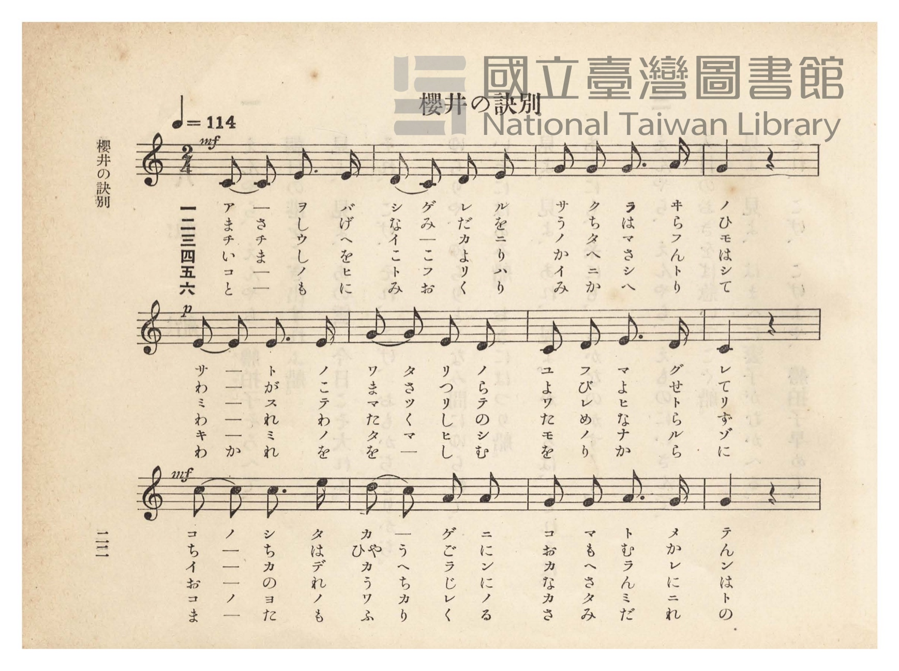
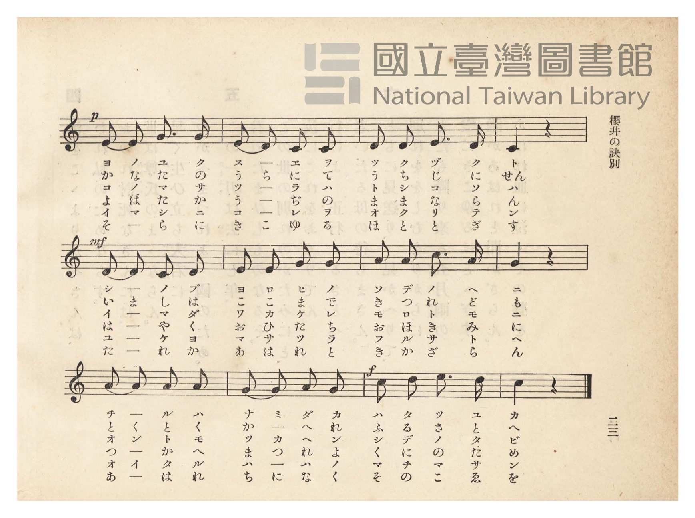
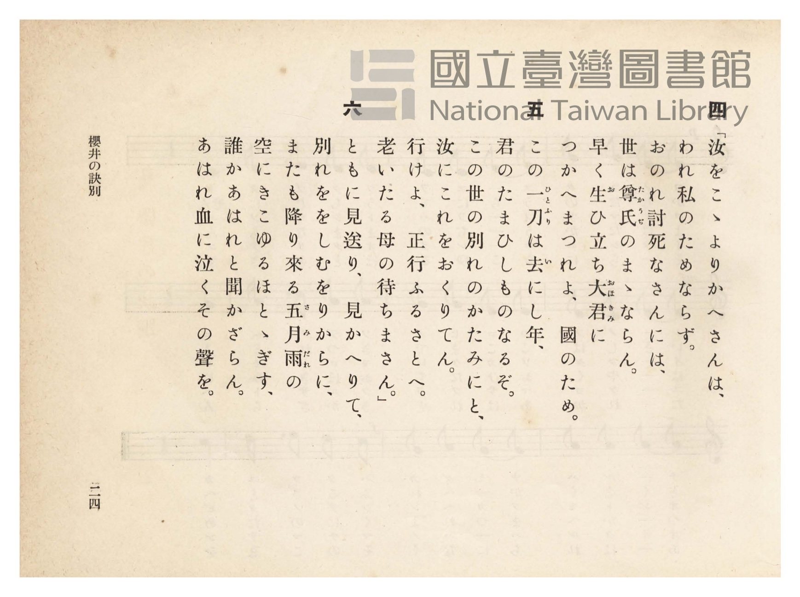
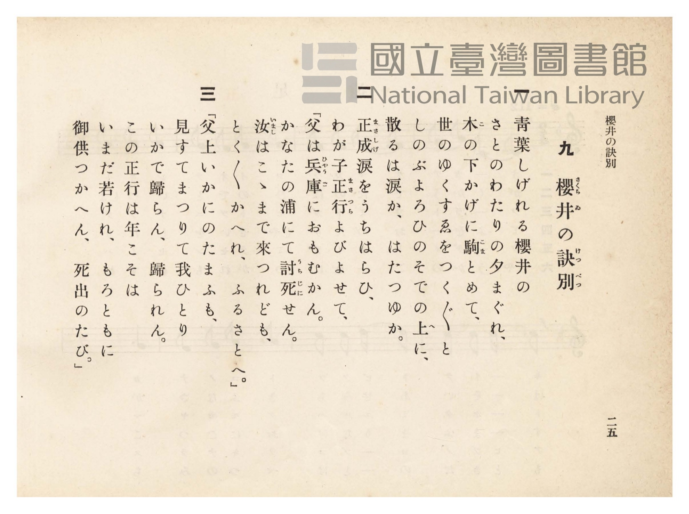

# 櫻井の訣別

> Re:Shōka 使用 AI 協助辨識與重建樂譜，可能會有錯誤。歡迎回報。

- **鋼琴伴奏版**：<br><audio controls src="sakurai_no_ketsubetsu.mp3"></audio>
- **NEUTRINO 歌聲合成版**：<br><audio controls src="sakurai_no_ketsubetsu_neutrino.mp3"></audio>

- 詞：落合直文
- 曲：奧山朝恭
- 臺灣總督府《公學校唱歌》第四學年用（昭和十一年，索書號 0729 73）

## 說明

原書資訊與歌詞全文（對應 P027.jpg–P030.jpg，原書 pp. 22–25）：
作詞：落合直文／作曲：奧山朝恭
調性與拍號：ハ長調（C 大調）2/4 拍，速度 ♩=114


## 歌詞

```text
一
青葉しげれる櫻井（さくらゐ）の
さとのわたりの夕まぐれ、
木（こ）の下かげに駒（こま）とめて、
世のゆくすゑをつくづくと
しのぶよろひのそでの上（うへ）に、
散るは涙か、はたつゆか。

二
正成（まさしげ）涙をうちはらひ、
わが子正行（まさつら）よびよせて、
「父は兵庫（ひゃうご）におもむかん。
かなたの浦にて討死（うちじに）せん。
汝（いまし）はここまで來つれども、
とくとくかへれ、ふるさとへ。」

三
「父上いかにのたまふも、
見すてまつりて我ひとり
いかで歸らん、歸られん。
この正行は年こそは
いまだ若けれ、もろともに
御供（おんとも）つかへん、死出のたび。」

四
「汝をここよりかへさんは、
われ私のためならず。
おのれ討死なさんには、
世は尊氏（たかうぢ）のままならん。
早く生（お）ひ立ち大君（おほきみ）に
つかへまつれよ、國のため。

五
この一刀（ひとふり）は去（い）にし年、
君のたまひしものなるぞ。
この世の別れのかたみにと、
汝にこれをおくりてん。
行けよ、正行ふるさとへ。
老いたる母の待ちまさん。」

六
ともに見送り、見かへりて、
別れををしむをりからに、
またも降り來る五月雨（さみだれ）の
空にきこゆるほととぎす、
誰かあはれと聞かざらん。
あはれ血に泣くその聲を。
```

## ABC

```abc
X:1
T:櫻井の訣別
C:曲：奧山朝恭
M:2/4
L:1/16
Q:1/4=114
K:C
V:V1 name="Piano" snm="Pia"
[V:V1]
!mf! C2 C2 E3 E | D2 C2 D2 E2 | G2 G2 G3 A | G4 z4 |
w: 1.~ア _ ヲ バ | シ ゲ レ ル | サ ク ラ ヰ | ノ
w: 2.~ま さ し げ | な み だ を | う ち は ら | ひ
w: 3.~チ チ ウ ヘ | イ _ カ ニ | ノ タ マ フ | モ
w: 4.~い ま し を | こ こ よ り | か へ さ ん | は
w: 5.~コ ノ ヒ ト | フ _ リ ハ | イ ニ シ ト | シ
w: 6.~と も に み | お く り み | か へ り て | _
!p! E2 E2 E3 E | G2 G2 E2 D2 | C2 D2 E3 D | C4 z4 |
w: 1.~サ _ ト ノ | ワ タ リ ノ | ユ フ マ グ | レ
w: 2.~わ _ が こ | ま さ つ ら | よ び よ せ | て
w: 3.~ミ _ ス テ | マ ツ リ テ | ワ レ ヒ ト | リ
w: 4.~わ _ れ わ | た く し の | た め な ら | ず
w: 5.~キ _ ミ ノ | タ マ ヒ シ | モ ノ ナ ル | ゾ
w: 6.~わ か れ を | を _ し む | を り か ら | に
!mf! c2 c2 c3 e | d2 c2 A2 A2 | G2 G2 A3 G | G4 z4 |
w: 1.~コ ノ シ タ | カ _ ゲ ニ | コ マ ト メ | テ
w: 2.~ち _ ち は | ひゃ う ご に | お も む か | ん
w: 3.~イ _ カ デ | カ ヘ ラ ン | カ ヘ ラ レ | ン
w: 4.~お _ の れ | う ち じ に | な さ ん に | は
w: 5.~コ _ ノ ヨ | ノ ワ カ レ | ノ カ タ ミ | ニ
w: 6.~ま _ た も | ふ り く る | さ み だ れ | の
!p! E2 E2 G3 G | E2 D2 C2 C2 | D2 D2 E3 D | C4 z4 |
w: 1.~ヨ ノ ユ ク | ス _ ヱ ヲ | ツ ク ヅ ク | ト
w: 2.~か な た の | う ら に て | う ち じ に | せん
w: 3.~コ ノ マ サ | ツ _ ラ ハ | ト シ コ ソ | ハ
w: 4.~よ は た か | う _ ぢ の | ま ま な ら | ん
w: 5.~イ マ シ ニ | コ _ レ ヲ | オ ク リ テ | ン
w: 6.~そ _ ら に | き こ ゆ る | ほ と と ぎ | す
!mf! D2 D2 C2 D2 | E2 E2 G2 G2 | A2 A2 c3 A | G4 z4 |
w: 1.~シ _ ノ ブ | ヨ ロ ヒ ノ | ソ デ ノ ウ | ヘ
w: 2.~い ま し は | こ こ ま で | き つ れ ど | も
w: 3.~イ _ マ ダ | ワ カ ケ レ | モ ロ ト モ | ニ
w: 4.~は _ や く | お ひ た ち | お ほ き み | に
w: 5.~ユ _ ケ ヨ | マ サ ツ ラ | フ ル サ ト | ヘ
w: 6.~た _ れ か | あ は れ と | き か ざ ら | ん
A2 A2 A2 A2 | G2 G2 A2 G2 | !f! c2 d2 e3 d | c4 z4 |
w: 1.~チ _ ル ハ | ナ ミ ダ カ | ハ タ ツ ユ | カ
w: 2.~と く と く | か _ へ れ | ふ る さ と | へ
w: 3.~オ ン ト モ | ツ カ ヘ ン | シ デ ノ タ | ビ
w: 4.~つ _ か へ | ま つ れ よ | く に の た | め
w: 5.~オ イ タ ル | ハ ハ ノ _ | マ チ マ サ | ン
w: 6.~あ _ は れ | ち に な く | そ の こ ゑ | を
```

## TMD 檔案連結

- [主旋律 TMD 檔案](sakurai_no_ketsubetsu.tmd) [[在 TMD Studio 編輯](https://tmdlang.github.io/Tmd-TS/#tmd=s7IKdvYPcrWy4qpTUCpJTLdSSM7PyUlNLsnMz7PKzk9PzM7Ojy_OyM9OVIKrKMvPKc1NtUovSkxJjTdBiBfnlxYlp1oVJ2fk5-fEl6RWlCTl52ejy8cXJKanWgUYGJkjZAqK8stS8xLzgLoLijLzSlJTwNoRClLLMlNSQdLFyYl58WWpRZlpmakpSE5KLSoGuRhqRUlRYl5xclFmAcgbCFX5RSUZ-UBnF2RUWmVkFpfkF2UmJ-bEZyfmIfmuJCMV6DmIdCW6cG5mTmZJIrI40Iz0zDyr3Py8pFJgOGFKpGZmZSIFhpaWwrPVu5_smvq4cd2LFYufdixV0NLiUrRVMDQ04bK3VXDmsjHSN7EDGfNi5bz3e2a9mLD36YSO57O3PJvWDjb92exNQOGnS5c_3bjx2Zy5zxrXgoVftO963rj4-Y69z-cufrprzuOGrqeta56u3fFswcKnUzY-W9vzuKH7-Zo1T2fPBgo-3bnl-ZQV7_d0PJux9umknqe9jU92NAAF3-_peb5l0bPZO17MnK9gYG5kqWBu_H5PpxIXl76Wgi21AJeCgsLTvvkgaza3v1jR9aKjHeg-oHeftq4A-hLorKcbep-1dyqAUoleVkH6o4bJAQbGBiAm0IUQrQoFBXoKRkZAKSNToBOBQQIy9sneOZjB9n5PP1AcM9xAGl6s2v-sYTnIBd29QE8DVTxu7n85dTtQHOgOZ4WnS5aDmZ3AWFEAqgHa_7Jh_tNdyxQezVxpC4o0sLU7GkDUy7mTXkzsfNw4_XHjpMdNPY-buiFxDTTpcSMwxvsfN3U-bpoANA0Y-yANYNEVQM7jpv7HjfMfN3UB2U-XAAX3PW6cADKioRGk7tkcUGQ9bpwM0fpkR_fjRiCa9Lhx9cvlkyBSQD1g2RWPmxofNy6D6nyyYxrY-DaQ7Y0zHzdNfNwE1LYEzF0KJldAXAJ09LrHjdseN3U8bup93LgJzJ37uHE52MIusCVAU3aALVkNc9jUxUBfPm5c_2zbTJCTGoBWrwf5BGgDyE6gSBMkhHb1gNWvXfysAxgAQLOAPgT6ExRUQBNB2kHuAmpZCDIBGE5AF0DsAIdNz9O1E4CaXyzsQdIMtAMY8cAgBYpsBpOzET5_3NDzvGMb0LCnrVuf7loN1rbpcVMz2JIpUF80dj1uanrc1AByadNkkGPBYQH00SqwL9Y927oMrG7ZixV9z9buhoUC0JEzgOJgU2YjdD7bOBesogXswulgaWBwAOMGFD3AsHyyD6gZ6Oyex40rQTZDnQpKA6CYAJNAy3dAov5x41Zw6EISyQ6gJY8beqEJrhPhR2DsgK0EqgS6FBhrQIcDLQPqhVnwYhlQDhhBQL8AJYD2AzUse9YxERzNwATTBXEFxIzlz9YC7QeGKtBXjTA2MDEjggfomXWQyAAF784tYBFgUlkPNwZoy4IX3cD0BUxuYJ-AQhmYqoB2NQFdCS4B9i18sm82OLiAkQA0ACQHDjFg4oSEAcQBu5-274J5azNSGACLMmgYAIMdnHrA4QxKv0DvgU0AhhzI5PVIKamp5_lyYMCCjQNllFXgtDYL7jdQDgQqgkQ3OBlAzACGLMwYcJ5a_3RD17MN_WD3Ax0GtA4Ys4sg-RPsfyACm41IHNNXAuP3-RRgIQPyM1jppuergToXAkuZpxNgYdEItBYYVKBCBxpUiCCBRh8wNjqAjnk6BygI8wk8o01BRBKoVO9ogCZ9UBoCpgmIxeuf9kEScwssJ0wHRSTEg0C3IKUjoM7p4GgDigB9BLRyHkpKgBQxwJoMnKyBioAqgDr3g01dASsogFEE4gPjB-h4YFwB_QmMDFA6RIQQOEEBUwzIb7D0hZ4DwOpAWQOYyoD-7n62HhhW657uawVnSnC5ADYPnkpaweU8POkBs8JLUHrsAtoBzhaQpAZ2CNT3EJ8AHQlyJ9DrDWA2OE2B0gqs7APbBnRC08uZvUBpUNZu6gYG_7M5HS9nQ8proLOBwbAAaByizH--EpiagSEBdDYwMEB6wDEO9B4Q9YGyKTTPrtoAdhzQ0cDyEBgSK14AAx4kMg0lWcFVvFgILMZWP9u8GFyKAIN73QtQgTcJqo7yehsKFLT0ubiCE7NLixIz_fK9U0uKS5NAhFVAZmJevkONQU01yD4FG0MzLTswC1vjQQHYGAEmT2AcK2iYKDzd0P98fYMOvMbXxKIBaC3IsBqF6ty0WgVDBV0wNgZiEFmjYAQVAdEg0RoFUyAJw7oKZlAREDSA0jVgI30Ma4BlwyKo2OPmTVB6AlDH46btIHYTSOxx8xowuRps-uOmrWCZ9WCxlVA9G0AyzX1Qs-JR7TECyjXuA6lrnAomp0N0NU4C6WpcBWbvB5MLwGZPgtjU2AYWWwgmQfaB5DrBMhC3YthkDHJFI9hFYLJpGdR9M8AuXwLzaxPIL4-buyH2gN39uAnsguZ5UB1TwTKw0EGzxwTkhhawuyD-gvoI6HKQzGSwGJhs6gCTXVAfgWwE5jx4WIDkJoNlIP7DsMkU5O7NYBeBXdkMChsQ3QF2H8QMEB8cis39EHvAPoX4DxKTcB1QHoY9ZiA3rACrbwK7DhRCkHgByYDcD8xgcL9A4gvNR2AZEG8ZUAZmPsIe_JliFzAnk5EpCmrBqR6GIXkClvpBIqB8UYOSQ0AsiAiuPAFK4bAwg9B94NAGp3loOoGENyhOQDKgdAaJDXgKaoLkCVDewZEnmkDhCQmxHigNSQvIeQUck8BUD4lXcGpqBKcHMBvEmw3WA0np2HPEfJg9TTuh_mkDuw3k0sfN4HQM9Q8ox8F9Cs33qCkOpA5HjkD4pwnqH6AIyG0g-6GpB5xTgIU0xB6ITBM4r4LLAYhfQTKzsNsDzg9rYfZAfQaNH6QcDHE1JLXD8jEsB0FTKbA8A-kBhTWO_AD2DzSFw30EzuHgEgoS-mD_NDVA7AGLw3IISB_CP5D8RHx-2NFJfiURBzQfQQBTfRyoooALmEExIqOAeCAW_qoCqRiCFSrAIAfJwDwHqzCgBStUByRCYFlpIThCQAkNR7YAF_iQwIWwQIUjuNAH9mPAXEi9MAVMQmslSAkFKbvAsQGJAZAjQOUwjpyBViOAnNcO9xCo1gCRoDrucTPIK9hkIPkE5CWQChw5A-w6iJtAKR-SntBrOLCZcP9AakVwGQD1AUiOmJoCliMg9ApEDQctvyA-AOVtRN0HFgPnH0iuAslA0i8i6lDrCli-geRhSNiDxCGtA-T6ApoYoOUZop5HhAIkTIjOG8AuEGbesCCproAkc1CCh9URsJYVpEVFdF0BDF9EyQJtbQDbRqC4gJS1IPGNYBKUNUA6wOUttP3UiqwDHs7YMgWknoWkCmiIA8MNnobANQQk9UDqAmypC5GGQL137JaBswVygwNWnW2FOx7iKUi2gDY4wE6HNRohifBx016wDKxSwFZhQKozcFDAPQXOtGCnQ_jgohteYUCqRgiJUmHg8g84W0CaQ-ByCN4cghQOiAwDqeygkdQEDmhoJEHtgVaaOLI5OFPMhZkGjg5EcPeC2ZAGISS6YJliN1gGnIjAJIgGV2aNMzHsIdCAmkJWpgBVGLAUD2slQXIFLJ-AcA280oBWKYS6FbBmJiwVTYP4F5pd1oJJcGUJa0IBUwuI1w4XA4USqCEJKWxhcYaZMdCb4ZD0BJJBaoZD5ZdDZSDxAWlawZpeK8GuAFUguHIFvLKA1mjQSh-5WG2CZHVY4QppdkB8C6v_FqEUrtgqC1gB_7gJ4jdoHoM2wsE1LLRJBcraCBlIWgL5DURDGu6YzQ54roAWVwhXg-IGJA7JJ-CCHNo4BOV1kAykgQvxKaSRDGsWwuIIW65AND9BYQ0pykDikI4GJPQgMlAXQOMHUuSBUg4kR2HP5firita15OQKWGLH3lKCZIhqWEsL3LACNrFAzgGygdUFhI29vgC1dSEBB6mHYQUoOArB7VlIwoIkKFgBCmvbQopfUNSBAgNH5IKzBaRIgbRgEWxYTQJJIpBeGyjoETU3JNChfVOgTpAMSB2uTAHpN0AqDHBxDk70iHoOub0Ea0OBqwm0rA5Ors04CnFwtoBnP6Q-J6JKQGRmSLUCkoH4HlInQttdwMQIcgEsFrBVFpCiH2IeJNRRYgJKwsY64BkGOu6AWl3iqyxgRQ1yFgCJQ-priKsh9T0s5kDVC8QnkGINpGsi2D-w_gjCnlouLl07BSwDVgpAYWUuAA)]
- [鋼琴伴奏 TMD 檔案](sakurai_no_ketsubetsu_piano.tmd) [[在 TMD Studio 編輯](https://tmdlang.github.io/Tmd-TS/#tmd=s7IKdvYPcrWy4tLSUni2eveTXVMfN657sWLx046l7_d0vOze83zClid7tjxd2v-8s-P9nk4FLS0uRVsFQ0MTLntbBWcuGyN9EzuuOgWlFyvnvd8z68WEvU8ndDyfveXZtHYlkPCz2ZuAwk-XLn-6ceOzOXOfNa4FC79o3_W8cfHzHXufz138dNecxw1dT1vXPF2749mChU-nbHy2tudxQ_fzNWuezp4NFHy6c8vzKSuAznk2Y-3TST1Pexuf7GgACr7f0_N8y6Jns3e8mDlfwcDcyFLB3BjoRCUuruDE7NKixEy_fO_UkuLSJBBhFZCZmJcf5OFQY1BTzaUABDaGZlp2YFaNQnVuWq2CoYIuGBsDMYisUTCCioBokGiNgimQhGFdBTOoCAgaQOkasJE-hjUKj5sWQcUeN2-C0hOAOh43bQexm0Bij5vXgMnVYNMfN20Fy6wHi62E6tkAkmnug5oVj2qPEVCucR9IXeNUMDkdoqtxEkhX4yowez-YXAA2exLEpsY2sNhCMAmyDyTXCZaBuBXDJmOQKxrBLgKTTcug7psBdvkSmF-bQH553NwNsQfs7sdNYBc0z4PqmAqWgYUOmj0mIDe0gN0F8RfUR0CXg2Qmg8XAZFMHmOyC-ghk4-PGHfCwAMlNBstA_IdhkynI3ZvBLgK7shkUNiC6A-w-iBkgPjgUm_sh9oB9CvEfJCbhOqA8DHvMQG5YAVbfBHYdKIQg8QKSAbn_cSPIdIhfIPGF5iOwDIi3DCgDMx9hDywdF9SCEyoMQ5IxLMGCREBJuQYlUYNYEBFcyRiUKGHehNB94AACJ1No1EKCCBSMIBlQ0oAEIDzSmyDJGJTccSTjJlAQQDzZA6Uh0YecvMGBD0yokKgAJ4BGcBSC2SDebLAeSOLEnojnw-xp2gn1TxvYbSCXPm4GJz2of0CZBO5TaFZFTSQgdTgSMcI_TVD_AEVAbgPZD41wcOIGFrkQeyAyTeDsBc66EL-CZGZhtwechNfC7IH6DBo_SJkO4mpIAoVlPViihyYsYBEE0gMKaxxJGOwfaKKE-wicKcGFCiT0wf5paoDYAxaHJWqQPoR_IFkAWxIGF8VxQCEEAUyocaDiGC5gBsWItA3igVj4C2SkzA7LusBQAsnA3AMrlqHFF1QHJAxhqX8hOAxBaQNHSgYXq5DwgLBARRC4aH3c1AzmQkrfKWASWvZDygFICQEOQEiggRwBKu1wJGa0chfkvHa4h0BlM4gE1SSPm0FewSYDSdogL4FU4EjMYNdB3ARKrJAkgF6PgM2E-wdS94CzLdQHIDliymNYIobQKxD1CLTIgfgAlB0RNQxYDJzkIRkBJANJcoioQy2RYUkdku0gYQ8Sh9TByKUyNDFAiyBEbYoIBUiYECiRISkTlEZhJTGsyQFpahBdIgODBJF_odUwsNEACj5IiQYS3wgmQakZpANcqkEbFq3IOuBBgy0dQyogSERCAwnoVXi0g8thSIRDSlxsCQIR7bPxp2TkmhhWaWyFOx7iKUhKhtbEYKfDWlOQdPO4aS9YBlb0YiuWIZUGOCjgngLnM7DTIXxwAQkvliEVEIREKZZx-QeckiHtBHDRAW8nQPIzIo1DqhRoJDWBAxoaSVB7oFUTjpwJTsdzYaaBowMR3L1gNqSlBIkuWDreDZYBJyIwCaLBVUbjTAx7kItlWCKFNR8gCRmWtEG4Bl40QwtuQk1kWJMJFvHTIE6EpvC1YBJci8DaFsAIBvHa4WIgj4EaRZAiDRbMmGkZvUkJSQIgGaQmJVR-OVQGEoSQNgesTbIS7ApQMY0rIcOLZGi9Aa0NkQuvJkjuhBVhkPoY4ltYLbMIpQjDViTDitHHTRC_QbMFtEEJrsegbQ1QbkTIQKIf5DcQDWmEYtbH8IQMLWEQrgbFDUgckrTBxSW01QTKniAZSMsP4lNI6xHWXoLFEbaEjGiXgcIaUvqAxCGNZkjoQWSgLoDGD6SUAqUcSCbAnjGhCRmWPrE3ISBpuBrWBAG3OIBtD5AJQDawUIawsZfKoHYbxK-QCgpWTIFDHdw2g6QFSBqAFVOwdhqkkAOFNsj9OOIDnJIhGRfSGkOwYeU1JFYhnQZQaCGqNEg4QbtGQJ0gGZA6XOkY0gaGFMvgQhOcThG1CXJDAta4ABfGaLkTnMKacRSV4JQMzzFIXR5EwYvIf5DCGyQD8T2k5oE2SIDpB-QCWCxgK5IhBSzEPEioo8QElIR1teFpHNrtRa2U8BXJsNIBOdWCxCG1IsTVkFoVFnOgQhziE0hJBNI1EewfWNsaYU8tnhEOH-QRDgv4AIdhvEK0YSyMAqb5eDQBrApM42PBCR3iNUxFUAZcLR4RfMaYABkmsTAKLg_iE-8WuCJMEfyuwaOMkAuRjcGhhHBYQQwBxqmunQKWaI32AarBJWWEW8oYtxTQfbikTHFLmYGllLkA)]

## 分析

```text
================================================================================
📊 TMD Song Profile: [ 櫻井の訣別 ]
================================================================================
⏱  Duration:       0:25 (25.3s), 24 measures total
🎼 Key & Tempo:    首調基準 C, != 114.0 BPM, <2/4>
   - 分析範圍：      由實際發聲的音符與和弦推測調性；播放脈絡另行呈現
🎤 人聲音域:    C4 (MIDI 60) – E5 (MIDI 76) [跨度: 16 個半音 / 1.3 個八度, 難度: moderate]
   - 最低音:  C4 in [SakuraiNoKetsubetsu #1 @ m.1, 0:00]
   - 最高音: E5 in [SakuraiNoKetsubetsu #1 @ m.9, 0:09]
   - 適合: soprano, mezzo-soprano, contralto, tenor, baritone, bass
🏛  結構:      SakuraiNoKetsubetsu (25.3s)
⚡ 編曲密度:        Peak 1 軌道同時演奏
🗝  調性診斷：       C 大調（純淨自然大調，未偵測到可信轉調）
   - 風格氣質:    純淨自然大調（陽光明朗、易唱易記，無明顯調外色彩）
   - 轉調歷程:    全曲維持單一推測調性（未偵測到可信轉調）
   - 核心骨幹音:  G, C, E, D, A
   - 調性數值:    C 大調 [相關度: 0.85, 穩定度: Moderate, 自然音純度: 100.0%]
   - 候選調性 (K-S): C 大調 (0.85), G 大調 (0.75), E 小調 (0.68)
   - 五度圈歷程:   +0
   - 各段落調性細節:
     • [SakuraiNoKetsubetsu #1]: C 大調 (r: 0.85, 自然音純度: 100.0%)

  [ 五度圈游移軌跡 ]
              [C ]*
         F            G  
      Bb               D  
      Eb               A  
         Ab           E  
            Db       B  
               F# 
     (* = active key center)

  [ 十二半音累積音高分佈 ]
     C  : ███████████████████████   23.8%
     C# :                            0.0%
     D  : ███████████████           16.1%
     D# :                            0.0%
     E  : █████████████████████     21.4%
     F  :                            0.0%
     F# :                            0.0%
     G  : ████████████████████████  25.0%
     G# :                            0.0%
     A  : █████████████             13.7%
     A# :                            0.0%
     B  :                            0.0%
--------------------------------------------------------------------------------
Assignment 軌道音域：
  - Piano         : C4 – E5 (16 個半音 / 1.3 個八度, 78 個音符)
================================================================================
```


## 原書掃描頁










