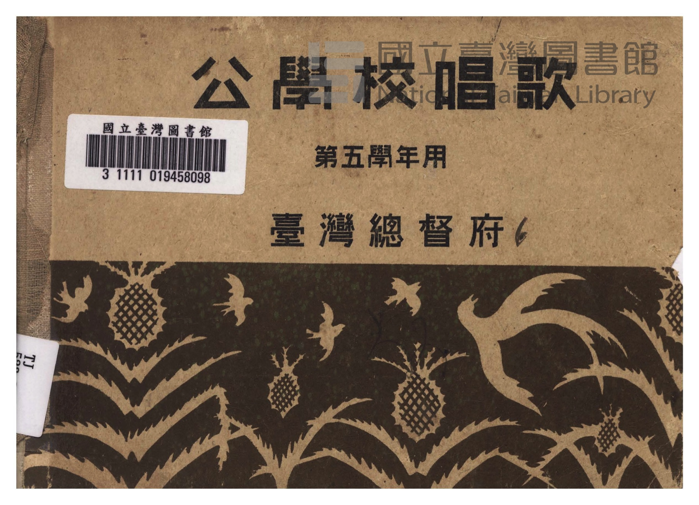
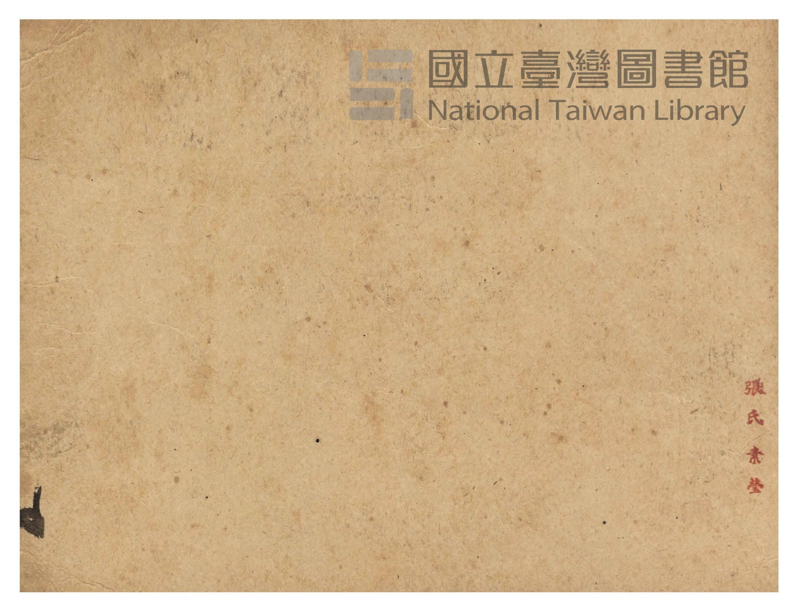
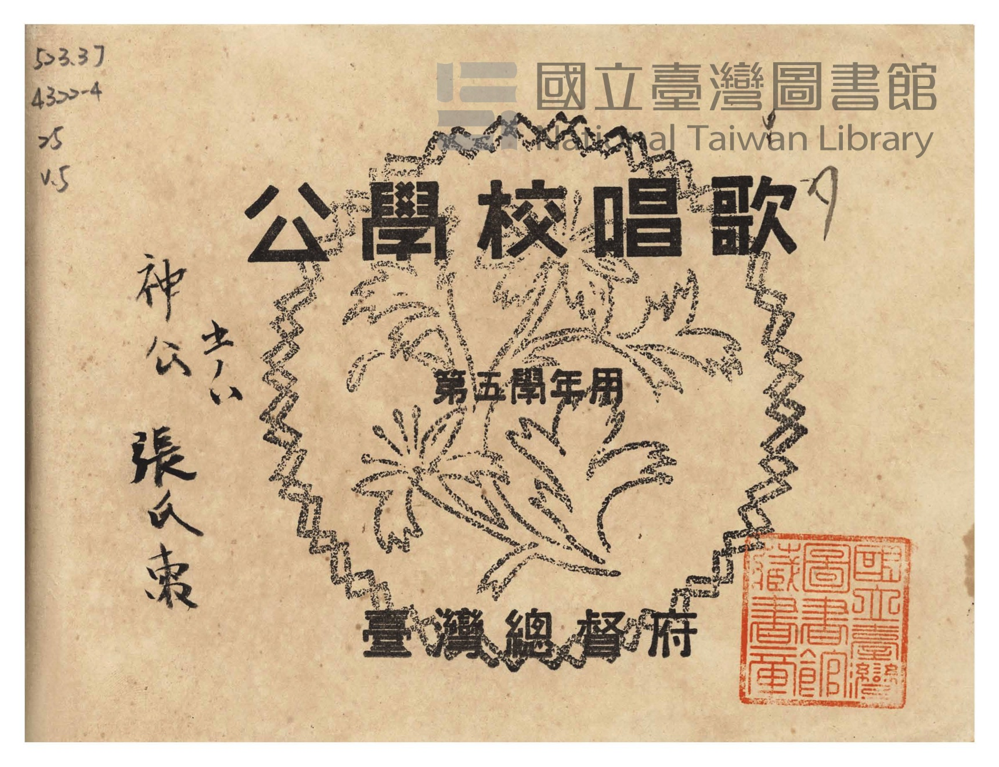
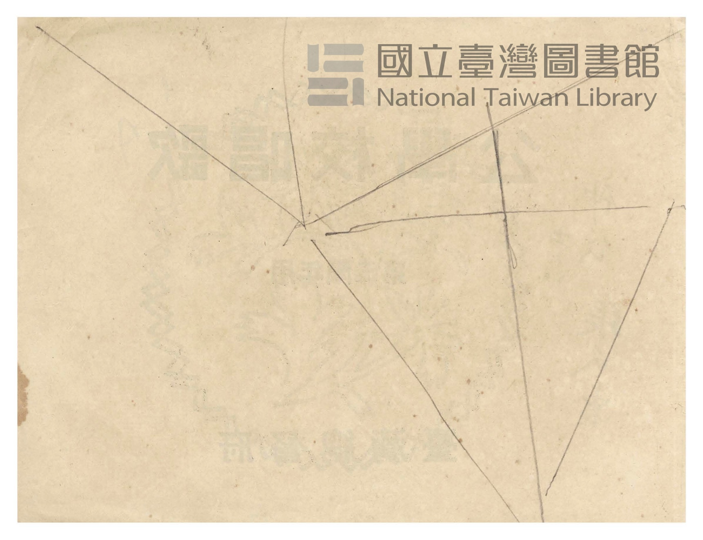
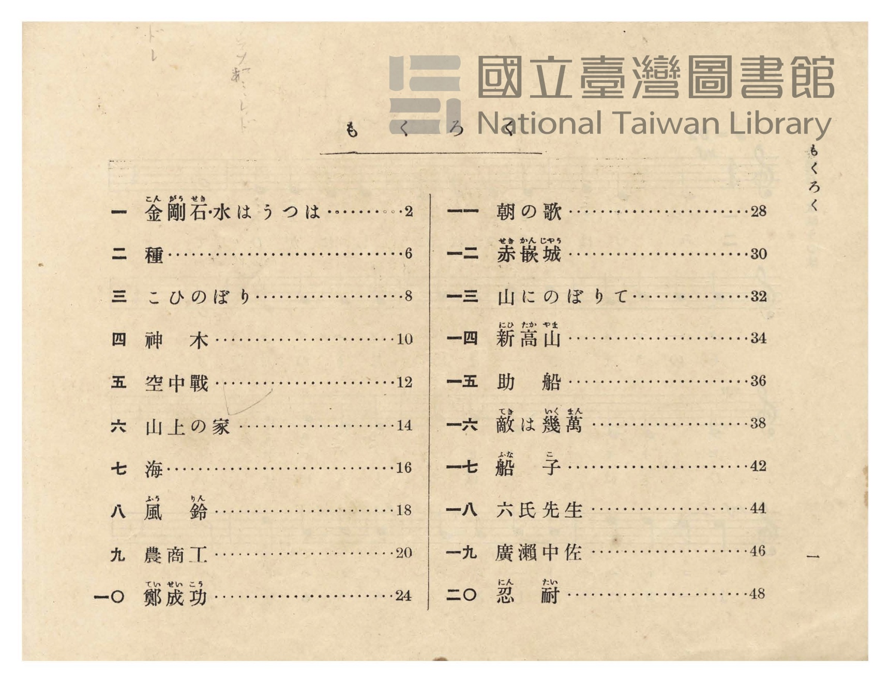
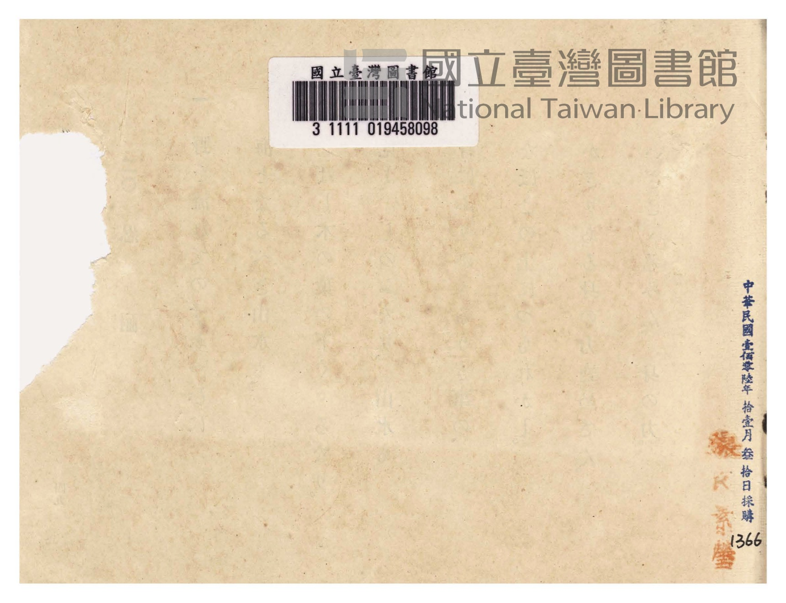

# 書訊與卷首／卷末掃描頁 — 《公學校唱歌》 尋常科 第五學年用（國臺圖 523.37 4322-4）

本頁收錄本冊之封面、扉頁、目次（もくろく）、樂典大要、版權頁與封底等原書掃描圖檔（共 6 頁）。

### P001.jpg

本冊封面（右頁），題「公學校唱歌　第五學年用　臺灣總督府」，下方繪有臺灣鳳梨與烏秋（大卷尾）飛翔圖案，左貼國立臺灣圖書館條碼籤「3 1111 019458098」。

### P002.jpg

封面裏（見返頁）。

### P003.jpg

扉頁，題「公學校唱歌　第五學年用　臺灣總督府」，左上鉛筆標註索書號「523.37 4322-4 25 v.5」，左側有原持有者毛筆署名「神公 五ノハ 張氏素」，右下蓋有「國立臺灣圖書館藏書章」。

### P004.jpg

扉頁裏留白頁。

### P005.jpg

目次頁（「もくろく」，原書第 1 頁）：列出「一　金剛石・水はうつは」至「二〇　忍耐」共 20 首曲名與頁碼。

### P054.jpg

卷末襯頁（原書缺封底版權頁），上貼國立臺灣圖書館條碼籤「3 1111 019458098」，右下蓋有原持有者「張氏素瑩」紅印及「中華民國壹佰零陸年拾壹月叁拾日採購 1366」館藏採購章。

