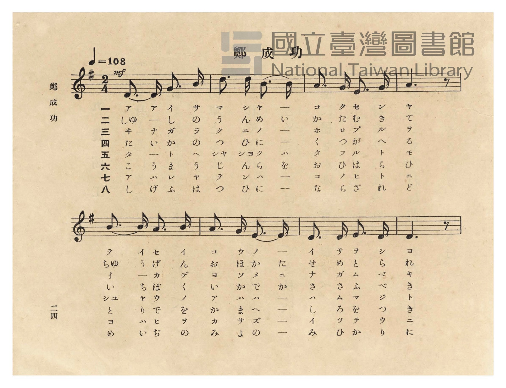
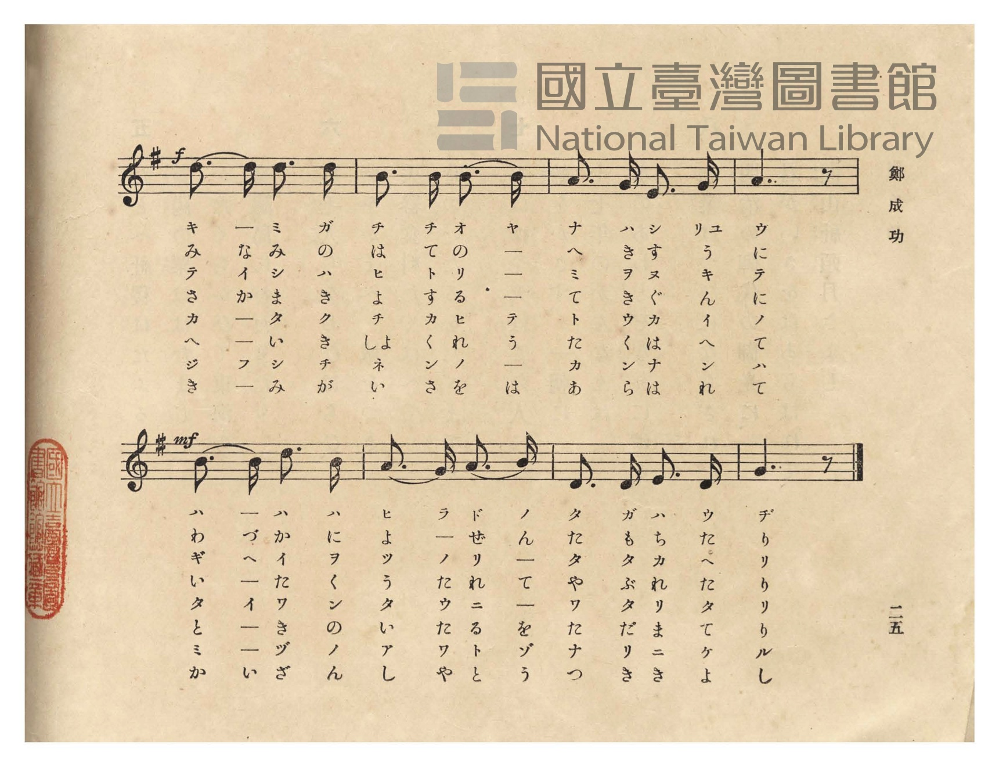
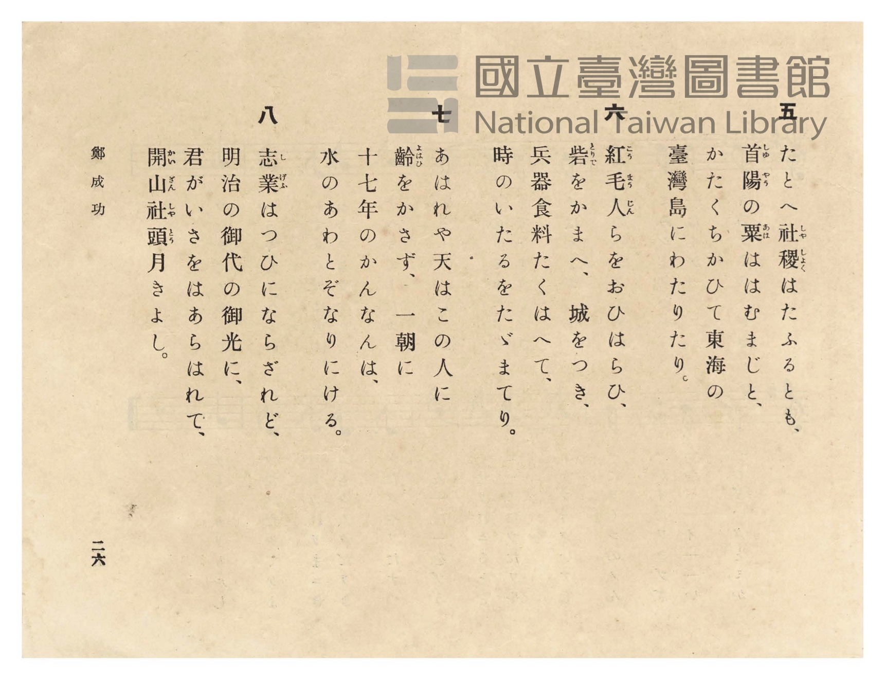
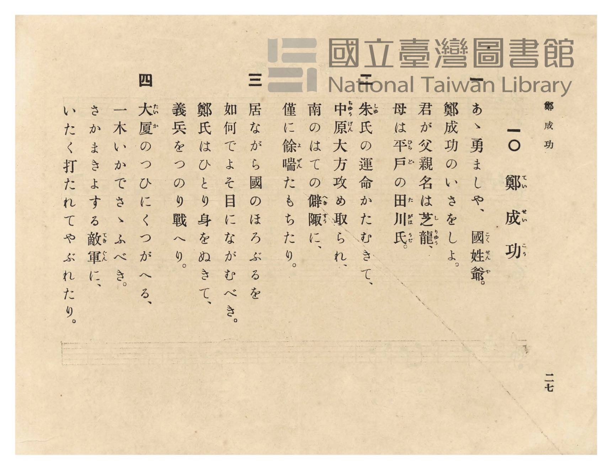

# 鄭成功

> Re:Shōka 使用 AI 協助辨識與重建樂譜，可能會有錯誤。歡迎回報。

- **鋼琴伴奏版**：<br><audio controls src="teiseiko.mp3"></audio>
- **NEUTRINO 歌聲合成版**：<br><audio controls src="teiseiko_neutrino.mp3"></audio>

- 臺灣總督府《公學校唱歌》第五學年用（昭和十一年，索書號 523.37 4322-4）

## 說明

原書資訊與歌詞全文（對應 P028.jpg–P031.jpg，原書 pp. 24–27）：
調性與拍號：ト長調（G 大調，1 升記號）2/4 拍，速度 ♩=108


## 歌詞

```text
一
あゝ勇ましや、國姓爺（こくせんや）。
鄭成功のいさをしよ。
君が父親名は芝龍（しりゅう）、
母は平戸（ひらど）の田川氏（たがはうぢ）。

二
朱氏（しゅし）の運命かたむきて、
中原（ちゅうげん）大方攻め取られ、
南のはての僻陬（へきすう）に、
僅に餘喘（よぜん）たもちたり。

三
居ながら國のほろぶるを
如何でよそ目にながむべき。
鄭氏はひとり身をぬきて、
義兵をつのり戰へり。

四
大廈（たいか）のつひにくつがへる、
一木いかでさゝふべき。
さかまきよする敵軍（てきぐん）に、
いたく打たれてやぶれたり。

五
たとへ社稷（しゃしょく）はたふるとも、
首陽（しゅやう）の粟（あは）ははむまじと、
かたくちかひて東海の
臺灣島にわたりたり。

六
紅毛人（こうまうじん）らをおひはらひ、
砦（とりで）をかまへ、城をつき、
兵器食料たくはへて、
時のいたるをたゞまてり。

七
あはれや天はこの人に
齡（よはひ）をかさず、一朝に
十七年のかんなんは、
水のあわとぞなりにける。

八
志業（しげふ）はつひにならざれど、
明治の御代の御光に、
君がいさをはあらはれて、
開山社頭（かいざんしゃとう）月きよし。
```

## ABC

<div class="abc-score" data-abc-src="teiseiko.abc" aria-label="五線譜載入中"></div>

[下載 ABC 原始檔](teiseiko.abc)

## TMD 檔案連結

- [主旋律 TMD 檔案](teiseiko.tmd) [[在 TMD Studio 編輯](https://tmdlang.github.io/Tmd-TS/#tmd=s7IKdvYPcrWy4qpTUCpJTLdSSM7PyUlNLsnMz7PKzk9PzM7Ojy_OyM9OVIKrKMvPKc1NtUovSkxJjTdFiBfnlxYlp1oVJ2fk5-fEl6RWlCTl52ejy8cXJKanWgUYGFkgZAqK8stS8xLzgLoLijLzSlJTwNoRClLLMlNSQdLFyYl58WWpRZlpmakpSE5KLSoGuRhqRUlRYl5xclFmAcgbCFX5RSUZ-UBnF2RUWmVkFpfkF2UmJ-bEZyfmIfmuJCMV6DmIdCWy3sz0zDyrksTMcqAL8tPSMpMzE3OUuLS0FF62rH3WMeFp13wFLS0uRVsFQwMLLntbBXcuGyN9EzuQCS_adz1vXPx8x97ncxc_3TXncUPX09Y1T9fueLZg4dMpG5-t7Xnc0P18zZonu6YABZ_u3PJ8yor3ezqezVj7dFLP097GJzsagILv9_Q837Lo2ewdL2bOVzA1MtYzNlcwMTYy0jV5v6dTiYtLX0vBllqAS0FB4WnffJBlm9tfrOh60dEOdOWLlfOetq54Nq0d6LinG3qftXcqgOJRL6sg_VHD5AADY0MQE-hOiFaFggI9BSMToJSROdCJ7_fMAhn7YtX-Zw3LQQZ29wJ9AhR93Nzxcup2oDjQWHeFp0uWg5k9hgpPe4F2zwAr6gQGpQJQB1D8ZcP8p7uWKTyaudIWFNIgM4EBBKIeNzY9bpr7tLv9ceO-x43THze1PG5ofDqn--nyyc87dgFNf9w4-XFj_-PG2Y-bJgNlgcY-bmgC6YRH4ePGdY8bWx43Tn3cNAlsRAdUxdMJsx839jzv2PZi2aqnE3ofN65_0TX35T6gg4CmAtV1PW5qfdzYBjayEaTh2XqQoqc7Nz_r2AFWtOlxU-fjxpUgFY3rnk_Z8HT73Gcb-sFSQGt7gIqB-h83LoK6CuyvXT1go-ZshKkE2gS0ZjrEkJeN3U8n7n3c2A0yoanhcSPQxmVQ65_sWAuMBbCehRCnPW6cBPQ2UCcwhJ9N2_lsyu7HTY1P-6eBnNUETIFgbU97p4ODAOiWZUDG0-bdL2euAZuyA2z8TKgfG1fDNDQDzV79csmMp9NmgNQBA6xxDsQesKuaQPaDGF1wT-3oBGvcCNS4CuTxpk5gHIFtBboIaMe2x03dwOAHK1rW9GTv1MeNy8Hmzn0-G6hoNUwb0MM7QY5CROEGYNwCXb7pceMKoIUvdq0Gx-IalIB5vm_l09atYIklIEubup51bAB5D-HCp7Nng6kly5_u7oBFEDBRdEOCHawRaAfQIUD7gGxg3AG1d8NDvuHZnBUQDSCXg9LS3MeNW1FcCxIFSQPTaS_YbzOBBjybuvXFbkiKAgY-0M0TYAEJC22wqUDH9D_rBKZkYKgCrV4GSuegQAOyUcJ51xSIFqB6oHN2PF-y7_mK7bBU1AwmgTkFmK6AFgBDDagMGCxANwHDrglq38tl017O3ItIeSCbIPG_7vkmSOoCRvB6mBHrwZEC9NMMkCkwJ4OTJyiogAkByAaG3LJnczc-27odaAq4RACXjk83bwP5swmoDuwLFL88bV0Ljrstrc_Wz36yC56XgYkaaBuQnAENKVBaBsYsUDvQGqBzgO7aBIv4BcvA2kBJAxgvYNVApZBI2AEqKeb3wZIFMJogqbt169OZK14unv9sGjDlQ3wB9CcwL8CS07OZwACAlBlAB4PSLZgxD2wqMGqQkn0zrIwCOQyYflueLlkJNg7okXVATwG9Dw7zvQthGQmUlpHcCUwys4DWghMYMEWBVYOrh2Zg9QB2BdB-oGGrwOR6mAs3QOSAZSPQ9cCUAHQbUAUwDIAJeCI43cICGWLi_unPlq6FxjmwzGjcCoteeLIHageKAEsOYJJbCbNmRt-zTbtBZca-hU92L4YwnrYiFxXgIhSpeAUaCXQU2GxIQoYmumndTzduBCbXlwsgzgB6HagHaB3QV5CkC_QFKBk-mwOUheSf6dCMRXndBwUKWvpcXCGpmcWpmdn5VgGZiXn5DjUGNdUgSxRsDM207MAsbLWuAqgu39HwYmGPgoaJwtMN_c_XN-jAq0pNLBqAdoEMq1Gozk2rVTCNV9AFQiBlCGYYAyVMIUJANkzECMwyVDCDqDaEC0GgARDXgE31MaxReNy0CCwKoh83LYGytwL1PG6eB-VtB7IhMkCdQP5mqPh6IN4NYTdvBuuAqQJBkO1Qe4yAcuByAioF5EDpdSBtjW1QAycDcSNUpgUs0w3lzQfKNEDZvWCZZditMgY5YwPUUV1AXWug7JVgp6-H8rqBuA_hpebZUPG1QDwNyl4NltmE3R4TkBvmw92KcCnER9CAbNwExKsR9jT2Q8WXAHEPlL0D7DKIfgx7TEFy-2Hh1twBpWeA9Wx_3LwYGnRA5nIk__WD5SH6HjdPBfsGZgLIV5BIx7DNDOTGyVB3tQHxPjgbJDMDahkonjqh7ElgmS4k_0LdAFQBksERfuZISQ_o2sfNsHhaAnYfNEUAkxVIFh5-sKQHjLvHzZNQfIQj_CzASQ_quklAvBXKXo83nlbB_QAsX6DsHrDMSgx78Gf3XT3kZHdYboZkXCy5GkgB8z68PICKAllwUQhEy-2wgAXmdHjeBbKRc_Uy1KyBVCbAMgOoRACZtQJ7kINzO6htCQ1bUDqCxhUw5SCnlt0oORwkA82HwFIAWJbD4wDkDEhuwbAMlN_hTlwNdFQ7wulQBz5u2gtkL4SwgekEJAN1AbB0eNy8ACozE2zPWuz2gPN7C9StC4F4D5QNzmlwGWC50rgc4YLGqVBxYA6Ep7ydYJle7PaA8zswMy-FOgoUT5CiDhQr6JkGKWtA2SDvIEpucNECLTQwrAJndlgQAYtKqMNhWRoWMfvARRTCS9DM1NQLVglRA05BuLwEyuqwqAC7GpZxN4H9Ay2YQOmraRfCHlikNjcjpdplhLI6UvUB7DFB2ZAiGVoYNnWARRD-gYqDiwCon4GhAZKBFQgIewjU7J2YWd2ScM0OqtjBdpjCaUQBQHa1vhYq_rgZWksB0zoo8KABBKQfN0FLOWiZC80ToCgCZnAIexUoJYKMw1HdgvM6LARXIbEhYQ6tCoCVNWqYQ9ITKMUAOzhQNqSKwQxzRLWOXHbBHAjOfkhVAdDJCHtgXgemtMfN0OoWGDAIszDsAWdzWKYFZWZYBQhudADTDoQ3E6nCBumA5lCwfyZA7YEUdTj8A87mMDl4RQ2svpGiCFycwXwGDh1Y9Q8qo-H5BhJ5sBIbzR5wHoflXkQxBWlCgfp5UAFQnMPaI5CIgLVtgDLwaAQXJ7haXuAaHRqxoBYHPIoawQ7shfJANTpy9QJrl4DEYSkQ0piEFW5o9oBrdIhpIDfBEhykdoZ5EGQ_rHCC1PRN0OAC1eiwFgpED6Z_8GZz4CAAWdkc1ICH5WZIPkfO1YiKHnulDmnwQyB6nQ4LKEQdgJorVgIxtLkGrUNg6Q1U_UH1QMtWSDBhBDoonzfBGq9LkWoHcCMZmi9A_DlQ0yCpH1b0NAHZ0AoYUtEDS1is9oCrc0hJAWrkImoBcF3RDI1ecPMPKZ_D_bMfKUGBm8hwVWj2oFTnwM4FvGGOkviBCQSRPED2wHRsQ8oueP2D1HwHl1vNsAY6OInDZYD5GV6rgVwNS6BA_0B9AGLj8Q9SXQ7J3xAaUgoj-RNaasHqeFgmB7YZ4CUdOB3g8g-4LofoAvkC2sRDa5kA-4XwkmofStUCrCGg_nzctBEsg6N8BGdyWBoD1eWwRjgkXYE6-1DJFeBIgwcdvEXfiwgGYPIEa8KwqpaLS9dOAdaXVwCylbkA)]
- [鋼琴伴奏 TMD 檔案](teiseiko_piano.tmd) [[在 TMD Studio 編輯](https://tmdlang.github.io/Tmd-TS/#tmd=s7IKdvYPcrWy4tLSUnjZsvZZx4SnXfPf7-l42b3n-YQtT_Zsebq0_3lnx_s9nQpaWlyKtgqGBhZc9rYK7lw2Rvomdlx1Ckov2nc9b1z8fMfe53MXP90153FD19PWNU_X7ni2YOHTKRufre153ND9fM2aJ7umAAWf7tzyfMoKoAXPZqx9OqnnaW_jkx0NQMH3e3qeb1n0bPaOFzPnK5gaGesZmyuYGBsZ6ZoArVbi4vLMKynKtwrITMzLD_JwqDGoqeZSAAIbQzMtOzCrRqE6N61WwTReQRcIgZQhmGEMlDCFCAHZMBEjMMsQSoNEIKoh0ACIa7hqUSz1QbbUBNVOw3iFaMNYkCEwhmk8kGUaDxUzgJgWkppZnJqZTX1fmEFUG8KFkL0BMtXHsEbhcdMisCiIfty0BMreCtTzuHkelLcdyIbIAHUC-Zuh4uuBeDeE3bwZrAOmCgRBtkPtMQLKNU5_3NQKlQJyoPQ6kLbGNqiBk4G4ESrTApbphvLmA2UaoOxesMwy7FYZg5yxAeqoLqCuNVD2SrDT10N53UDch_BS82yo-FogngZlrwbLbMJujwnIDfPhbkW4FOIjaEA2bgLi1Qh7Gvuh4kuAuAfK3gF2GUQ_hj2mILn9sHBr7oDSM8B6tj9uXgwNOiBzOZL_-sHyEH2Pm6eCfQMzAeQrSKRj2GYGcuNkqLvagHgfnA2SmQG1DBRPnVD2JLBMF5J_oW4AqgDJ4Ag_c6SkB3Tt42ZYPC0Buw-aIoDJCiQLDz9Y0gPG3ePmSSg-whF-FuCkB3XdJCDeCmWvxxtPq-B-eNwITQ9NPWCZlRj2QHMoLAMiCg-0jAikQEUAmA2koKJAFlwUAtEyKCwsgJkTnt2AbOSMuAw1NSNlY1j6BWVikFkrsIcSOIMuhGVQSNRDgxcY2cgRvBslU4JkoFkHmHEfN0KMh0Y9MMCwWgbKonAnrgY6qh3hdKgDHzftBbIXQtjAqAXJQF0AzNCPmxdAZWaC7VmL3R5wFm2BunUhEO-BssGZAy4DLAoalyNc0DgVKg7MNPDEshMs04vdHnAWBea_pVBHgeIJUjqBYgU9nSOlZigb5B1EYQsuDaD5HMMqcP6EBRGwdIM6HJYLYRGzD1yqILwETf9NvWCVEDXgFITLS6DcCYsKsKtheW0T2D_QsgSUvpp2IeyBRWpzM1KqXUYodyKV-I8boSEFLUWh5VdTB1gE4R-oODjXQv0MDA2QDCwPI-yB1Z-g6hMsbAqnEXmW7MpzLVT8cTO0LgAmT5B_oX4C0o-boGUJtGSDJmNQqALzJIS9CpR4QMbhqNTA2RPm6VVIbEgwQQtcYJWIGkyQJACK5MeNM6FsSEGOGUyIyhO5uIE5EJxjkApcoJMR9sC8Dkwcj5uhlRowYBBmYdgDzpmwfAbKf7BqBly1A6MbwpuJVC2CdEAzFdg_E6D2QEonHP4B50yYHLw6BFaSSFEELoFgPgOHDqySBRWr8KQOiTxYIYtmDzhbwjIcomSBNFSA7R5IAQcqeGCFIiwiYC0IoAw8GsElAK72DbjehEYsqF6HR1Ej2IG9UB6o3kSuEWC1P0gclgIhTTZYeYRmD7jehJgGchMswUHqQJgHQfbDyhNIfdoEDS5QvQlrB0D0YPoHuWULy4CQrIm9LY696sRsoSNqTpjfECUtakJeCcTQdgy0pIYlEVAlA9UDLcEgPsMIJ1DWbIK16pYilcHg1iM0KYP4c6CmQRIsrLRoArKh1RykOgWWY1jtAVeakMwNav0hylpwidwMjRFwuwgpa8L9sx8pDYDbjnBVaPagVJrAVje8xYqSXoFxiohRkD0wHduQUjhe_yC1a8FFTTOs5QpOlXAZYBaE1x0gV8PSFNA_UB-A2Hj8g1RjQrIkhIYUnEj-hBY0sJoUli-BNTO8cAKnA1z-AdeYEF0gX0AbUmj1P7DDBC9c9qHUBsBCHerPx00bwTI4ijRwvoSlMVCNCWudQtIVsLBphkquAEcaPOjgTd1eRDAAkydYE4ZVGN1S0vu5ZkAMYYH6uRDlIAWQ7i-qCiRBhGJQjU280aguQTMUo8-ta6cA7sQrABkwj0b7ALWi8I3Q-MZofBM0vika3wyNb47GtwDzlbkA)]

## 分析

```text
================================================================================
📊 TMD Song Profile: [ 鄭成功 ]
================================================================================
⏱  Duration:       0:17 (17.8s), 16 measures total
🎼 Key & Tempo:    首調基準 G, != 108.0 BPM, <2/4>
   - 分析範圍：      由實際發聲的音符與和弦推測調性；播放脈絡另行呈現
🎤 人聲音域:    D4 (MIDI 62) – D5 (MIDI 74) [跨度: 12 個半音 / 1.0 個八度, 難度: easy]
   - 最低音:  D4 in [Teiseiko #1 @ m.1, 0:00]
   - 最高音: D5 in [Teiseiko #1 @ m.2, 0:01]
   - 適合: soprano, mezzo-soprano, contralto, tenor, baritone, bass
🏛  結構:      Teiseiko (17.8s)
⚡ 編曲密度:        Peak 1 軌道同時演奏
🗝  調性診斷：       D 大調（純淨自然大調，未偵測到可信轉調）
   - 風格氣質:    純淨自然大調（陽光明朗、易唱易記，無明顯調外色彩）
   - 轉調歷程:    全曲維持單一推測調性（未偵測到可信轉調）
   - 核心骨幹音:  D, A, B, E, G
   - 調性數值:    D 大調 [相關度: 0.85, 穩定度: High, 自然音純度: 100.0%]
   - 候選調性 (K-S): D 大調 (0.85), G 大調 (0.65), B 小調 (0.63)
   - 五度圈歷程:   +2
   - 各段落調性細節:
     • [Teiseiko #1]: D 大調 (r: 0.85, 自然音純度: 100.0%)

  [ 五度圈游移軌跡 ]
               C  
         F            G  
      Bb              [D ]*
      Eb               A  
         Ab           E  
            Db       B  
               F# 
     (* = active key center)

  [ 十二半音累積音高分佈 ]
     C  :                            0.0%
     C# :                            0.0%
     D  : ████████████████████████  29.2%
     D# :                            0.0%
     E  : ███████████               13.3%
     F  :                            0.0%
     F# :                            0.0%
     G  : ██████████                12.5%
     G# :                            0.0%
     A  : █████████████████████     25.0%
     A# :                            0.0%
     B  : ████████████████          20.0%
--------------------------------------------------------------------------------
Assignment 軌道音域：
  - Piano         : D4 – D5 (12 個半音 / 1.0 個八度, 52 個音符)
================================================================================
```


## 原書掃描頁










