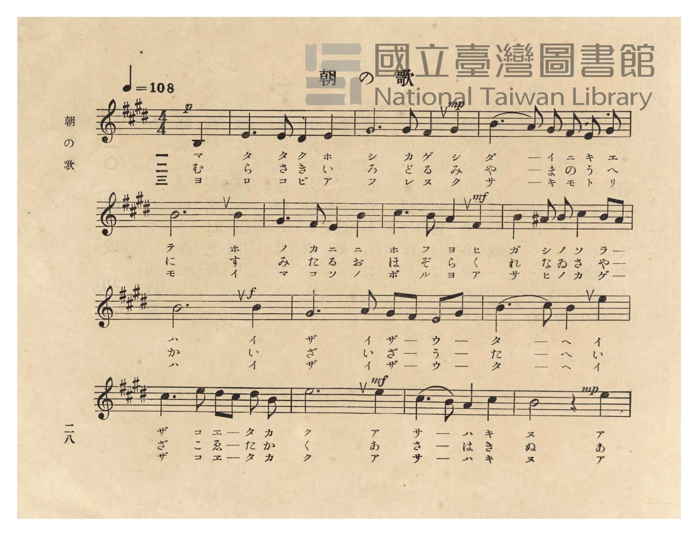
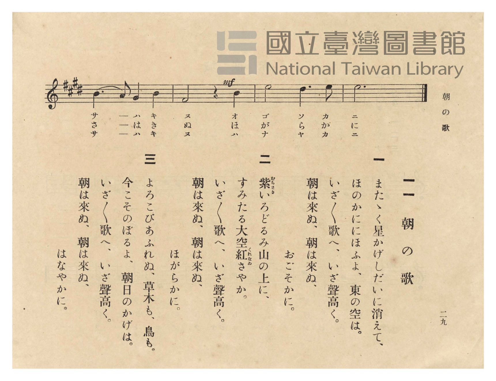

# 朝の歌

> Re:Shōka 使用 AI 協助辨識與重建樂譜，可能會有錯誤。歡迎回報。

- **鋼琴伴奏版**：<br><audio controls src="asa_no_uta.mp3"></audio>
- **NEUTRINO 歌聲合成版**：<br><audio controls src="asa_no_uta_neutrino.mp3"></audio>

- 臺灣總督府《公學校唱歌》第五學年用（昭和十一年一月，索書號 523.37 4322-4）

## 說明

原書資訊與歌詞全文（對應 P032.jpg–P033.jpg，原書 p. 28–29，第 11 首）：
調性與拍號：イ長調（A 大調，3 個升記號）4/4 拍子，♩= 108


## 歌詞

```text
一
またゝく星かげしだいに消えて、
ほのかににほふよ、東の空は。
いざ〳〵歌へ、いざ聲高く。
朝は來ぬ、朝は來ぬ、
おごそかに。

二
紫（むらさき）いろどるみ山の上に、
すみたる大空紅（くれなゐ）さやか。
いざ〳〵歌へ、いざ聲高く。
朝は來ぬ、朝は來ぬ、
ほがらかに。

三
よろこびあふれぬ、草木も、鳥も。
今こそのぼるよ、朝日のかげは。
いざ〳〵歌へ、いざ聲高く。
朝は來ぬ、朝は來ぬ、
はなやかに。
```

## ABC

<div class="abc-score" data-abc-src="asa_no_uta.abc" aria-label="五線譜載入中"></div>

[下載 ABC 原始檔](asa_no_uta.abc)

## TMD 檔案連結

- [主旋律 TMD 檔案](asa_no_uta.tmd) [[在 TMD Studio 編輯](https://tmdlang.github.io/Tmd-TS/#tmd=s7IKdvYPcrWy4qpTUCpJTLdSSM7PyUlNLsnMz7PKzk9PzM7Ojy_OyM9OVIKrKMvPKc1NtUovSkxJjTdFiBfnlxYlp1oVJ2fk5-fEl6RWlCTl52ejy8cXJKanWgUYGBshZAqK8stS8xLzgLoLijLzSlJTwNoRClLLMlNSQdLFyYl58WWpRZlpmakpSE5KLSoGuRhqRUlRYl5xclFmAcgbCFX5RSUZ-UBnF2RUWmVkFpfkF2UmJ-bEZyfmIfmuJCMV6Lm8xJLSolRkrZnpmXlWJYmZ5UAH5KelZSZnJuYocWlpKTybM_dx47pna3sUtLS4FG0VDA0suOxtFRy5bEz0TexAJrxo3_W8cfHzHXufz138dNecxw1dT1vXPF2749mChU-nbATqfNzQ_XzNmie7pgAFn-7c8nzKivd7Op7NWPt0Us_T3sYnOxqAgkDy2ZyO93t6nm9Z9Gz2jhcz5yuYGhnrGZsrmBgbGemavN_TqcTFpa-lYEstwKWgoPC0bz7Iss3tL1Z0vehoB7r1xcp5T1tXPJvWDnTi0w29z9o7FUCRqZdVkP6oYTKQaQxiAt0J0apQoKdgZAGUMbIEuX3NGgVDQ4WXy6YBnft-zyyQFS9W7X_WsBxkeHcv0FdA0cdNS15O3Q4UB1rhqPB0yXIws8dY4WlD99NeoFNmgNV1AsNXAajp6doJQNlHM1dCwh5kJjCwQNTjxn2PG-c_bgJGUP-zGfMfN3Y_bpz0uHH648YFjxtbHjeufrat43EjEC173NAI0bAbGJdgdavBCMjd-ripAyj9bO5GoNTzlbseN65_3NAEUQ00Y9rjhs2PG7aCYrFxB1AdRPBF46aXq2cArYUqBSeS9U_2tT1uXAMyDJULMazrceOUx41ACbDtQH1gn-zqAVHPt6wGBsbjpobHTZ2PG6c-buwF-h9kVVPv48aVj5uAWvY_3Qhy4ZMdQHOA2qGGzgRKgMOgGxiOQNc_39IKMgjosCagg1c9bgKGHdjEJqCzu2njMWAg9oDdjeKxHZ1gWWDggvww-XHj5seNTeDgBloI0vyit_PZnBWPm5qA7Jebl4IZYDuf7AZ6EagBlO8eN-4B-R4SRXPmPpu-FBaBwIimUUStBwccOLwg_gGKUp7doEBBS5-Ly7E40S8_tCTRKiAzMS_foUbXsKYaZIuCjYWWHZiBLaMrgAqRHQ0vFvYoaJgoPN3Q_3x9gw48d2pi0QC0C2RYjYKBgi4cVhfUKhjHAxk1CmYgShdEmYJYYG6NgiFY0FDBHMQFcWoUjBBCEMWGCjVgo30MaxQghkDg4-Z5YA2Pm_ZD-ED6cdN6sMxsqMx2qMxqIN4EZoFEgDLNDVCZJUB2N5i1FiQDsckIzaYmkGqQeZ0QfuNUIO4Fs1qgMiAeiL8SyAab1whyFUgGpALE3wfE68CsNoRNxuh-WgF1H8g1IJs3A9mTwaxFUJmpUJVrgLgHLAPyM8imrVA9a4EyINWPmzvANuGP5l095EQzJJqg0ZwLjGeQACxCYbEMETMGixmB5aDxDpIwVAdSIDmQDCKKHzeBggARIODAgkYpiN8Hjk4QCxTMIBkQDYl0SOAgAnESODjWgMntUL17EYEPjGZgBka2rRFkMkh0JpQPTFKN88H6obY1dkFldgMxKAFCEgVIph_MA0dJ4yogawI4oSBH9ePmVSh-g0YpMBHCEjQowkGmgF0JdjFEZg4QQ3wN9Rs4OUCiHORPRLgQiu4dneDoBlaB5Ed3Giy6wfkWPbdCFRuD6WqgWlNEIIAiuHklSiCAgg0pEJq2QdkgFkRmGVQGGBnNM8AskDxSJELzGCwSYVEFy3nToGwQCyIDSlQg_nxoAoDmY0REgUsLargRb2Q8nT2bnLwHyVCmCiZAlgkwlGvAIYwSPeAgR8l5IDYiHkGlNDjbosUN2D_QcgecESGlK0gGlLggcuAyFlYewUodYBhBylBIqQSK5z1QHaBEAlWPlPFAcQEK-clAuYnQ2IDEDiRDg0TAWaqxCSoOLfka18NLX1DWxrAJoh4pLmntJwLl6xTMOAa3bPHGMTRnwUpSMBdei8LiDxjR0AIVEtOQEhdEwkpihGrkSCbWe6DSCqR-CzyYQOUSiF6NVPIidCBHL7GRtRsi2ghyAcRsWCXbDRaHRRGaHeCIJdIfsOzbDCm7QSKwjIzLH7VcXLp2CrDGkwKQrcwFAA)]
- [鋼琴伴奏 TMD 檔案](asa_no_uta_piano.tmd) [[在 TMD Studio 編輯](https://tmdlang.github.io/Tmd-TS/#tmd=s7IKdvYPcrWy4tLSUng2Z-7jxnXP1va839PxsnvP8wlbnuzZ8nRp__POjvd7OhW0tLgUbRUMDSy47G0VHLlsTPRN7LjqFJRetO963rj4-Y69z-cufrprzuOGrqeta56u3fFswcKnUzYCjXvc0P18zZonu6YABZ_u3PJ8ygqgBc9mrH06qedpb-OTHQ1AQSD5bA7Qmp7nWxY9m73jxcz5CqZGxnrG5gomxkZGuiZAByhxcXnmlRTlWwVkJublB3k41BjUVHMpAIGNhZYdmFGjUJ2bVqtgrKALhKYKJkCWiYIRUNgULKILljEE4hqoGl2gLISsAYvDoAFIDVctio0-yDaaoNpoGK9gHK9gEq9gGh8PMipeIdowFioK5gJpkJQRqqwBxBLH4kS__NCSRITPdA0xvQZyEwxWFwB9GQ_2iBmI0gVRpiAWmAvzjKGCOYgL8THEp2AhiGJDoO0go30MaxQghkDg4-Z5YA2Pm_ZD-ED6cdN6sMxsqMx2qMxqIN4EZoFEgDLNDVCZJUB2N5i1FhyYYJuM0GxqAqkGmdcJ4TdOBeJeMKsFKgPigfgrgWyweY0gV4FkQCpA_H1AvA7MakPYZIzupxVQ94FcA7J5M5A9GcxaBJWZClW5Boh7wDIgP4Ns2grVsxYoA1L9uLkDbBM0ZiAhC42ZXGDUgARgcQCLGIgYJNkZgeWgUQWSMFQHUiA5kAwiVh43gVyN8APYf9BYAPH7wDEAYoFCBiQDoiHxBPEPwt-TwD5YAya3Q_XuRYQXMGYeN-5Atq0RZDJIdCaUD0wFjfPB-qG2NXZBZXYDMSjNQOIRJNMP5oFDsXEVkDUBHLfIsfO4eRWK36CxAEw3sDQIiiOQKWBXgl0MkZkDxBBfQ_0GjkFILIH8iQgXHDEEzLCQ2ADnDvQ8AVVsDKargWpBhQdSnDSvRHE3yKdI7m7aBmWDWBCZZVAZYPg1zwCzQPJI4Q5NybBwh4UuLH1Pg7JBLIgMKB2A-POhcQbNLYiwBedJargRGn64S1R4iIJDCSV9g9iIoAcVX-DMgRacYCdAMyQ4uUOKHZAMKAohcuDCB5ZRYdkR6C1I4QLJrqCo2QPVAYpXqHqk5A0KPlBgTQbKTYQGICRAIdkGJAJOuI1NUHFokdC4Hl4sgTIQhk0Q9UjBT2s_QaMFmn5hRQyYC68RYEEOjBtoSUNMnYeIF2JdBMrGIPVb4D4DZVgQvRqpSELoQI4RYsN3N0S0EeQCiNmwCqMbLA4LVTQ7wHFBpD9gmaQZUqiBRGDZBZc_MKpuUBMBUXUj2ggGUFgDaiIAIwOzYQDmQlsIMD5UM4gbbRofC2aAzMBsTgC5QBJoNtwMKBeXEWg2IfNBbRKILpyNGoQjYB6BWwD2JZKtUEPBDgWaFG0SnwtVRLBVpGunAG59KQAZsGCO9gEqQeEbofGNwXxlLgA)]

## 分析

```text
================================================================================
📊 TMD Song Profile: [ 朝の歌 ]
================================================================================
⏱  Duration:       0:39 (40.0s), 18 measures total
🎼 Key & Tempo:    首調基準 A, != 108.0 BPM, <4/4>
   - 分析範圍：      由實際發聲的音符與和弦推測調性；播放脈絡另行呈現
🎤 人聲音域:    C#4 (MIDI 61) – E5 (MIDI 76) [跨度: 15 個半音 / 1.2 個八度, 難度: moderate]
   - 最低音:  C#4 in [AsaNoUta #1 @ m.1, 0:01]
   - 最高音: E5 in [AsaNoUta #1 @ m.11, 0:23]
   - 適合: soprano, mezzo-soprano, contralto, tenor, baritone, bass
🏛  結構:      AsaNoUta (40.0s)
⚡ 編曲密度:        Peak 1 軌道同時演奏
🗝  調性診斷：       E 大調（純淨自然大調，未偵測到可信轉調）
   - 風格氣質:    純淨自然大調（陽光明朗、易唱易記，無明顯調外色彩）
   - 轉調歷程:    全曲維持單一推測調性（未偵測到可信轉調）
   - 核心骨幹音:  B, A, C#, E, F#
   - 調性數值:    E 大調 [相關度: 0.80, 穩定度: Moderate, 自然音純度: 97.9%]
   - 候選調性 (K-S): E 大調 (0.80), B 大調 (0.68), A 大調 (0.61)
   - 五度圈歷程:   +4
   - 各段落調性細節:
     • [AsaNoUta #1]: E 大調 (r: 0.81, 自然音純度: 97.8%, 調外音: D, A#)

  [ 五度圈游移軌跡 ]
               C  
         F            G  
      Bb               D  
      Eb               A  
         Ab          [E ]*
            Db       B  
               F# 
     (* = active key center)

  [ 十二半音累積音高分佈 ]
     C  :                            0.0%
     C# : ████████████              15.0%
     D  : █                          1.4%
     D# :                            0.0%
     E  : ████████████              15.0%
     F  :                            0.0%
     F# : ███████████               12.9%
     G  :                            0.0%
     G# : ███████                    8.6%
     A  : ██████████████            17.1%
     A# : █                          0.7%
     B  : ████████████████████████  29.3%
--------------------------------------------------------------------------------
Assignment 軌道音域：
  - Piano         : C#4 – E5 (15 個半音 / 1.2 個八度, 67 個音符)
================================================================================
```


## 原書掃描頁






