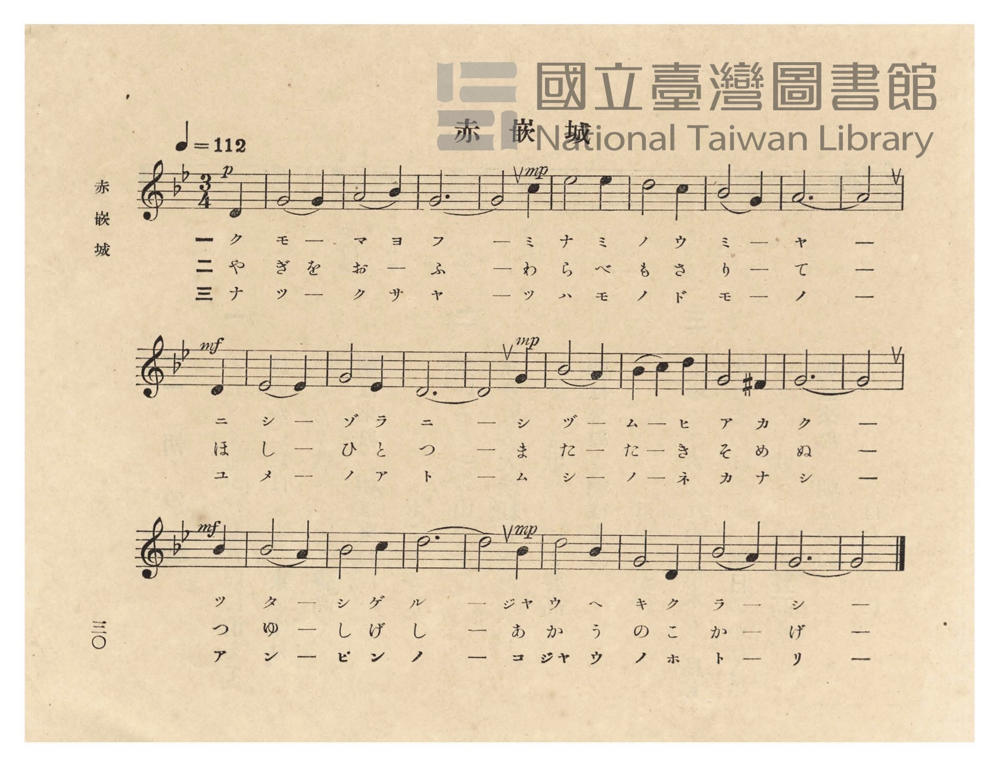
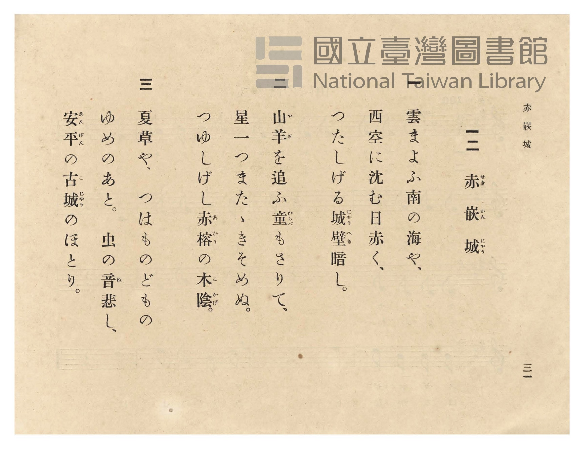

# 赤嵌城

> Re:Shōka 使用 AI 協助辨識與重建樂譜，可能會有錯誤。歡迎回報。

- **NEUTRINO 歌聲合成版**：<br><audio controls src="sekikanjo_neutrino.mp3"></audio>
- **鋼琴伴奏版**：<br><audio controls src="sekikanjo.mp3"></audio>


- 詞：木村久（昭和八年公學校唱歌歌詞懸賞入選，原題〈赤崁城懷古〉）
- 臺灣總督府《公學校唱歌》第五學年用（昭和十一年一月，索書號 523.37 4322-4）

## 說明

原書資訊與歌詞全文（對應 P034.jpg–P035.jpg，原書 p. 30–31，第 12 首）：
調性與拍號：ト短調（G 小調，2 個降記號）3/4 拍子，♩= 112
作詞：木村久（據 1933 年 9 月《臺灣教育》第 374 號〈懸賞募集 公學校唱歌教材入選歌詞〉第 19 篇〈赤崁城懷古〉，臺南市開山町三丁目百七十三番地）


## 歌詞

```text
一
雲まよふ南の海や、
西空に沈む日赤く、
つたしげる城壁（じゃうへき）暗し。

二
山羊（やぎ）を追ふ童（わらべ）もさりて、
星一つまたゝきそめぬ。
つゆしげし赤榕（あかう）の木陰（こかげ）。

三
夏草や、つはものどもの
ゆめのあと。虫の音（ね）悲し、
安平（あんぴん）の古城（こじゃう）のほとり。
```

## ABC

```abc
X:1
T:赤嵌城
M:3/4
L:1/16
Q:1/4=112
K:Gm
V:V1 name="Piano" snm="Pia"
[V:V1]
!p! z8 D4 | G8 G4 | A8 B4 | G12 |
w: 1.~ク | モ マ | ヨ フ | ー
w: 2.~や | ぎ を | お ふ | ー
w: 3.~ナ | ツ ク | サ ヤ | ー
!mp! G8 c4 | d8 d4 | c8 B4 | A8 G4 |
w: 1.~_ ミ | ナ ミ | ノ ウ | ミ ヤ
w: 2.~_ わ | ら べ | も さ | り て
w: 3.~_ ツ | ハ モ | ノ ド | モ ノ
A12 | !mf! A8 D4 | E8 E4 | G8 E4 |
w: 1.~ー | _ ニ | シ ゾ | ラ ニ
w: 2.~ー | _ ほ | し ひ | と つ
w: 3.~ー | _ ユ | メ ノ | ア ト
D12 | !mp! D8 G4 | B8 A4 | B4 c4 d4 |
w: 1.~ー | _ シ | ヅ ム | ヒ _ ア
w: 2.~ー | _ ま | た た | き _ そ
w: 3.~ー | _ ム | シ ノ | ネ _ カ
G8 ^F4 | G12 | !mf! G8 B4 | B8 A4 |
w: 1.~カ ク | ー | _ ツ | タ シ
w: 2.~め ぬ | ー | _ つ | ゆ し
w: 3.~ナ シ | ー | _ ア | ン ピン
B8 c4 | d12 | !mp! d8 B4 | c8 B4 |
w: 1.~ゲ ル | ー | _ ジャウ | ヘ キ
w: 2.~げ し | ー | _ あ | か う
w: 3.~ノ ー | ー | _ コ | ジャウ ノ
G8 D4 | B8 A4 | G12 | G8 z4 |
w: 1.~ク ラ | シ ー | ー | _
w: 2.~の こ | か げ | ー | _
w: 3.~ホ ト | リ ー | ー | _
```

## TMD 檔案連結

- [主旋律 TMD 檔案](sekikanjo.tmd) [[在 TMD Studio 編輯](https://tmdlang.github.io/Tmd-TS/#tmd=s7IKdvYPcrWy4qpTUCpJTLdSSM7PyUlNLsnMz7PKzk9PzM7Ojy_OyM9OVIKrKMvPKc1NtUovSkxJjTdFiBfnlxYlp1oVJ2fk5-fEl6RWlCTl52ejy8cXJKanWgUYGJsgZAqK8stS8xLzgLoLijLzSlJTwNoRClLLMlNSQdLFyYl58WWpRZlpmakpSE5KLSoGuRhqRUlRYl5xclFmAcgbCFX5RSUZ-UBnF2RUWmVkFpfkF2UmJ-bEZyfmIfmuJCMV6DmIdCW6cHoqVD9Coig1HWRzSWJmeSKKXZnpmTDh-Py0tMzkzMQcXPLJ-UBPF5fEG1oaGytxaWkpvNi65OnWnqfz-xS0tLgUbRUMDY247G0VnHS4slMrbRXcc7lsjPVN7EDGvVg57_2eWc_mrHg2d-KTna3v93Q8m7H26aSep62rn-7c8rR1zdO1O54tWPh0ysZna3uACKj-WfuOF5vnPW1d-rJxx_s9PU_75r9c2PO4oQNk65ZGoK3P2rc_7V_yuKHz_Z5OsJtftO963rj4-Y69z-cufrprzuOGLjSDHzd0P1-z5smuKUBBoLXPp6xAOKS38cmOBqAgkHw2pwNo4fMti57N3vFi5nwFUyNjPWNzBRNjIyNdE7BlXPpaCrbUAlwKCgpA34Es29z-YkXXi452SAg8bV3xbFo70IlPN_Q-a-9UAKVHvayC9EcNk4FMUxATEjBArQoFegrGBkAZY0OQ29esUTA0Uni5bBrQucCAB1nxYtX-Zw3LQYZ39wJ9BRR93NzxfP5aoDjQCneFpxv6wcweI4WnDd0vZ_a-WDEDrK4TGIkKQE1P104Ayj6auRIS00Ajn-ydgyViJ89SACURBWBgKlgqAAMTGBGQqHk2deaLpk2QWFAwNjdRAJoPjFFoTHfPfzm7TQE9LUyd-WzuBEgqgIQKMMLB3rNUeL6-HUd66AHa97R3-tMdTS-ndT_duPH5lF1PdnQ-2dH4fPa65zP3PdnRDI7vzudTVz2dswHoRS6wd3Y0gKiXszc9btz3uKnjceNWoCGPG9c927r9cVPL44ZGcDgu3f985a7Hjaufbep43NTwbPpSoAseN_ZDpR83AjnzHzcC9U163NQNdNfTxY3AYHncOONxU_PjxrbHjTseN_YC7Xw2C6hm-uOGJojlu3rACQHo2H1dIPVACxv7gMoeN016sX8v0C3PVy8Fi_c_bup83LgTLNX0uHHq46aux43LoNY_mzEf6A2wI_aB3NE0F2jZ48a5j5saHzeuAVkGdWMT0CFgNzZOB7r_2bKpYDcCzesGuhFkNtDbc1a8nAkMHaD4ZLD4JJA4zL07OsHuXdL_ohfoEFDogG1dD3bUuseNKyEMsH1Ay0D2A0WBQiuARryYuRrIfTl_M9j0taDQACYMUGiAffF0XefTnRC5psdNQMu3AEmIo4BRDAxTmKOgYQqRety4G2Q6MDgg3qQ8a0KBgpY-F1dwanYmsBTOyrcKyEzMy3eo0TWsqQZZo2BjomUHZmArFRRAJc6OhhcLexQ0DA1Auez5-gYdeF7WxKIDaBvItBoFAwVdheqCWgXjeCDHLB7IAxI1CuYgliFMSBfGqM4FKjUC8oyBHGMgbQRVBlaP0AnSAGZU56ZBzAZb52NYowASfdy0HqjgcfMiELt5Hpi9AsyeCmbvgRoBVts8HyzWhcTuA5uxDMyeDxZfgkVfN8xWI5itLSBVjRDdk8BssKmNWzF1N_WDxJo6wfI7wewmMBvswiaIPogLUPQ17obZagxzRxdYVQvC301bcboZ7MLmfjB7EcKvzZ1I4dWHRR_QJeAsgzt97OoBpw9L0pKHCch4IAGNfzALGJ0Qq8EMcJIAx7whkAeMdBDDCJw4wFpM49WxJCNgqgAmG3iieNy0HRw8-8BeWwmLPoxI2Q4WawXLLwCzJ4HFwUHVtBopaWEEKzwpAIsAcERtAicAcLJrxBIVjWC3NIKTF5AEsXvB7LlguxrB7DVY9AHNgieAx80LEVEGdCWI3YHFfWC_QMIAGr1gu4A-gid9qN9RwwPobwLRvqOTnGhHikpdeH4HRzksxkGZHpb5wXEKLkDg-lDj2wAlqvcjvNO0CexliDdRvbbjcfNiWB6fARZZC9axHqxjJVKA7cHQDS9vQNHd1AaOlungKAQnFwgbLdqawPLdYHYbmL0OzJ6MJA4uM7DbBI7szWD3TAExEFkX03mPm8DycC8iYn02UgpZhcdztVxcunYK8OpCAchR5gIA)]
- [鋼琴伴奏 TMD 檔案](sekikanjo_piano.tmd) [[在 TMD Studio 編輯](https://tmdlang.github.io/Tmd-TS/#tmd=s7IKdvYPcrWy4tLSUnixdcnTrT1P5_e939PxsnvP8wlbnuzZ8nRp__POjvd7OhW0tLgUbRUMDY247G0VnHS4slMrbRXcc7lsjPVN7LjqFJRerJz3fs-sZ3NWPJs78cnOVqApz2asfTqp52nr6qc7tzxtXfN07Y5nCxY-nbLx2doeIAKqf9a-48XmeU9bl75s3PF-T8_TvvkvF_Y8bugAOWVLI9Apz9q3P-1f8rihE-gCJbAl7bueNy5-vmPv87mLn-6a87ihC83gxw3dz9esebJrClAQaO3zKSsQDultfLKjASgIJJ_NAXqq5_mWRc9m73gxc76CqZGxnrG5gomxkZGuCdgyLs-8kqJ8q4DMxLz8IA-HGoOaai4FILAx0bIDM2oUqnMLahWMFHQVDIEcs3ggwzgeyDIEMsxBDLCQgUINVy2KaT74TItXiDbKjVUwhOgH8szigVywuSAuUBzOhkhBzQ9Ozc7MTszLQnKxriGmJQZAF1UD7YEaAuQBiRqQc5F8oQtjQD1Yo2AM8huQhnkWrB6hE6QBzKjOTYOYDbbOx7BGAST6uGk9UMHj5kUgdvM8MHsFmD0VzN4DNQKstnk-WKwLid0HNmMZmD0fLL4Ei75umK1GMFtbQKoaIbongdlgUxu3Yupu6geJNXWC5XeC2U1gNtiFTRB9EBeg6GvcDbPVGOaOLrCqFoS_m7bidDPYhc39YPYihF-bO5HCqw-LPqBLuKAxagISARLQKAOzgDEAUQ1mgGMRHFnwlGkIjElQfIK1mKrDdSPFPDAigTENj8fHTdvBPtoHds1KWIhjhON2sFgrWH4BmD0JLA72XdNqpNSAERLw2HvcOB0ctpvAcQZOKY1YQq8R7JZGcIoAkiB2L5g9F2xXI5i9Bos-oFnwOHvcvBARykBXgtgdWNwH9gskDKAxArYL6CN4aoX6HTU8gP6GxRRS6OvCcxU4lmCRBMpahMoTeBSBMj4idvYjXNC0CexKiMtQXbPjcfNiWE6aARZZC9axHqxjJZIf92DohudqUAw1tYFDcjo41MExDGGjhXQTWL4bzG4Ds9eB2ZORxME5E7tN4PjZDHbPFBADkUEwnfe4CSwP9yIiomYjReoqPJ7DLEVBJTX2UhQEkUthCAnOcNHGQC4QY5NGLbYhhmGqglUCYAJspjlQDUgdmgVQDsIsNJ0Io4ESOPUiVyxIbgJqQatq0LiEPIVcVwHZeJ2AXO9hhAue2g-7G4AxqWunAK5yFYAMeKxG-xjGogkYoQsAHQQUUOYCAA)]

## 分析

```text
================================================================================
📊 TMD Song Profile: [ 赤嵌城 ]
================================================================================
⏱  Duration:       0:43 (43.4s), 27 measures total
🎼 Key & Tempo:    首調基準 B,, != 112.0 BPM, <3/4>
   - 分析範圍：      由實際發聲的音符與和弦推測調性；播放脈絡另行呈現
🎤 人聲音域:    D4 (MIDI 62) – D5 (MIDI 74) [跨度: 12 個半音 / 1.0 個八度, 難度: easy]
   - 最低音:  D4 in [Sekikanjo #1 @ m.1, 0:01]
   - 最高音: D5 in [Sekikanjo #1 @ m.6, 0:08]
   - 適合: soprano, mezzo-soprano, contralto, tenor, baritone, bass
🏛  結構:      Sekikanjo (43.4s)
⚡ 編曲密度:        Peak 1 軌道同時演奏
🗝  調性診斷：       G 小調（純淨自然小調，未偵測到可信轉調）
   - 風格氣質:    純淨自然小調（陰鬱抒情、旋律集中，無明顯調外色彩）
   - 轉調歷程:    全曲維持單一推測調性（未偵測到可信轉調）
   - 核心骨幹音:  G, D, A#, A, C
   - 調性數值:    G 小調 [相關度: 0.92, 穩定度: High, 自然音純度: 98.8%]
   - 候選調性 (K-S): G 小調 (0.92), G 大調 (0.69), D 大調 (0.46)
   - 五度圈歷程:   +1
   - 各段落調性細節:
     • [Sekikanjo #1]: G 小調 (r: 0.92, 自然音純度: 98.7%, 調外音: F#)

  [ 五度圈游移軌跡 ]
               C  
         F           [G ]*
      Bb               D  
      Eb               A  
         Ab           E  
            Db       B  
               F# 
     (* = active key center)

  [ 十二半音累積音高分佈 ]
     C  : ██████                     8.6%
     C# :                            0.0%
     D  : ████████████████          21.0%
     D# : ████                       4.9%
     E  :                            0.0%
     F  :                            0.0%
     F# : █                          1.2%
     G  : ████████████████████████  32.1%
     G# :                            0.0%
     A  : ███████████               14.8%
     A# : █████████████             17.3%
     B  :                            0.0%
--------------------------------------------------------------------------------
Assignment 軌道音域：
  - Piano         : D4 – D5 (12 個半音 / 1.0 個八度, 49 個音符)
================================================================================
```


## 原書掃描頁






