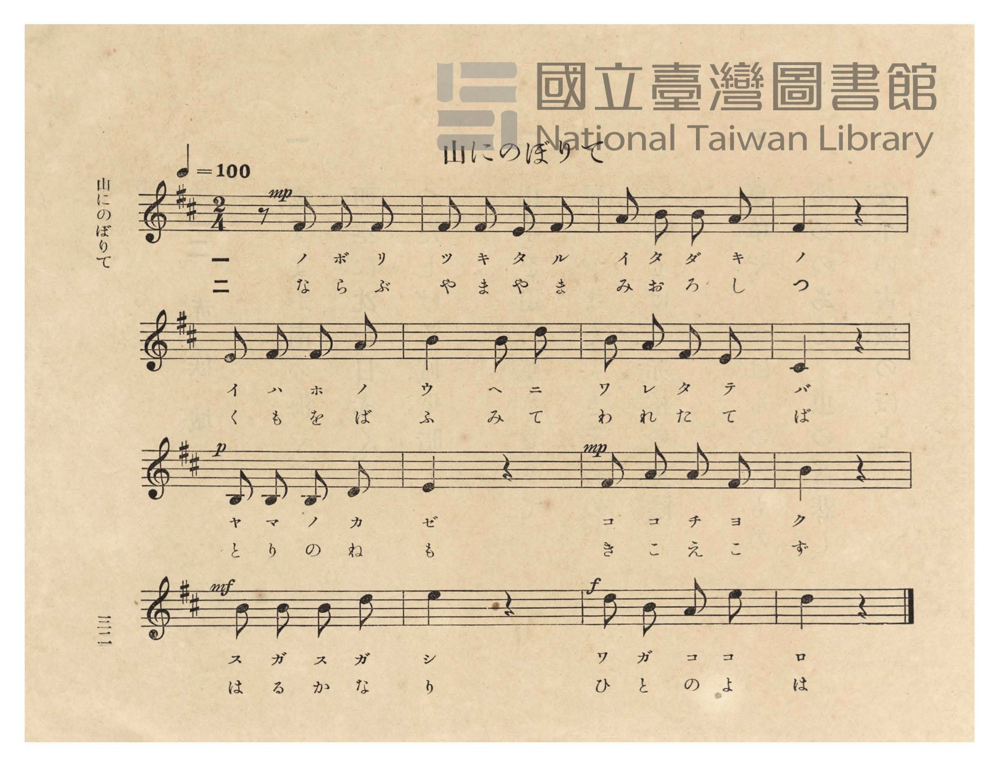
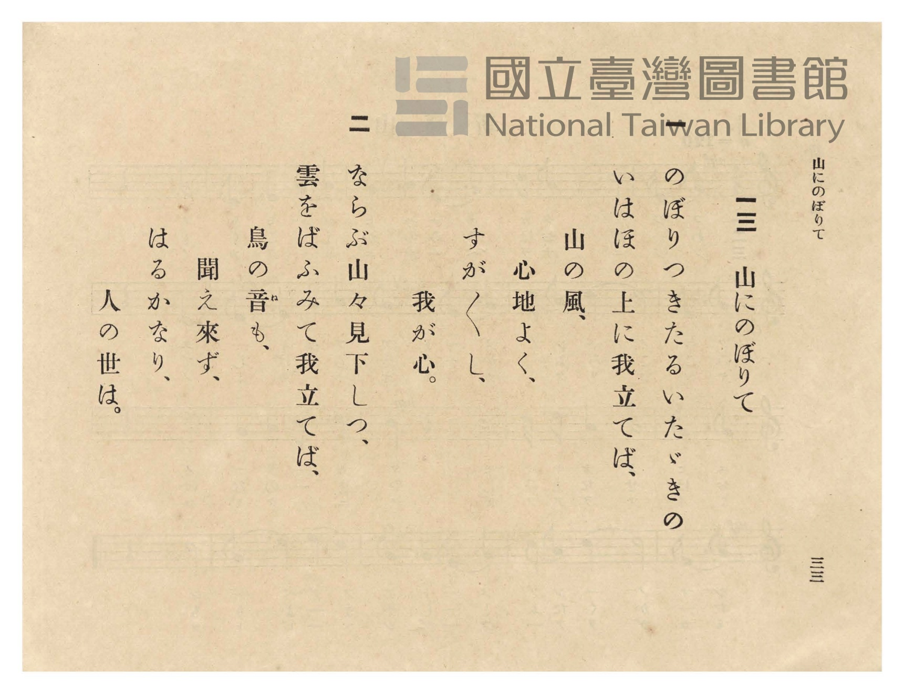

# 山にのぼりて

> Re:Shōka 使用 AI 協助辨識與重建樂譜，可能會有錯誤。歡迎回報。

- **NEUTRINO 歌聲合成版**：<br><audio controls src="yama_ni_noborite_neutrino.mp3"></audio>
- **鋼琴伴奏版**：<br><audio controls src="yama_ni_noborite.mp3"></audio>


- 臺灣總督府《公學校唱歌》第五學年用（昭和十一年一月，索書號 523.37 4322-4）

## 說明

原書資訊與歌詞全文（對應 P036.jpg–P037.jpg，原書 p. 32–33，第 13 首）：
調性與拍號：ニ長調（D 大調，2 個升記號）2/4 拍子，♩= 100


## 歌詞

```text
一
のぼりつきたるいたゞきの
いはほの上に我立てば、
山の風、
心地よく、
すが〳〵し、
我が心。

二
ならぶ山々見下しつ、
雲をばふみて我立てば、
鳥の音（ね）も、
聞え來ず、
はるかなり、
人の世は。
```

## ABC

```abc
X:1
T:山にのぼりて
M:2/4
L:1/16
Q:1/4=100
K:D
V:V1 name="Piano" snm="Pia"
[V:V1]
!mp! z2 F2 F2 F2 | F2 F2 E2 F2 | A2 B2 B2 A2 | F4 z4 |
w: 1.~ノ ボ リ | ツ キ タ ル | イ タ ダ キ | ノ
w: 2.~な ら ぶ | や ま や ま | み お ろ し | つ
E2 F2 F2 A2 | B4 B2 d2 | B2 A2 F2 E2 | C4 z4 |
w: 1.~イ ハ ホ ノ | ウ ヘ ニ | ワ レ タ テ | バ
w: 2.~く も を ば | ふ み て | わ れ た て | ば
!p! B,2 B,2 B,2 D2 | E4 z4 | !mp! F2 A2 A2 F2 | B4 z4 |
w: 1.~ヤ マ ノ カ | ゼ | コ コ チ ヨ | ク
w: 2.~と り の ね | も | き こ え こ | ず
!mf! B2 B2 B2 d2 | e4 z4 | !f! d2 B2 A2 e2 | d4 z4 |
w: 1.~ス ガ ス ガ | シ | ワ ガ コ コ | ロ
w: 2.~は る か な | り | ひ と の よ | は
```

## TMD 檔案連結

- [主旋律 TMD 檔案](yama_ni_noborite.tmd) [[在 TMD Studio 編輯](https://tmdlang.github.io/Tmd-TS/#tmd=s7IKdvYPcrWy4qpTUCpJTLdSSM7PyUlNLsnMz7PKzk9PzM7Ojy_OyM9OVIKrKMvPKc1NtUovSkxJjTdFiBfnlxYlp1oVJ2fk5-fEl6RWlCTl52ejy8cXJKanWgUYGJshZAqK8stS8xLzgLoLijLzSlJTwNoRClLLMlNSQdLFyYl58WWpRZlpmakpSE5KLSoGuRhqRUlRYl5xclFmAcgbCFX5RSUZ-UBnF2RUWmVkFpfkF2UmJ-bEZyfmIfmuJCMV6Lm8xJLSolRkrZnpmXlWJYmZ5UAH5KelZSZnJuYocWlpKTzduPFx4-rHjeseN-553NT1uHGZgpYWl6KtgqGBAZe9rYILl42RvokdyKgX7bueNy5-vmPv87mLn-6a87ih62nrmqdrdzxbsPDplI3P1vY8buh-vmbNk11TgIJPd255PmXF-z0dz2asfTqp52lv45MdDUBBIPlsTsf7PT3Ptyx6NnvHi5nzFUyNjPWMzRVMjI2MdE3e7-lU4uLS11KwpRbgUlBQeNo3H2TZ5vYXK7pedLQD3fpi5bynrSueTWsHOvHpht5n7Z0KoFjVyypIf9QwGcg0BzGB7oRoVSjQUzA2AsoYG4PcvmaNgqGxwstl04DOfb9nFsiKF6v2P2tYDjK8uxfoK6Do4-bul1O3A8WBVrgoPF2yHMzsMVJ42tD9tBfolBlgdZ3A8FUAanq6dgJQ9tHMlZCwB5kJDCwQhRQ7Sx439j5unP-4qftxYwuYMQ8ssg6iDii0_nHjbiD_yQ6g6tXPOiY-Xw1Uuuxx44bHDY3goABF-LqXi1bA-Pubn87Z8Lip43FjP1TocePMx43A2Nz8uGHr48bpUFGgWUBRoPLHDU0Q1-3qgahe9bip83HjNpDJDa0vlnU_2QG0cjrIsRCdL2dvetw0CeSERqB5-4HOweKul5uXgtw1fzMwtB43rgWGy-OmJqjci0agLzue7Gt73DgL7sb14EAAIqD1XVDRJ7t2gf0-DSQNdCZQiPIEBAUKWvpcXJGJuYl-mX75ScAsVQIsCDIT8_IdagxqqkFWKdhYaNmBGdjSrwIob-xoeLGwR0HDROHphv7n6xt04IlOE4sGoIUgw2oUDBSqcwtqFYzBsAZMGoFZpgpmQGgKFtMFKtNVqAFr8TGsUYhXeNzcB8RzgHgVUMXj5haFx01rgXg_kL0aJNK0BMprAMuA1PQBzYhHmGMENqdxFVC-E0hvA-sCmtO4D04DRRqBZjR2AUV6gfR0sMgSuDn4A2RXDzkBAvK9MdjfZkA7zBQM48BMU3DA1CiYg2xGDQ2wX5v7gXg22JcgkWVAFY-bZwBxN9jv64F4DTRE2sAiEzBCA5hLgCqagHgSkL0B7NetIHPAYbAMbC5IRQ-QNx8mAlRHXGjs6CQnNKqBacMsHooMwcED9T4s3ZiCgwYSWmjh0gwKl3mQtNIESRV7YK4FsjdDcHMjEK8Ai6zHEiYrgOLA-G9cB8TgdAQMIbgZjaBUMRmIO8A0SGQWceHxdPZsssIjNw0YIGAIThhGcYjwAMoAxUBJBShaA2JjppSdQAxKBxAaJLId4RtQKgHLQkIGJLIWS4iAVHUDaRAG5z5g-CBCZBMkzEDh1dQBFkGEai0Xl66dAmpBowAUUeYCAA)]
- [鋼琴伴奏 TMD 檔案](yama_ni_noborite_piano.tmd) [[在 TMD Studio 編輯](https://tmdlang.github.io/Tmd-TS/#tmd=s7IKdvYPcrWy4tLSUni6cePjxtWPG9c9btzzuKnrceOy93s6XnbveT5hy5M9W54u7X_e2fF-T6eClhaXoq2CoYEBl72tgguXjZG-iR1XnYLSi_ZdzxsXP9-x9_ncxU93zXnc0PW0dc3TtTueLVj4dMrGZ2t7Hjd0P1-z5smuKUDBpzu3PJ-yAmjBsxlrn07qedrb-GRHA1AQSD6bA7Sm5_mWRc9m73gxc76CqZGxnrG5gomxkZGuCdABSlxcnnklRflWAZmJeflBHg41BjXVXApAYGOhZQdm1ChU56bVKpiBoWEckG8Up6CrYArENSC-GZAJFAGzdRUMQMJctSjG-iAba4JqrEm8QrRJLJBnGg9kmcaDmIbxYB6YYQAxLTIxN9Ev0y8_Kb8osyQVr2sNgAYX1CoYg2ENmDQCs0zBPjAFi8EcCtLiY1ijEK_wuLkPiOcA8SqgisfNLQqPm9YC8X4gezVIpGkJlNcAlgGp6QOaEY8wxwhsTuMqoHwnkN4G1gU0p3EfnAaKNALNaOwCivQC6elgkSVwc6B-ADnYGOxUM6AwNNhBbgf5pUbBHKQY1QNg5zX3A_FssMNAIsuAKh43zwDibrBz1wPxGqgn2sAiEzA88LgRaEZTExBPArI3gJ23FWQO2NnLwOaCVPQAefNhIkB1aB6oBsaAWTwUGYJ9BHUxLHZMwb6BeBDNK80gr8yDxEgTJOz3wCwAsjdDcHMjEK8Ai6zH4o0VQHFgKDeuA2JwbAE9BTejERT2k4G4A0yDRGZheAFbqod6ASiDI-Uj4mMnEINCG0KDRLYjHACKC7AsxDMgkbVYPAFS1Q2kQRicLIFeQnhiE8SbIC82dYBFEAGBI8_gyIrAjBZtiJ71gFkTngUhykBSQIEaRK6FqzdGVmcGystm8bmwfA2UQVgB1ItQiZL9ocrQ876unQK4MFEAMlD9FO0DNBGLqBFYVJkLAA)]

## 分析

```text
================================================================================
📊 TMD Song Profile: [ 山にのぼりて ]
================================================================================
⏱  Duration:       0:19 (19.2s), 16 measures total
🎼 Key & Tempo:    首調基準 D, != 100.0 BPM, <2/4>
   - 分析範圍：      由實際發聲的音符與和弦推測調性；播放脈絡另行呈現
🎤 人聲音域:    B3 (MIDI 59) – E5 (MIDI 76) [跨度: 17 個半音 / 1.4 個八度, 難度: challenging]
   - 最低音:  B3 in [YamaNiNoborite #1 @ m.9, 0:09]
   - 最高音: E5 in [YamaNiNoborite #1 @ m.14, 0:15]
   - 適合: soprano, mezzo-soprano, contralto, tenor, baritone, bass
🏛  結構:      YamaNiNoborite (19.2s)
⚡ 編曲密度:        Peak 1 軌道同時演奏
🗝  調性診斷：       B 小調（純淨自然小調，未偵測到可信轉調）
   - 風格氣質:    純淨自然小調（陰鬱抒情、旋律集中，無明顯調外色彩）
   - 轉調歷程:    全曲維持單一推測調性（未偵測到可信轉調）
   - 核心骨幹音:  B, F#, E, A, D
   - 調性數值:    B 小調 [相關度: 0.80, 穩定度: Moderate, 自然音純度: 100.0%]
   - 候選調性 (K-S): B 小調 (0.80), B 大調 (0.69), F# 小調 (0.60)
   - 五度圈歷程:   +5
   - 各段落調性細節:
     • [YamaNiNoborite #1]: B 小調 (r: 0.80, 自然音純度: 100.0%)

  [ 五度圈游移軌跡 ]
               C  
         F            G  
      Bb               D  
      Eb               A  
         Ab           E  
            Db      [B ]*
               F# 
     (* = active key center)

  [ 十二半音累積音高分佈 ]
     C  :                            0.0%
     C# : ███                        3.9%
     D  : ██████████                11.8%
     D# :                            0.0%
     E  : █████████████             15.7%
     F  :                            0.0%
     F# : █████████████████████     25.5%
     G  :                            0.0%
     G# :                            0.0%
     A  : ███████████               13.7%
     A# :                            0.0%
     B  : ████████████████████████  29.4%
--------------------------------------------------------------------------------
Assignment 軌道音域：
  - Piano         : B3 – E5 (17 個半音 / 1.4 個八度, 44 個音符)
================================================================================
```


## 原書掃描頁






