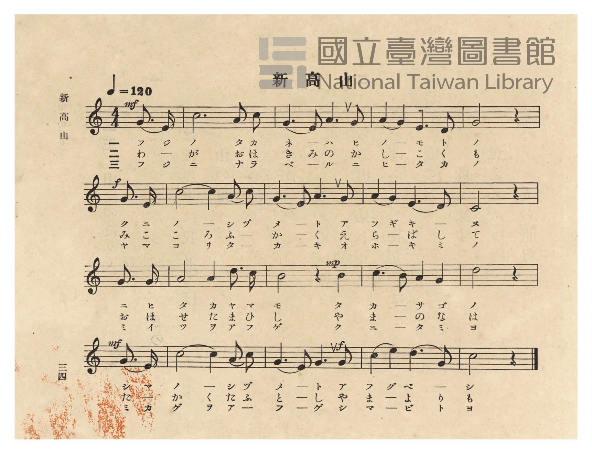
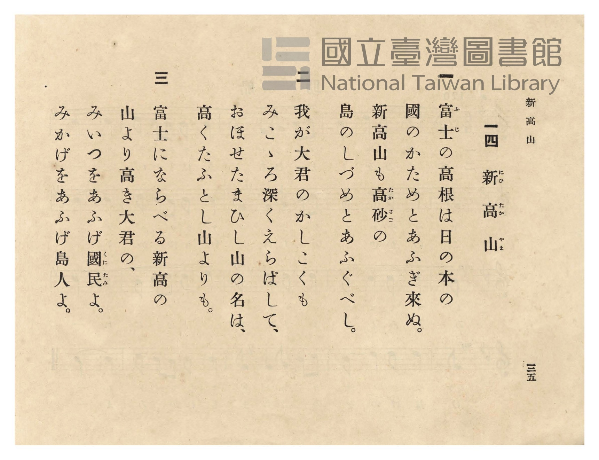

# 新高山

> Re:Shōka 使用 AI 協助辨識與重建樂譜，可能會有錯誤。歡迎回報。

<audio controls src="niitakayama.mp3"></audio>

- 臺灣總督府《公學校唱歌》第五學年用（昭和十一年一月，索書號 523.37 4322-4）

## 說明

原書資訊與歌詞全文（對應 P038.jpg–P039.jpg，原書 p. 34–35，第 14 首）：
調性與拍號：ハ長調（C 大調）4/4 拍子（弱起 1 拍），♩= 120
註：P038 譜面第 2 行第 1 節印作「ク ニ ノ ー シ ヅ メ ー ト」，P039 歌詞頁印作「國のかためとあふぎ來ぬ」。

## 歌詞

```text
一
たかねは雲の絶え間より、
朝夕高くあらはれて、
神代（かみよ）の昔そのままに、
國のかためとあふぎ來ぬ。

二
ふもとの里のたみの草、
めぐみの露にうるほひて、
しげり行く世のたのしさに、
あふぐも高し、新高山。

三
明治のみ代のしるしぞと、
たまひし名こそめでたけれ。
山より高きおほみいつ、
あふげや、ともに、諸人（もろびと）よ。
```

## ABC

```abc
X:1
T:新高山
M:4/4
L:1/16
Q:1/4=120
K:C
V:V1 name="Piano" snm="Pia"
[V:V1]
!mf! z4 z4 z4 G3 E | c12 A2 c2 | G6 E2 A6 G2 | A4 G4 E6 D2 |
w: 1.~タ カ | ネ ハ ク | モ ノ タ エ | マ ヨ リ ア
w: 2.~ふ も | と の さ | と の た み | の く さ め
w: 3.~メ イ | ジ ノ ミ | ヨ ノ シ ル | シ ゾ ト タ
!f! G8 z4 G3 E | c12 A2 c2 | G6 E2 A6 G2 | A4 G4 E6 D2 |
w: 1.~サ ユ フ | タ カ ク | ア ラ ハ レ | テ カ ミ ヨ
w: 2.~ぐ み の | つ ゆ に | う る ほ ひ | て し げ り
w: 3.~マ ヒ シ | ナ コ ソ | メ デ タ ケ | レ ヤ マ ヨ
C8 z4 G3 G | A8 A4 d3 c | !mp! B8 z4 B4 | c6 B2 A4 G4 |
w: 1.~ノ ム カ | シ ソ ノ マ | マ ニ | ク ニ ノ シ
w: 2.~ゆ く よ | の た の し | さ に | あ ふ ぐ も
w: 3.~リ タ カ | キ オ ホ ミ | イ ツ | ア フ ゲ ヤ
!mf! d8 z4 G3 E | c12 A2 c2 | !f! G6 E2 G6 G2 | c4 e4 d6 G2 |
w: 1.~ヅ メ ト | ア フ ギ | キ ヌ ア フ | ギ キ ヌ ー
w: 2.~た か し | に ひ た | か や ま に | ひ た か や
w: 3.~ト モ ニ | モ ロ ビ | ト ヨ モ ロ | ビ ト ヨ ー
c8 z4 z4 |
w: 1.~ー
w: 2.~ま
w: 3.~ー
```

## TMD 檔案連結

- [主旋律 TMD 檔案](niitakayama.tmd) [[在 TMD Studio 編輯](https://tmdlang.github.io/Tmd-TS/#tmd=s7IKdvYPcrWy4qpTUCpJTLdSSM7PyUlNLsnMz7PKzk9PzM7Ojy_OyM9OVIKrKMvPKc1NtUovSkxJjTdFiBfnlxYlp1oVJ2fk5-fEl6RWlCTl52ejy8cXJKanWgUYGFsgZAqK8stS8xLzgLoLijLzSlJTwNoRClLLMlNSQdLFyYl58WWpRZlpmakpSE5KLSoGuRhqRUlRYl5xclFmAcgbCFX5RSUZ-UBnF2RUWmVkFpfkF2UmJ-bEZyfmIfmuJCMV6Lm8xJLSolR00fRUqHaERFFqOsjiksTM8kSgVVpaCs-mbXi5esbTjRsVtLS4FG0VDI0MuOxtFZy5bEz0TexAGl-073reuPj5jr3P5y5-umvO44aup61rnq7d8WzBwqdTNj5b2_O4ofv5mjVPdk0BCj7dueX5lBXv93Q8m7H26aSep72NT3Y0AAWB5LM5He_39DzfsujZ7B0vZs5XMDUy1jM2VzAxNjLSNXm_p1OJi0tfS8GWWoBLQUHhad98kGWb21-s6HrR0Q5064uV8562rng2rR3oxKcbep-1dyqAIlcvqyD9UcNkINMSxAS6E6JVoUBPwdgEKGNsCnL7mjUKhiYKL5dNAzr3_Z5ZICterNr_rGE5yPDuXqCvgKKPm_tfTt0OFAda4azwdMlyMLMTGJwKQDVP104AWb1n44ut2xUMQSJgs3oezVwJCXyQmSt2A80BuUvhxdo5L-cuAllspPBiIcQFCs_XNzzt3fBkLzAueh43rVd43NwNxH1AvEfhcdN2IN0KxAsh_OaOxw1AO3pAflOAhMDLBY1w_U_ndD9uXPe4EUjOf9zU-LhxxePGpseNWx839j3Z1_a4cQ1Q9-OGJi6Qu4CRCKJAKkHq1z5uXP9y9iag9udbtz1u7Hg5bfLjpo7HTV2PGxpB6p7Nmft0yVRg6nrc2A8ytKkTqOFxU8_jxmVQFc-XznuyezEwPMDm7QfqBgYG0LxnM6Y8bpwLdtc-MFoN1UCEa6FO3dUDcerWx01ABUBl6162A20G6gU6fj-Q8aK3E2oo2KAJENGXc4D-Wf24se1xE9CO3Y8bgVyYax83Tn_cOAnoP2BEAL30ZMc0mHlAEig1FeFOmKsmAG0HB8B0oAQ8qyHCsxMcTjP6nm0CWgU0ZT8wOKDGgewHGjoP5HiYoUCrgIEBdNL0pxN6HzdOBgUSyPHLwVITQWELNBoUTkBLwFEBthyotAvsGaAPWx43LkFzJNBLLUAhkEWgsAL54cXqHU927QJFDFCkCah_M1AWFDdAQyE2UJ5BoUBBS5-Lyy8zsyQxO7EyMTfRKiAzMS_foUbXsKYaZJGCjaGZlh2Yha14UAAVPTsagFGioAHNVdoKJgpPN_QDc4kOPHNrYtEJtBhkao2CgYIuGKLT1blptQqmYKYxUJlhHFQcHZoBMViyBqoaAo2hUjAIkquBi8BUglTBoBGGGSjOQXYN2Ok-hjUK8VBZdPpx034ovRpo5uPmXhyOBxZXYFXrwXY_bl6EIteHZBLM3BVQlfPgqkAiENYqFJUgs4Aqm7ai2Ql3Y_MyKD0V5iMjPD5qhJgDTJMgUxthtmL4qHEdmJwKsR1FHUxuPooYyH8glSA5iAgoTCAskCkIHzVCVU7A5SOwWRB7oD4yxuMjYCENMXcJOJx24PIRJB6aQa4GhTyKj6BxtB1FbDVEJVz0cdM-uFwHio-gfofHJoaPmidBVW4H-gh_PtzVA86HJGY_euUrQzTjYfkKosMUKU-hpnhkCMpNSLkFnMLhcs0rwSQs7UDE1kBUNrehmACRQ0mF4FgFqQTFJzJExMQCuAmI3AIsz3G6FWQnsECHmNsIcwFErhsstxtZrHETVCUkV4JEpsNZkFQA090FUQm2AatboTkIWGEg5YPHzSB92N26GUzuhZgLzRcwf7eD5VBLoY1QlaDwhaiChQNqWkaEK3LZhOJW5JKSQArf0UlOCkdOrSAI4xtBUj4wjdcomKOpQVRCBbVwSbTMAhJGT_c1MFOxGYW1BkEtOyAhAYoHSOhBUiMoTPGXEqD0BLEfkjvgZoFlEKkaYRvIvFac5kFLRmBphZzWYSU03HR4SQ6TA6VZkErkchvFZHB-gNrf2IRiFqh-QZTtoHoGoRI5r6KaB_E52F5ESm9ai-7SJlj6e9w8G0rPB4cWev5FhEELwn60kgbku8dNoPwK4cPMAIUpcvmOah7EDFCMEEjnT2fPpldJjmjVQCCkNIebZAxjoKRqNEUwiN6AQ07jyOGHDGFhCUo96PH2uLkHLIcZ9iCV8NYCXA9EPULlHohKMI0M0dsByCkcljox3AkunSHpEKQOlt8gLgClFGDnAEU9rNyHpxKkvIKpG6QSWT8ed4JLctzhCQqNx82TIWaitjbAZTF6GxOkHqQSpAMiAtOD3tIhPjxrubh07RSQuhUKQK4yFwA)]
- [鋼琴伴奏 TMD 檔案](niitakayama_piano.tmd) [[在 TMD Studio 編輯](https://tmdlang.github.io/Tmd-TS/#tmd=s7IKdvYPcrWy4tLSUng2bcPL1TOebtz4fk_Hy-49zydsebJny9Ol_c87O97v6VTQ0uJStFUwNDLgsrdVcOayMdE3seOqU1B60b7reePi5zv2Pp-7-OmuOY8bup62rnm6dsezBQufTtn4bG3P44bu52vWPNk1BSj4dOeW51NWAC14NmPt00k9T3sbn-xoAAoCyWdzgNb0PN-y6NnsHS9mzlcwNTLWMzZXMDE2MtI1ATpAiYvLLzOzJDE7sTIxN9EqIDMxLz_Iw6FG17CmmksBCGwMzbTswKwaBQMFXTBEp6tz02oVTMFMY6AywzioODo0A2KwZA1UNQQaQ6VgECRXAxeBqQSpgkEjDDNQnIPsGrDTfQxrFOKhsuj046b9UHo10MzHzb04HP-4uR-saj3Y7sfNi1Dk-pBMgpm7AqpyHlwVSATCWoWiEmQWUGXTVjQ74W5sXgalp8J8ZITHR40Qcx43NYFMbYTZiuGjxnVgcirEdhR1MLn5KGIg_4FUguQgIqAwgbBApiB81AhVOQGXj8BmQeyB-sgYj4-aF0LNXQIOpx24fASJh2aQq0Ehj-IjaBxtRxFbDVEJF33ctA8u14HiI6jf4bGJ4aPmSVCV24E-guYYemUFQzTjYVkBosMUKRugJlJkCMoASAkcnCjhcs0rwSQsuiFiayAqm9tQTIDIoSQccESAVIKiABkiAm8B3AREAn_cuASnW0F2Pm6ERl8jzAUQuW6w3G5kscZNUJWQjAQSmQ5nQSIOprsLohJsA1a3QhP946YOpKT7uBmkD7tbN4PJvRBzoUkZ5u92sBxqwbERqhIUvhBVsHBATX6IcEUuTlDcily4wRIlcgIDQRjfCJJYgcmyRsEcTQ2iqC-ohUuipW-QMHpSrYGZis0orOU0ag6FOB4UdBAPQxIQKBjw50VQEoDYD0nQcLPAMoiEiLANZF4rTvOg5Q-wTEBOnrByEG46vLyEyYGSGUglcumIYjI4CUPtb2xCMQtUiiNKUFBpjlCJnL1QzYP4HGwvInE2rUV3aRMsyTxung2l54NDCz3LIcKgBWE_WuEA8t3jJlAWg_BhZoDCFLkURTUPYgYoRigqLxHVPQRCyky4ScYwBkpCRFMEg-gtG-RkiexlZAjzPijC0YP6cXMPWA4zuEAq4dUoXA9EPULlHohKMI0M0StI5EQJS1AY7gSXgZCkA1IHyyIQF4Ai93EjrPKDqIeVrvCIRUremLpBKpH143EnuLzEHZ6g0HjcPBliJmo1DC7x0BtfIPUglSAdEBGYHvQmAPHhWYulYeyD0jA2QWoXQyAwQcUrRBvGgiiTeAQXyAayaqA0EJnGg7ggMto0PhaiF5YDSDEBKousH6gi2gSswQjTDpAGY7DJYNNIcACUgvPhWtEcAQw2XTsFpJCL9gHKoQsZYQoZg4WUuQA)]

## 分析

```text
================================================================================
📊 TMD Song Profile: [ 新高山 ]
================================================================================
⏱  Duration:       0:32 (32.0s), 16 measures total
🎼 Key & Tempo:    首調基準 C, != 120.0 BPM, <4/4>
   - 分析範圍：      由實際發聲的音符與和弦推測調性；播放脈絡另行呈現
🎤 人聲音域:    C4 (MIDI 60) – E5 (MIDI 76) [跨度: 16 個半音 / 1.3 個八度, 難度: moderate]
   - 最低音:  C4 in [Niitakayama #1 @ m.9, 0:16]
   - 最高音: E5 in [Niitakayama #1 @ m.16, 0:30]
   - 適合: soprano, mezzo-soprano, contralto, tenor, baritone, bass
🏛  結構:      Niitakayama (32.0s)
⚡ 編曲密度:        Peak 1 軌道同時演奏
🗝  調性診斷：       C 大調（純淨自然大調，未偵測到可信轉調）
   - 風格氣質:    純淨自然大調（陽光明朗、易唱易記，無明顯調外色彩）
   - 轉調歷程:    全曲維持單一推測調性（未偵測到可信轉調）
   - 核心骨幹音:  C, G, A, E, D
   - 調性數值:    C 大調 [相關度: 0.88, 穩定度: High, 自然音純度: 100.0%]
   - 候選調性 (K-S): C 大調 (0.88), G 大調 (0.75), A 小調 (0.64)
   - 五度圈歷程:   +0
   - 各段落調性細節:
     • [Niitakayama #1]: C 大調 (r: 0.86, 自然音純度: 100.0%)

  [ 五度圈游移軌跡 ]
              [C ]*
         F            G  
      Bb               D  
      Eb               A  
         Ab           E  
            Db       B  
               F# 
     (* = active key center)

  [ 十二半音累積音高分佈 ]
     C  : ████████████████████████  29.2%
     C# :                            0.0%
     D  : ███████                    8.9%
     D# :                            0.0%
     E  : █████████                 10.6%
     F  :                            0.0%
     F# :                            0.0%
     G  : ███████████████████████   27.5%
     G# :                            0.0%
     A  : ███████████████           17.8%
     A# :                            0.0%
     B  : █████                      5.9%
--------------------------------------------------------------------------------
Assignment 軌道音域：
  - Piano         : C4 – E5 (16 個半音 / 1.3 個八度, 55 個音符)
================================================================================
```


## 原書掃描頁






