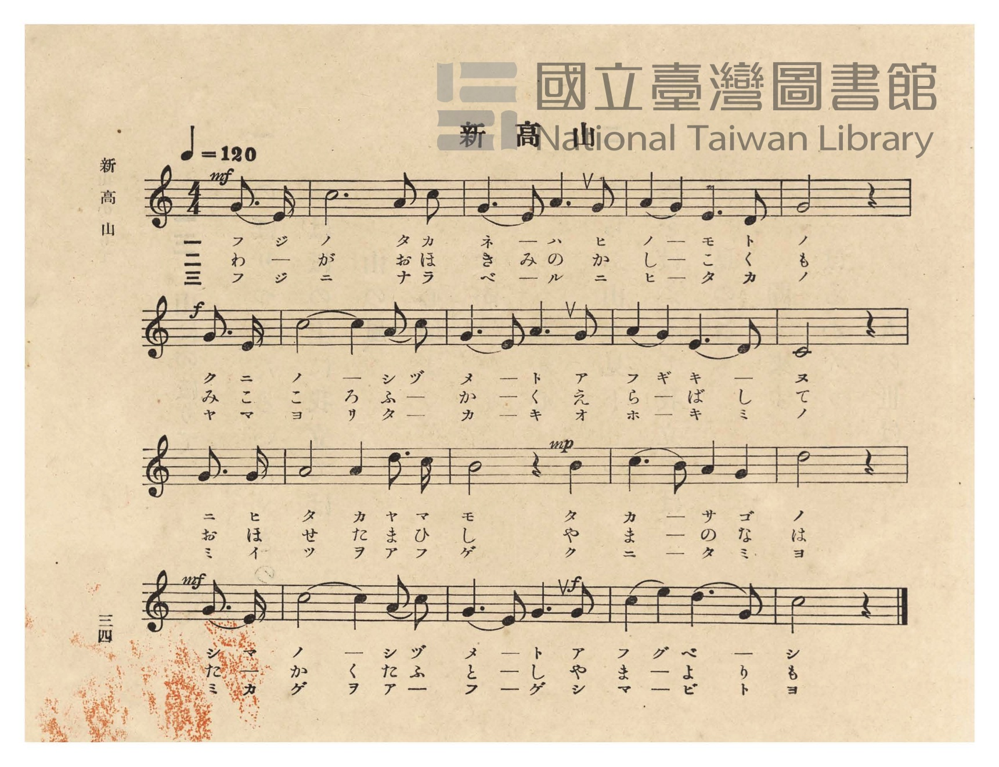
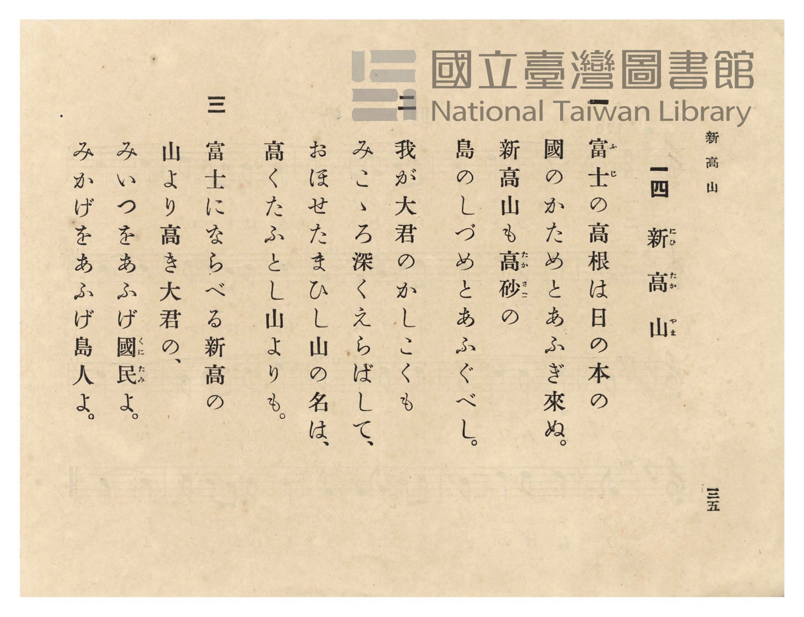

# 新高山

> Re:Shōka 使用 AI 協助辨識與重建樂譜，可能會有錯誤。歡迎[回報](https://github.com/TMDLang/reshoka/issues)。

- **鋼琴伴奏版**：<br><audio controls src="niitakayama.mp3"></audio>
- **NEUTRINO 歌聲合成版**：<br><audio controls src="niitakayama_neutrino.mp3"></audio>

- 臺灣總督府《公學校唱歌》第五學年用（昭和十一年一月，索書號 523.37 4322-4）

## 說明

原書資訊與歌詞全文（對應 P038.jpg–P039.jpg，原書 p. 34–35，第 14 首）：
調性與拍號：ハ長調（C 大調）4/4 拍子（弱起 1 拍），♩= 120
註：P038 譜面第 2 行第 1 節印作「ク ニ ノ ー シ ヅ メ ー ト」，P039 歌詞頁印作「國のかためとあふぎ來ぬ。」。


## 歌詞

```text
一
富士（ふじ）の高根は日の本の
國のかためとあふぎ來ぬ。
新高山も高砂（たかさご）の
島のしづめとあふぐべし。

二
我が大君のかしこくも
みこゝろ深くえらばして、
おほせたまひし山の名は、
高くたふとし山よりも。

三
富士にならべる新高の
山より高き大君の、
みいつをあふげ國民（くにたみ）よ。
みかげをあふげ島人よ。
```

## ABC

<div class="abc-score" data-abc-src="niitakayama.abc" aria-label="五線譜載入中"></div>

[下載 ABC 原始檔](niitakayama.abc)

## TMD 檔案連結

- [主旋律 TMD 檔案](niitakayama.tmd) [[在 TMD Studio 編輯](https://tmdlang.github.io/Tmd-TS/#tmd=s7IKdvYPcrWy4qpTUCpJTLdSSM7PyUlNLsnMz7PKzk9PzM7Ojy_OyM9OVIKrKMvPKc1NtUovSkxJjTdFiBfnlxYlp1oVJ2fk5-fEl6RWlCTl52ejy8cXJKanWgUYGFsgZAqK8stS8xLzgLoLijLzSlJTwNoRClLLMlNSQdLFyYl58WWpRZlpmakpSE5KLSoGuRhqRUlRYl5xclFmAcgbCFX5RSUZ-UBnF2RUWmVkFpfkF2UmJ-bEZyfmIfmuJCMV6Lm8xJLSolR00fRUqHaERFFqOsjiksTM8kQUqzLTM2HC8flpaZnJmYk5SlxaWgrPpm14uXrG040bFbS0uBRtFQyNDLjsbRWcuWxM9E3sQCa8aN_1vHHx8x17n89d_HTXnMcNXU9b1zxdu-PZgoVPp2x8trbncUP38zVrnuyaAhR8unPL8ykr3u_peDZj7dNJPU97G5_saAAKAslnczre7-l5vmXRs9k7Xsycr2BqZKxnbK5gYmxkpGvyfk-nEheXvpaCLbUAl4KCwtO--SDLNre_WNH1oqMd6NYXK-c9bV3xbFo70IlPN_Q-a-9UAEW-XlZB-qOGyUCmJYgJdCdEq0KBnoKxCVDG2BTk9jVrFAxNFF4umwZ07vs9s0BWvFi1_1nDcpDh3b1AXwFFHzf3v5y6HSgOtMJZ4emS5WBmJzA4FYBqnq6dALJ6z8YXW7crGIJEwGb1PJq5EhL4IDNX7AaaA3KXwou1c17OXQSy2EjhxUKICxSer2942rvhyV5gXPQ8blqv8Li5G4j7gHiPwuOm7UC6FYgXQvjNHY8bgHb0gPymAAmBlwsa4fqfzul-3LjucSOQnP-4qfFx44rHjU2PG7c-bux7sq_tceOaxw1NQAOAJBfIacB4BAfs-p6ni1cDPQJWOQPoBaAhwHT0bMHOx43rn01fCuQ-m7MGSIJVE2EHSB08LT5uagIyni9oAtswH6xz6uPGKRB7wEZu3gY2cvrjxqWoRk543Ah0w3S4g3f1gI3umPi4sQcYGU8nzIa5Bah38uPGfqBlIBWPG_eD-E1zHzf1Ptu-ESTR2PG4CWjhBrDSZY8bGiHquh437n7cCDQG6LB9jxs3AaVBbm5c93RCL9D3UHVAD4DNACoCugroPLCiJqCRXUAbEeHZiQjPx41AtAps587HTd2Q4IB5GKYZLNSL8AnMVUDXtzxuXPK4aRIsJCYBw_3ZhongMAQ6BGg20C2gpAgyCBLiYG3AoJiEom3ztie7diEUUZ4XoUBBS5-Lyy8zsyQxO7EyMTfRKiAzMS_foUbXsKYaZJGCjaGZlh2Yha0kUACVMjsagNlAQQOagbQVTBSebugHZggdeD7WxKITaDHI1BoFAwVdMESnq3PTahVMwUxjoDLDOKg4OjQDYrBkDVQ1BBpDpWAQJFcDF4GpBKmCQSMMM1Ccg-wasNN9DGsU4qGy6PTj5qkQumkH0ExQSYDd8Y-b9oPJ1WC7Hzf3oss396PwJkHVoZv3uHkRCq8Dhzq4-4BlFERlN8w3Rnh80wRzBdDMxh5cfmnsApO7oeqQ_QJM1WByHYpYN1TldAyTJqPwQLYD1TU14fIN2HSIPqhvjImPG5ArsPqnGeyf5pUQ25tnYsiDYg3Bg_oGHEco6sBxjODB4hpn3DQvgdLzgL7Bn_d29YDzHolZDiMvwQWonJkM0eyBZSaIDlOkjIQvi2wHB0Yr2ERQJYomD07sCNWgjABSB4lkkAgs0T1uWoumF6QOPTkjogGSMEARisgiqEkTYmovjNW4FWEuOHGjqAMnYwQPmkWbOjHUbUDhgTIHyLxluNwJznaQjIdI_I-bV6Cb27wK7mJYggTZj5yIIbJrUXggXSDzZuNX1zwfqg53sgapAOlbQjBZ7-gkJ1kjp1AQhPGNIKkbmK5rFMzR1CBqm4JauCRaDgEJo6f1Gpip2IzCWlWgFgOQkICFPUqWRyvMUcKQQMzB0t_jpi0IdXgqAVDOghU0iBSOEdONkJgDsfZB6U1YC26EyS0I-6F6kM2D58hGWJoEqYNUSVhMg9uPnL5hNsBNbd4Etx0SfqAyABROMHFMV8JsxFYNIMIalnIh6tDzFWb6Xk0ofT-dPZtuxTYyH9aGQTLKGMZASc5oimAQvYlGn-IbVhxi1sCgyIUkYQREr-2REzbuIhmSxCAFOEglRuGJktQhyRtr0m5C9Q2oaMbXckFzJShhYyRXzISNGkII25B1QkIGpG4ehnkorSt4WxFXwka4sZaLS9dOAam7EO1jGKuALmSEKWQMFlLmAgA)]
- [鋼琴伴奏 TMD 檔案](niitakayama_piano.tmd) [[在 TMD Studio 編輯](https://tmdlang.github.io/Tmd-TS/#tmd=s7IKdvYPcrWy4qpTUCpJTLdSSM7PyUlNLsnMz7PKzk9PzM7Ojy_OyM9OVIKrKMvPKc1NtTJFiBTnlxYlp-JSD5GNL0hMT7UKMDC20AUSlgjpgqL8stS8xDygASWJmeWJefHpQIGivPyi-PTUvNSixByE2tSyzJRUkMqCoszcxKLK-JT8ZKBb8kqQXJdaVAxyfEFmYl5-fGJRUWJeeiqqkvyikoz89KLEgoxKq4zM4pL8oszkxJz47MQ8JFeXZAB1WaWmlCYnggJDiUtLS-HZtA0vV894unHj-z0dL7v3PJ-w5cmeLU-X9j_v7Hi_p1NBS4tL0VbB0MiAy95WwZnLxkTfxA5k3ov2Xc8bFz_fsff53MVPd8153ND1tHXN07U7ni1Y-HTKxmdrex43dD9fs-bJrilAwac7tzyfsgJowbMZa59O6nna2_hkRwNQEEg-mwO0puf5lkXPZu94MXO-gqmRsZ6xuYKJsZGRrgnQAUpcXJ55JUX5VgEgvwd5ONQY1FRzKQCBjaGZlh2YVaNQnZtWq2AYp6CLAuECZjBOjYIpkrwxECPzQewahC5jGMMI2WA0RTBogEbXcNWiuNwH2eUmaA6PV4g2jAVRJvEgs-FcEAXnm8YDadN4JBEDIATb45eZWZKYnViZmJuICCddQywBhe5MGA12ByQsjLF5DwbxhCRICjWQYCIwlSBVMGiEYQaKc5BdA3a6j2GNQjxUFp1-3DwVQjftAJr5uLkPh-MfN-0Hk6vBdj9u7kWXb-5H4U2CqkM373HzIhReBw51cPc1rYeq7Ib5xgiPb5pgrgCa2diDyy-NXWByN1Qdsl8eN4L92bgORawbqnI6hkmTUXgg24Hqmppw-QZsOkQf1DfGxMcNyBVY_dMM9k_zSojtzTMx5EGxhuBBfQOOIxR14DhG8GBxjTNumpdA6XlA30BzCVklCTnp3xDNHlj6h-gwRUr7-FL1djC5C2zi4-aF6PLg9IlQDUq7IHWQeAGJwNLJ46a1aHpB6tBTICLkIHEJigNEqkZNTRBTe2Gsxq0Ic8HpEUUdOOUheNBc1dSJoW4DCg-UnkHmLcPlTnBOgeQVRHp93LwC3dzmVXAXw9IQyH7kdAeRXYvCA-kCmTcbv7rm-VB1uFMiSAVI3xJESkROVCAI40OrJGBSrFEwR1ODKNMLauGSaIkaJIyePGtQKzpUo7AWyKiZDeJ4WHChZCy0IhPF2wQCG5ZkHjdtQajDU9SCMgMsOyMSJUbkNEICG8TaB6U3YS0eESa3IOyH6kE2D56JGmHJCKQOUvBjMQ1uP3KShNkAN7V5E9x2SPiBsi0onGDimK6E2YitsEWENSyxQdShZwXMJLmawsIRmQ-r3KnX1KJHIQkrdDCrJlB8QFIdAqJXg8hpEXfBB0kVkGISpBKjiEJJnZAUiTU1NqH6BlQA4qvS0VwJSosYKQwzLaKGEMI2ZJ2QkAGpm4dhHkqzA96IwpUWEW7E1uAFNa8RDV5E-xrURAY3k3E0soFsIKsGSgMRqJUNTL6wtjakiQ1N-KSYgNJEh-gHqog2AWswQrMDrsUYbDbYPBKcQEJPQddOAdwpUQAykAIx2geoCF3ICFPIGCykzAUA)]

## 分析

```text
================================================================================
📊 TMD Song Profile: [ 新高山 ]
================================================================================
⏱  Duration:       1:36 (96.0s), 48 measures total
🎼 Key & Tempo:    首調基準 C, != 120.0 BPM, <4/4>
   - 分析範圍：      由實際發聲的音符與和弦推測調性；播放脈絡另行呈現
🎤 人聲音域:    C4 (MIDI 60) – E5 (MIDI 76) [跨度: 16 個半音 / 1.3 個八度, 難度: moderate]
   - 最低音:  C4 in [Niitakayama[L1] #1 @ m.9, 0:16]
   - 最高音: E5 in [Niitakayama[L1] #1 @ m.16, 0:30]
   - 適合: soprano, mezzo-soprano, contralto, tenor, baritone, bass
🏛  結構:      Niitakayama[L1] (32.0s) -> Niitakayama[L2] (32.0s) -> Niitakayama[L3] (32.0s)
⚡ 編曲密度:        Peak 1 軌道同時演奏
🗝  調性診斷：       C 大調（純淨自然大調，未偵測到可信轉調）
   - 風格氣質:    純淨自然大調（陽光明朗、易唱易記，無明顯調外色彩）
   - 轉調歷程:    全曲維持單一推測調性（未偵測到可信轉調）
   - 核心骨幹音:  C, G, A, E, D
   - 調性數值:    C 大調 [相關度: 0.88, 穩定度: High, 自然音純度: 100.0%]
   - 候選調性 (K-S): C 大調 (0.88), G 大調 (0.75), A 小調 (0.64)
   - 五度圈歷程:   +0 -> +0 -> +0
   - 各段落調性細節:
     • [Niitakayama[L1] #1]: C 大調 (r: 0.86, 自然音純度: 100.0%)
     • [Niitakayama[L2] #1]: C 大調 (r: 0.88, 自然音純度: 100.0%)
     • [Niitakayama[L3] #1]: C 大調 (r: 0.88, 自然音純度: 100.0%)

  [ 五度圈游移軌跡 ]
              [C ]*
         F            G  
      Bb               D  
      Eb               A  
         Ab           E  
            Db       B  
               F# 
     (* = active key center)

  [ 十二半音累積音高分佈 ]
     C  : ████████████████████████  29.2%
     C# :                            0.0%
     D  : ███████                    8.9%
     D# :                            0.0%
     E  : █████████                 10.6%
     F  :                            0.0%
     F# :                            0.0%
     G  : ███████████████████████   27.5%
     G# :                            0.0%
     A  : ███████████████           17.8%
     A# :                            0.0%
     B  : █████                      5.9%
--------------------------------------------------------------------------------
Assignment 軌道音域：
  - Piano         : C4 – E5 (16 個半音 / 1.3 個八度, 171 個音符)
================================================================================
```


## 原書掃描頁






