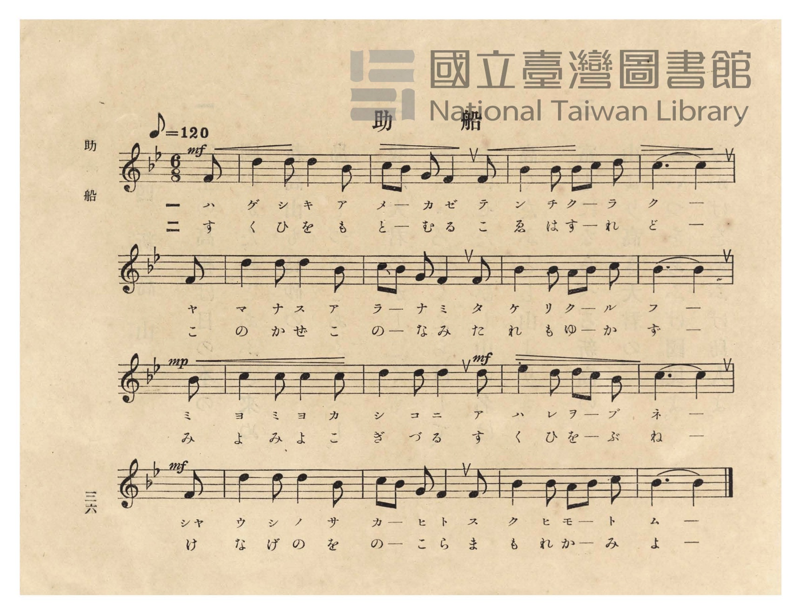
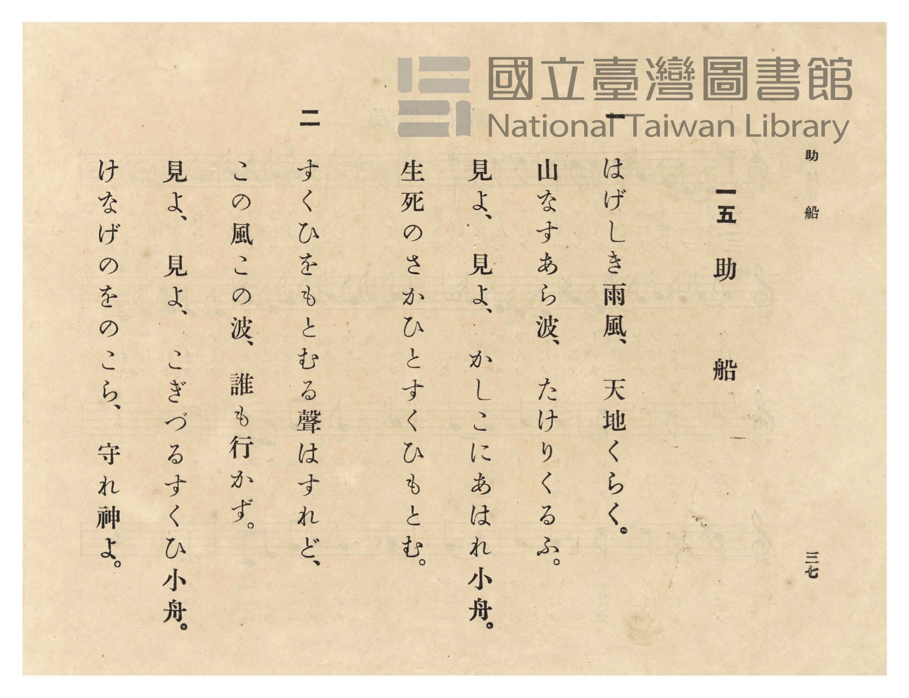

# 助船

> Re:Shōka 使用 AI 協助辨識與重建樂譜，可能會有錯誤。歡迎回報。

- **NEUTRINO 歌聲合成版**：<br><audio controls src="tasukebune_neutrino.mp3"></audio>
- **鋼琴伴奏版**：<br><audio controls src="tasukebune.mp3"></audio>


- 臺灣總督府《公學校唱歌》第五學年用（昭和十一年一月，索書號 523.37 4322-4）

## 說明

原書資訊與歌詞全文（對應 P040.jpg–P041.jpg，原書 p. 36–37，第 15 首）：
調性與拍號：變ロ長調（Bb 大調，2 個降記號）6/8 拍子（弱起 1 八分音符），♩.= 60


## 跨冊／重複收錄參照

> 同曲（〈助船／助け船〉；收錄於《公學校唱歌》第五學年、《新定兒童唱歌》第五學年與《唱歌帖》P211《小公學校唱歌教材集》抄譜）

- **[同曲]** 《新定兒童唱歌》尋常科第五學年用（2020.006.0847.0005）：[**〈助船〉**](../../../shintei_jido_shoka/grade_5_2020.006.0847.0005/2_07_tasukebune/index.md)（`B,` / `6/8` — [原始 TMD](../../../shintei_jido_shoka/grade_5_2020.006.0847.0005/2_07_tasukebune/tasukebune.tmd)）
- **[同曲]** 楊金土手抄《唱歌帖》第 10 冊・X（2020.006.0843）：[**〈助け船 (救生船)〉**](../../../shokacho/vol_10/p211_tasukebune/index.md)（`B,` / `6/8` — [原始 TMD](../../../shokacho/vol_10/p211_tasukebune/tasukebune.tmd)）
- 總表：[跨冊重複與同名歌曲總索引](../../../duplicate_songs.md)

## 歌詞

```text
一
はげしき雨風、天地くらく。
今しもしづまん沖の小船。
あれ〳〵、小船は浪（なみ）のそこに。
おくれな、人々。いだせ、助船。

二
さかまく荒浪（あらなみ）おしわけつゝ、
こぎ行く助船いさましさよ。
うれしや、人々すくはれたり。
萬歲、萬歲。萬々歲。
```

## ABC

```abc
X:1
T:助船
M:6/8
L:1/16
Q:3/8=40
K:Bb
V:V1 name="Piano" snm="Pia"
[V:V1]
!mf! z10 F2 | B4 B2 B4 A2 | B2 A2 G2 F4 F2 | A4 A2 A2 B2 c2 |
w: 1.~ハ | ゲ シ キ ア | メ _ カ ゼ ア | メ ツ チ _ ク
w: 2.~さ | か ま く あ | ら _ な み お | し わ け _ つ
B6 B4 F2 | B4 B2 B4 A2 | B2 A2 G2 F4 F2 | A4 A2 G2 A2 B2 |
w: 1.~ラ ク イ | マ シ モ シ | ヅ _ マ ン オ | キ ノ コ _ ブ
w: 2.~つ ー こ | ぎ ゆ く た | す _ け ぶ い | さ ま し _ さ
!mp! B6 B4 B2 | c4 c2 c4 c2 | !mf! d4 d2 d4 d2 | e4 d2 d2 c2 B2 |
w: 1.~ネ ー ア | レ ア レ コ | ブ ネ ハ ナ | ミ ノ ソ _ コ
w: 2.~よ ー う | れ し や ひ | と び と す | く は れ _ た
!mf! c6 c4 F2 | B4 B2 B4 A2 | B2 A2 G2 F4 F2 | A4 A2 G2 A2 B2 |
w: 1.~ニ ー オ | ク レ ナ ヒ | ト _ ビ ト イ | ダ セ タ ス ケ
w: 2.~り ー ば | ん ざ い ば | ん _ ざ い ば | ん ば ん _ ざ
B6 B4 z2 |
w: 1.~ブ ネ
w: 2.~い ー
```

## TMD 檔案連結

- [主旋律 TMD 檔案](tasukebune.tmd) [[在 TMD Studio 編輯](https://tmdlang.github.io/Tmd-TS/#tmd=s7IKdvYPcrWy4qpTUCpJTLdSSM7PyUlNLsnMz7PKzk9PzM7Ojy_OyM9OVIKrKMvPKc1NtUovSkxJjTdFiBfnlxYlp1oVJ2fk5-fEl6RWlCTl52ejy8cXJKanWgUYmBggZAqK8stS8xLzgLoLijLzSlJTwNoRClLLMlNSQdLFyYl58WWpRZlpmakpSE5KLSoGuRhqRUlRYl5xclFmAcgbCFX5RSUZ-UBnF2RUWmVkFpfkF2UmJ-bEZyfmIfmuJCMV6LncxKLMkszcVAzx_KLEHCUuLS2Fp10rX3TsVNDS4lK0VTAz4LK3VXDS4bIx07ewA-l50b7reePi5zv2Pp-7-OmuOY8bup62rnm6dsezBQufTtn4bG3P44bu52vWPNk1BSj4dOeW51NWvN_T8WzG2qeTep72Nj7Z0QAUBJLP5nS839PzfMuiZ7N3vJg5X8HUyFjP2FzBxNjISNfk_Z5OJS4ufS0FW2oBLgUFhad980GWbW5_saLrRUc70K0vVs572rri2bR2oBOfbuh91t6pAIpAvayC9EcNk4FMQxAT6E6IVoUCPQVjM6CMsTnI7WvWKBiaKrxcNg3o3Pd7ZoGseLFq_7OG5SDDu3uBvgKKvljX9bh57cup24FSQFuckhSeLlkOZvcYKTxt6H45s_fFihlgtZ3AMFYAany6dgLIPXs2vti6XcFQ4Wnr6qcdbS_nb36-ZhnYpp5HM1fqgeMGZCUwLEHU48b1jxsnPW6c_rix9-XsFS8XrXjc0Ph0ycqnczY8bux_3NQJIhuawDp2d4HUNTWBVS993LjvcdPkZ5umPW5c93RDPzDyoeoeNzY9bgLG5-bHDVtBhkHkGtc_27oK6L7HjaseNwK9ATR43ePGuY8bJz9uXA3XCbQBaGkPSFFD45Ndux43tALlHje2PG5c8LhxNsg4cDoDaQC7aVcPROPUx43dIBc19r_onQSzCegOoDVw-yDO73_cOPFx45LHTXOBpkE0A53Q92Ih0NZ-qOkg-4AmAo0D-nTq46YOuAPbwK4DGtOCcGDjTJCrgQEJkpr_uKkLqvrFhDXP1m4CqoMxmoAMoAYIG6SC8gQKBQpa-lxcIYnFpdmpSaV5wPIkMzEv36HGoKYaZI2CjYWWHZiBLW8ogPLdjgZgAChoQFOPtoKJAjDenq9v0IGnbE0sOoG2gkytUTBQ0IXC6ty0WgXTeKCYIZBnCCbNIVwgZRYPktOFKADywXJAZKhgBNUB0gORBxvtY1ijAFIGgY-b-4HKHjdtArGbtgPxWjBrEUi0eSGYvRqI96CLNrcAcSNYdD1YdCXEPCAPRC6B2WaEYlvjVJDaxm4wex8Q94NZTWA3dILZq4B4P5jVBVY7HWxeP5A1ESwKNBlMQlwPdlfjZKBt-GNjVw84NkiMBKIDHCgIDnPkEK_OLagFCcFD_XHzPFgoNy-CskCirWCfzAPizWDRVeDQAMdDcx-QBRZtngZW24vsb1B8wEMZmOPAYm3wUJ0PDqmZYPZEIN4GxGuBuAUsPhUeB-AQhsRMUwdKuLYRDNcdneSEqxHQdCMoWaNgDKSNwSQ4qRsDhUygQkbgMAUpBClFygtIgboGGhQw1mZwQE0De6MXnMBBLHBiap4PD9S9SGpByRERqMDgRwRqUw84IKYDWS1g1iZw4K0AszfDWTPBopBgXw_XBY6Api6UIN1AKEifzp5N96RqgBygkBwMDExQoIFYk8CBBEoZj5snw1igHA5kN4DZu4F4PxDvBOKN8OCHRIAuMP8jB-hkcDBMA6dDaIAQEN2AJA8KZpAKWICCzK7l4tK1U0CU1QpAnjIXAA)]
- [鋼琴伴奏 TMD 檔案](tasukebune_piano.tmd) [[在 TMD Studio 編輯](https://tmdlang.github.io/Tmd-TS/#tmd=s7IKdvYPcrWy4tLSUnjatfJFx873ezpedu95PmHLkz1bni7tf97Z8X5Pp4KWFpeirYKZAZe9rYKTDpeNmb6FHVedgtKL9l3PGxc_37H3-dzFT3fNedzQ9bR1zdO1O54tWPh0ysZna3seN3Q_X7Pmya4pQMGnO7c8n7ICaMGzGWufTup52tv4ZEcDUBBIPpsDtKbn-ZZFz2bveDFzvoKpkbGesbmCibGRka4J0AFKXFyeeSVF-VYBmYl5-UEeDjUGNdVcCkBgY6FlB2bUKFTnptUqGCroAjGINI8HihmCKLN4BdN4oAiQqAHxwXJAQSBpCFajC9akq2CgUMNVi2KVDz6rQCaBTIXQQINADBMgFyEEY6EpAloHoqD2hSQWl2anJpXmpeL1nwFYIwiCrQf7hmjvgv1qhOJbkDzYaB_DGgWIq0DwcXM_UNnjpk0gdtN2IF4LZi0CiTYvBLNXA_EedNHmFiBuBIuuB4uuhJgH5IHIJTDbjFBsa5wKUtvYDWbvA-J-MKsJ7IZOMHsVEO8Hs7rAaqeDzesHsiaCRYEmg0mI68HuapwMtA0abhQliercAlCiQgTU4-Z5sIBpXgRlgURbwZbPA-LNYNFVYA-Ag665D8gCizZPA6vtRXYqKAjhAfO4sQ8s1gYPiPlgz80EsycC8TYgXgvELWDxqfBgAwcKJDCbOlCCog0RFEZAASMoWaNgDKSNwSQ4QRkDhUygQkbgYAApBClFSnFI4bAG6noYazPYb9PANveCkxGIBY6y5vnwcNiLpBYU6YhwAIYYIhyaesBunw5ktYBZm8D-XQFmb4azZoJFISG1Hq4LHGZNXSihsIFKCQKUZ-FhAEnaQP-D_AliTQL7CxT-j5snw1igpA9kN4DZu4F4PxDvBOKN8BCDhJkuMGMgh8FksMungWMb6gcCohuQ5EEhA1IBCwOQ2VhKGxxFHKK0AfqYSmUdNPipaBZ-dSA-yFwwF6IEyEDXRW2XAcNY104BXIkoABmI8I72MYxFFzECiyhzAQA)]

## 分析

```text
================================================================================
📊 TMD Song Profile: [ 助船 ]
================================================================================
⏱  Duration:       0:51 (51.0s), 17 measures total
🎼 Key & Tempo:    首調基準 B,, != 60.0 BPM, <6/8>
   - 分析範圍：      由實際發聲的音符與和弦推測調性；播放脈絡另行呈現
🎤 人聲音域:    F4 (MIDI 65) – D#5 (MIDI 75) [跨度: 10 個半音 / 0.8 個八度, 難度: easy]
   - 最低音:  F4 in [Tasukebune #1 @ m.1, 0:02]
   - 最高音: D#5 in [Tasukebune #1 @ m.12, 0:33]
   - 適合: soprano, mezzo-soprano, contralto, tenor, baritone, bass
🏛  結構:      Tasukebune (51.0s)
⚡ 編曲密度:        Peak 1 軌道同時演奏
🗝  調性診斷：       A# 大調（純淨自然大調，未偵測到可信轉調）
   - 風格氣質:    純淨自然大調（陽光明朗、易唱易記，無明顯調外色彩）
   - 轉調歷程:    全曲維持單一推測調性（未偵測到可信轉調）
   - 核心骨幹音:  A#, A, C, F, D
   - 調性數值:    A# 大調 [相關度: 0.78, 穩定度: High, 自然音純度: 100.0%]
   - 候選調性 (K-S): A# 大調 (0.78), F 大調 (0.58), A# 小調 (0.57)
   - 五度圈歷程:   -2
   - 各段落調性細節:
     • [Tasukebune #1]: A# 大調 (r: 0.78, 自然音純度: 100.0%)

  [ 五度圈游移軌跡 ]
               C  
         F            G  
     [Bb]*              D  
      Eb               A  
         Ab           E  
            Db       B  
               F# 
     (* = active key center)

  [ 十二半音累積音高分佈 ]
     C  : ████████                  13.5%
     C# :                            0.0%
     D  : █████                      8.3%
     D# : █                          2.1%
     E  :                            0.0%
     F  : ████████                  12.5%
     F# :                            0.0%
     G  : ███                        5.2%
     G# :                            0.0%
     A  : ███████████               18.7%
     A# : ████████████████████████  39.6%
     B  :                            0.0%
--------------------------------------------------------------------------------
Assignment 軌道音域：
  - Piano         : F4 – D#5 (10 個半音 / 0.8 個八度, 67 個音符)
================================================================================
```


## 原書掃描頁






