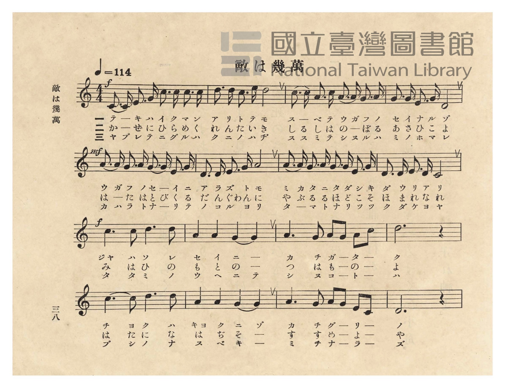
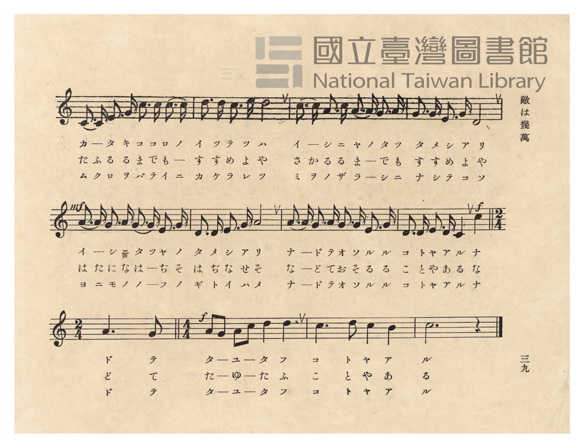
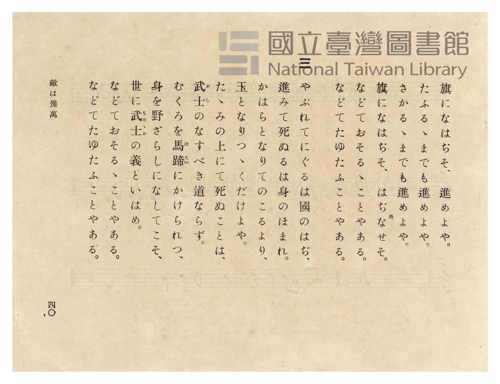
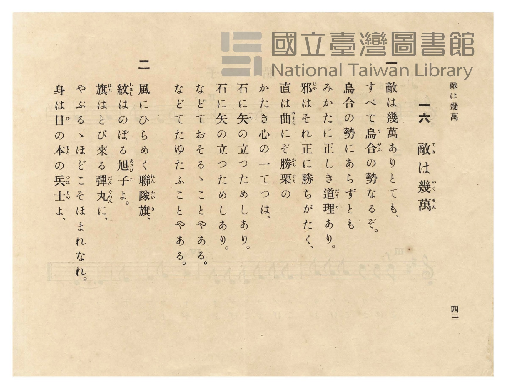

# 敵は幾萬

> Re:Shōka 使用 AI 協助辨識與重建樂譜，可能會有錯誤。歡迎回報。

- **NEUTRINO 歌聲合成版**：<br><audio controls src="teki_wa_ikuman_neutrino.mp3"></audio>
- **鋼琴伴奏版**：<br><audio controls src="teki_wa_ikuman.mp3"></audio>


- 詞：山田美妙
- 曲：小山作之助
- 臺灣總督府《公學校唱歌》第五學年用（昭和十一年一月，索書號 523.37 4322-4）

## 說明

原書資訊與歌詞全文（對應 P042.jpg–P045.jpg，原書 p. 38–41，第 16 首）：
調性與拍號：ハ長調（C 大調）4/4 拍子（第 25 小節為 2/4 拍子），♩= 114
作詞：山田美妙／作曲：小山作之助
註：原書裝訂時 p. 40（P044.jpg）與 p. 41（P045.jpg）頁序對調；
P043 譜面第 6 行第 1 節印作「イ ー シ ニ タ ツ ヤ ノ タ メ シ ア リ」，P045 歌詞頁印作「石に矢の立つためしあり」。


## 歌詞

```text
一
敵は幾萬ありとても、
すべて烏合（うがふ）の勢なるぞ。
烏合の勢にあらずとも
みかたに正しき道理（だうり）あり。
邪（じゃ）はそれ正に勝ちがたく、
直は曲（きょく）にぞ勝栗（かちぐり）の
かたき心の一てつは、
石に矢（や）の立つためしあり。
石に矢の立つためしあり。
などておそるゝことやある。
などてたゆたふことやある。

二
風にひらめく聯隊旗（れんたいき）、
紋（しるし）はのぼる旭子（あさひこ）よ。
旗（はた）はとび來る彈丸（だんぐゎん）に、
やぶるゝほどこそほまれなれ。
身は日（ひ）の本（もと）の兵士（つはもの）よ、
旗になはぢそ、進めよや。
たふるゝまでも進めよや。
さかるゝまでも進めよや。
旗になはぢそ、はぢなせそ。
などておそるゝことやある。
などてたゆたふことやある。

三
やぶれてにぐるは國のはぢ、
進みて死ぬるは身のほまれ。
かはらとなりてのこるより、
玉となりつゝくだけよや。
たゝみの上にて死ぬことは、
武士（ぶし）のなすべき道ならず。
むくろを馬蹄（ばてい）にかけられつ、
身を野ざらしになしてこそ、
世に武士（ものゝふ）の義といはめ。
などておそるゝことやある。
などてたゆたふことやある。
```

## ABC

```abc
X:1
T:敵は幾萬
C:曲：小山作之助
M:4/4
L:1/16
Q:1/4=114
K:C
V:V1 name="Piano" snm="Pia"
[V:V1]
!f! C3 C E3 G c3 c c3 c | d3 d c3 e d8 | c3 c A3 c A3 A G3 A | G3 G E3 G D8 |
w: 1.~テ ー キ ハ イ ク マ ン | ア リ ト テ モ | ス ー ベ テ ウ ガ フ ノ | セ イ ナ ル ゾ
w: 2.~か ー ぜ に ひ ら め く | れ ん た い き | し る し は の ー ぼ る | あ さ ひ こ よ
w: 3.~ヤ ブ レ テ ニ グ ル ハ | ク ニ ノ ハ ヂ | ス ス ミ テ シ ヌ ル ハ | ミ ノ ホ マ レ
!mf! A3 A G3 A G3 G E3 G | D3 D E3 G A8 | A3 A G3 A G3 G E3 G | D3 D E3 D C8 |
w: 1.~ウ ガ フ ノ セ ー イ ニ | ア ラ ズ ト モ | ミ カ タ ニ タ ダ シ キ | ダ ウ リ ア リ
w: 2.~は ー た は と び く る | だ ん ぐゎ ん に | や ぶ る る ほ ど こ そ | ほ ま れ な れ
w: 3.~カ ハ ラ ト ナ ー リ テ | ノ コ ル ヨ リ | タ ー マ ト ナ リ ッ ツ | ク ダ ケ ヨ ヤ
!f! c6 c2 d6 d2 | A4 A4 G4 G4 | A6 G2 A2 G2 A2 c2 | d12 z4 |
w: 1.~ジャ ハ ソ レ | セ イ ニ ー | カ チ ガ ー タ ー | ク
w: 2.~み は ひ の | も と の ー | つ は も ー の ー | よ
w: 3.~タ タ ミ ノ | ウ ヘ ニ テ | シ ヌ コ ー ト ー | ハ
c6 c2 d6 d2 | A4 A4 G4 G4 | A6 G2 A2 G2 E2 C2 | D12 z4 |
w: 1.~チ ョ ク ハ | キョ ク ニ ゾ | カ チ グ ー リ ー | ノ
w: 2.~は た に な | は ぢ そ ー | す す め ー よ ー | や
w: 3.~ブ シ ノ ナ | ス ベ キ ー | ミ チ ナ ー ラ ー | ズ
C3 C E3 G c3 c c3 c | d3 d c3 e d8 | c3 c A3 c A3 A G3 A | G3 G E3 G D8 |
w: 1.~カ ー タ キ コ コ ロ ノ | イ ッ テ ツ ハ | イ ー シ ニ ヤ ノ タ ツ | タ メ シ ア リ
w: 2.~た ふ る る ま で も ー | す す め よ や | さ か る る ま ー で も | す す め よ や
w: 3.~ム ク ロ ヲ バ テ イ ニ | カ ケ ラ レ ツ | ミ ヲ ノ ザ ラ ー シ ニ | ナ シ テ コ ソ
!mf! A3 A G3 A G3 G E3 G | D3 D E3 G A8 | A3 A G3 A G3 G E3 G | !f! D3 D E3 D C4 c4 |
w: 1.~イ ー シ ニ タ ツ ヤ ノ | タ メ シ ア リ | ナ ー ド テ オ ソ ル ル | コ ト ヤ ア ル ナ
w: 2.~は た に な は ー ぢ そ | は ぢ な せ そ | な ー ど て お そ る る | こ と や あ る な
w: 3.~ヨ ニ モ ノ ノ ー フ ノ | ギ ト イ ハ メ | ナ ー ド テ オ ソ ル ル | コ ト ヤ ア ル ナ
[M:2/4] A6 G2 | [M:4/4] !f! A2 G2 A2 c2 d4 d4 | c6 d2 c4 B4 | c12 z4 |
w: 1.~ド テ | タ ー ユ ー タ フ | コ ト ヤ ア | ル
w: 2.~ど て | た ー ゆ ー た ふ | こ と や あ | る
w: 3.~ド テ | タ ー ユ ー タ フ | コ ト ヤ ア | ル
```

## TMD 檔案連結

- [主旋律 TMD 檔案](teki_wa_ikuman.tmd) [[在 TMD Studio 編輯](https://tmdlang.github.io/Tmd-TS/#tmd=s7IKdvYPcrWy4qpTUCpJTLdSSM7PyUlNLsnMz7PKzk9PzM7Ojy_OyM9OVIKrKMvPKc1NtUovSkxJjTdFiBfnlxYlp1oVJ2fk5-fEl6RWlCTl52ejy8cXJKanWgUYmBghZAqK8stS8xLzgLoLijLzSlJTwNoRClLLMlNSQdLFyYl58WWpRZlpmakpSE5KLSoGuRhqRUlRYl5xclFmAcgbCFX5RSUZ-UBnF2RUWmVkFpfkF2UmJ-bEZyfmIfmuJCMV6LnczJzMksSiSiUuLS2FZ1O3Pm5c_3TnvhcT1ihoaXEp2ioYGppw2dsqOHPZmOib2IE0v1g57_2eWU83bnw-ZcPzfX1Pl80Em_ls9iaQ8IZ-oMyTvXOe7Ox-2rUSLPOifdfzxsXPd-x9Pnfx011zHjd0PW1d83TtjmcLFj6dsvHZ2p7HDd3P16x5smsKUPDpzi3Pp6x4v6fj2Yy1Tyf1PO1tfLKjASgIJJ_N6Xi_p-f5lkXPZu94MXO-gqmRsZ6xuYKJsZGRrsn7PZ1KXFz6Wgq21AJcCgoKT_vmgyzb3P5iRdeLjnagW4G-f9q64tm0dqATn27ofdbeqQCKYr2sgvRHDZOBTFMQE-hOiFaFAj0FYwugjIkhyO1r1igYmim8XDYN6FxgaIGseLFq_7OG5SDDu3uBvgKKPm7ufzl1O1AcaIWzwtMly8HMTmD4KwDVPF07ASgOMsnIVAEY3M_XNzxv2qVghCQLNLrn0cyVkMgDWgGMDsxIe7-nHyiONdbAzlqxGyQB8f_iuS9WND2b2QTyjYkB0HqgP00g_uwEuhwsDPQfSBjq_c6XCxqf7uoHhhDY8bNBRgJljRVerJ3zcu4ikPPNFF4shISIAtAPT3s3AO1_3NDzuGmJwuPmPQqPm7YD6W4gvR9ItwAxSLwPyl8IkW9aBGSvetzQC_QxyHIFSAyBLIeZ93z-5seNq5_PX_S4cd3z1d2PG5c8bpz_uKnxceP0x41Nj5u6gLofNzRxgQNqRwOIQs4GUDWNKx43Lnvc1PS4oRGk4nHjzMeNO4FCz5v7n04AJsuOx41tjxt7HjduBfodaNPTbqB9qx43Ae2bBzIdqAeiFCa3GmwwUOkskNlNYBWPG_c_bgTqmA-UfrZ2MdiFvS8bJz-f0Aa2YQHIkqYusA0Ql4O1vWxaBZae8bipGSy3_nHj3MdNPWAjVj_tnvu4cSHYbUBz-6EeeD57C1AdOPaBOnsfN7UD5cCagQ6bB9TzbMF0sBTQOUDNE2DWroO4E-LI3qf7m4FCwFADBQ4oYNfDjIcFOsiMphaIVhyhDwkcwrEEDaJVjxtXgq0DRgrQl92Pm4D-mwwOxBaw0m5MpUCTgLEDdDEwXjGUgiN-Vw84JBcBoxkYAJtAMQOyvP9F4_qXs7qeTQcHRhMwcQK1A80BagcmuU6Yb7d0g8NqOji-gUohcbDuceMeoMiz6WsheRZkZeNUkOmNk0FqmjqgLoUaD9IDzP8QzUCHbH6yDxjd3U_3djzZsQOaAED2AyOjD8iAxhY0QYJ8tA0WHLvBHgcqhbD3gVwOSo3AkhZs4YtdQE-ufzZ9KdhUYBoARc-zOWvAngQ6Elj-ghNx69ani1eD1YDjFiS1DuZysLVAl4MDDBjSQDcDI28uUOJlAzD8GkGKgI6CxQU48KHO2_e4cTnQMKzqgOEDVERIHVZ7YWyg4GywCE1TzI5O5HAHhi9QF9BFwMgBpoH1T-cASWACALsIElYgb4Ay-LJna4FxsgaiDhwTQHWwWII5BCQHLh6A6QAYcUCXA40HqpsMdj8wJIAZApL2-pAVLQH7rR9cVEzEiAGQHNABwAwLVAq0F-YSiA_hmffZ2mWwaN8GS85Aq4FhAyn0QEUS2EJw6QU1vglYBvQ_bgKWJJNeLlvzYicwzwP1bwC7G5L_gRYCfQV0FTD9AINrCdQ2UAgA9bT3PW6cBjYSHrNABlAzOBVDlD7ZMQ1cMsKcB06PYF9BS93n-4CxB_QJME6AoddIuxQAVEp5AwMKFLT0ubhCUrMzwxM9s0tzE_OsAjIT8_IdagxqqkEWKdgYmmnZgVnYmjcKoKbTjgZgXaqgYQJtEOjA2ySaWDQA7QMZVqNQnVYLrHx1gdBQwRhMmyoYxkEE4pBYNQpGEDaQgooax8HEELAGSYsZKsMMaDKEroGyTOE2GqEbA3adj2ENsGpvA4tAmgNroex-IHsJhN20HsifBxXfDDQb1CCA8FYBcQeU3QbEEHFkxz5u2okwvXkmQm3TMqjpa4D8qVDxPrCO3VAZUFOkCyqzGsjfh90PRkA9jd0IWxrnQNiNQD2Nm6BmdQJxI1S8H2xLD1RmMijXQmWADaDGXkw_NE6HqgU2lGDsRmCoNK5DsnUPXA1IRxNU1VSEGxqBNjVBQgvDD8ageICGd_M0IF6DCClg8wxi8gZwOMDiB-SH9VAe0F3AsIPHXDPEdqzxAKQfN0P9C46H7VB2D7rpcFXA5mDzbCh7HtxtyH7An2929ZCVb3KBGQc9YaMna2CmAbOM4CIQHcheJ9UMI2h2xYgkUGbBkWzhiRaciWARCU4K8MyyEsjeBWV3YM8ssCBvAiX3_XBTEOwGRIQBsypIRwOUtwycHSFscHsdux_AmQWWbEDJFpb0Qcl5BZS9GZxJIGZBkvMCKA-UWUAtIyQuJM2geKOpBWrQNrABMIOAFTBUHBgUwNwAYc8FWwCT2YfImY3A0gXKxvAGKL8AAwniDVCKXwllgwIWVmaAShxokABTOiiwYO4GehCe1ldgCyykIAeZAiv9kE0HlX3NUHYLSm4ERdJGJNMhyQHZDwTqmU6y6xnk2gLMQak_wBxYhgBlBQgNyRAIGqECJgriw2iwsfDKChMawH2JyDQ7HjcvRlICijJQNOxFEQMVK4jiHyQPCzhYEQiJDkQUISe9x82g4h2UL2GqIFEIYSOiBxPGozoYnEMgkQ81GZxfYMU4TAxU9INMhRW1sNwDk8NwbSNyMoCaCdYNdS1YF8K16BUFDteCMwKKa6G-huRrmDtACR9ReoFEZsBZiLCFNAQgKiGlDEwGlA1B2QbuWnC1D3ctOD7xuxZvkn86ezY5SZ7WyR1UH4DqAlgNgQmxJHZwOkSE3HIQiZL2IKEFCuO1EGmwIFwJUoTAWzy4EvsGMBsSIaAyDBEhkJIOX4SgVwdQk8EVAmqpDiqJIUkY7sZGWOUFKr9hbkJO7JCWHkwNiAdpf8GyJkrygdYXBF0LbiVNQzYZnExRfQspoREtHpAIzDWw9i2aa9EyC8SdIFNgYQuqXRCuhVTi-FxLoD00BTOxGxNO7GCzB2kfAl4Xg5o_0JoTGNaQIgNSdDxuhoQ9rJUPayQ1wwseyAAkelGCrBYyYAlhg9q8MHHIgCXMDOTaGzKECXEDoWYRrCm0Fa3VAsmFwGESeHEPcgkilYNoeO8CmLIx0zNILbSxCOypYDUd3BiDlAYgW0gyHSl3wBpqoD4bLLw3AfEEKLsNKTQhzVNozAFbLIhWFKhxi8UP8B4ByERYWwrYxoPrQ40fkA5oawk8zAyNZVBaQKn6IX7AX0G0riUnzwyCPgRKsww5x-BI00jpGDl9k5SmEeEObr12QtmguId1EfYC-bA8uxpsOjSngtu4sJ4_yHRYTQAzE2tXAph3YHUGuN2O0sWAdoCgLX2YDqDZ4HoFxJ6NVI8g-QImDzYFmsYalwEx1HdAPch5CaQD1qsAtrvhvZAmuCqI61B8Ac410I4PuEyBdddAvV5YnxoUiqhjFLCePyg_wmIJ1A9ZiOkLGscFgb5EM0q-Ac42QSaDIFzYhBZ01swINIUGk4LOhBGb02yARtnBMhsEgjIJSAY0p1kLzggY_Qh41QRnoLXqwOJwEXPsipAhthYZJNBhQQcqhmDZCVbBg9rFyL0GiEpIlENUQ6IEJgNpvsD7J9A-PiS60TvEMIit6QVJ1FBTgEkbkuzBTTCoa0CuhfUQYM0UUBUFtw-a5GEyoKSMqCJgA1EQP8AyAQGXgbPEYAuzWi4uXTsF5BFcBSBfmQsA)]
- [鋼琴伴奏 TMD 檔案](teki_wa_ikuman_piano.tmd) [[在 TMD Studio 編輯](https://tmdlang.github.io/Tmd-TS/#tmd=s7IKdvYPcrWy4tLSUng2devjxvVPd-57MWHN-z0dL7v3PJ-w5cmeLU-X9j_v7Hi_p1NBS4tL0VbB0NCEy95WwZnLxkTfxI6rTkHpxcp57_fMerpx4_MpG57v63u6bKYSSPjZ7E0g4Q39QJkne-c82dn9tGslWOZF-67njYuf79j7fO7ip7vmPG7oetq65unaHc8WLHw6ZeOztT2PG7qfr1nzZNcUoODTnVueT1kBdNGzGWufTup52tv4ZEcDUBBIPpsDdFfP8y2Lns3e8WLmfAVTI2M9Y3MFE2MjI10ToIuVuLg880qK8q0CMhPz8oM8HGoMaqq5FIDAxtBMyw7MqlGoTqtVMFTQBUJDBWMwbapgGAcRiENi1SgYQdhACipqHAcTQ8AamCQEguXhIubYFSFDA5gSrloU5_sgO98E1fXxCtGGsTCqRsE0Ph7EAVHRpvEgESgPSoH5UB0GEItCUrMzwxM9s0tzE_MGJriAlBkqwwxoMoQGeglqE8xGI3RjwK7zMaxReNzcBhZ53LxH4XHTWii7H8heAmE3rQfy50HFNwPNfty0CMpbBcQdUHYbEEPEkR37uGknwvTmmQi1Tcugpq8B8qdCxfvAOnZDZZYARbqgMquB_H3Y_WAE1NPYjbClcQ6E3QjU07gJalYnEDdCxfvBtvRAZSYDReZDZVqAuBfTD43ToWq7EexGYKg0rkOydQ9cDUhHE1TVVIQbGoE2NUFCC8MPxqB4gIZ38zQgXoMIqWao35o2gMMBFj8gP6yH8oDuAoYdPOaaIbZjjQcg_bgZ6l9wPGyHsnvQTYer6gPi2VD2PLjbkP0AS-q5wLSOnhbRUyIwnYNZRnARiA5k15JqhhE0h2GEKyh940hp8HQGTvewsAfHHjx9rwSyd0HZHdjTNyyUmkApdD_cFAS7ARHGwNwF0tEA5S0D5yAIexGcjeEHcPqGxTQopcFSKygFroCyN4PTNcQsSApcAOWB0veEx03Q5AHmQqIZxRtNLVCDtoENgBn0uBEaSI3AoAAmYAh7LtgCmMw-RGZqBBYIUDaGN0BJHBhIEG-AEulKKBsUsLBsDiokoEECTJygwIK5G-hBePJcgS2wkIIcZAqswEI2HVRcNUPZLSgZCBRJG5FMhyQHZD8gl-bIZTKYg1JKgzmwNAxKvRAakoYRNEIFTBTEh9FgY-FVAiZE1HqIdL7jcfNiJCWgUAaF3F4UMVDmRRSyIHmYX2EFDSQEEaGKnFoeN4MKUVBWgqmChDqEjQhRTBiP6mBwoobEF9RkcBKHFZYwMVABCzIVVqDBEjxMDsO1jcgxBzUTrBvqWrAuhGvRi2McrgWnXRTXQn0NyYowd4DSKqLAAYnMgLMQYQupbiEqIQUDTAaUc0ApHe5acOUKdy04PvG7FppKaZ1CQaUuqMSFlcOYEEv6BCcdhGeXg0iU5ALxIChY1kKkwYJwJUhhCG8K4EqfG8BsSBiCSgpEGELKE3xhiF7oQk0GF7uoZSeovIOkOrgbG2FVBKiUhLkJOX1CmkAwNSAepGECy00oMQ4tlQm6Ftx8mIZsMjhlofoWUg4imgIgEZhrYA0_NNeipW-IO0GmwMIWVIYjXAupKvG5FpY-wdxB2h6GV1KgdgG0SgEGDyRjQjLo42ZIcMFarLDWQzM8e4MqGMwMi6wWZDqs7QVqv8HEQS0TWEUGqaRgvIVILQlC7QVYG2ErWnUOyTiPG5fDC1WQSxAJE0TDW8rAxIiZBEFqoa0oYKsbq-ngVgokA4NsIcl0pAQNa8GA-h-w8N4ExBOg7Dak0IS026AxB6zKEc0LUKsPix_grVuQibBGBrDxA9eHGj8gHdBmBFAUHsugtIBSwUL8MHjawyjtFeREjiMZIiU95CRJUjJEBBW4JdYJZYOiC9bc3Qvkw7LZarDp0MwFbq_BOp4g02HlLcxMrM1iYHKHlczgNihKcxnamIe2WmE6gGaDS28QezZSaY3kC5g82BRosmhcBsRQ3wH1ICd_kA5YCxnYhoS3qJvgqiCuQ_EFOKFDG_HgYgDW9QB1umBdOlAoonaRYR1PUBaCxRKoTb0Q0xc0jgtYUrcxAo5uwVI7BIJSKUgGNO5VC06JGC1ceHEOZ1BvOAjR8ID4GuZ2UNaFpWdYPQZqsSG3ZyEqIWEOUQ0JE5gMpJaGt5yhHUZIeKP3rmAQWwsDkqqgpgDTFiTdgVsaUNeAXAtru8JqY1CxDrcPmuZgMqC0hChWYQMRED_AUiEBl4HT5GALM6xjbjjG-AiP75kAWSaxIAooDteAUAA1CCKPbg5UM1ZpsHaYCKpzMK2H60Q4B2IwXCmIARpxJN0gsL_wmzNYwgdWdsBsg5UYUHNIGZbVtVMADwErABnIySXaB6gMQ8wIi5gxWEyZCwA)]

## 分析

```text
================================================================================
📊 TMD Song Profile: [ 敵は幾萬 ]
================================================================================
⏱  Duration:       0:57 (57.9s), 28 measures total
🎼 Key & Tempo:    首調基準 C, != 114.0 BPM, <4/4>
   - 分析範圍：      由實際發聲的音符與和弦推測調性；播放脈絡另行呈現
🎤 人聲音域:    C4 (MIDI 60) – E5 (MIDI 76) [跨度: 16 個半音 / 1.3 個八度, 難度: moderate]
   - 最低音:  C4 in [TekiWaIkuman #1 @ m.1, 0:00]
   - 最高音: E5 in [TekiWaIkuman #1 @ m.2, 0:03]
   - 適合: soprano, mezzo-soprano, contralto, tenor, baritone, bass
🏛  結構:      TekiWaIkuman (57.9s)
⚡ 編曲密度:        Peak 1 軌道同時演奏
🗝  調性診斷：       G 調性不明確（純淨自然大調，未偵測到可信轉調）
   - 風格氣質:    純淨自然大調（陽光明朗、易唱易記，無明顯調外色彩）
   - 轉調歷程:    全曲維持單一推測調性（未偵測到可信轉調）
   - 核心骨幹音:  D, C, A, G, E
   - 調性數值:    G 調性不明確 [相關度: 0.72, 穩定度: Ambiguous, 自然音純度: 100.0%]
   - 候選調性 (K-S): G 大調 (0.72), C 大調 (0.70), A 小調 (0.67)
   - 五度圈歷程:   +1
   - 各段落調性細節:
     • [TekiWaIkuman #1]: G 調性不明確 (r: 0.72, 自然音純度: 100.0%)

  [ 五度圈游移軌跡 ]
               C  
         F           [G ]*
      Bb               D  
      Eb               A  
         Ab           E  
            Db       B  
               F# 
     (* = active key center)

  [ 十二半音累積音高分佈 ]
     C  : ██████████████████████    23.4%
     C# :                            0.0%
     D  : ████████████████████████  25.2%
     D# :                            0.0%
     E  : █████████                  9.3%
     F  :                            0.0%
     F# :                            0.0%
     G  : ██████████████████        18.7%
     G# :                            0.0%
     A  : █████████████████████     22.4%
     A# :                            0.0%
     B  : █                          0.9%
--------------------------------------------------------------------------------
Assignment 軌道音域：
  - Piano         : C4 – E5 (16 個半音 / 1.3 個八度, 148 個音符)
================================================================================
```


## 原書掃描頁










