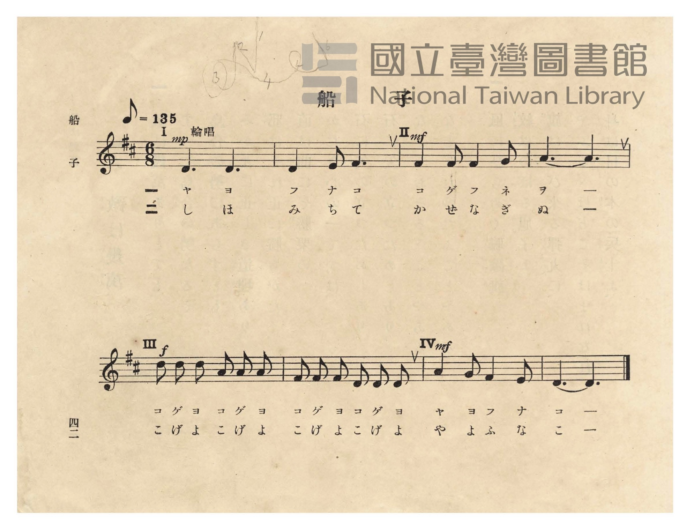
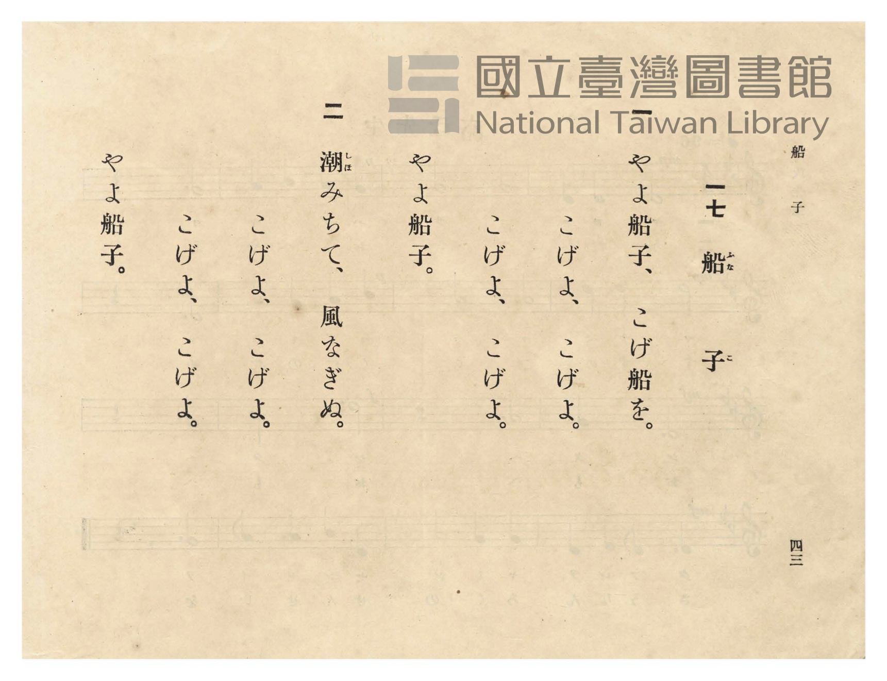

# 船子

> Re:Shōka 使用 AI 協助辨識與重建樂譜，可能會有錯誤。歡迎回報。

<audio controls src="funako.mp3"></audio>

- 臺灣總督府《公學校唱歌》第五學年用（昭和十一年一月，索書號 523.37 4322-4）

## 說明

原書資訊與歌詞全文（對應 P046.jpg–P047.jpg，原書 p. 42–43，第 17 首）：
調性與拍號：ニ長調（D 大調，2 個升記號）6/8 拍子（♪= 135，即 ♩.= 68），四部輪唱

## 歌詞

```text
一
やよ船子、こげ船を。
こげよ、こげよ。
こげよ、こげよ。
やよ船子。

二
潮（しほ）みちて、風なぎぬ。
いでや、いでや。
いでや、いでや。
船出せん。
```

## ABC

```abc
X:1
T:船子
M:6/8
L:1/16
Q:3/8=45
K:D
V:V1 name="Piano" snm="Pia"
[V:V1]
!mp! D6 D6 | D4 E2 F6 | !mf! F4 F2 F4 G2 | A6 A6 |
w: 1.~ヤ ヨ | フ ナ コ | コ ゲ フ ネ | ヲ ー
w: 2.~し ほ | み ち て | か ぜ な ぎ | ぬ ー
!f! d2 d2 d2 A2 A2 A2 | F2 F2 F2 D2 D2 D2 | !mf! A4 G2 F4 E2 | D6 D6 |
w: 1.~コ ゲ ヨ コ ゲ ヨ | コ ゲ ヨ コ ゲ ヨ | ヤ ヨ フ ナ | コ ー
w: 2.~い で や い で や | い で や い で や | ふ な で せ | ん ー
```

## TMD 檔案連結

- [主旋律 TMD 檔案](funako.tmd) [[在 TMD Studio 編輯](https://tmdlang.github.io/Tmd-TS/#tmd=s7IKdvYPcrWy4qpTUCpJTLdSSM7PyUlNLsnMz7PKzk9PzM7Ojy_OyM9OVIKrKMvPKc1NtUovSkxJjTdFiBfnlxYlp1oVJ2fk5-fEl6RWlCTl52ejy8cXJKanWgUYmJghZAqK8stS8xLzgLoLijLzSlJTwNoRClLLMlNSQdLFyYl58WWpRZlpmakpSE5KLSoGuRhqRUlRYl5xclFmAcgbCFX5RSUZ-UBnF2RUWmVkFpfkF2UmJ-bEZyfmIfmuJCMV6LncxKLMkszcVCUuLS2FFx07n66doKClxaVoq2BmwWVvq-DCZWOmb2EH0vWifdfzxsXPd-x9Pnfx011zHjd0PW1d83TtjmcLFj6dsvHZ2p7HDd3P16x5smsKUPDpzi3Pp6x4v6fj2Yy1Tyf1PO1tfLKjASgIJJ_N6Xi_p-f5lkXPZu94MXO-gqmRsZ6xuYKJsZGRrsn7PZ1KXFz6Wgq21AJcCgoKT_vmgyzb3P5iRdeLjnagW1-snPe0dcWzae1AJz7d0PusvVMBFFV6WQXpjxomA5nmICbQnRCtCgV6CiZGQBkTY5Db16xRMDRXeLlsGtC57_fMAlnxYtX-Zw3LQYZ39wJ9BRR93Nz9cup2oDjQCheFp0uWg5k9RgpPG7qf9gKdMgOsrhMYvgpATcCQByp8NHOVrYKhsSnI5t7NCo9mrtQDRQXYnp6ns2e_bF7xYs8qYHhzgSwFhiaIetzU8ripAxJ7jxsaHzdOftw4Cch93DTpcUMTWAVYCKgILg1mE5ZDMbkJYumuHhD1bO86oHsfN05_3Lgb6LzHjfsfNy583LgMaMrLRSseN6563Nj3uHEN3JKWx43LQcaBLIGzCcqBrG7f9bhx9uOmyVAhypMEFCho6XNxuZXmJWbnWwVkJublO9QY1FSDrFCwsdCyAzOwpUQFUCrf0fBiYY-ChonC0w39z9c36MCTjyYWDUCLQIbVKFTnFtQqGCroAiGErAHTRgrGUF51blotmGMMJk2AQqZgKQhZAzbHx7BG4XHzErDI4-YVUK2Pm6eC-V3AWNsMEwOzHjdtgsv2glVugurdg2yqEVCmcTpEpnE3zITG_WD-QiBeBhfrBovNAeJVYFYfWHQNmqn4Q3BXD1khCAwfwzgoMgXDGnBgGQNDEgShYQgKLxNwGBpBAxke5IgwBIYOJGxWoLDxyoDDHSwOD29YOGMP0RYgXg7KSShs_DJbwaG6CiwGYs0G2zEZzY5aLi5dOwVIClYAspS5AA)]
- [鋼琴伴奏 TMD 檔案](funako_piano.tmd) [[在 TMD Studio 編輯](https://tmdlang.github.io/Tmd-TS/#tmd=s7IKdvYPcrWy4tLSUnjRsfPp2gnv93S87N7zfMKWJ3u2PF3a_7yz4_2eTgUtLS5FWwUzCy57WwUXLhszfQs7rjoFpRftu543Ln6-Y-_zuYuf7przuKHraeuap2t3PFuw8OmUjc_W9jxu6H6-Zs2TXVOAgk93bnk-ZQXQ_Gcz1j6d1PO0t_HJjgagIJB8NgdoS8_zLYuezd7xYuZ8BVMjYz1jcwUTYyMjXROg_UpcXJ55JUX5VgGZiXn5QR4ONQY11VwKQGBjoWUHZtQoVOem1SoYxkGRKRjWKBiDoSEY1gBFdBVMgHxdBSMgzxBI64JJA4UarloUS3zwWRIP1mgaD6GBBkEYUApoDVQGuwqoZW6leYnZhLxUALQN7kqwQWC3g3wA4oGdA-KAPAnyGsSLQJshCsDm-BjWKDxuXgIWedy8Aqr1cfNUML9L4XHTZpgYmPW4aRNctheschNU7x5kU42AMo3TITKNu2EmNO4H8xcC8TK4WDdYbA4QrwKz-sCia9BMhXmacDSCvY0rLlG8DfQQxDsrUNh4ZcBBBRaHBxEsaLAHQgsQLweqANEINn6ZreCAWAUWA7Fmg-2YjGYHWjLBkSgJpkccfLgGYs3Bn66hDta1UwDnIwUgA-L4aB_DWGSeEZinzAUA)]

## 分析

```text
================================================================================
📊 TMD Song Profile: [ 船子 ]
================================================================================
⏱  Duration:       0:21 (21.2s), 8 measures total
🎼 Key & Tempo:    首調基準 D, != 68.0 BPM, <6/8>
   - 分析範圍：      由實際發聲的音符與和弦推測調性；播放脈絡另行呈現
🎤 人聲音域:    D4 (MIDI 62) – D5 (MIDI 74) [跨度: 12 個半音 / 1.0 個八度, 難度: easy]
   - 最低音:  D4 in [Funako #1 @ m.1, 0:00]
   - 最高音: D5 in [Funako #1 @ m.5, 0:10]
   - 適合: soprano, mezzo-soprano, contralto, tenor, baritone, bass
🏛  結構:      Funako (21.2s)
⚡ 編曲密度:        Peak 1 軌道同時演奏
🗝  調性診斷：       D 大調（純淨自然大調，未偵測到可信轉調）
   - 風格氣質:    純淨自然大調（陽光明朗、易唱易記，無明顯調外色彩）
   - 轉調歷程:    全曲維持單一推測調性（未偵測到可信轉調）
   - 核心骨幹音:  D, F#, A, E, G
   - 調性數值:    D 大調 [相關度: 0.90, 穩定度: High, 自然音純度: 100.0%]
   - 候選調性 (K-S): D 大調 (0.90), F# 小調 (0.61), D 小調 (0.54)
   - 五度圈歷程:   +2
   - 各段落調性細節:
     • [Funako #1]: D 大調 (r: 0.90, 自然音純度: 100.0%)

  [ 五度圈游移軌跡 ]
               C  
         F            G  
      Bb              [D ]*
      Eb               A  
         Ab           E  
            Db       B  
               F# 
     (* = active key center)

  [ 十二半音累積音高分佈 ]
     C  :                            0.0%
     C# :                            0.0%
     D  : ████████████████████████  41.7%
     D# :                            0.0%
     E  : ██                         4.2%
     F  :                            0.0%
     F# : ████████████████          27.1%
     G  : ██                         4.2%
     G# :                            0.0%
     A  : █████████████             22.9%
     A# :                            0.0%
     B  :                            0.0%
--------------------------------------------------------------------------------
Assignment 軌道音域：
  - Piano         : D4 – D5 (12 個半音 / 1.0 個八度, 29 個音符)
================================================================================
```


## 原書掃描頁






