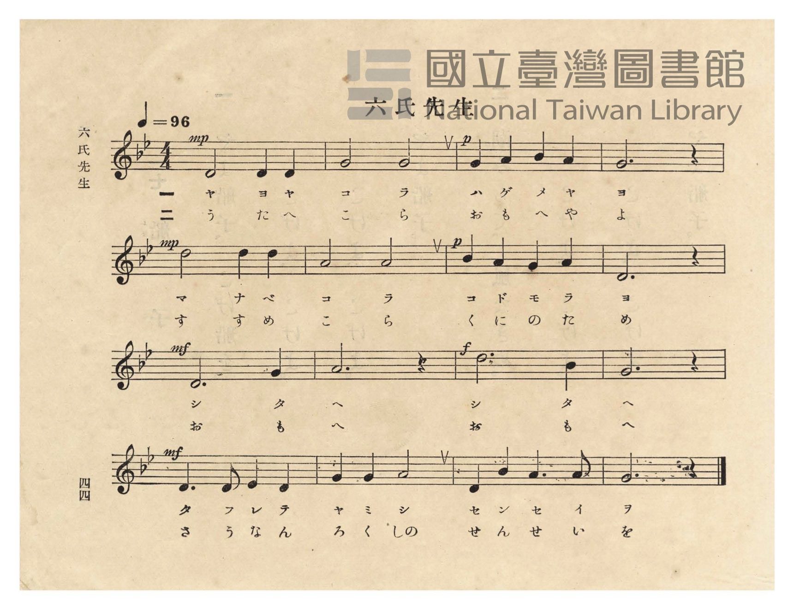
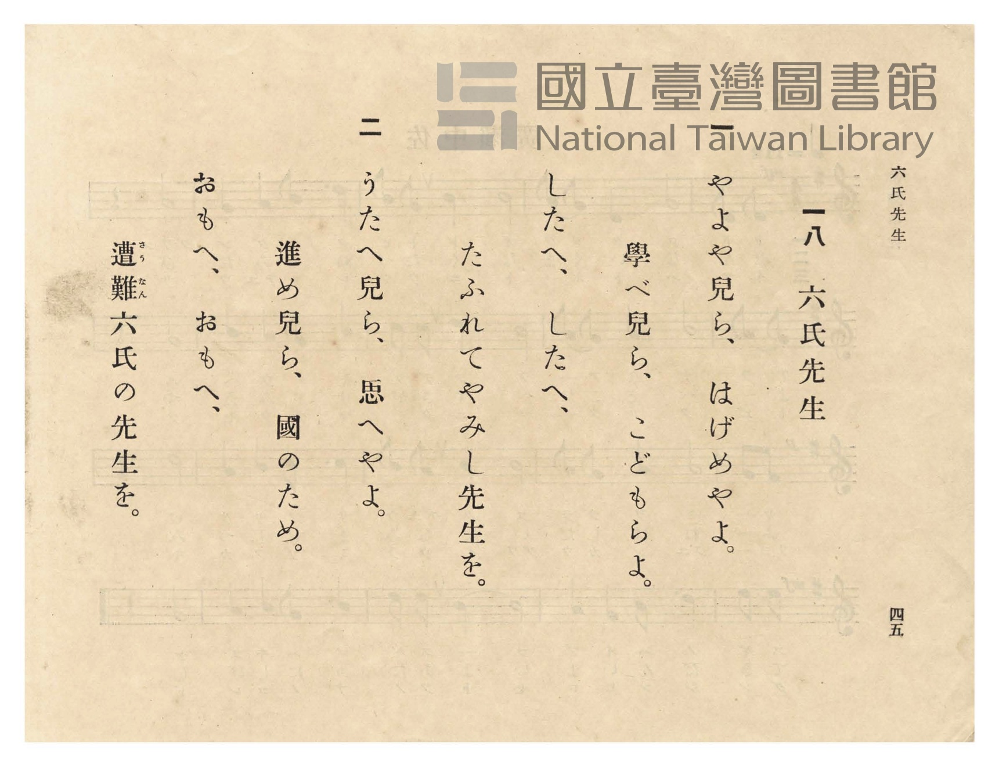

# 六氏先生

> Re:Shōka 使用 AI 協助辨識與重建樂譜，可能會有錯誤。歡迎回報。

<audio controls src="rokushi_sensei.mp3"></audio>

- 曲：宮島慎三郎
- 臺灣總督府《公學校唱歌》第五學年用（昭和十一年一月，索書號 523.37 4322-4）

## 說明

原書資訊與歌詞全文（對應 P048.jpg–P049.jpg，原書 p. 44–45，第 18 首）：
調性與拍號：ト短調（G 小調，2 個降記號）4/4 拍子，♩= 96
作曲：宮島慎三郎（據大正四年《公學校唱歌集》卷首〈緒言〉）

## 歌詞

```text
一
やよや子等（こら）、はげめやよ。
學べ子等、子供等よ。
したへ〳〵、
たふれてやみし先生を。

二
歌へ子等、思へやよ。
進め子等、國のため。
思へ〳〵、
遭難（さうなん）六氏の先生を。
```

## ABC

```abc
X:1
T:六氏先生
C:曲：宮島慎三郎
M:4/4
L:1/16
Q:1/4=96
K:Gm
V:V1 name="Piano" snm="Pia"
[V:V1]
!mp! D8 D4 D4 | G8 G8 | !p! G4 A4 B4 A4 | G12 z4 |
w: 1.~ヤ ヨ ヤ | コ ラ | ハ ゲ メ ヤ | ヨ
w: 2.~う た へ | こ ら | お も へ や | よ
!mp! d8 d4 d4 | A8 A8 | !p! B4 A4 G4 A4 | D12 z4 |
w: 1.~マ ナ ベ | コ ラ | コ ド モ ラ | ヨ
w: 2.~す す め | こ ら | く に の た | め
!mf! D12 G4 | A12 z4 | !f! d12 B4 | G12 z4 |
w: 1.~シ タ | ヘ | シ タ | ヘ
w: 2.~お も | へ | お も | へ
!mf! D6 D2 E4 D4 | G4 G4 A8 | D4 B4 A6 A2 | G12 z4 |
w: 1.~タ フ レ テ | ヤ ミ シ | セ ン セ イ | ヲ
w: 2.~さ う な ん | ろ く しの | せ ん せ い | を
```

## TMD 檔案連結

- [主旋律 TMD 檔案](rokushi_sensei.tmd) [[在 TMD Studio 編輯](https://tmdlang.github.io/Tmd-TS/#tmd=s7IKdvYPcrWy4qpTUCpJTLdSSM7PyUlNLsnMz7PKzk9PzM7Ojy_OyM9OVIKrKMvPKc1NtUovSkxJjTdFiBfnlxYlp1oVJ2fk5-fEl6RWlCTl52ejy8cXJKanWgUYmFggZAqK8stS8xLzgLoLijLzSlJTwNoRClLLMlNSQdLFyYl58WWpRZlpmakpSE5KLSoGuRhqRUlRYl5xclFmAcgbCFX5RSUZ-UBnF2RUWmVkFpfkF2UmJ-bEZyfmIfmuJCMV6DmIdCW6MNRvOZlpqQipotR0kN0liZnliUDbtLQUnraufbah_2lrx_Mp8xW0tLgUbRUszbjsbRWcdLiyUyttFdxzuWxM9E3sQGY8m73p_Z5ZT9ete7p527PWvic7Ol8294FNf9G-63nj4uc79j6fu_jprjmPG7qetq55unbHswULn07Z-Gxtz-OG7udr1jzZNQUo-HTnludTVrzf0_Fsxtqnk3qe9jY-2dEAFASSz-Z0vN_T83zLomezd7yYOV_B1MhYz9hcwcTYyEjX5P2eTiUuLn0tBVtqAS4FBYWnffNBlm1uf7Gi60VHO9CtL1bOe9q64tm0dqATn27ofdbeqQBKBHpZBemPGiYDmZYgJtCdEK0KBXoKJiZAGRNTkNvXrFEwtFB4uWwa0LnA0AJZ8WLV_mcNy0GGd_cCfQUUfdzc8Xz-WqA40Ap3hacb-sHMHiOFpw3dL2f2vlgxA6yuExjyCkBNT9dOAMo-mrkSHDtAE5_snYM1MkCBOnnW0yXLn61d_HT2bGCgYkbFy9ltwNh42rsd6MbHDR3Pt096saLhcQPQsZ1cYLN3NICox00tj5s6gCTQ8udrgbIdjxsnP24CKXvc0Pi4cf3jxkmPmxqhyhqawGG5dsfjxp0QDUBFQMaTfbNBbLiKx43THzfOf9y443HD5scNW4GKIKJAoa2Pm3oeNy4DGdi4H6gOkigfN00CaQU7bFcPiAKlpsYdcEueNcwFGYfsjJcNm4AuQzhjTvfjxnUgO4DOhaiAakJ2w8vGtS9nLwZ7c-rjxrbHjaseN00GehaSQ4AGoLgHqIHy5AcFClr6XFxB-dmlxRmZwal5xamZVgGZiXn5DjUGNdUgmxRsLLTswAxsiV8BlLF2NLxY2KOgYQJKS8_XN-jAU6wmFg1A-0CG1ShU5xbUKhjHK-iCIZgBJmoUzGCCcAZQNVAxmGsOIgxhDCTFIGgAEgKb72NYo_C4eQlU_HHzCjAJ4gPFmzbDxVfCbXjc3A8SadoEFl-IrB6sGwbB1kLsMALKNbbBzGqcDyZ3QPQ0ToaJN3Ui7GjsAos0wVUC0w7UTR0YduAP9V095Ic6LNChuAYSmCAIZ0CCHB7QiLCvQUQatiCfBw9asFebZ-ILcrDo42ZQAD1uXgSXJRTkIDMhQQ5iAXMW3iAHR2vjajC5DkyCIgpkO0gfKUG-o5O8IE9DSujwdI0U6PBwVKgGKUUSBYU__jTetB1J7nHTfmjwzUD3GvEqkQIaFIUIHaBUCxIFpVs0s4lViT-AgbUGpQEMpEzQixJE2oUkCbAcPGWDKQJhDAorUOKcCsRrwCxQroeVMI-bwTkfHr4gHbvB4uDkDWaD6CVgHaDyBVd4T4WoBJYpwCoArAeUpEHm9YLFIUkZWIuB0jHUqsbZcIUQNohuAWuahGFVLReXrp0CSnmvABRQ5gIA)]
- [鋼琴伴奏 TMD 檔案](rokushi_sensei_piano.tmd) [[在 TMD Studio 編輯](https://tmdlang.github.io/Tmd-TS/#tmd=s7IKdvYPcrWy4tLSUnjauvbZhv6nrR3Pp8x_v6fjZfee5xO2PNmz5enS_uedHe_3dCpoaXEp2ipYmnHZ2yo46XBlp1baKrjnctmY6JvYcdUpKD2bven9nllP1617unnbs9a-Jzs6Xzb3KYFkXrTvet64-PmOvc_nLn66a87jhq6nrWuert3xbMHCp1M2Plvb87ih-_maNU92TQEKPt255fmUFUAnPJux9umknqe9jU92NAAFgeSzOUCH9DzfsujZ7B0vZs5XMDUy1jM2VzAxNjLSNQE6UYmLyzOvpCjfKiAzMS8_yMOhxqCmmksBCGwstOzAjBqF6tyCWgXjeAVdIARSJiAWmFujYAaiwIQ5RB4kCJYzRIgBKahKGDQAqeOqRbHcB9lyE3TL4xWijeNzYxWMgCwQD2QgUMwMJAaVjQVbDWQaoggh1IFYBhB7g_KzS4szMoNT84pTM4n2PNTbyH4HQTgDqBqoGBEc8DDA6n2Q-T6GNQqPm5dAxR83rwCTID5QvGkzXHwl3IbHzf0gkaZNYPGFyOrBumEQbC3EDiOgXGMbzKzG-WByB0RP42SYeFMnwo7GLrBIE1zl46YWqJs6MOxACShYOEFxDSJdICUQUCjBwwYRXNCUgyuU5sFDA-y65pn4Qgks-rgZ5KfHzYvgsoRCCWQmJJRArMdNjXhDCRwTjavB5DowCQpbkO0gfThCKQ0pOcFTD1I4wb2uUA1SiiQKCjL8KalpO5Lc46b9UB_PQHcN8SqRwgYU6ggdoLQBEgWlDjSziVWJLUyoWb4gggXkPVASmArEa8AsUHaAZb3HzeAsAQ8SkI7dYHFwIgKzQfQSsA5QxsMVRFMhKoGZ7XHjKrAeUMIBmdcLFockmOmQ1AK1qnE2XCGEDaJbwJomYViFvejCUXQiSk0EC708hLAgoiBVhpjFK6zYhBiKXTu8vEUqeKFGwUxGU4QwEeE4nCYCFSNJAg0GlfG43Uj16kLXTgFcUykAGSjhH-0D1I0paAQWVOYCAA)]

## 分析

```text
================================================================================
📊 TMD Song Profile: [ 六氏先生 ]
================================================================================
⏱  Duration:       0:40 (40.0s), 16 measures total
🎼 Key & Tempo:    首調基準 B,, != 96.0 BPM, <4/4>
   - 分析範圍：      由實際發聲的音符與和弦推測調性；播放脈絡另行呈現
🎤 人聲音域:    D4 (MIDI 62) – D5 (MIDI 74) [跨度: 12 個半音 / 1.0 個八度, 難度: easy]
   - 最低音:  D4 in [RokushiSensei #1 @ m.1, 0:00]
   - 最高音: D5 in [RokushiSensei #1 @ m.5, 0:10]
   - 適合: soprano, mezzo-soprano, contralto, tenor, baritone, bass
🏛  結構:      RokushiSensei (40.0s)
⚡ 編曲密度:        Peak 1 軌道同時演奏
🗝  調性診斷：       D 大調（流行色彩大調，未偵測到可信轉調）
   - 風格氣質:    流行大調（略帶和弦色彩音與裝飾副屬和弦）
   - 轉調歷程:    全曲維持單一推測調性（未偵測到可信轉調）
   - 核心骨幹音:  D, G, A, A#, D#
   - 調性數值:    D 大調 [相關度: 0.78, 穩定度: Moderate, 自然音純度: 91.5%]
   - 候選調性 (K-S): D 大調 (0.78), G 大調 (0.70), G 小調 (0.68)
   - 五度圈歷程:   +2
   - 各段落調性細節:
     • [RokushiSensei #1]: D 大調 (r: 0.78, 自然音純度: 91.5%, 調外音: D#, A#)

  [ 五度圈游移軌跡 ]
               C  
         F            G  
      Bb              [D ]*
      Eb               A  
         Ab           E  
            Db       B  
               F# 
     (* = active key center)

  [ 十二半音累積音高分佈 ]
     C  :                            0.0%
     C# :                            0.0%
     D  : ████████████████████████  35.6%
     D# : █                          1.7%
     E  :                            0.0%
     F  :                            0.0%
     F# :                            0.0%
     G  : █████████████████████     30.5%
     G# :                            0.0%
     A  : █████████████████         25.4%
     A# : █████                      6.8%
     B  :                            0.0%
--------------------------------------------------------------------------------
Assignment 軌道音域：
  - Piano         : D4 – D5 (12 個半音 / 1.0 個八度, 38 個音符)
================================================================================
```


## 原書掃描頁






