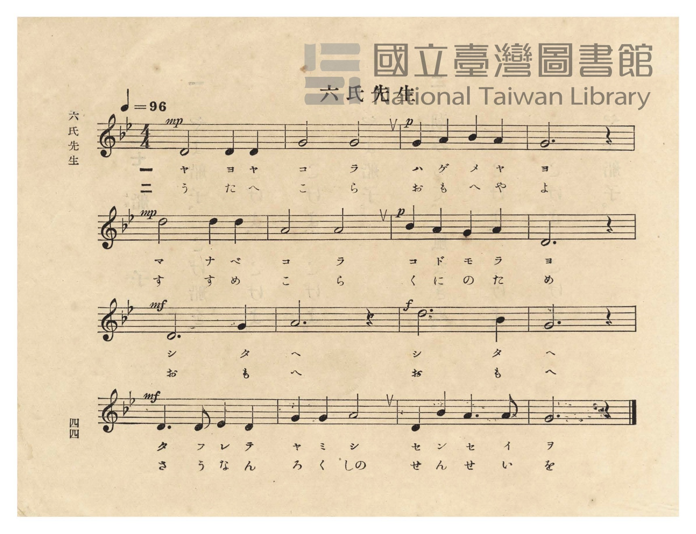
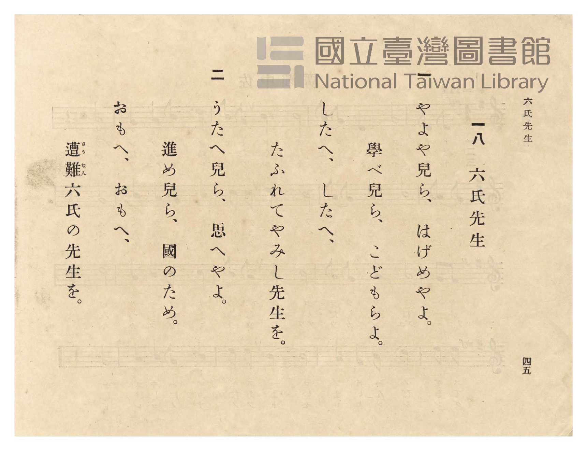

# 六氏先生

> Re:Shōka 使用 AI 協助辨識與重建樂譜，可能會有錯誤。歡迎[回報](https://github.com/TMDLang/reshoka/issues)。

- **鋼琴伴奏版**：<br><audio controls src="rokushi_sensei.mp3"></audio>
- **NEUTRINO 歌聲合成版**：<br><audio controls src="rokushi_sensei_neutrino.mp3"></audio>

- 曲：宮島慎三郎
- 臺灣總督府《公學校唱歌》第五學年用（昭和十一年一月，索書號 523.37 4322-4）

## 說明

原書資訊與歌詞全文（對應 P048.jpg–P049.jpg，原書 p. 44–45，第 18 首）：
調性與拍號：ト短調（G 小調，2 個降記號）4/4 拍子，♩= 96
作曲：宮島慎三郎（據大正四年《公學校唱歌集》卷首〈緒言〉）


## 歌詞

```text
一
やよや子等（こら）、はげめやよ。
學べ子等、子供等よ。
したへ〳〵、
たふれてやみし先生を。

二
歌へ子等、思へやよ。
進め子等、國のため。
思へ〳〵、
遭難（さうなん）六氏の先生を。
```

## ABC

<div class="abc-score" data-abc-src="rokushi_sensei.abc" aria-label="五線譜載入中"></div>

[下載 ABC 原始檔](rokushi_sensei.abc)

## TMD 檔案連結

- [主旋律 TMD 檔案](rokushi_sensei.tmd) [[在 TMD Studio 編輯](https://tmdlang.github.io/Tmd-TS/#tmd=s7IKdvYPcrWy4qpTUCpJTLdSSM7PyUlNLsnMz7PKzk9PzM7Ojy_OyM9OVIKrKMvPKc1NtUovSkxJjTdFiBfnlxYlp1oVJ2fk5-fEl6RWlCTl52ejy8cXJKanWgUYmFggZAqK8stS8xLzgLoLijLzSlJTwNoRClLLMlNSQdLFyYl58WWpRZlpmakpSE5KLSoGuRhqRUlRYl5xclFmAcgbCFX5RSUZ-UBnF2RUWmVkFpfkF2UmJ-bEZyfmIfmuJCMV6DmIdCW6MNRvOZlpqQipotR0kN0liZnliSi2ZaZnwoTj89PSMpMzE3OUuLS0FJ62rn22of9pa8fzKfMVtLS4FG0VLM247G0VnHS4slMrbRXcc7lsTPRN7ECGPZu96f2eWU_XrXu6eduz1r4nOzpfNveBrXnRvut54-LnO_Y-n7v46a45jxu6nrauebp2x7MFC59O2fhsbc_jhu7na9Y82TUFKPh055bnU1a839PxbMbap5N6nvY2PtnRABQEks_mdLzf0_N8y6Jns3e8mDlfwdTIWM_YXMHE2MhI1-T9nk4lLi59LQVbagEuBQWFp33zQZZtbn-xoutFRzvQrS9WznvauuLZtHagE59u6H3W3qkASiR6WQXpjxomA5mWICbQnRCtCgV6CiYmQBkTU5Db16xRMLRQeLlsGtC5wNACWfFi1f5nDctBhnf3An0FFH3c3PF8_lqgONAKd4WnG_rBzB4jhacN3S9n9r5YMQOsrhMY8gpATU_XTgDKPpq5Ehw7QBOf7J2DNTJAgTp51tMly5-tXfx09mxgoGJGxcvZbcDYeNq7HejGxw0dz7dPerGi4XED0LGdXGCzdzSAqMdNLY-bOoAk0PLna4GyHY8bJz9uAil73ND4uHH948ZJj5saocoamsBhuXbH48adEA1ARUDGk32zQWy4iseN0x83zn_cuONxw-bHDVuBiiCiQKGtj5t6HjcuAxnYuB-oDpIoHzdNAmkFO2xXD4gCpabGHXBLnjXMBRmH7IyXDZuALkM4Y07348Z1IDuAzoWogGpCdsPLxrUvZy8Ge3Pq48a2x42rHjdNBnoWkkOABqC4B6iB8uQHBQpa-lxcQfnZpcUZmcGpecWpmVYBmYl5-Q41BjXVIJsUbCy07MAMbIlfAZSxdjS8WNijoGECSkvP1zfowFOsJhYNQPtAhtUoVOcW1CoYxyvogiGYASZqFMxggnAGUDVQMZhrDiIMYQwkxSBoABICm-9jWKPwuHkJVPxx8wowCeIDxZs2w8VXwm143NwPEmnaBBZfiKwerBsGwdZC7DACyjW2wcxqnA8md0D0NE6GiTd1Iuxo7AKLNMFVAtMO1E0dGHbgD_VdPeSHOizQobgGEpggCGdAghwe0Iiwr0FEGrYgnwcPWrBXm2fiC3Kw6ONmUAA9bl4ElyUU5CAzIUEOYgFzFt4gB0dr42owuQ5MgiIKZDtIHylBvqOTvCBPQ0ro8HSNFOjwcFSoBilFEgWFP_403rQdSe5x035o8M1A9xrxKpECGhSFCB2gVAsSBaVbNLOJVYk_gIG1BqUBDKRM0IsSRNqFJAmwHDxlgykCYQwKK1DinArEa8AsUK6HlTCPm8E5Hx6-IB27weLg5A1mg-glYB2g8gVXeE-FqASWKcAqAKwHlKRB5vWCxSFJGViLgdIx1KrG2XCFEDaIbgFrmoRhVS0Xl66dAkp5rwAUUOYCAA)]
- [鋼琴伴奏 TMD 檔案](rokushi_sensei_piano.tmd) [[在 TMD Studio 編輯](https://tmdlang.github.io/Tmd-TS/#tmd=s7IKdvYPcrWy4qpTUCpJTLdSSM7PyUlNLsnMz7PKzk9PzM7Ojy_OyM9OVIKrKMvPKc1NtTJFiBTnlxYlp-JSD5GNL0hMT7UKMDCx0AUSlgjpgqL8stS8xDygASWJmeWJefHpQIGivPyi-PTUvNSixByE2tSyzJRUkMqCoszcxKLK-JT8ZKBb8kqQXJdaVAxyfEFmYl5-fGJRUWJeeiqqkvyikoz89KLEgoxKq4zM4pL8oszkxJz47MQ8JFeXZAB1WaWmlCYnggJDiUtLS-Fp69pnG_qftnY8nzL__Z6Ol917nk_Y8mTPlqdL-593drzf06mgpcWlaKtgacZlb6vgpMOVnVppq-Cey2Vjom9iBzL62exN7_fMerpu3dPN25619j3Z0fmyuQ9s6Yv2Xc8bFz_fsff53MVPd8153ND1tHXN07U7ni1Y-HTKxmdrex43dD9fs-bJrilAwac7tzyfsgLohGcz1j6d1PO0t_HJjgagIJB8NgfokJ7nWxY9m73jxcz5CqZGxnrG5gomxkZGuiZAJypxcXnmlRTlWwWAAijIw6HGoKaaSwEIbCy07MCMGoXq3IJaBeN4BV0gBFImIBaYW6NgBqLAhDlEHiQIljNEiAEpqEoYNACp46pFsdwH2XITdMvjFaKN43NjFYyALBAPZCBQzAwkBpWNBVsNZBqiCCHUgVgGEHuD8rNLizMyg1PzilMzifY81NvIfgdBOAOoGqgYERzwMMDqfZD5PoY1Co-bl0DFHzevAJMgPlC8aTNcfCXchsfN_SCRpk1g8YXI6sG6YRBsLcQOI6BcYxvMrMb5YHIHRE_jZJh4UyfCjsYusEgTXOXjphaomzow7EAJKFg4QXENIl0gJRBQKMHDBhFc0JSDK5TmwUMD7LrmmfhCCSz6uBnkp8fNi-CyhEIJZCYklECsx02NeEMJHBONq8HkOjAJCluQ7SB9OEIpDSk5wVMPUjjBva5QDVKKJAoKMvwpqWk7ktzjpv1QH89Adw3xKpHCBhTqCB2gtAESBaUONLOJVYktTKhZviCCBeQ9UBKYCsRrwCxQdoBlvcfN4CwBDxKQjt1gcXAiArNB9BKwDlDGwxVEUyEqgZntceMqsB5QwgGZ1wsWhySY6ZDUArWqcTZcIYQNolvAmiZhWIW96MJRdCJKTQQLvTyEsCCiIFWGmMUrrNiEGIpdO7y8RSp4oUbBTEZThDAR4TicJgIVI0kCDQaV8bjdSPXqQtdOAVxTKQAZKOEf7QPUjSloBBZU5gIA)]

## 分析

```text
================================================================================
📊 TMD Song Profile: [ 六氏先生 ]
================================================================================
⏱  Duration:       0:40 (40.0s), 16 measures total
🎼 Key & Tempo:    首調基準 B,, != 96.0 BPM, <4/4>
   - 分析範圍：      由實際發聲的音符與和弦推測調性；播放脈絡另行呈現
🎤 人聲音域:    D4 (MIDI 62) – D5 (MIDI 74) [跨度: 12 個半音 / 1.0 個八度, 難度: easy]
   - 最低音:  D4 in [RokushiSensei #1 @ m.1, 0:00]
   - 最高音: D5 in [RokushiSensei #1 @ m.5, 0:10]
   - 適合: soprano, mezzo-soprano, contralto, tenor, baritone, bass
🏛  結構:      RokushiSensei (40.0s)
⚡ 編曲密度:        Peak 1 軌道同時演奏
🗝  調性診斷：       D 大調（流行色彩大調，未偵測到可信轉調）
   - 風格氣質:    流行大調（略帶和弦色彩音與裝飾副屬和弦）
   - 轉調歷程:    全曲維持單一推測調性（未偵測到可信轉調）
   - 核心骨幹音:  D, G, A, A#, D#
   - 調性數值:    D 大調 [相關度: 0.78, 穩定度: Moderate, 自然音純度: 91.5%]
   - 候選調性 (K-S): D 大調 (0.78), G 大調 (0.70), G 小調 (0.68)
   - 五度圈歷程:   +2
   - 各段落調性細節:
     • [RokushiSensei #1]: D 大調 (r: 0.78, 自然音純度: 91.5%, 調外音: D#, A#)

  [ 五度圈游移軌跡 ]
               C  
         F            G  
      Bb              [D ]*
      Eb               A  
         Ab           E  
            Db       B  
               F# 
     (* = active key center)

  [ 十二半音累積音高分佈 ]
     C  :                            0.0%
     C# :                            0.0%
     D  : ████████████████████████  35.6%
     D# : █                          1.7%
     E  :                            0.0%
     F  :                            0.0%
     F# :                            0.0%
     G  : █████████████████████     30.5%
     G# :                            0.0%
     A  : █████████████████         25.4%
     A# : █████                      6.8%
     B  :                            0.0%
--------------------------------------------------------------------------------
Assignment 軌道音域：
  - Piano         : D4 – D5 (12 個半音 / 1.0 個八度, 38 個音符)
================================================================================
```


## 原書掃描頁






