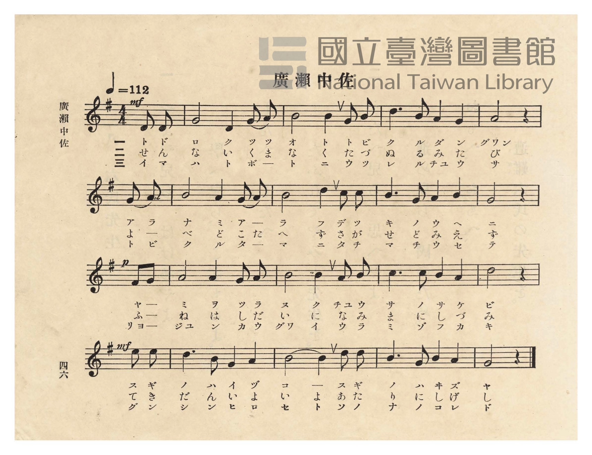
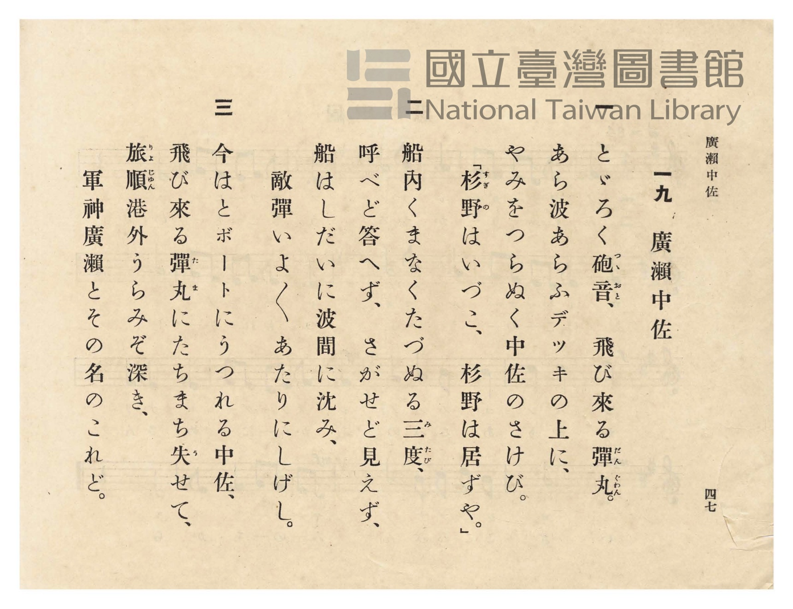

# 廣瀨中佐

> Re:Shōka 使用 AI 協助辨識與重建樂譜，可能會有錯誤。歡迎回報。

- **NEUTRINO 歌聲合成版**：<br><audio controls src="hirose_chusa_neutrino.mp3"></audio>
- **鋼琴伴奏版**：<br><audio controls src="hirose_chusa.mp3"></audio>


- 詞：文部省
- 曲：文部省
- 臺灣總督府《公學校唱歌》第五學年用（昭和十一年一月，索書號 523.37 4322-4）

## 說明

原書資訊與歌詞全文（對應 P050.jpg–P051.jpg，原書 p. 46–47，第 19 首）：
調性與拍號：ト長調（G 大調，1 個升記號）4/4 拍子（弱起 1 拍），♩= 112


## 歌詞

```text
一
とどろくつゝ音（おと）、飛び來る彈丸（だんぐゎん）。
荒浪（あらなみ）あらふデッキの上に、
やみを貫（つらぬ）く中佐のさけび。
「杉野はいづこ、杉野は居ずや。」

二
船內（せんない）くまなくたづぬる三度（みたび）、
呼べどこたへず、さがせど見えず。
船はしだいに浪間（なみま）にしづみ、
敵彈（てきだん）いよ〳〵あたりにしげし。

三
今はとボートにうつれる中佐、
飛び來る丸（たま）にたちまちうせぬ。
旅順港外（りょじゅんこうぐゎい）うらみぞ深き、
軍神廣瀨のその名とともに。
```

## ABC

```abc
X:1
T:廣瀨中佐
C:曲：文部省
M:4/4
L:1/16
Q:1/4=112
K:G
V:V1 name="Piano" snm="Pia"
[V:V1]
!mf! z12 D2 D2 | G8 D4 G2 A2 | B8 B4 G2 B2 | d6 B2 A4 G4 |
w: 1.~ト ド | ロ ク ツ ツ | オ ト ト ビ | ク ル ダ ン
w: 2.~せ ん | な い く ま | な く た づ | ぬ る み た
w: 3.~イ マ | ハ ト ボ ー | ト ニ ウ ツ | レ ル チュ ウ
A8 z4 G2 A2 | B8 A4 G2 A2 | B8 d4 c2 c2 | B6 G2 A4 B4 |
w: 1.~グヮン ア ラ | ナ ミ ア ラ | フ ー デ ッ | キ ノ ウ ヘ
w: 2.~び よ べ | ど こ た へ | ず ー さ が | せ ど み え
w: 3.~サ ト ビ | ク ル タ マ | ニ ー タ チ | マ チ ウ セ
!p! G8 z4 F2 G2 | A8 A4 G2 A2 | B8 B4 A2 B2 | c6 c2 B4 A4 |
w: 1.~ニ ヤ ミ | ヲ ツ ラ ヌ | ク ー チュ ウ | サ ノ サ ケ
w: 2.~ず ふ ね | は し だ い | に ー な み | ま に し づ
w: 3.~ヌ リョ ジュン | コ ウ グヮ イ | ー ー ウ ラ | ミ ゾ フ カ
!mf! d8 z4 e2 e2 | d6 B2 G4 A4 | B8 B4 d2 d2 | B6 G2 B4 A4 |
w: 1.~ビ ス ギ | ノ ハ イ ヅ | コ ー ス ギ | ノ ハ ヰ ズ
w: 2.~み て き | だ ん い よ | い よ あ た | り に し げ
w: 3.~キ グ ン | シ ン ヒ ロ | セ ノ ソ ノ | ナ ト ト モ
G8 z4 z4 |
w: 1.~ヤ
w: 2.~し
w: 3.~ニ
```

## TMD 檔案連結

- [主旋律 TMD 檔案](hirose_chusa.tmd) [[在 TMD Studio 編輯](https://tmdlang.github.io/Tmd-TS/#tmd=s7IKdvYPcrWy4qpTUCpJTLdSSM7PyUlNLsnMz7PKzk9PzM7Ojy_OyM9OVIKrKMvPKc1NtUovSkxJjTdFiBfnlxYlp1oVJ2fk5-fEl6RWlCTl52ejy8cXJKanWgUYmBogZAqK8stS8xLzgLoLijLzSlJTwNoRClLLMlNSQdLFyYl58WWpRZlpmakpSE5KLSoGuRhqRUlRYl5xclFmAcgbCFX5RSUZ-UBnF2RUWmVkFpfkF2UmJ-bEZyfmIfmuJCMV6LnczJzMksSiSnRxiDagsJaWwtPdi583rHiyY-2TvRMUtLS4FG0VDA2NuOxtFdy5bEz0TexAel-snPd-z6xn09pfNq94PqcRbN6z2ZswxF6073reuPj5jr3P5y5-umvO44aup61rnq7d8WzBwqdTNj5b2_O4ofv5mjVPdk0BCj7dueX5lBXv93Q8m7H26aSep72NT3Y0AAWB5LM5He_39DzfsujZ7B0vZs5XMDUy1jM2VzAxNjLSNXm_p1OJi0tfS8GWWoBLQUHhad98kGWb21-s6HrR0Q50K9DTT1tXAD0IdOLTDb3P2jsVQBGul1WQ_qhhMpBpCGIC3QnRqlCgp2BiBpQxMQe5fc0aBUNLhZfLpgGdCwwnkBUvVu1_1rAcZHh3L9BXQNHHzR0vp24HigOtcFd4umQ5mNljqPC0oftpL9ApM8DqOoHxoADU9HTtBJBb9mx8sXW7giFIBGx4z6OZKyGxBrIFGHwg6nHjiseNKx839T5u7H_cuORx09yX8zcDdT9u7AJKAfU9bmh8uXj248bNT_a1PW7qfrq348mOHWAFCx43TX7cOOFxUx-QAVbZBHZ-76RnW1eBVTQ9bup83LjqcSPQtUAGhLv1cXP74-bmx01rHzeue7IDaM1qoB1gtzS1AJU-bpr0YtNqsH6gc4Aa1oA190PSHlDP48apjxsnAl0EtfBxQ8-zuZ0v2_seN65_3Ag0YunjxslAI-GCTze2Pm6cBTK9oelxQy_E-7t6wI7t2Pm0dTnYstlg7wAd2wKx73HjPjAXyJgPNnMN0PtPdnQ-3bUMrH4_WBwYVqAgAieNiXseN-4EhSbQepDcDpCtDY1g9_aALGhc-WJZ9-NGoGagOCSwOoAagK6eDgpOkNtXA8Pu5TRgcAIVgQIO6Aqwc1aD1QBdsR9q27OpW4FxAVa37HEjMPpA0QFW2vK4qeNxAzB0toKCHOiQJnAYg_RPApFAmyEJoBNM7QbKAl2w4nHznMfNe4BJDay4DRz6PWAvg8MdYityUoClA6BP4W4EsheCAw5IAo0AKl4D9emz6a0vF7Q927H-6RJgWu8AOaqp_XHjjMdNreCAByKgBnBqgsYA0A4gCQyBec-2bwR5EeKEF7t7ny-dBymPwKlhLpB8OgEYAkDuisdNQC8DExTYTsqzPBQoaOlzcXlkFuUXpzpnlBYnWgVkJublO9QY1FSD7FGwsdCyAzOwFTcKoKJsR8OLhT0KGtBMqa1govB0Q__z9Q068MJCE4tOoLUgU2sUDBR04bA6N61WwTQehGqA2RsiCOToAjlGQCFjqBCINgSSNQqmUL4RWEQXKAJigSDIXLAusD0-hjUKIHNgEJgYgLgTqP5x81qYWNN6sEwLGANlmlYhqYbpmQyWAakEiawG4gYwazPY9sdNGx43r4PwQBBk5-OmRUD5lTCXGKG5pHE2UAXY1Ea4fY0tYLIfiPehyfSDyflAvBQsswbq9m4gez9UDuySRlQ3AN3euBPmBmM0NzQtAbpwHjg0QOYj-3kOEO8By4D4EJlusJ5lsHBqhroBHBqNj5uXQqUhAbIV2RmwIATnU9xpalcPOE2RmJRgyQOSGJATDCiZmAAhTAQkC0lGiHQGSjDVBbUK5vFAIUSqedzcBfc3KGThsQkkp8Jl9oDJdiBuBnsakqYeN_dBA-Jx8wxIcIDDDhEcoHCfj5QygAUpzMzGydDYBBa34PichWpb41Qg7gHLzIbqWAlPA6C4QtYDtq1xKxCvRUoDsHQMiTuQ3_bD0wHMnVDbwDKNYJl5UPFGmN-adkP91oPit1WPm5cDJXcAEwQoQxCK8x2d5MQ5LLtjxjmINgIXEiZgvglUBORUSLEBjXNQoWMGhMhxvgnue3BOBMY3yHeoIQaJc3B6BwUEIq1Doh3Efty0ERo0oMhEZMadQLwOJdrhxjZOB5MLwIUASAYUMcjRvgocySCZfVAdwGwH1QXKeSAZUCJARDswozb2okQ7rGiARSCo0AKXAiCngqxBjnlQPoekd1D6B4nsg6b9x00gxyHSO8x7G8DlIYEIfzp7NjkRDivxQdkWEpnIEW4KhIhMjohw5EwOwshx3Qf1LbC0BYYAiNUK9RU8mKAhAY02VD3NG8ByuyB6gDkaERIgjBzJC6DhNxlWwgNLZUiEgXgQOXCp29gEzvkgN0BKH-RIngTVA-JhsQkcwduh7tsMxCD1kFoOJAPKq7BECrJvL5iFKOcgRTSk7F8E9RNymQWxqZaLS9dOAandoADkKnMBAA)]
- [鋼琴伴奏 TMD 檔案](hirose_chusa_piano.tmd) [[在 TMD Studio 編輯](https://tmdlang.github.io/Tmd-TS/#tmd=s7IKdvYPcrWy4tLSUni6e_HzhhVPdqx9snfC-z0dL7v3PJ-w5cmeLU-X9j_v7Hi_p1NBS4tL0VbB0NCIy95WwZ3LxkTfxI6rTkHpxcp57_fMejat_WXziudzGpVAYs9mb8IQe9G-63nj4uc79j6fu_jprjmPG7qetq55unbHswULn07Z-Gxtz-OG7udr1jzZNQUo-HTnludTVgAd8mzG2qeTep72Nj7Z0QAUBJLP5gCd0_N8y6Jns3e8mDlfwdTIWM_YXMHE2MhI1wToUCUuLs-8kqJ8q4DMxLz8IA-HGoOaai4FILCx0LIDM2oUqnPTahVMFXSB0FjBEEgaAXENkA0SAYnpAmVN4SKGYBqiBqQaBA2guIarFsVGH2QbTVBtNIxXiDaMBVGm8fEgs-B8EAXngySjTeORRAyAEGyRR2ZRfnGqc0ZpcSJeD4JcBoMQz4LsRHI-kAPylxGar0E-rYGHDMjHIA01YBbM12BdYHt8DGsUQObA4OPmDiDuBKp_3LwWJta0HizTAsZAmaZVSKpheiaDZUAqQSKrgbgBzNoMtv1x04bHzesgPBAE2fm4aRFQfiXMJUZoLmmcDVQBNrURbl9jC5jsB-J9aDL9YHI-EC8Fy6yBur0byN4PlQO7pBHVDUC3N-6EucEYzQ1NS4AunAcODZD5yH6eA8R7wDIgPkSmG6xnGSycmqFuAIdG4-PmpVBpSIBsRXYGLAi5oLEPi1FI_CHHMShmTYAQkbJBakBs1JRdXVCrYB4PFEJE9OPmLrhTQYEBjwAgORUuswdMtgNxM9idkGTwuLkP6vbHzTMgPgB7F-EDUFDNR4rMx40rYWY2ToZGwOPGHeAomIVqW-NUIO4By8yG6lgJjzZQ8CLrAdvWuBWI1yJFGyzpQYIb5Lf98KiDuRNqG1imESwzDyreCPNb026o33pQ_LbqcfNyoOQOYByC0jA8mmCZCjOaIMUNKCuagPkmSAUQJHNCowmUtc2AEDmaNsEdDE7vwCgCOQjVk5BoAqcqkNsRKQoSUyD246aNUN-Awh-R5HcC8TqUmIIb2zgdTC4AZzWQDCgskWNqFTheQDL7oDqAiRuqC5S-QTKgeEPEFDA7NPaixBQsA8LCHFQ0gPMayKkga5AjC5SbIEkUlGRBIvugyfVxE8hxiCQK894GcKkDjyNqVRKI6OmDOhBYDAEdDWK1Qh0C9xnU8dCQRtXTvAEstwuiB5hvEI4HYeR4WQD18mRY0QcsriBhDOJB5MDFUWMTOH-B3ADJ48jxMgmqB8TDYhM4TrZD3bcZiEHqIcU_SAaUI2DpCmTfXjALUZpAyi5IobgI6ifkkgFiE7aaD0dFC6oqwdUlrtoVW20LZAKjGlbtQmpbiHE4q2QgZYJUh-Oqs6GpCCaL1RyIc4CmRZtgNg6wOIaC9oOunQK4raIAZCCFaLQPUBG6kBGmkDFYSJkLAA)]

## 分析

```text
================================================================================
📊 TMD Song Profile: [ 廣瀨中佐 ]
================================================================================
⏱  Duration:       0:36 (36.4s), 17 measures total
🎼 Key & Tempo:    首調基準 G, != 112.0 BPM, <4/4>
   - 分析範圍：      由實際發聲的音符與和弦推測調性；播放脈絡另行呈現
🎤 人聲音域:    D4 (MIDI 62) – E5 (MIDI 76) [跨度: 14 個半音 / 1.2 個八度, 難度: moderate]
   - 最低音:  D4 in [HiroseChusa #1 @ m.1, 0:01]
   - 最高音: E5 in [HiroseChusa #1 @ m.13, 0:27]
   - 適合: soprano, mezzo-soprano, contralto, tenor, baritone, bass
🏛  結構:      HiroseChusa (36.4s)
⚡ 編曲密度:        Peak 1 軌道同時演奏
🗝  調性診斷：       B 調性不明確（純淨自然大調，未偵測到可信轉調）
   - 風格氣質:    純淨自然大調（陽光明朗、易唱易記，無明顯調外色彩）
   - 轉調歷程:    全曲維持單一推測調性（未偵測到可信轉調）
   - 核心骨幹音:  B, A, G, D, C
   - 調性數值:    B 調性不明確 [相關度: 0.69, 穩定度: Ambiguous, 自然音純度: 95.0%]
   - 候選調性 (K-S): B 小調 (0.69), G 大調 (0.68), D 大調 (0.55)
   - 五度圈歷程:   +5
   - 各段落調性細節:
     • [HiroseChusa #1]: B 調性不明確 (r: 0.69, 自然音純度: 95.0%, 調外音: C)

  [ 五度圈游移軌跡 ]
               C  
         F            G  
      Bb               D  
      Eb               A  
         Ab           E  
            Db      [B ]*
               F# 
     (* = active key center)

  [ 十二半音累積音高分佈 ]
     C  : ███                        5.0%
     C# :                            0.0%
     D  : ██████████                15.0%
     D# :                            0.0%
     E  : █                          1.7%
     F  :                            0.0%
     F# : █                          0.8%
     G  : ██████████████            20.0%
     G# :                            0.0%
     A  : ███████████████           22.5%
     A# :                            0.0%
     B  : ████████████████████████  35.0%
--------------------------------------------------------------------------------
Assignment 軌道音域：
  - Piano         : D4 – E5 (14 個半音 / 1.2 個八度, 60 個音符)
================================================================================
```


## 原書掃描頁






