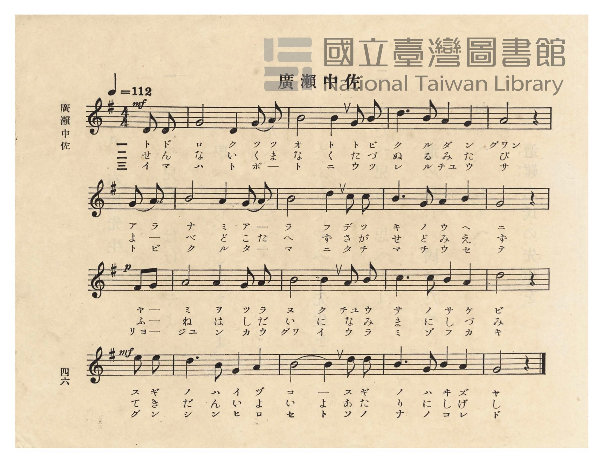
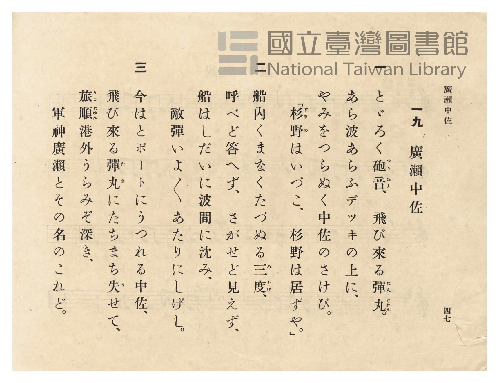

# 廣瀨中佐

> Re:Shōka 使用 AI 協助辨識與重建樂譜，可能會有錯誤。歡迎[回報](https://github.com/TMDLang/reshoka/issues)。

- **鋼琴伴奏版**：<br><audio controls src="hirose_chusa.mp3"></audio>
- **NEUTRINO 歌聲合成版**：<br><audio controls src="hirose_chusa_neutrino.mp3"></audio>

- 詞：文部省
- 曲：文部省
- 臺灣總督府《公學校唱歌》第五學年用（昭和十一年一月，索書號 523.37 4322-4）

## 說明

原書資訊與歌詞全文（對應 P050.jpg–P051.jpg，原書 p. 46–47，第 19 首）：
調性與拍號：ト長調（G 大調，1 個升記號）4/4 拍子（弱起 1 拍），♩= 112


## 歌詞

```text
一
とどろくつゝ音（おと）、飛び來る彈丸（だんぐゎん）。
荒浪（あらなみ）あらふデッキの上に、
やみを貫（つらぬ）く中佐のさけび。
「杉野はいづこ、杉野は居ずや。」

二
船內（せんない）くまなくたづぬる三度（みたび）、
呼べどこたへず、さがせど見えず。
船はしだいに浪間（なみま）にしづみ、
敵彈（てきだん）いよ〳〵あたりにしげし。

三
今はとボートにうつれる中佐、
飛び來る丸（たま）にたちまちうせぬ。
旅順港外（りょじゅんこうぐゎい）うらみぞ深き、
軍神廣瀨のその名とともに。
```

## ABC

<div class="abc-score" data-abc-src="hirose_chusa.abc" aria-label="五線譜載入中"></div>

[下載 ABC 原始檔](hirose_chusa.abc)

## TMD 檔案連結

- [主旋律 TMD 檔案](hirose_chusa.tmd) [[在 TMD Studio 編輯](https://tmdlang.github.io/Tmd-TS/#tmd=s7IKdvYPcrWy4qpTUCpJTLdSSM7PyUlNLsnMz7PKzk9PzM7Ojy_OyM9OVIKrKMvPKc1NtUovSkxJjTdFiBfnlxYlp1oVJ2fk5-fEl6RWlCTl52ejy8cXJKanWgUYmBogZAqK8stS8xLzgLoLijLzSlJTwNoRClLLMlNSQdLFyYl58WWpRZlpmakpSE5KLSoGuRhqRUlRYl5xclFmAcgbCFX5RSUZ-UBnF2RUWmVkFpfkF2UmJ-bEZyfmIfmuJCMV6LnczJzMksSiSnRxiDYkYaAZ6Zl5Vrn5eUmlwHBS4tLSUni6e_HzhhVPdqx9sneCgpYWl6KtgqGhEZe9rYI7l42JvokdSPeLlfPe75n1bFr7y-YVz-c0gk18NnsThtiL9l3PGxc_37H3-dzFT3fNedzQ9bR1zdO1O54tWPh0ysZna3seN3Q_X7Pmya4pQMGnO7c8n7Li_Z6OZzPWPp3U87S38cmOBqAgkHw2p-P9np7nWxY9m73jxcz5CqZGxnrG5gomxkZGuibv93QqcXHpaynYUgtwKSgoPO2bD7Jsc_uLFV0vOtqBbgV6-mnrCqAHgU58uqH3WXunAigl6GUVpD9qmAxkGoKYQHdCtCoU6CmYmAFlTMxBbl-zRsHQUuHlsmlA5wLDCWTFi1X7nzUsBxne3Qv0FVD0cXPHy6nbgeJAK9wVni5ZDmb2GCo8beh-2gt0ygywuk5gPCgANT1dOwHklj0bX2zdrmAIEgEb3vNo5kpIrIFsAQYfiHrcuOJx48rHTb2PG_sfNy553DT35fzNQN2PG7uAUkB9jxsaXy6e_bhx85N9bY-bup_u7XiyYwdYwYLHTZMfN0543NQHZIBVNoGd3zvp2dZVYBVNj5s6HzeuetwIdC2QAeFufdzc_ri5-XHT2seN657sAFqzGmgH2C1NLUClj5smvdi0Gqwf6ByghjVgzf2QtAfU87hx6uPGiUAXQS183NDzbG7ny_a-x43rHzcCjVj6uHEy0Ei44NONrY8bZ4FMb2h63NAL8f6uHrBjO3Y-bV0Otmw22DtAx7ZA7HvcuA_MBTLmg81cA_T-kx2dT3ctA6vfDxYHhhUoiMBJY-Kex407QaEJtB4ktwNka0Mj2L09IAsaV75Y1v24EagZKA4JrA6gBqCrp4OCE-T21cCwezkNGJxARaCAA7oC7JzVYDVAV-yH2vZs6lZgXIDVLXvcCIw-UHSAlbY8bup43AAMna2gIAc6pAkcxiD9k0Ak0GZIAugEU7uBskAXrHjcPOdx8x5gUgMrbgOHfg_Yy-Bwh9iKnBRg6QDoU7gbgeyF4IADkkAjgIrXQH36bHrrywVtz3asf7oEmNY7QI5qan_cOONxUys44IEIqAGcmqAxALQDSAJDYN6z7RtBXoQ44cXu3udL50HKI3BqmAskn04AhgCQu-JxE9DLwAQFtpPyLA8FClr6XFwemUX5xanOGaXFiVYBmYl5-Q41uoY11SCLFGwstOzADGzljQKoLNvR8GJhj4IGNFdqK5goPN3Q_3x9gw68tNDEohNoL8jUGgUDBV04rM5Nq1UwjQehGmD-hggCObpAjhFQyBgqBKINgWSNgimUbwQW0QWKgFggCDIXrAtsj49hjQLIHBgEpgYg7gSqf9y8FibWtB4s0wLGQJmmVUiqYXomg2VAKkEiq4G4AczaDLb9cdOGx83rIDwQBNn5uGkRUH4lzCVGaC5pnA1UATa1EW5fYwuY7AfifWgy_WByPhAvBcusgbq9G8jeD5UDu6QR1Q1AtzfuhLnBGM0NTUuALpwHDg2Q-ch-ngPEe8AyID5EphusZxksnJqhbgCHRuPj5qVQaUiAbEV2BiwIwRkVd5ra1QNOUyQmJVjygCQG5AQDSiYmQAgTAclCkhEinYESTHVBrYJ5PFAIkWoeN3fB_Q0KWXhsAsmpcJk9YLIdiJvBnoakqcfNfdCAeNw8AxIc4LBDBAco3OcjpQxgSQozs3EyNDaB5S04Pmeh2tY4FYh7wDKzoTpWwtMAKK6Q9YBta9wKxGuR0gAsHUPiDuS3_fB0AHMn1DawTCNYZh5UvBHmt6bdUL_1oPht1ePm5UDJHcAEAcoQhOJ8Ryc5cQ7L7phxDqKNwIWECZhvAhUBORVSbEDjHFTomAEhcpxvgvsenBOB8Q3yHWqIQeIcnN5BAYFI65BoB7EfN22EBg0oMhGZcScQr0OJdrixjdPB5AJwIQCSAUUMcrSvAkcySGYfVAcw20F1gXIeSAaUCBDRDsyojb0o0Q4rGmARCCq0wKUAyKkga5BjHpTPIekdlP5BIvugaf9xE8hxiPQO894GcHlIIMKfzp5NToTDSnxQtoVEJnKEmwIhIpMjIhw5k4Mwclz3QX0LLG2BIQBitUJ9BQ8maEhAow1VT_MGsNwuiB5gjkaEBAgjR_ICaPhNhpXwwFIZEmEgHkQOXOo2NoFzPsgNkNIHOZInQfWAeFhsAkfwdqj7NgMxSD2klgPJgPIqLJGC7NsLZiHKOUgRDSn7F0H9hFxmQWyq5eLStVNAajgoALnKXAA)]
- [鋼琴伴奏 TMD 檔案](hirose_chusa_piano.tmd) [[在 TMD Studio 編輯](https://tmdlang.github.io/Tmd-TS/#tmd=s7IKdvYPcrWy4qpTUCpJTLdSSM7PyUlNLsnMz7PKzk9PzM7Ojy_OyM9OVIKrKMvPKc1NtTJFiBTnlxYlp-JSD5GNL0hMT7UKMDA10AUShgjpgqL8stS8xDygASWJmeWJefHpQIGivPyi-PTUvNSixByE2tSyzJRUkMqCoszcxKLK-JT8ZKBb8kqQXJdaVAxyfEFmYl5-fGJRUWJeeiqqkvyikoz89KLEgoxKq4zM4pL8oszkxJz47MQ8JFeXZAB1WaWmlCYnggJDiUtLS-Hp7sXPG1Y82bH2yd4J7_d0vOze83zClid7tjxd2v-8s-P9nk4FLS0uRVsFQ0MjLntbBXcuGxN9EzuQkS9Wznu_Z9azae0vm1c8n9MItubZ7E0YYi_adz1vXPx8x97ncxc_3TXncUPX09Y1T9fueLZg4dMpG5-t7Xnc0P18zZonu6YABZ_u3PJ8ygqgQ57NWPt0Us_T3sYnOxqAgkDy2Rygc3qeb1n0bPaOFzPnK5gaGesZmyuYGBsZ6ZoAHarExeWZV1KUbxUACqYgD4cag5pqLgUgsLHQsgMzahSqc9NqFUwVdIHQWMEQSBoBcQ2QDRIBiekCZU3hIoZgGqIGpBoEDaC4hqsWxUYfZBtNUG00jFeINowFUabx8SCz4HwQBeeDJKNN45FEDIAQbJFHZlF-capzRmlxIsKDuoaYPgQ5DQYhvgVZiuR-IAfkMSM0b4O8WgMPGpCXQRpqwCyYt8G6wPb4GNYogMyBwcfNHUDcCVT_uHktTKxpPVimBYyBMk2rkFTD9EwGy4BUgkRWA3EDmLUZbPvjpg2Pm9dBeCAIsvNx0yKg_EqYS4zQXNI4G6gCbGoj3L7GFjDZD8T70GT6weR8IJ4FllkDdXs3kL0fKgd2SSOqG4Bub9wJc4MxmhualgBdOA8cGiDzkf08B4j3gGVAfIhMN1jPMlg4NUPdAA6NxsfNS6HSkADZiuwMWBByQWMfFqOQ-EOOY1DMmgAhImmD1IDYqEm7uqBWwTweKISI6MfNXXCnggIDHgFAcipcZg-YbAfiZrA7IcngcXMf1O2Pm2dAfAD2LsIHoKCajxSZjxtXwsxsnAyNgMeNO8BRMAvVtsapQNwDlpkN1bESHm2g4EXWA7atcSsQr0WKNljSgwQ3yG_74VEHcyfUNrBMI1hmHlS8Eea3pt1Qv_Wg-G3V4-blQMkdwDgEpWF4NMEyFWY0QcobUFY0AfNNkEogSOaERhMoa5sBIXI0bYI7GJzegVEEchCqJyHRBE5VILcjUhQkpkDsx00bob4BhT8iye8E4nUoMQU3tnE6mFwAzmogGVBYIsfUKnC8gGT2QXUAEzdUFyiGQDKgeEPEFDA7NPaixBQsA8LCHFQ0gPMayKkga5AjC5SbIEkUlGRBIvugyfVxE8hxiCQK894GcKkDjyNq1RKI6OmDOhBYDAEdDbJyF9QhcJ9BHQ8NaXx6gPkG4XgQRo6XBVAvT4YVfcDiChLGIB5EDlwcNTaB8xfIDZA8jhwvk6B6QDwsNoHjZDvUfZuBGKQeUvyDZEA5ApauQPbtBbMQpQmk7IIUiougfkIuGSA2Yav6QDUtoupDVLWgyhJcYeKqX7HVt0AmMK5hFS-kvoUYh7NSBlImSLU4rlobmoxgsljNgTgHaFq0CWbzAItjKGhB6NopgFsrCkAGUpBG-wAVoQsZYQoZg4WUuQA)]

## 分析

```text
================================================================================
📊 TMD Song Profile: [ 廣瀨中佐 ]
================================================================================
⏱  Duration:       0:34 (34.3s), 16 measures total
🎼 Key & Tempo:    首調基準 G, != 112.0 BPM, <4/4>
   - 分析範圍：      由實際發聲的音符與和弦推測調性；播放脈絡另行呈現
🎤 人聲音域:    D4 (MIDI 62) – E5 (MIDI 76) [跨度: 14 個半音 / 1.2 個八度, 難度: moderate]
   - 最低音:  D4 in [HiroseChusa #1 @ m.1, 0:01]
   - 最高音: E5 in [HiroseChusa #1 @ m.13, 0:27]
   - 適合: soprano, mezzo-soprano, contralto, tenor, baritone, bass
🏛  結構:      HiroseChusa (34.3s)
⚡ 編曲密度:        Peak 1 軌道同時演奏
🗝  調性診斷：       B 調性不明確（純淨自然大調，未偵測到可信轉調）
   - 風格氣質:    純淨自然大調（陽光明朗、易唱易記，無明顯調外色彩）
   - 轉調歷程:    全曲維持單一推測調性（未偵測到可信轉調）
   - 核心骨幹音:  B, A, G, D, C
   - 調性數值:    B 調性不明確 [相關度: 0.69, 穩定度: Ambiguous, 自然音純度: 95.0%]
   - 候選調性 (K-S): B 小調 (0.69), G 大調 (0.68), D 大調 (0.55)
   - 五度圈歷程:   +5
   - 各段落調性細節:
     • [HiroseChusa #1]: B 小調 (r: 0.70, 自然音純度: 94.8%, 調外音: C)

  [ 五度圈游移軌跡 ]
               C  
         F            G  
      Bb               D  
      Eb               A  
         Ab           E  
            Db      [B ]*
               F# 
     (* = active key center)

  [ 十二半音累積音高分佈 ]
     C  : ███                        5.0%
     C# :                            0.0%
     D  : ██████████                15.0%
     D# :                            0.0%
     E  : █                          1.7%
     F  :                            0.0%
     F# : █                          0.8%
     G  : ██████████████            20.0%
     G# :                            0.0%
     A  : ███████████████           22.5%
     A# :                            0.0%
     B  : ████████████████████████  35.0%
--------------------------------------------------------------------------------
Assignment 軌道音域：
  - Piano         : D4 – E5 (14 個半音 / 1.2 個八度, 60 個音符)
================================================================================
```


## 原書掃描頁






