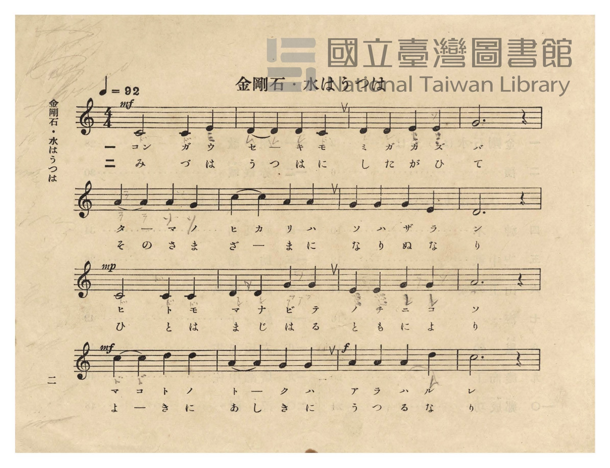
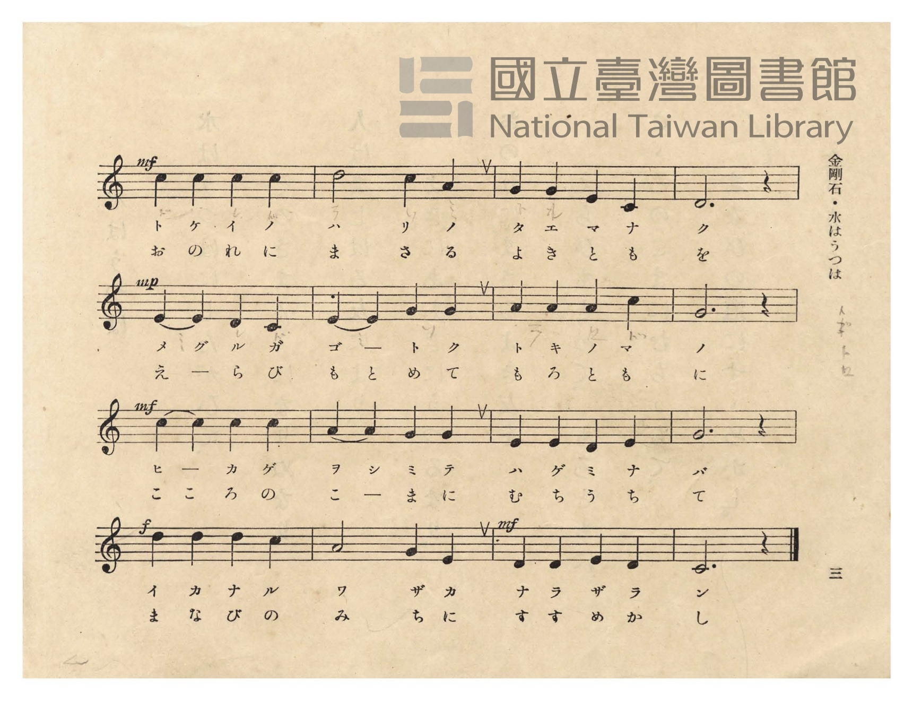
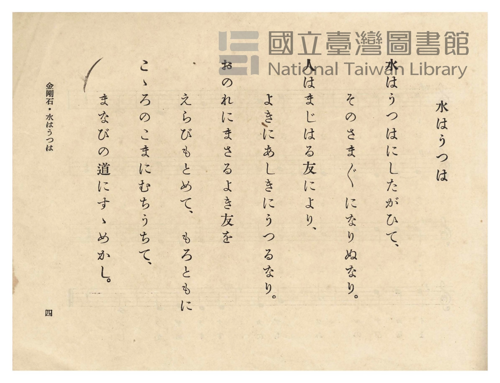
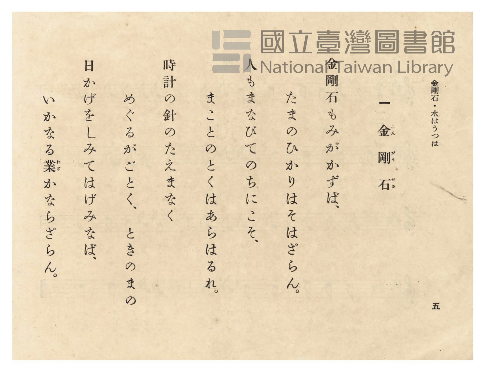

# 金剛石・水はうつは

> Re:Shōka 使用 AI 協助辨識與重建樂譜，可能會有錯誤。歡迎回報。

- **鋼琴伴奏版**：<br><audio controls src="kongoseki_mizu_wa_utsuwa.mp3"></audio>
- **NEUTRINO 歌聲合成版**：<br><audio controls src="kongoseki_mizu_wa_utsuwa_neutrino.mp3"></audio>

- 詞：昭憲皇太后御歌
- 曲：奧好義
- 臺灣總督府《公學校唱歌》第五學年用（昭和十一年，索書號 523.37 4322-4）

## 說明

原書資訊與歌詞全文（對應 P006.jpg–P009.jpg，原書 pp. 2–5）：
調性與拍號：ハ長調（C 大調）4/4 拍，速度 ♩=92


## 歌詞

```text
水はうつは（P008.jpg，p. 4）
水はうつはにしたがひて、
そのさま〴〵になりぬなり。
人はまじはる友により、
よきにあしきにうつるなり。
おのれにまさるよき友を
えらびもとめて、もろともに
こゝろのこまにむちうちて、
まなびのみちにすゝめかし。

金剛石（P009.jpg，p. 5）
金剛石（こんがうせき）もみがかずば、
たまのひかりはそはざらん。
人もまなびてのちにこそ、
まことの徳（とく）はあらはるれ。
とけいのはりのたえまなく、
めぐるがごとく、ときのまの
日かげをしみてはげみなば、
いかなる業（わざ）かならざらん。
```

## ABC

```abc
X:1
T:金剛石・水はうつは
C:曲：奧好義
M:4/4
L:1/16
Q:1/4=92
K:C
V:V1 name="Piano" snm="Pia"
[V:V1]
!mf! C4 C4 C4 E4 | D8 D4 C4 | D4 D4 E4 E4 | G12 z4 |
w: 1.~コン _ ガ ウ | セ キ モ | ミ ガ カ ズ | バ
w: 2.~み _ づ は | うつ は に | し た が ひ | て
A8 A4 G4 | c8 A4 A4 | G4 G4 G4 E4 | D12 z4 |
w: 1.~タ マ ノ | ヒカ リ ハ | ソ ハ ザ ラ | ン
w: 2.~その さ ま | ざ ま に | な り ぬ な | り
!mp! C8 C4 C4 | D4 D4 G4 G4 | E4 E4 G4 G4 | A12 z4 |
w: 1.~ヒ ト モ | マ ナ ビ テ | ノ チ ニ コ | ソ
w: 2.~ひ と は | ま じ は る | と も に よ | り
!mf! c8 d4 d4 | A8 G4 G4 | !f! A4 A4 A4 d4 | c12 z4 |
w: 1.~マコ ト ノ | ト ク ハ | ア ラ ハ ル | レ
w: 2.~よ き に | あし き に | う つ る な | り
!mf! c4 c4 c4 c4 | d8 c4 A4 | G4 G4 E4 C4 | D12 z4 |
w: 1.~ト ケ イ ノ | ハ リ ノ | タ エ マ ナ | ク
w: 2.~お の れ に | ま さ る | よ き と も | を
!mp! E8 D4 C4 | E8 G4 G4 | A4 A4 A4 c4 | G12 z4 |
w: 1.~メグ ル ガ | ゴ ト ク | ト キ ノ マ | ノ
w: 2.~え ら び | もと め て | も ろ と も | に
!mf! c8 c4 c4 | A8 G4 G4 | E4 E4 D4 E4 | G12 z4 |
w: 1.~ヒ カ ゲ | ヲシ ミ テ | ハ ゲ ミ ナ | バ
w: 2.~ここ ろ の | こ ま に | む ち う ち | て
!f! d4 d4 d4 c4 | A8 G4 E4 | !mf! D4 D4 E4 D4 | C12 z4 |
w: 1.~イ カ ナ ル | ワ ザ カ | ナ ラ ザ ラ | ン
w: 2.~ま な び の | み ち に | す す め か | し
```

## TMD 檔案連結

- [主旋律 TMD 檔案](kongoseki_mizu_wa_utsuwa.tmd) [[在 TMD Studio 編輯](https://tmdlang.github.io/Tmd-TS/#tmd=s7IKdvYPcrWy4qpTUCpJTLdSSM7PyUlNLsnMz7PKzk9PzM7Ojy_OyM9OVIKrKMvPKc1NtUovSkxJjTdFiBfnlxYlp1oVJ2fk5-fEl6RWlCTl52ejy8cXJKanWgUYGJghZAqK8stS8xLzgLoLijLzSlJTwNoRClLLMlNSQdLFyYl58WWpRZlpmakpSE5KLSoGuRhqRUlRYl5xclFmAcgbCFX5RSUZ-UBnF2RUWmVkFpfkF2UmJ-bEZyfmIfmuJCMV6LnM3AKgJYk56OLliSWpRcgmZqZn5lnl5ucllQJDCVMiNTMrEykotLQUXrZPfNo5-_n8zY-bdz_bsOVx4_rHjW2PG5cAGQpaWlyKtgqWRlz2tgrOXDYm-iZ2IBNfrJz3fs-sZzPWPmvb9HxW-9Mlq55O6Hu6b-GztT1gG5_N3gSUf7p0-dOle5_vWwkWe9G-63nj4uc79j6fu_jprjmPG7qetq55unbHswULn07ZCNT5uKH7-Zo1T3ZNAQo-3bnl-ZQV7_d0AO14OqnnaW_jkx0NQMH3e3qeb1n0bPaOFzPnK5gaGesZmyuYGBsZ6Zq839OpxMWlr6VgSy3ApaCg8LRvPsiyze0vVnS96GgHuhLo9aetK55Nawc67umG3mftnQqgpKOXVZD-qGEykGkJYgLdCdGqUFCgp2AElDEFOhAYJiBDX6za_6xhOci47l6gP4Cij5v7X07dDhQHGuqs8HTJcjCzExjcCkA1QMNeNsx_umuZwqOZK22BkQEyBC2mgBqBdltA7QbaCQoQLOoeN65-3Dj9ceP8x409jxs3PW5c9rihEaTucePcx43rHjdOfdy473HDlscNW8FKVz1u6nrcuAbKaGgCKX2yaxfYpH2PG2eAGE3dT_u7QaqbOsCKIOYBOY29YDOawDZC2GBnNAFVI5n3uBFoxbrHTUAHAVUATZ0KUgHWDzK4aRJEEdDwzseNmx83Ac1b8bipEeJ2ELcJaDZQBCi-GqJ08uOmuWBRoIcmg40EOq7hceNCsAOAJMLXQLlVIFNBSveD5YBumAnWD7QB6NDpIFeC1MLzCSSsYfEMDGtQ3KKrADsCaDfQU0ArZwP9AlQEdiPQFqAg0ORZjxs3wN0BjBCgU4COAMYJ0M_AEAGGMDBKgOQ0kMeBZiFCH2QM3OHLwNogDgdaOBfZa0D-CqD0030QJwHZ_SBngEwFBhuYAQpqYN6DxgRQxcTHjS1gI4Fy4IgBuQ2oGWJhPzx-gcEzARyVQN9MgZgNig8QAxLyIP-Ak-D0pWD_TgJGJTgpAEMA6GigG4BcIBtoKiIcgFZDUkf3s6VrQY5u6geGANjREHEgAzVAKM_pUKCgpc_F5Z2fl55fnJqd6ZtZVRqeGFpSXFqeaBWQmZiX71BjUFMNslHBxkLLDszAVt4ogEqxHQ0vFvYoaJgoPN3Q_3x9gw68kNDEogFoL8iwGoXq3LRaBUMFXTg2BuIaBSMgCYIgGiQKEQFhkDxEjSlUDQgagETARvoY1gBjCliyb4ZKPW5aAyaXgTU9btoNF18LIpsXQcSb5yOpXQ0md0FlJiBZFI-wyAgo17gfZlrjUjC5HqIHnOvhUiBBYGKFSk0H88DWNfaAyU1QGZATUS3CH-S7esgJcjOoDSAaFIY1CoZxSEIgDAlcGEaNEmzBDQ-F5nlgsg8acsD0D_I1RGoVmOyHSDXthfMeN20Ds1dCNcEiDltwg0pseLBOBZP7oIE3DS4OEkEEN9japi6wGDh2wSIgJ4DESAnuHZ3kpfACSAoHQVgqR6RnWCDXwFM2QgQWU1iCvHkSPFw7wCQsGUMiAOzd5slgsg0qA4qUx82NYLIbHCigkIbFBa4QB6VNSLCuAJOwBA4J5BlwMWDxBZUBq2tqgkcCsF4jL8Cfzp5NfpECS9JGIAaYQIQnIoSrgUphiR6EoQrhurGF_DxIwCEHPiy9g3hg8SZwkMATOyhyIAkcmuSboamzGZQicQQ9ONggQd8LD0xQAINaFzikQHENKXkg8UF-Yt81BTPszUkIezQCmOBhYQrmo5YyoGSPyBa4Ah4c1k0bwSTYi_BwB4UpciEDFQeXS4-bwAkSKWOAZEDxgyvJQ8oKUDkDbCegBC8o0SOVPbAkD44pWFQgkj9IBpZNiU3yrWvJC3ZgGQMKRHCKhwcmTAS1RIFhaLzgqUabFz5u2gAPWkheBiVYkMe2wMUh0QItF6C8tfBogAQ8rPzBFeSIjNMJDkRYyQRq-MKlwEUXuJIES4HFsIQ5OLZISeo7milL6vBEDQ1RzGIGVrTDGjD4Qx1etEPbIdDmQfOmx03b4aEObj_Ay3ZIPQpSCJOBJnS8jRdgWxlURUDsgoQkKNWDpWDiqLVpUwOYtxBMQgobEJuMxsvT1tVkhTow0BFFOpjAEuqQMAbHEHK7EUQDC3fcQQ8pViDBDq1DYQU1rMCAtlbAakDiEFXgop2EdgwkUMGFFTitIwIe0aCEBDKs6JkJ5oFJaEaA1bewugBhTy0Xl66dAtZ2vQJQQpkLAA)]
- [鋼琴伴奏 TMD 檔案](kongoseki_mizu_wa_utsuwa_piano.tmd) [[在 TMD Studio 編輯](https://tmdlang.github.io/Tmd-TS/#tmd=s7IKdvYPcrWy4tLSUnjZPvFp5-zn8zc_bt79bMOWx43rHze2PW5cAmS839PxsnvP8wlbnuzZ8nRp__POjvd7OhW0tLgUbRUsjbjsbRWcuWxM9E3suOoUlF6snPd-z6xnM9Y-a9v0fFb70yWrnk7oe7pv4bO1PUog-WezNwHlny5d_nTp3uf7VoLFXrTvet64-PmOvc_nLn66a87jhq6nrWuert3xbMHCp1M2AnU-buh-vmbNk11TgIJPd255PmUF0E1AO55O6nna2_hkRwNQ8P2enudbFj2bvePFzPkKpkbGesbmCibGRka6JkDXKnFxeefnpecXp2Zn-mZWlYYnhpYUl5YnWgVkJublB3k41BjUVHMpAIGNhZYdmFGjUJ2bVqtgqKALx8ZAXKNgBCRBEESDRCEiIAySh6gxhaoBQQOQCNhIH8MahcdNwBDeDJV63LQGTC4Da3rctBsuvhZENi-CiDfPR1K7GkzugspMQLIoHmGREVCucT_MtMalYHI9RA84WuFSIMHHjSBDQVLTwTywdY09YHITVAbkRFSLoKFkBhUE0SBv1ygYxiEJgTAkPGAYNRSxhRDc4c3zwGQf1LOTIL6HSK0Ck_0Qqaa9cN7jpm1g9kqoJlhYYwuhuY8b18FDYiqY3Af17zS4OEgEEUJga5u6wGLgCAGLgJwAEsMaQtW5BZB0BIKwtIRINbBwqYGnH4QILHCxhFLzJHhQdIBJWGKBhBnYhc2TwWQbVAYUjo-bG8FkN9gfoMCBBR-uQAKlAEhIrACTsGQECZcZcLHHTSAzQTJgdU1N8HB73ARyIYEwAuU1WMIxAjHABCIIEIFSDVQKS1ogDFUI140tsOZB_IocXrBUBeKBxZvAvoAnKVB4QpIRNGE1Q9NAMyjecYQW2KeQ0OqF-x8UJk2QzIVNChQ9kCwJCUKikhQsuNAIYLKCBQOYj5r9QIkLkfhwhRU4eJo2gkmwq-BBBQoG5NwHFQdn2MdN4GhHSn4gGVCQ4kpYkEwEyoCPmyCFDSxEQEkLKVPCEhY4cGGhh0hkIBlYZsCe-UD-BqcruP9hIqhZDYahQYmnFG9e-LhpAzw0IIkclCxAbtkCF4eEJDTDQHlr4SEHCStYxsQVSojk2Qn2NyzLAhMUKAggUuA8DS6jwVJgMSzBBA5gAgkKnnSggYCZ_2DFFKzKwx9Q8GIKWnNBK5TmTY-btsMDClzjwMspSDEOUgiTgSYnvNXdZCCC2wXxPChtgaVg4qiFeVMDmLcQTEJyIYiNt7oDFT6I4glMYAkoSLCAAxW5cQCigQUV7tCC5DdISEGLcFihA8tJ0PoNrAYkDlEFLqZIqPkg4QDOxeAUhQgrRKsBEi6wPDkTzAOT0OQGK-5h5RrCnlq8zS0f5OaWCby5ZRivEG0YC6OAiSoeyDKNj4UwUIWwKzKAerFGwQQoaoKkDMqHUgTsQhiDUxlcBF0FwiIMx8A143QekgqEubhdg8NTZiBTzOJzSfAXkSbjNwTdU0SGMWaYohuEmhCwhQ8wvenaKWBNctE-QGW4JY3AkspcAA)]

## 分析

```text
================================================================================
📊 TMD Song Profile: [ 金剛石・水はうつは ]
================================================================================
⏱  Duration:       1:23 (83.5s), 32 measures total
🎼 Key & Tempo:    首調基準 C, != 92.0 BPM, <4/4>
   - 分析範圍：      由實際發聲的音符與和弦推測調性；播放脈絡另行呈現
🎤 人聲音域:    C4 (MIDI 60) – D5 (MIDI 74) [跨度: 14 個半音 / 1.2 個八度, 難度: moderate]
   - 最低音:  C4 in [KongosekiMizuWaUtsuwa #1 @ m.1, 0:00]
   - 最高音: D5 in [KongosekiMizuWaUtsuwa #1 @ m.13, 0:32]
   - 適合: soprano, mezzo-soprano, contralto, tenor, baritone, bass
🏛  結構:      KongosekiMizuWaUtsuwa (83.5s)
⚡ 編曲密度:        Peak 1 軌道同時演奏
🗝  調性診斷：       C 大調（純淨自然大調，未偵測到可信轉調）
   - 風格氣質:    純淨自然大調（陽光明朗、易唱易記，無明顯調外色彩）
   - 轉調歷程:    全曲維持單一推測調性（未偵測到可信轉調）
   - 核心骨幹音:  C, D, G, A, E
   - 調性數值:    C 大調 [相關度: 0.81, 穩定度: Moderate, 自然音純度: 100.0%]
   - 候選調性 (K-S): C 大調 (0.81), G 大調 (0.76), A 小調 (0.64)
   - 五度圈歷程:   +0
   - 各段落調性細節:
     • [KongosekiMizuWaUtsuwa #1]: C 大調 (r: 0.81, 自然音純度: 100.0%)

  [ 五度圈游移軌跡 ]
              [C ]*
         F            G  
      Bb               D  
      Eb               A  
         Ab           E  
            Db       B  
               F# 
     (* = active key center)

  [ 十二半音累積音高分佈 ]
     C  : ████████████████████████  25.8%
     C# :                            0.0%
     D  : ████████████████████      21.7%
     D# :                            0.0%
     E  : ████████████              13.3%
     F  :                            0.0%
     F# :                            0.0%
     G  : ████████████████████      21.7%
     G# :                            0.0%
     A  : ████████████████          17.5%
     A# :                            0.0%
     B  :                            0.0%
--------------------------------------------------------------------------------
Assignment 軌道音域：
  - Piano         : C4 – D5 (14 個半音 / 1.2 個八度, 92 個音符)
================================================================================
```


## 原書掃描頁










