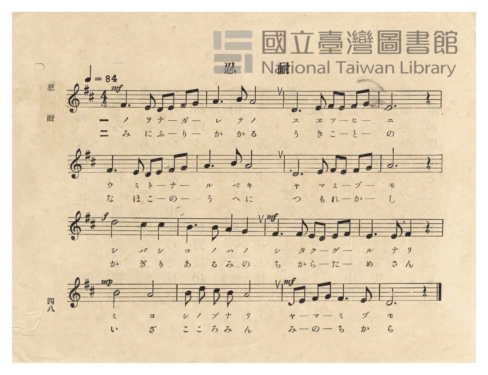
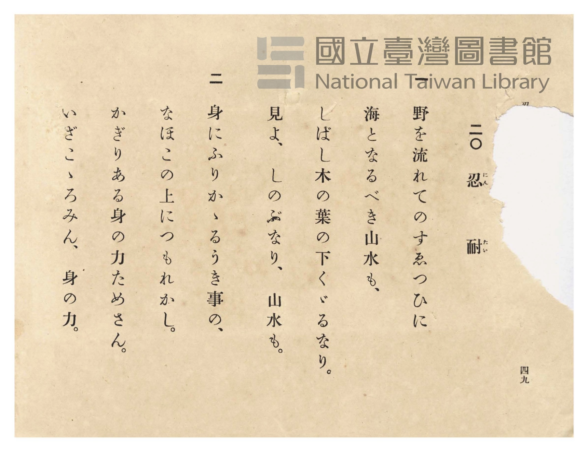

# 忍耐

> Re:Shōka 使用 AI 協助辨識與重建樂譜，可能會有錯誤。歡迎回報。

- **NEUTRINO 歌聲合成版**：<br><audio controls src="nintai_neutrino.mp3"></audio>
- **鋼琴伴奏版**：<br><audio controls src="nintai.mp3"></audio>


- 詞：文部省
- 曲：文部省
- 臺灣總督府《公學校唱歌》第五學年用（昭和十一年一月，索書號 523.37 4322-4）

## 說明

原書資訊與歌詞全文（對應 P052.jpg–P053.jpg，原書 p. 48–49，第 20 首）：
調性與拍號：ニ長調（D 大調，2 個升記號）4/4 拍子，♩= 84


## 跨冊／重複收錄參照

> 同曲（《公學校唱歌》、《新定兒童唱歌》共同收錄教材）

- **[同曲]** 《新定兒童唱歌》尋常科第四學年用（2020.006.0847.0004）：[**〈忍耐〉**](../../../shintei_jido_shoka/grade_4_2020.006.0847.0004/3_05_nintai/index.md)（`C` / `4/4` — [原始 TMD](../../../shintei_jido_shoka/grade_4_2020.006.0847.0004/3_05_nintai/nintai.tmd)）
- 總表：[跨冊重複與同名歌曲總索引](../../../duplicate_songs.md)

## 歌詞

```text
一
野を流れての末つひに、
海となるべき山水も、
しばし木の葉の下くゞるなり。
見よ、しのぶなり、山水も。

二
身にふりかゝるうき事の、
なほこの上につもれかし。
かぎりある身の力ためさん。
いざ、こゝろみん、身の力。
```

## ABC

```abc
X:1
T:忍耐
C:曲：文部省
M:4/4
L:1/16
Q:1/4=84
K:D
V:V1 name="Piano" snm="Pia"
[V:V1]
!mf! F6 E2 D2 E2 F2 G2 | A6 B2 A8 | D6 E2 F2 E2 F2 G2 | E12 z4 |
w: 1.~ノ ヲ ナ _ ガ _ | レ テ ノ | ス エ ツ _ ヒ _ | ニ
w: 2.~み に ふ _ り _ | か か る | う き こ _ と _ | の
F6 E2 D2 E2 F2 G2 | A6 B2 A8 | D6 E2 F2 E2 F2 G2 | A12 z4 |
w: 1.~ウ ミ ト _ ナ _ | ル ベ キ | ヤ マ ミ _ ヅ _ | モ
w: 2.~な ほ こ _ の _ | う へ に | つ も れ _ か _ | し
!f! d8 c4 c4 | B6 B2 A4 G4 | !mf! F6 F2 E2 D2 E2 F2 | E6 E2 F4 z4 |
w: 1.~シ バ シ | コ ノ ハ ノ | シ タ ク _ グ _ | ル ナ リ
w: 2.~か ぎ り | あ る み の | ち か ら _ た _ | め さ ん
!mp! B8 A8 | B2 d2 c2 B2 A8 | !mf! D2 E2 F2 G2 F6 E2 | D12 z4 |
w: 1.~ミ ヨ | シ ノ ブ ナ リ | ヤ _ マ _ ミ ヅ | モ
w: 2.~い ざ | こ こ ろ み ん | み _ の _ ち か | ら
```

## TMD 檔案連結

- [主旋律 TMD 檔案](nintai.tmd) [[在 TMD Studio 編輯](https://tmdlang.github.io/Tmd-TS/#tmd=s7IKdvYPcrWy4qpTUCpJTLdSSM7PyUlNLsnMz7PKzk9PzM7Ojy_OyM9OVIKrKMvPKc1NtUovSkxJjTdFiBfnlxYlp1oVJ2fk5-fEl6RWlCTl52ejy8cXJKanWgUYmBohZAqK8stS8xLzgLoLijLzSlJTwNoRClLLMlNSQdLFyYl58WWpRZlpmakpSE5KLSoGuRhqRUlRYl5xclFmAcgbCFX5RSUZ-UBnF2RUWmVkFpfkF2UmJ-bEZyfmIfmuJCMV6Lnc_KLEHHTB1Nx8iIFaWgpP9_e-aJigoKXFpWirYGHCZW-r4MJlY6JvYgfS9GLlvPd7Zj2b1v6yecXzOY1gg57N3oQh9qJ91_PGxc937H0-d_HTXXMeN3Q9bV3zdO2OZwsWPp2y8dnanscN3c_XrHmyawpQ8OnOLc-nrHi_p-PZjLVPJ_U87W18sqMBKAgkn83peL-n5_mWRc9m73gxc76CqZGxnrG5gomxkZGuyfs9nUpcXPpaCrbUAlwKCgpP--aDLNvc_mJF14uOdqBbgZ5-2roC6EGgE59u6H3W3qkAima9rIL0Rw2TgUxjEBPoTohWhQI9BRMLoIyJJcjta9YoGBkovFw2DehcYDiBrHixav-zhuUgw7t7gb4Cij5u7n45dTtQHGiFi8LTJcvBzB4jhacN3U97gU6ZAVbXCYwHBaCmp2snAGUfzVwJjiKQkcCwAlEv2_seN016trXxcVPP48ZljxvXPZuz-nHjkseNmx43rn7c0AhS9Gzr9seNKx43rnrc1P24cefjxt6nGzc-27DlcVMTVMXjxumPGzcAyWdzgOrWvZjYCSSf7ACq7n_cNA-sDai563FDE9g7y7ofN3UAtYK1rXvcuA0m3YhkcBPEnbt6wFp2AV0FRFtByhqB2ueCDW0DuuXJLiBjHdwhqx437n7cOBlsP1Ap2DNA40DeA6qbDnUCmAP0OlAFUK4bbPy6p12zHzfOf9wEdNfUx02T4UpbHjdOA7t2Mtje3seN-8HSjQhtEKWUJygoUNDS5-LyAxYAiZlWAZmJefkONQY11SArFGwstOzADGzpWAGUR3Y0vFjYo6BhovB0Q__z9Q068MSniUUD0CKQYTUK1blptQrGCrpAaKRgCMTGCiZAYVOwiBmU1gWKGELVGMPVGEHlQNAApAZspI9hjcLj5j6w6OPmTUDcBWI1rQGb8rgZRINk2uCqwOJNOyHiTSuA4i1gFZOgOrqR7IlH2GMElGvcD9HVuBqIt4L1g2wDyUB0gWhgRCPsaWyDivcC8WQwawVUZh2GPfgDfFcPOQFOXljD5LCEddMyaIjOB-IOMAsaBs2roTIzgarWIsKgeQlUfB5YF4jVCpVZhCesV0FDbjc85EAhhhymO8AxgQhrqD1NTUDcA40NiMx0EsN6RydZiRuYtg3joNaYQ3ENMKgRAW4CFkHKBaAwh8QNLIWD2Jihvh1q7OPmCWA_gvgg8c1Q0T4g7oeyIDIQHY-b9gPxejBrA1o8dQExKJTRQx6WfoFlF1gfLI03QU0EpnFwTkDEyEKoelDq7wSzQPEMckUjVGYqkA2KRSJC_-ns2eQVLQW10LDWRUrcZqAoMUdJ7-Dgh2UIWAaBZQOsiR6cbCGBBsq-0AQHDGJIwE9DCkzkRA9K8pCsAtHbSjDRg4oiSIBNQ5gFTP5g3AQqREDRCQpImBwiIpCjAeQ6UESg2lPLxaVrpwAp8RWALGUuAA)]
- [鋼琴伴奏 TMD 檔案](nintai_piano.tmd) [[在 TMD Studio 編輯](https://tmdlang.github.io/Tmd-TS/#tmd=s7IKdvYPcrWy4tLSUni6v_dFw4T3ezpedu95PmHLkz1bni7tf97Z8X5Pp4KWFpeirYKFCZe9rYILl42JvokdV52C0ouV897vmfVsWvvL5hXP5zQqgcSezd6EIfaifdfzxsXPd-x9Pnfx011zHjd0PW1d83TtjmcLFj6dsvHZ2p7HDd3P16x5smsKUPDpzi3Pp6wAuuPZjLVPJ_U87W18sqMBKAgkn80Buqbn-ZZFz2bveDFzvoKpkbGesbmCibGRka4J0J1KXFyeeSVF-VYBmYl5-UEeDjUGNdVcCkBgY6FlB2bUKFTnFtQqmCnogqEplK4BihjGKZgDKYRQdW5arYKhgpGCsYIJEIMEjYDChlAFIGgAUshVi2KvD7K9Jqj2msQrRJvEKhgCKcNYoCCQbxofj-CDrUQSNI0HiUKlQdgAYp1fZl5JYiYBfwKNgrka5osaqPeQvQnxD0gepsYIw4cgI30MaxQeN_eBRR83bwLiLhCraQ3YlMfNIBok0wZXBRZv2gkRb1oBFG8Bq5gE1dGNZE88wh4joFzjfoiuxtVAvBWsH2QbSAaiC0Q_boKZABJvg4r3AvFkMGsFVGYdhj3QMCIveGByWIKnaRk0EOYDcQeYBXV282qozEygqrUIZzcvgYrPA-sCsVqhMovwBM8qqGd3wz0L8iRyMOwABx4ieKD2NDUBcQ80ACEy03EFTzUo_cdBZcyhGJRVEGFkAhZBSmugYIIEJywdgdiYAbUdauzj5glgZ4H4IPHNUNE-IO6HsiAyEB2Pm_YD8XowawNa0HYBMShg0AMLlkoeN4LMQqSkJqiJwJQETm-IQFwIVQ9KY51gFihqQK5ohMpMBbJBAY8aYNQvWxA5D-QCiD9B6RoarcBQgYTVNCT_IyctUMKCJEiI3laCSQuURyF-nIYwC5jIwLgJlLtAMQDyO0wOEXbIIQdyHSjsUO1BK7xwFJbQEg9IgUpCOB_EQS0T4SrgUmACVEySaxJaaYtiDJI2pKLcNN4cySCgBJCF5CIgD2EQoRqAiMJf104BXN0oABmQsIz2Acoi8YzAPGUuAA)]

## 分析

```text
================================================================================
📊 TMD Song Profile: [ 忍耐 ]
================================================================================
⏱  Duration:       0:45 (45.7s), 16 measures total
🎼 Key & Tempo:    首調基準 D, != 84.0 BPM, <4/4>
   - 分析範圍：      由實際發聲的音符與和弦推測調性；播放脈絡另行呈現
🎤 人聲音域:    D4 (MIDI 62) – D5 (MIDI 74) [跨度: 12 個半音 / 1.0 個八度, 難度: easy]
   - 最低音:  D4 in [Nintai #1 @ m.1, 0:01]
   - 最高音: D5 in [Nintai #1 @ m.9, 0:22]
   - 適合: soprano, mezzo-soprano, contralto, tenor, baritone, bass
🏛  結構:      Nintai (45.7s)
⚡ 編曲密度:        Peak 1 軌道同時演奏
🗝  調性診斷：       A 調性不明確（流行色彩大調，未偵測到可信轉調）
   - 風格氣質:    流行大調（略帶和弦色彩音與裝飾副屬和弦）
   - 轉調歷程:    全曲維持單一推測調性（未偵測到可信轉調）
   - 核心骨幹音:  A, F#, E, D, B
   - 調性數值:    A 調性不明確 [相關度: 0.84, 穩定度: Ambiguous, 自然音純度: 94.2%]
   - 候選調性 (K-S): A 大調 (0.84), D 大調 (0.84), F# 小調 (0.70)
   - 五度圈歷程:   +3
   - 各段落調性細節:
     • [Nintai #1]: A 調性不明確 (r: 0.84, 自然音純度: 94.2%, 調外音: G)

  [ 五度圈游移軌跡 ]
               C  
         F            G  
      Bb               D  
      Eb              [A ]*
         Ab           E  
            Db       B  
               F# 
     (* = active key center)

  [ 十二半音累積音高分佈 ]
     C  :                            0.0%
     C# : ████                       4.2%
     D  : █████████████████         17.5%
     D# :                            0.0%
     E  : ██████████████████        18.3%
     F  :                            0.0%
     F# : ██████████████████        19.2%
     G  : ██████                     5.8%
     G# :                            0.0%
     A  : ████████████████████████  25.0%
     A# :                            0.0%
     B  : ██████████                10.0%
--------------------------------------------------------------------------------
Assignment 軌道音域：
  - Piano         : D4 – D5 (12 個半音 / 1.0 個八度, 62 個音符)
================================================================================
```


## 原書掃描頁






