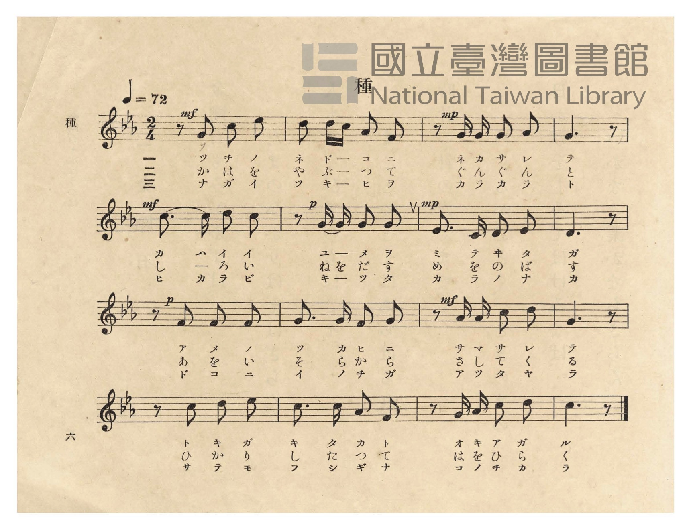
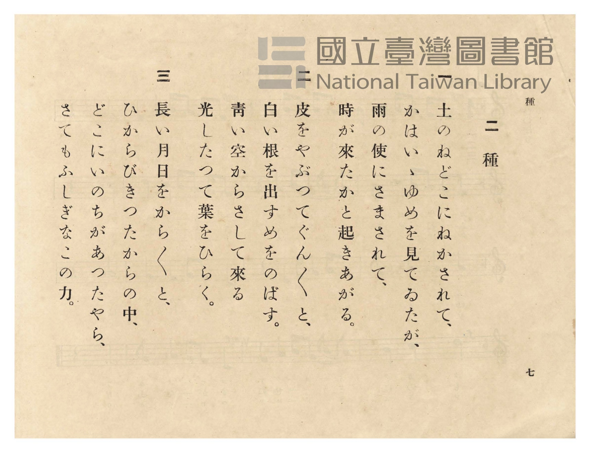

# 種

> Re:Shōka 使用 AI 協助辨識與重建樂譜，可能會有錯誤。歡迎回報。

- **鋼琴伴奏版**：<br><audio controls src="tane.mp3"></audio>
- **NEUTRINO 歌聲合成版**：<br><audio controls src="tane_neutrino.mp3"></audio>

- 臺灣總督府《公學校唱歌》第五學年用（昭和十一年，索書號 523.37 4322-4）

## 說明

原書資訊與歌詞全文（對應 P010.jpg–P011.jpg，原書 pp. 6–7）：
調性與拍號：ハ短調（C 小調，3 降記號）2/4 拍，速度 ♩=72


## 歌詞

```text
一
土のねどこにねかされて、
かはいゝゆめを見てゐたが、
雨の使にさまされて、
時が來たかと起きあがる。

二
皮をやぶつてぐん〳〵と、
白い根を出すめをのばす。
青い空からさして來る
光したつて葉をひらく。

三
長い月日をから〳〵と、
ひからびきつたからの中、
どこにいのちがあつたやら、
さてもふしぎなこの力。
```

## ABC

<div class="abc-score" data-abc-src="tane.abc" aria-label="五線譜載入中"></div>

[下載 ABC 原始檔](tane.abc)

## TMD 檔案連結

- [主旋律 TMD 檔案](tane.tmd) [[在 TMD Studio 編輯](https://tmdlang.github.io/Tmd-TS/#tmd=s7IKdvYPcrWy4qpTUCpJTLdSSM7PyUlNLsnMz7PKzk9PzM7Ojy_OyM9OVIKrKMvPKc1NtUovSkxJjTdFiBfnlxYlp1oVJ2fk5-fEl6RWlCTl52ejy8cXJKanWgUYGBogZAqK8stS8xLzgLoLijLzSlJTwNoRClLLMlNSQdLFyYl58WWpRZlpmakpSE5KLSoGuRhqRUlRYl5xclFmAcgbCFX5RSUZ-UBnF2RUWmVkFpfkF2UmJ-bEZyfmIfmuJCMV6Lm8xJLSolR00YKcxLySYmQDM9Mz86xKEjPLgc7KT0vLTM5MzFHi0tJSeL5inYKWFpeirYK5EZe9rYKrDld2aqWtgnMul42RvokdyIwX7bueNy5-vmPv87mLn-6a87ih62nrmqdrdzxbsPDplI3P1vY8buh-vmbNk11TgIJPd255PmXF-z0dz2asfTqp52lv45MdDUDB93t6nm9Z9Gz2jhcz5yuYGhnrGZsrmBgbGemavN_TqcTFpa-lYEstwKWgoPC0bz7Iss3tL1Z0vehoB7ryxcp5T1tXPJvWDnTc0w29z9o7FUDRq5dVkP6oYTKQaQhiAt0J0apQUKCnYAaUMQc68P2eWSBDX6za_6xhOci47l6gP4Cij5v7n89fCxQHGuqs8HRDP5jZY6zwcmbvixUzwIo6gQGpANQBFH_ZMP_prmUKj2autAWGN8hIYOiAnTtn_uPGdY8b1z5uXPm4cfLjxtVgdvfjxqmPm3oeNy573NAIUgcWWv-4seVx09zHTW2PmxofN016sQwouOxx04THjUBTgNEBVvpy9gqgkU_27gcbNvVx4z50w57NbAIqf7KvDawPaMaKF1u3P27sfdwIEn_c1P24oQniyF09IOr5rHVA2x43tTxu3Pa4cQnIoMYJj5smP27Y_LhhK1A71NznM_cCXfhswU6g6qftux43zoS4E-zDDSAu0FyQC-cChVqerwSq6H7c1Al25HSgqSAXNXWDg6UVKAoUAjoPZN2LiZ1gYzaBVffDnbejE2zcVKDjW57N6Xg2fSlYGdhQNLeBNENt2wz2KtBcsOdBIuue7FgLVwePB6B3ge5eCAoSUMCANQDDAGQ2VCnQ3cDgB8oBLQK6tu9x4yqw5nVPu2ZD_Up5qoYCBS19Lq6QxDxg4ZSZmJfvUGNQUw2yQMHG0EzLDszClpcUQDl0R8OLhT0KGiaghPp8fYMOPANoYtEAtAdkWI2CgYKuQnVuWq2CMZBhBsSGcUCiRsEcSJoDBUDCRmARiMoCkEoQ1FUwAQuDWDAIUlIDNtjHsEYhHsh73NwCJhvBZB9Yx-PmXjCvE0Q2bQazu8EyEB29QNHVQLwVzFsD1dOGZA9IHdQeI6iuRpAJwNwDNnMSRE8T2O7GbWByCZhchrCncQJQxWQwDdIzGaKncQV2e4xhrusCqwa56nETyEyQ28D2NK0Fy4Psfty8CWEPyC_NK8E0SGYlVE8Hhj34o3dXDznRC45aULSCIhcUpyA2NC6RohKEQYqBQoYQxfEK5iBXgXjAxABiYo9kiLdAHuuHBggsWCDBBQrwx80LkQLlcfN8qI42IN4A1rEfGmGgYMUeycC8B9HVBEwejaAAB0FYVK4FR_rjxgVg3kyoaaBEB0kOwNwKlgHZBjILpAJ7JEMiEBFtIHdCkgYkMiGR3IzialgIACMZnMQhiQQhQ3wk7-gkOw8Dow6UT2EYljGNwTxI_MLzugkQghICKEEQzMFNi8BegkQhLAdDIgASSJAUj5SDgTn3cfM8knNwEzSyQGyQ-aCImgu1pxOWw4EsRLRPBScLSK4GVhnQQAepw5eDMcsdSJKF-A9aVoGTIiIEQFEOifDHzbBcD0ocJETu09mzyY1cWFxBy2ZYfgYVwIiy2RglUiFqcEYquPiBpmaoVyE8SLqGFVYgVbBAWAVWAU0OMD3NmCkcNVJBeR4WddBcAcvJjfOxFsvroTkWrBMa3ZDIxROp0KQGSmKPm0EuBLltKtQ_24EYnP-h-RKiYzNKdIP8gT1Sa7m4dO0UQJWyApBW5gIA)]
- [鋼琴伴奏 TMD 檔案](tane_piano.tmd) [[在 TMD Studio 編輯](https://tmdlang.github.io/Tmd-TS/#tmd=s7IKdvYPcrWy4tLSUni-Yt37PR0vu_c8n7DlyZ4tT5f2P-_seL-nU0FLi0vRVsHciMveVsFVhys7tdJWwTmXy8ZI38SOq05B6UX7rueNi5_v2Pt87uKnu-Y8buh62rrm6dodzxYsfDpl47O1PY8bup-vWfNk1xSg4NOdW55PWQG06NmMtU8n9TztbXyyowEo-H5Pz_Mti57N3vFi5nwFUyNjPWNzBRNjIyNdE6ATlLi4PPNKivKtAjIT8_KDPBxqDGqquRSAwMbQTMsOzKpRMFDQVajOLahVMAMyzIHYMA5I1IC5ukDSBEgagUVAKo2BfJhCmBoIBMnWcNWi2OmDbKcJ3EqIdfHxCtFm8bmxQAEjINMIzDJGCIIUGECMDEnMSyXGF2m1QAeCHA33Bcid5kABkDDCF2AHGIOhLtiDQIsxvAIy2MewRiEeyHvc3AImG8FkH1jH4-ZeMK8TRDZtBrO7wTIQHb1A0dVAvBXMWwPV04ZkD0gd1B4jqK5GkAmPG9eDzZwE0dMEtrtxG5hcAiaXIexpnABUMRlMg_RMhuhpXIHdHmOY67rAqkGuetwEMhPkNrA9TWvB8iC7HzdvQtgD8kvzSjANklkJ1dOBYQ88koGxAUtEoGgAsaHBjxT6IAxNEYYQxfEK5iCDQDxg_IGY2OMF4hKQW_qhfoD5BOJDUBg9bl6I5I_HzfOhOtqAeANYx35oGINCAnu8PG6cDtHVBIzRRlAYgSAs9NeC4-lx4wIwbybUNFA6gcTg48Z1YBmQbSCzQCqwxwskzBEhDXInJDYh4Q-Jl2YUV8NCABgv4FQJiVeEDJZ4gUUAKDfAMCz5G4N5kCiB5ygTlCxPIJ80LQK7AhLqsHwCCTOIvyDpCimfAPPH4-Z5JOeTJmj4gtgg80FhOxdqTycsHwFZiJiaCo5JSN553NgPDSeQOnz5BDN3Q1IZxH_QEgGcehAhAIolSBw9boblLVB84owPqhS9qOUVKF9C0wzUdRAeJPXAcjFIFczdq8AqoDEI09OMmY5Q4wGUs2ChDU17sPzSOB9rebUemi_AOqExBIkPPPEATR2gVPG4GeRCkNumQv2zHYjBuQya-iE6NqPEEMgf2OMBpX7BWWOBCjOkGgtUTxmDWfDKDFiJgcVBdRYOXeCCD1MnkqFImkF5FF4vopgCMhYkhU0bKdWqrp0CuLJWADJAQRDtYxiLYBshsY3BbGUuAA)]

## 分析

```text
================================================================================
📊 TMD Song Profile: [ 種 ]
================================================================================
⏱  Duration:       0:26 (26.7s), 16 measures total
🎼 Key & Tempo:    首調基準 E,, != 72.0 BPM, <2/4>
   - 分析範圍：      由實際發聲的音符與和弦推測調性；播放脈絡另行呈現
🎤 人聲音域:    C4 (MIDI 60) – D#5 (MIDI 75) [跨度: 15 個半音 / 1.2 個八度, 難度: moderate]
   - 最低音:  C4 in [Tane #1 @ m.7, 0:10]
   - 最高音: D#5 in [Tane #1 @ m.1, 0:01]
   - 適合: soprano, mezzo-soprano, contralto, tenor, baritone, bass
🏛  結構:      Tane (26.7s)
⚡ 編曲密度:        Peak 1 軌道同時演奏
🗝  調性診斷：       C 調性不明確（純淨自然大調，未偵測到可信轉調）
   - 風格氣質:    純淨自然大調（陽光明朗、易唱易記，無明顯調外色彩）
   - 轉調歷程:    全曲維持單一推測調性（未偵測到可信轉調）
   - 核心骨幹音:  G, C, D, F, D#
   - 調性數值:    C 調性不明確 [相關度: 0.74, 穩定度: Ambiguous, 自然音純度: 100.0%]
   - 候選調性 (K-S): C 小調 (0.74), C 大調 (0.72), G 大調 (0.66)
   - 五度圈歷程:   +0
   - 各段落調性細節:
     • [Tane #1]: C 調性不明確 (r: 0.74, 自然音純度: 100.0%)

  [ 五度圈游移軌跡 ]
              [C ]*
         F            G  
      Bb               D  
      Eb               A  
         Ab           E  
            Db       B  
               F# 
     (* = active key center)

  [ 十二半音累積音高分佈 ]
     C  : ███████████████████       24.5%
     C# :                            0.0%
     D  : ██████████████            17.9%
     D# : ███████                    8.5%
     E  :                            0.0%
     F  : █████████                 11.3%
     F# :                            0.0%
     G  : ████████████████████████  31.1%
     G# : █████                      6.6%
     A  :                            0.0%
     A# :                            0.0%
     B  :                            0.0%
--------------------------------------------------------------------------------
Assignment 軌道音域：
  - Piano         : C4 – D#5 (15 個半音 / 1.2 個八度, 50 個音符)
================================================================================
```


## 原書掃描頁






