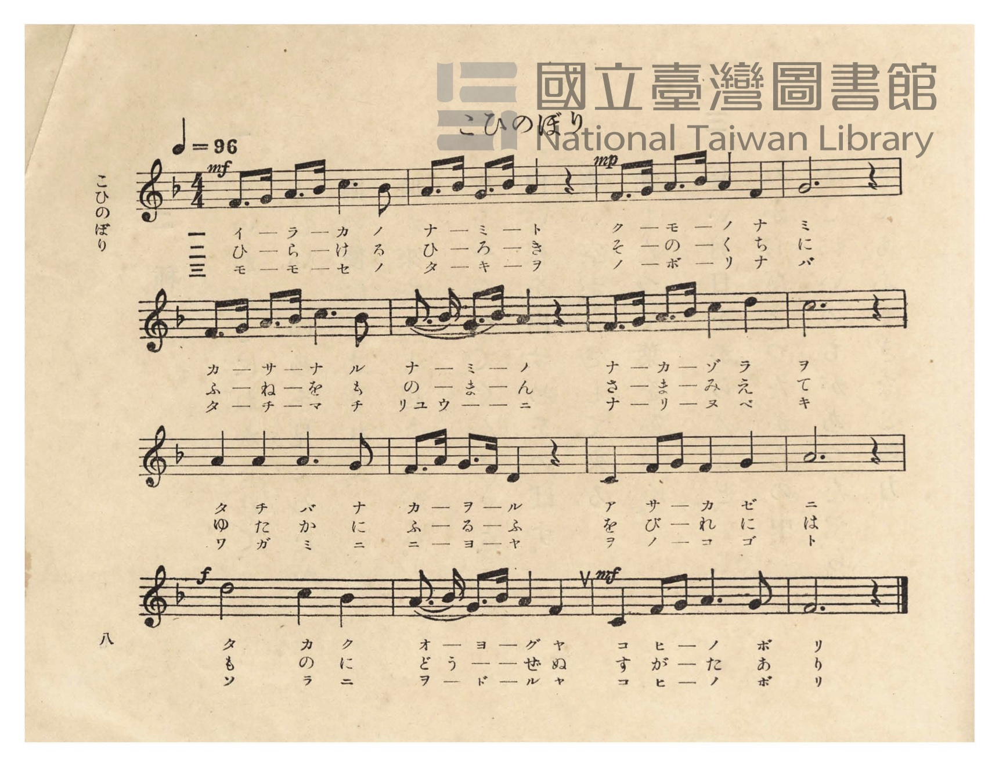
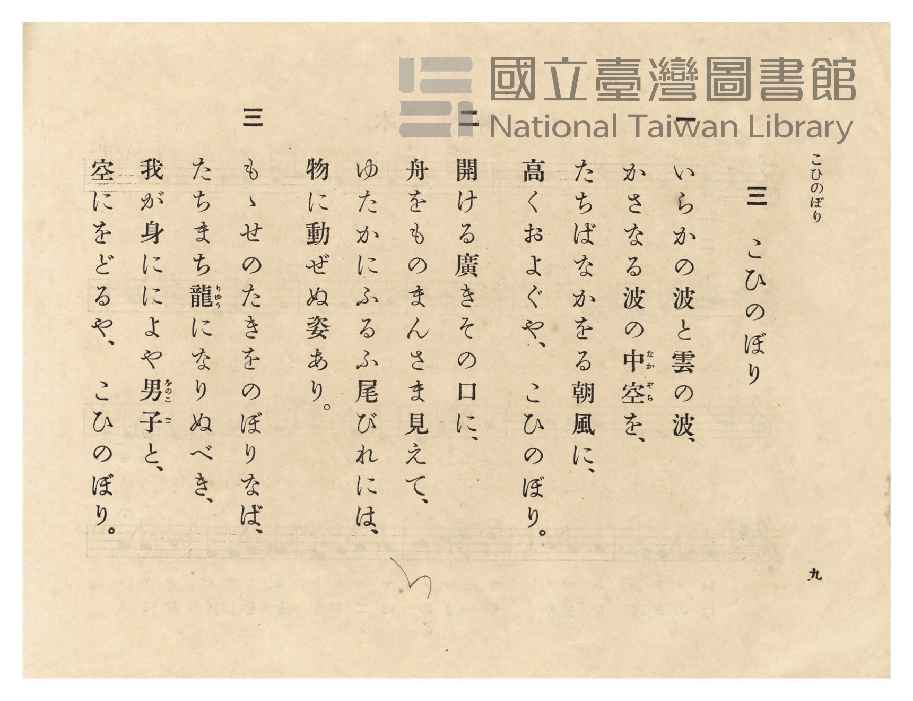

# こひのぼり

> Re:Shōka 使用 AI 協助辨識與重建樂譜，可能會有錯誤。歡迎回報。

- **鋼琴伴奏版**：<br><audio controls src="koinobori.mp3"></audio>
- **NEUTRINO 歌聲合成版**：<br><audio controls src="koinobori_neutrino.mp3"></audio>

- 詞：文部省唱歌
- 曲：弘田龍太郎
- 臺灣總督府《公學校唱歌》第五學年用（昭和十一年，索書號 523.37 4322-4）

## 說明

原書資訊與歌詞全文（對應 P012.jpg–P013.jpg，原書 pp. 8–9）：
調性與拍號：ヘ長調（F 大調，1 降記號）4/4 拍，速度 ♩=96


## 歌詞

```text
一
いらかの波と雲の波、
かさなる波の中空（なかぞら）を、
たちばなかをる朝風に、
高くおよぐや、こひのぼり。

二
開ける廣きその口に、
舟をものまんさま見えて、
ゆたかにふるふ尾びれには、
物に動ぜぬ姿あり。

三
もゝせのたきをのぼりなば、
たちまち龍（りゅう）になりぬべき、
我が身にによや男子（をのこご）と、
空にをどるや、こひのぼり。
```

## ABC

<div class="abc-score" data-abc-src="koinobori.abc" aria-label="五線譜載入中"></div>

[下載 ABC 原始檔](koinobori.abc)

## TMD 檔案連結

- [主旋律 TMD 檔案](koinobori.tmd) [[在 TMD Studio 編輯](https://tmdlang.github.io/Tmd-TS/#tmd=s7IKdvYPcrWy4qpTUCpJTLdSSM7PyUlNLsnMz7PKzk9PzM7Ojy_OyM9OVIKrKMvPKc1NtUovSkxJjTdFiBfnlxYlp1oVJ2fk5-fEl6RWlCTl52ejy8cXJKanWgUYGBohZAqK8stS8xLzgLoLijLzSlJTwNoRClLLMlNSQdLFyYl58WWpRZlpmakpSE5KLSoGuRhqRUlRYl5xclFmAcgbCFX5RSUZ-UBnF2RUWmVkFpfkF2UmJ-bEZyfmIfmuJCMV6Lm01OKSzLLEnGJ0ieLUxOL8PCRhoCHpmXlWufl5SaXAgMKQKEnMBAqDwrA8MT43MTMvJzEP6HItLYXHjZMfN2563LjuceOex01dClpaXIq2CpZmXPa2Cm5cNib6JnYgw16snPd-z6xn09pfNq94Pqfx6ZSNz9b2gK15NnsTUObpnhnPp2x4ua_36ZJVL5v7wDIv2nc9b1z8fMfe53MXP90153FD19PWNU_X7ni2YCFE_-OG7udr1jzZNQUo-HTnludTVrzf0_Fsxtqnk3qe9jY-2dEAFHy_p-f5lkXPZu94MXO-gqmRsZ6xuYKJsZGRrsn7PZ1KXFz6Wgq21AJcCgoKT_vmgyzb3P5iRdeLjnagK4Fef9q6Auh1oOOebuh91t6pAEo4elkF6Y8aJgOZxiAm0J0QrQoFBXoKFkAZS6ADgSEDMvTFqv3PGpaDjOvuBfoDKPq4ecbLqduB4kBD3RSeLlkOZvYYKryc2ftixQywok5g4CsAdQDFXzbMf7prmcKjmSttgVEDMhIYOiDqcWPL46bOx43dwBh8tnnR48YVL2eDYhPEbmiEqADKTX3cuOpxUzdYxbonO9Y-X7kLaDFIECQ7D2gE0LrHTZPgeuY_blz4uHEDVAVQAqh5ztyXi1Y8blwNVfRy9YzHjf2PG7seNwFNmvC4qQUogZacHjc0QVy7qwesZRrQtolAs57uXvy4sfdx41ygyqf9QDbM0Bcd88G2NYGN2Pe4CWgc0PH7XiwD6gRaswzmwqY2sCOBoqsfN24FGgkkn27Y97hx8-OmHrDgeqjS550rgfyn3UBj5jxuXPN0-f7HjU3IbtvRCTERKAh0z2ywzUCje0EOgXsEFBAb0IIHaNtCYJIHhSRQRVPr48Y2UDCCLAeGNlDPmseNO0EGQbQ965j4uLHnxS6gNBgBg62p5fmU7U_XTgAbAbEN6OEpYFNWwNy_chdYNVB6JcifuMIZqJTyLAAFClr6XFze-Zl5-UnAEsQqIDMxL9-hxqCmGmSLgo2hmZYdmIUt9ymA8vSOhhcLexQ0TBSebuh_vr5BB55lNLFoAFoGMqxGoTo3rVbBUEEXCI0UjMG0iYIpmIZAkFgNXMYISkP4ugoGULoGwwyYCog4SAVELyaEmwF2ko9hDTBhLAGLPG5eCWSvhrL7gLgLSd_j5vlgcx83d0D4TeuB7EVYVMfD3QDRA1K7Goi3QtV2ATHEFggPXTUmhJsIcbMRUG3jJqjJnUD2RCi7Gy4ONb2pF2JyI4gG8hvnAvE6KLsfiBdiurkRGgKNW4F4LdScSaDsAzMVagJE9T7i3GwM8h8stBYBTdsNZQNDrmk_iptBdoJUQ30IDts5UPYqHOE8Aap3P5DdCFU7D84G63zcvBShoWkZQWfjT_-7eshJ_7RI-jAzzOAqkE1FhliSPjBwIcEDTJSwpN-0D5wVkKIEHBWgUINEFChY4UGOpBM1SmDRB0r60IgHZgGE2sdNe5BUd-NwM5ak3zQZor9xKjz5PW4ERnwjJGNCTW8ExTBIdRuUPx9UU0LZQDcBkzeGm4EZCCIPcuckKHszkN0DNxXmelDSX0-cm8FJH2oyOPOvgrJ7gHgmspvhSR9i8uOmNYgiBGgCIpSQw3kFVH4JapZp2gw3dQuSauQwwu5mAuV-J3nlfkEtPCmj0yAISu6wpG0MTfyGCmYwVyFSvylMCKQWpA5W4sPKe1gWwoTYSn5YyYOcLJGj9XETKLKQgrlpAzioIWxg0miGJBPUKIFkKlBEQMotSMmF6poaHK7EnuQxy15EUoTwQBkWlChhyX0OEK-BsmcCMSwJI5f0sPoG2F6CsYA9BDLdCUrmTXth5sALENSsDS9KmjuhfGBWpFt44k3aT2fPJitpA1s0sKIXBmEFsAncbbiKdUR7Bdw0wkjduPIIJsSXumEQWyoHqYMVSCvA6RvCBhYniCIEHiu0Td1wd2JJ5aD0CklToDQOSt8QNrCIBKZvmGpYKqdt6oa7E0sqR676gG0zaEuPHuFZy8Wla6cAb9QrADnKXAA)]
- [鋼琴伴奏 TMD 檔案](koinobori_piano.tmd) [[在 TMD Studio 編輯](https://tmdlang.github.io/Tmd-TS/#tmd=s7IKdvYPcrWy4tLSUnjcOPlx46bHjeseN-553NT1fk_Hy-49zydsebJny9Ol_c87O97v6VTQ0uJStFWwNOOyt1Vw47Ix0Tex46pTUHqxct77PbOeTWt_2bzi-ZzGp1M2PlvbowSSeTZ7E1Dm6Z4Zz6dseLmv9-mSVS-b-8AyL9p3PW9c_HzH3udzFz_dNedxQ9fT1jVP1-54tmAhRP_jhu7na9Y82TUFKPh055bnU1YA3fRsxtqnk3qe9jY-2dEAFHy_p-f5lkXPZu94MXO-gqmRsZ6xuYKJsZGRrgnQtUpcXJ55JUX5VgGZiXn5QR4ONQY11VwKQGBjaKZlB2bVKFTnptUqGCroAqGRgjGYNlEwBdMQCBKrgcsYQWkIXxeqE6TCNB5JCKQMpgRiNEgJTDE6NIAZwlWL4mYfZDeboDk5XiHaMBZGAc0GMkzj0QSgCkDiyAIGEJu88zPz8pPyizJpGkJwz2GYgRmGEL34AgjkJB_DGoXHTUvAIo-bVwLZq6HsPiDuQtL3uHk-2NzHzR0QftN6IHsRFtWwyAOpBekBqV0NxFuharuAGGILhIeuGhPCTYS42QiotnET1OROIHsilN0NF4ea3tQLMbkRRAP5jXOBeB2U3Q_ECzHd3AgNgcatQLwWas4kIG6CmQo1AaJ6H3FuNgb5DxZai4Cm7YaygSHXtB_FzSA7QaqhPgSH7RwoexWOcJ4A1bsfyG6Eqp0HZ4N1Pm5eitDQtIygs6FJlhapFWaGGVwFsqnIEEtqBYYHxEfAdARLrU37wKkXKRTBoQfyKCRsQSEBDyUknaihCAtxUGqFxhUw1SLUPm7ag6S6G4ebsaTWpskQ_Y1T4SnmcSMwrhoheQlqeiMoUkCq26D8-UAMsQWUKkEpEsPNwDQPkQe5cxKUvRnI7oGbCnM9KLWuJ87N4NQKNRmcX1dB2T1APBPZzfDUCjH5cdMaRK4HmoAIJeRwXgGVX4Kayps2w03dgqQaOYywuxleuhbUwlMfOg2CyFWHMTS9GiqYwQxCJFiMCghWrsJKVViqx4TYyldY_kZOScgx8bgJFL5IIdO0ARw6EDYwNpshMYsaipB8AAo7SOkAKR9QXVODw5XYUylmCYdIPRAeKI-B0hEshc4B4jVQ9kwghqU65PIUVqo_boSb34Rcs5DkTlDKbNoLMwee51FzIzz3N3dC-cDcQ7fwhKVGYFUPK-BgEFbMmcCNI9wYArcZqNIiwkyQMIgtYYLUwbL9CnCShLCBmRaRUeEBSdsECXcnloQJSmKQZABKlqAkCWEDCyJgkoSphiVM2iZIuDuxJEzkCgbYaIE2gegRnpjtUzJbw8DGLoa0aTxUHsQAtYahzQaiTTHBbFAjFee4zDHBMAdbyxyRE4HqQTahKkRp5KN7HkdLX9dOAdytUAAy4KEa7QNUgypghC5gDBZQ5gIA)]

## 分析

```text
================================================================================
📊 TMD Song Profile: [ こひのぼり ]
================================================================================
⏱  Duration:       0:40 (40.0s), 16 measures total
🎼 Key & Tempo:    首調基準 F, != 96.0 BPM, <4/4>
   - 分析範圍：      由實際發聲的音符與和弦推測調性；播放脈絡另行呈現
🎤 人聲音域:    C4 (MIDI 60) – D5 (MIDI 74) [跨度: 14 個半音 / 1.2 個八度, 難度: moderate]
   - 最低音:  C4 in [Koinobori #1 @ m.11, 0:25]
   - 最高音: D5 in [Koinobori #1 @ m.7, 0:16]
   - 適合: soprano, mezzo-soprano, contralto, tenor, baritone, bass
🏛  結構:      Koinobori (40.0s)
⚡ 編曲密度:        Peak 1 軌道同時演奏
🗝  調性診斷：       F 調性不明確（純淨自然大調，未偵測到可信轉調）
   - 風格氣質:    純淨自然大調（陽光明朗、易唱易記，無明顯調外色彩）
   - 轉調歷程:    全曲維持單一推測調性（未偵測到可信轉調）
   - 核心骨幹音:  A, F, C, G, D
   - 調性數值:    F 調性不明確 [相關度: 0.76, 穩定度: Ambiguous, 自然音純度: 100.0%]
   - 候選調性 (K-S): F 大調 (0.76), A 小調 (0.73), C 大調 (0.57)
   - 五度圈歷程:   -1
   - 各段落調性細節:
     • [Koinobori #1]: F 調性不明確 (r: 0.76, 自然音純度: 100.0%)

  [ 五度圈游移軌跡 ]
               C  
        [F ]*          G  
      Bb               D  
      Eb               A  
         Ab           E  
            Db       B  
               F# 
     (* = active key center)

  [ 十二半音累積音高分佈 ]
     C  : █████████████             17.5%
     C# :                            0.0%
     D  : █████                      7.0%
     D# :                            0.0%
     E  :                            0.0%
     F  : ██████████████            19.3%
     F# :                            0.0%
     G  : █████████████             17.5%
     G# :                            0.0%
     A  : ████████████████████████  32.5%
     A# : █████                      6.1%
     B  :                            0.0%
--------------------------------------------------------------------------------
Assignment 軌道音域：
  - Piano         : C4 – D5 (14 個半音 / 1.2 個八度, 66 個音符)
================================================================================
```


## 原書掃描頁






