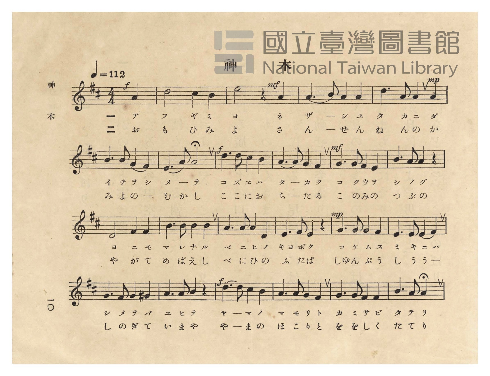
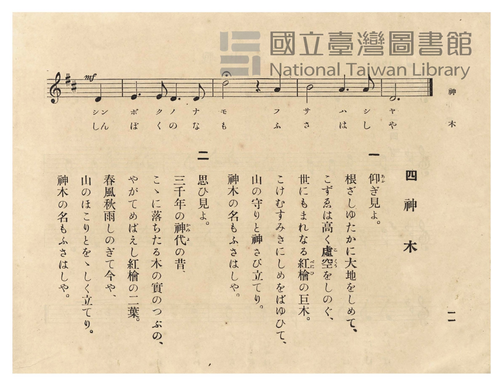

# 神木

> Re:Shōka 使用 AI 協助辨識與重建樂譜，可能會有錯誤。歡迎回報。

- **鋼琴伴奏版**：<br><audio controls src="shinboku.mp3"></audio>
- **NEUTRINO 歌聲合成版**：<br><audio controls src="shinboku_neutrino.mp3"></audio>

- 臺灣總督府《公學校唱歌》第五學年用（昭和十一年，索書號 523.37 4322-4）

## 說明

原書資訊與歌詞全文（對應 P014.jpg–P015.jpg，原書 pp. 10–11）：
調性與拍號：ニ長調（D 大調，2 升記號）4/4 拍，速度 ♩=112


## 歌詞

```text
一
仰（あふ）ぎ見よ。
根ざしゆたかに大地をしめて、
こずゑは高く虛空（こくう）をしのぐ、
世にもまれなる紅檜（べにひ）の巨木。
こけむすみきにしめをばゆひて、
山の守りと神さび立てり。
神木の名もふさはしや。

二
思ひ見よ。
三千年の神代（かみよ）の昔、
こゝに落ちたる木の實のつぶの、
やがてめばえし紅檜の二葉。
春風秋雨しのぎて今や、
山のほこりとをゝしく立てり。
神木の名もふさはしや。
```

## ABC

<div class="abc-score" data-abc-src="shinboku.abc" aria-label="五線譜載入中"></div>

[下載 ABC 原始檔](shinboku.abc)

## TMD 檔案連結

- [主旋律 TMD 檔案](shinboku.tmd) [[在 TMD Studio 編輯](https://tmdlang.github.io/Tmd-TS/#tmd=s7IKdvYPcrWy4qpTUCpJTLdSSM7PyUlNLsnMz7PKzk9PzM7Ojy_OyM9OVIKrKMvPKc1NtUovSkxJjTdFiBfnlxYlp1oVJ2fk5-fEl6RWlCTl52ejy8cXJKanWgUYGJogZAqK8stS8xLzgLoLijLzSlJTwNoRClLLMlNSQdLFyYl58WWpRZlpmakpSE5KLSoGuRhqRUlRYl5xclFmAcgbCFX5RSUZ-UBnF2RUWmVkFpfkF2UmJ-bEZyfmIfmuJCMV6Lm8xJLSolR00aLUnMx0NCOBAnlWJYmZ5UCH5aelZSZnJuYocWlpKTxfOu_ZnBUKWlpcirYKhoZGXPa2Ci5cNib6JnYg7S_adz1vXPx8x97ncxc_3TXncUPX09Y1T9fueLZg4dMpG5-t7Xnc0P18zZonu6YABZ_u3PJ8yor3ezqezVj7dFLP097GJzsagILv9_Q837Lo2ewdL2bOVzA1MtYzNlcwMTYy0jV5v6dTiYtLX0vBllqAS0FB4WnffJBlm9tfrOh60dEOdOWLlfOetq54Nq0d6LinG3qftXcqgOJWL6sg_VHDZCDTFMQEuhOiVaGgQE_B0AAoZWgIdOL7PbNAxr5Ytf9Zw3KQgd29QJ8ARR83d7-cuh0oDjTWReHpkuVgZo-RwtNeoN0zwIo6gUGpANQBFH_ZMP_prmUKj2autAWFNMhMYACBqd0bgEY8bmx63LgVqOVxY9-LZd2PmzoeNzSBpJ8t2Pm4cdrjxumPm9oeN85_3Nj9uHE10LqnczY8bpoEFm983LjscUMjSPXjxsmPG2c9bpr4uHH9y9UzHjf2v5g5-_nKXWAbgFL9jxvbQJZAdDaue9w4AarzyQ6gJasfNwGdse9xU8_jxlWPm7qfb2l9tmoOWDPQFasfN24Cu3Dd0-0rgCkH6kKwwRMfNzU8bpz5uHH_48ZesFKww0D2AN0JdPkmhCOfbtwIMmNdx-OmrseNK4DJ8HHj1MeNm5-vBvptGUgQYjAkfYKUTugFO2wrWN16sNktIEVgh-_qAYdTw1ygJShB92RH59PeZmAiBBoBNOvJ7sVgnwAt2Q9UBPHJsxlTkIKuCWjG6hcT9j5uXAgK66ZuqP3rl4HDasnjxm0gBlQD0A2NwIACuhgYAxseNwLNng4JMaAioLNeTOyEReKMpS8XrXi-vPvlbKB5kIDvA-p8srsL7BOkYHncuBvsElDIgIIP5CSghn7SAweoiPI8BQUKWvpcXMEZmXlJ-dmlVgGZiXn5DjW6hjXVIFsUbCy07MAMbLlZ4emejS-2bgfmHVBhsaPh2bqtChqwHKiJRT3QKpBZNQoGCrpwWJ1Wq2AKpGsUDOOgQuZAbAYWMoIJgXRU58KVgkiQGhCNotkUzK3OLYCqBFvoY1ijEI9k5eOmRWA9j5unwkXWgcjm-VDxFVBxkK7Hzb0Q0aZtcNXbweLLoOL7oaKrgWLdYJkGhN1GaHY3dkF1NcFFNoFJkCkg8Q5kuxtBLgSJToarngO2C8QHijeuhdo9GcgG-6ER5IIacAbCHmvgkr0HHFlmCk839D9f36ADLzjxRhsoTkChbgIkjcH2GyEFOgjWgKMTGhdAChGTEBWmSHrB0Qni6gJJkBDIMJglECNBsY6IwsdNSyCebW4EYnCggSMCFGELYcHT3AZ3yuOmzdDA2QUU3wiW7YfKQKIMEmkgcj2ajvVADIpeiD0gGZBNIH4fkL0BGj2IKIZEH0hnBzQiYG4AJQVItAAzMEK8ERKhIBpYMoFZ0ITRCPdLIyg5AssqNB3roLZB7AHJQMOlcRtUDOI2_ElgRyc5ScAQ6jZQfEGiEZYoQDRqVINokHpYMjEG0-A4heRQWOSjpycjMA0WQUQ-PE_C8hgsD8-Diq4BYlAQPm4GBSdIZiZc_ePmSWBWHzRS1j5uXg6VnAONfXCYIaWAjUC5BWDWTqhxoNgA8dfCnQBOTYg00NQCj7keMAkrIBqhohuAGJS9ISkBFHMgs0F8YNEBLQZgcboVKjMfrA_uPlAl0Ap1CCjpgEuiRlCiB0tCNbVBxcCJDX9CeDp7NjkJARJ3xmDaRB1sPSzeQakAGstEFwbI5QByuoKV5yCDEIENLgxgGXIhrDBongCNKFCwg_iToMUBNOiaIdkEJANKM_DUAE9Bi4B4FZgFiiSQHaCUBKkXHjeBIuRxM7TchZX5QPOhepq2P24GpR3kMgEWHaAcC7IMniIaISkF2CKDphpY6kOkoH1QnRD1u6GiwChvAifyRlB2AOkAJWyQ9UDPgu0DtiigeqDpFWgnTA8w7YDdT6h2mAJOESbIKQLclsabImB5F1JEGCJX6KDUAKmmIbEK4YFIRIkCU4ec5UFVHbQ0BkcWKMC7wFEGyvwgCKmgYZUkJM_AciY4UlAiHqYDOY72QEOpH15uA1vIKBU0pCIGmQ1SD28yNIJKDUheRo45hB21XFy6dgqwtpUCkK3MBQA)]
- [鋼琴伴奏 TMD 檔案](shinboku_piano.tmd) [[在 TMD Studio 編輯](https://tmdlang.github.io/Tmd-TS/#tmd=s7IKdvYPcrWy4qpTUCpJTLdSSM7PyUlNLsnMz7PKzk9PzM7Ojy_OyM9OVIKrKMvPKc1NtTJFiBTnlxYlp-JSD5GNL0hMT7UKMDA00QUSSJoLivLLUvMS84AGlCRmlifmxacDBYry8ovi01PzUosScxBqU8syU1JBKguKMnMTiyrjU_KTgW7JK0FyXWpRMcjxBZmJefnxiUVFiXnpqahK8otKMvLTixILMiqtMjKLS_KLMpMTc-KzE_OQXF2SAdRllZpSmpwICgwlLi0thedL5z2bs-L9no6X3XueT9jyZM-Wp0v7n3d2vN_TqaClxaVoq2BoaMRlb6vgwmVjom9iBzLsRfuu542Ln-_Y-3zu4qe75jxu6Hrauubp2h3PFix8OmXjs7U9jxu6n69Z82TXFKDg051bnk8BWfBsxtqnk3qe9jY-2dEAFHy_p-f5lkXPZu94MXO-gqmRsZ6xuYKJsZGRrgnQaiUuLs-8kqJ8qwCQl4M8HGoMaqq5FIDAxkLLDsyoUahOq1UwjFPQBUIgZQ6kzIC4RsEULGSqYAIkjcEi1blApSBJiASErFEwhIqAoAFIIVctir0-yPaaoNobrxBtGKtgGg-kTWJBZkEETCAU1EoQDygLVmUaj6QMSBlArAvOyMxLys8uRfhU1xDTqyDXwSDIepAfgIZBPK-L5HcjmBBIB9gNEKUQT5uBaRTNpmBudW4BVCXYQh_DGoV4JCsfNy0C63ncPBUusg5ENs-Hiq-AioN0PW7uhYg2bYOr3g4WXwYV3w8VXQ0U6wbLNCDsNkKzu7ELqqsJLrIJTIJMAYl3INvdCHIhSHQyXPUcsF0gPlC8cS3U7slANtgPjSAX1HBBQxqSSsyQEo8RUjiBIMkJD8TVBZIgIZBhMEsgRkISHizUHzctgbivuRGIwf4Ehx0ojBfCfNTcBnfK46bNUP_sAopvBMv2Q2UgoQwJZxC5Hk3HeiAGxQjEHpAMyCYQvw_I3gANUUSsQEIcpLMDGnYwN4BiDxKSjxunI8QbIXEAoh83gt0Ai8tGuF8aQSnocRM4DpB0rIPaBrEHJAMNl8ZtUDGI26CxBsvJoCCGhDwsHkE0auyAaJB6WMwag2lwNEDyASy-0JOAEZgGiyDiC57yYSkZllPmQUXXADHI14-bQSEAkpkJV_-4eRKY1QcNx7WPm5dDJedAIwzsTaRI2wiUWwBm7YQaBwpAEH8t3AngBICItqYWeGD3gElYNmyEim4AYlAmgkQeKLBBZoP4wAwKzWywaNgKlZkP1gd3X-P0x02tUIeAYhuc3xtB6RQsCdXUBhUDpw9Y3EGC2xhMm6iDdcCiChRx0IghOssh5zbkpAAr6EAGIcIHnOVgyX4hLMs1T4CGLSikQPxJ0EwH9W0zJDGCZEDRDI9AeKQvAuJVYBYoXEF2gCIfUmA-bgKF4eNmaIEEKwyB5kP1NG1_3AyKbuScBwtBUL4AWQaPxEZI5D5u3AeNaFiCQUT6PqhOiPrdUFFgLDWB02UjKAWDdIDSIsh6oGfB9j1uhJYk4DwKsROmBxjdYPfDIhGWQyAZ0RC5cgJFIKTKIaYGRmQsULENLabA4QsKoy5wKIOyGAhCKhtYgQ9JmbD0Dw5HlLiC6UAO1j1Qj_XDC7THjatQKhtIpQIyG6QeXv01gvImJMcgBzbCDoyqHdSYQFTtiNaEARTiaFfA2w5QNeD0C29EQNoaaHxYvoIYAW-RwE1Cao6Q3JQByUG0AgVAWkAY1JSBlsNoLkNyA7LRcHkUN0H8ByqA8bocqxeN4pHVAQVwBii675A8BuNj-gvSkoIZj-49A7AUnIuvuadrpwBuYCoAGbD0Ee0DVILCNwLzlbkA)]

## 分析

```text
================================================================================
📊 TMD Song Profile: [ 神木 ]
================================================================================
⏱  Duration:       0:55 (55.7s), 26 measures total
🎼 Key & Tempo:    首調基準 D, != 112.0 BPM, <4/4>
   - 分析範圍：      由實際發聲的音符與和弦推測調性；播放脈絡另行呈現
🎤 人聲音域:    D4 (MIDI 62) – E5 (MIDI 76) [跨度: 14 個半音 / 1.2 個八度, 難度: moderate]
   - 最低音:  D4 in [Shinboku #1 @ m.12, 0:23]
   - 最高音: E5 in [Shinboku #1 @ m.3, 0:04]
   - 適合: soprano, mezzo-soprano, contralto, tenor, baritone, bass
🏛  結構:      Shinboku (55.7s)
⚡ 編曲密度:        Peak 1 軌道同時演奏
🗝  調性診斷：       D 大調（純淨自然大調，未偵測到可信轉調）
   - 風格氣質:    純淨自然大調（陽光明朗、易唱易記，無明顯調外色彩）
   - 轉調歷程:    全曲維持單一推測調性（未偵測到可信轉調）
   - 核心骨幹音:  A, D, B, G, E
   - 調性數值:    D 大調 [相關度: 0.90, 穩定度: High, 自然音純度: 99.0%]
   - 候選調性 (K-S): D 大調 (0.90), A 大調 (0.74), B 小調 (0.63)
   - 五度圈歷程:   +2
   - 各段落調性細節:
     • [Shinboku #1]: D 大調 (r: 0.85, 自然音純度: 99.0%, 調外音: G#)

  [ 五度圈游移軌跡 ]
               C  
         F            G  
      Bb              [D ]*
      Eb               A  
         Ab           E  
            Db       B  
               F# 
     (* = active key center)

  [ 十二半音累積音高分佈 ]
     C  :                            0.0%
     C# : ███                        3.0%
     D  : █████████████████         18.7%
     D# :                            0.0%
     E  : ███████████               12.1%
     F  :                            0.0%
     F# : ██████████                11.1%
     G  : ████████████              12.6%
     G# : █                          1.0%
     A  : ████████████████████████  25.8%
     A# :                            0.0%
     B  : ███████████████           15.7%
--------------------------------------------------------------------------------
Assignment 軌道音域：
  - Piano         : D4 – E5 (14 個半音 / 1.2 個八度, 91 個音符)
================================================================================
```


## 原書掃描頁






