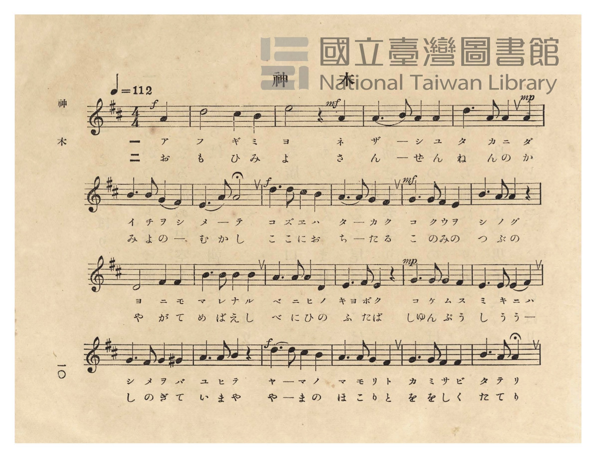
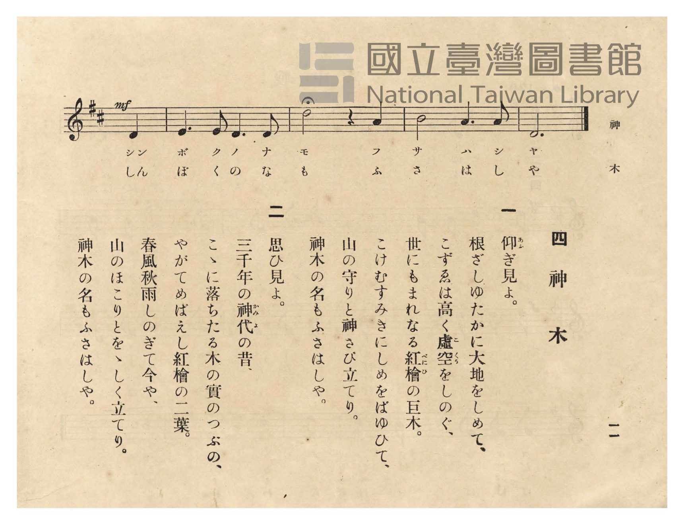

# 神木

> Re:Shōka 使用 AI 協助辨識與重建樂譜，可能會有錯誤。歡迎回報。

- **NEUTRINO 歌聲合成版**：<br><audio controls src="shinboku_neutrino.mp3"></audio>
- **鋼琴伴奏版**：<br><audio controls src="shinboku.mp3"></audio>


- 臺灣總督府《公學校唱歌》第五學年用（昭和十一年，索書號 523.37 4322-4）

## 說明

原書資訊與歌詞全文（對應 P014.jpg–P015.jpg，原書 pp. 10–11）：
調性與拍號：ニ長調（D 大調，2 升記號）4/4 拍，速度 ♩=112


## 歌詞

```text
一
仰（あふ）ぎ見よ。
根ざしゆたかに大地をしめて、
こずゑは高く虛空（こくう）をしのぐ、
世にもまれなる紅檜（べにひ）の巨木。
こけむすみきにしめをばゆひて、
山の守りと神さび立てり。
神木の名もふさはしや。

二
思ひ見よ。
三千年の神代（かみよ）の昔、
こゝに落ちたる木の實のつぶの、
やがてめばえし紅檜の二葉。
春風秋雨しのぎて今や、
山のほこりとをゝしく立てり。
神木の名もふさはしや。
```

## ABC

```abc
X:1
T:神木
M:4/4
L:1/16
Q:1/4=112
K:D
V:V1 name="Piano" snm="Pia"
[V:V1]
!f! z12 A4 | d8 c4 B4 | !mf! e8 z4 A4 | A6 B2 A4 A4 |
w: 1.~ア | フ ギ ミ | ヨ ネ | ザ _ シ ユ
w: 2.~お | も ひ み | よ さ | ん _ ぜ ん
!mp! d6 A2 A4 A4 | B6 B2 G4 F4 | E6 A2 A8 | !f! d6 d2 c4 B4 |
w: 1.~タ カ ニ ダ | イ チ ヲ シ | メ _ テ | コ ズ ヱ ハ
w: 2.~ね ん の か | み よ の _ | む か し | こ こ に お
A6 A2 G4 F4 | !mf! G6 G2 F4 E4 | B6 A2 A4 z4 | D8 F4 F4 |
w: 1.~タ _ カ ク | コ ク ウ ヲ | シ ノ グ | ヨ ニ モ
w: 2.~ち _ た る | こ の み の | つ ぶ の | や が て
B6 B2 B4 B4 | A6 A2 A4 D4 | E6 F2 E4 z4 | !mp! G6 G2 G4 F4 |
w: 1.~マ レ ナ ル | ベ ニ ヒ ノ | キョ ボ ク | コ ケ ム ス
w: 2.~め ば え し | べ に ひ の | ふ た ば | しゅ ん ぷ う
E6 E2 E4 F4 | G6 F2 G4 ^G4 | A6 A2 B4 z4 | !f! d6 d2 c4 B4 |
w: 1.~ミ キ ニ ハ | シ メ ヲ バ | ユ ヒ テ | ヤ _ マ ノ
w: 2.~し う う _ | し の ぎ て | い ま や | や _ ま の
A6 A2 G4 F4 | G6 G2 F4 F4 | !mf! B6 A2 A4 D4 | E6 E2 D6 D2 |
w: 1.~マ モ リ ト | カ ミ サ ビ | タ テ リ シン | ボ ク ノ ナ
w: 2.~ほ こ り と | を を し く | た て り しん | ぼ く の な
d8 z4 A4 | B8 A6 A2 | D12 z4 |
w: 1.~モ フ | サ ハ シ | ヤ
w: 2.~も ふ | さ は し | や
```

## TMD 檔案連結

- [主旋律 TMD 檔案](shinboku.tmd) [[在 TMD Studio 編輯](https://tmdlang.github.io/Tmd-TS/#tmd=s7IKdvYPcrWy4qpTUCpJTLdSSM7PyUlNLsnMz7PKzk9PzM7Ojy_OyM9OVIKrKMvPKc1NtUovSkxJjTdFiBfnlxYlp1oVJ2fk5-fEl6RWlCTl52ejy8cXJKanWgUYGJogZAqK8stS8xLzgLoLijLzSlJTwNoRClLLMlNSQdLFyYl58WWpRZlpmakpSE5KLSoGuRhqRUlRYl5xclFmAcgbCFX5RSUZ-UBnF2RUWmVkFpfkF2UmJ-bEZyfmIfmuJCMV6Lm8xJLSolR00aLUnMx0NCOBAnlWJYmZ5UCH5aelZSZnJuYocWlpKTxfOu_ZnBUKWlpcirYKhoZGXPa2Ci5cNib6JnYg7S_adz1vXPx8x97ncxc_3TXncUPX09Y1T9fueLZg4dMpG5-t7Xnc0P18zZonu6YABZ_u3PJ8yor3ezqezVj7dFLP097GJzsagILv9_Q837Lo2ewdL2bOVzA1MtYzNlcwMTYy0jV5v6dTiYtLX0vBllqAS0FB4WnffJBlm9tfrOh60dEOdOWLlfOetq54Nq0d6LinG3qftXcqgOJWL6sg_VHDZCDTFMQEuhOiVaGgQE_B0AAoZWgIdOL7PbNAxr5Ytf9Zw3KQgd29QJ8ARR83d7-cuh0oDjTWReHpkuVgZo-RwtNeoN0zwIo6gUGpANQBFH_ZMP_prmUKj2autAWFNMhMYACBqd0bgEY8bmx63LgVqOVxY9-LZd2PmzoeNzSBpJ8t2Pm4cdrjxumPm9oeN85_3Nj9uHE10LqnczY8bpoEFm983LjscUMjSPXjxsmPG2c9bpr4uHH9y9UzHjf2v5g5-_nKXWAbgFL9jxvbQJZAdDaue9w4AarzyQ6gJasfNwGdse9xU8_jxlWPm7qfb2l9tmoOWDPQFasfN24Cu3Dd0-0rgCkH6kKwwRMfNzU8bpz5uHH_48ZesFKww0D2AN0JdPkmhCOfbtwIMmNdx-OmrseNK4DJ8HHj1MeNm5-vBvptGUgQYjAkfYKUTugFO2wrWN16sNktIEVgh-_qAYdTw1ygJShB92RH59PeZmAiBBoBNOvJ7sVgnwAt2Q9UBPHJsxlTkIKuCWjG6hcT9j5uXAgK66ZuqP3rl4HDasnjxm0gBlQD0A2NwIACuhgYAxseNwLNng4JMaAioLNeTOyEReKMpS8XrXi-vPvlbKB5kIDvA-p8srsL7BOkYHncuBvsElDIgIIP5CSghn7SAweoiPI8BQUKWvpcXMEZmXlJ-dmlVgGZiXn5DjW6hjXVIFsUbCy07MAMbLlZ4emejS-2bgfmHVBhsaPh2bqtChqwHKiJRT3QKpBZNQoGCrpwWJ1Wq2AKpGsUDOOgQuZAbAYWMoIJgXRU58KVgkiQGhCNotkUzK3OLYCqBFvoY1ijEI9k5eOmRWA9j5unwkXWgcjm-VDxFVBxkK7Hzb0Q0aZtcNXbweLLoOL7oaKrgWLdYJkGhN1GaHY3dkF1NcFFNoFJkCkg8Q5kuxtBLgSJToarngO2C8QHijeuhdo9GcgG-6ER5IIacAbCHmvgkr0HHFlmCk839D9f36ADLzjxRhsoTkChbgIkjcH2GyEFOgjWgKMTGhdAChGTEBWmSHrB0Qni6gJJkBDIMJglECNBsY6IwsdNSyCebW4EYnCggSMCFGELYcHT3AZ3yuOmzdDA2QUU3wiW7YfKQKIMEmkgcj2ajvVADIpeiD0gGZBNIH4fkL0BGj2IKIZEH0hnBzQiYG4AJQVItAAzMEK8ERKhIBpYMoFZ0ITRCPdLIyg5AssqNB3roLZB7AHJQMOlcRtUDOI2_ElgRyc5ScAQ6jZQfEGiEZYoQDRqVINokHpYMjEG0-A4heRQWOSjpycjMA0WQUQ-PE_C8hgsD8-Diq4BYlAQPm4GBSdIZiZc_ePmSWBWHzRS1j5uXg6VnAONfXCYIaWAjUC5BWDWTqhxoNgA8dfCnQBOTYg00NQCj7keMAkrIBqhohuAGJS9ISkBFHMgs0F8YNEBLQZgcboVKjMfrA_uPlAl0Ap1CCjpgEuiRlCiB0tCNbVBxcCJDX9CeDp7NjkJARJ3xmDaRB1sPSzeQakAGstEFwbI5QByuoKV5yCDEIENLgxgGXIhrDBongCNKFCwg_iToMUBNOiaIdkEJANKM_DUAE9Bi4B4FZgFiiSQHaCUBKkXHjeBIuRxM7TchZX5QPOhepq2P24GpR3kMgEWHaAcC7IMniIaISkF2CKDphpY6kOkoH1QnRD1u6GiwChvAifyRlB2AOkAJWyQ9UDPgu0DtiigeqDpFWgnTA8w7YDdT6h2mAJOESbIKQLclsabImB5F1JEGCJX6KDUAKmmIbEK4YFIRIkCU4ec5UFVHbQ0BkcWKMC7wFEGyvwgCKmgYZUkJM_AciY4UlAiHqYDOY72QEOpH15uA1vIKBU0pCIGmQ1SD28yNIJKDUheRo45hB21XFy6dgqwtpUCkK3MBQA)]
- [鋼琴伴奏 TMD 檔案](shinboku_piano.tmd) [[在 TMD Studio 編輯](https://tmdlang.github.io/Tmd-TS/#tmd=s7IKdvYPcrWy4tLSUni-dN6zOSve7-l42b3n-YQtT_Zsebq0_3lnx_s9nQpaWlyKtgqGhkZc9rYKLlw2Jvomdlx1Ckov2nc9b1z8fMfe53MXP90153FD19PWNU_X7ni2YOHTKRufre153ND9fM2aJ7umAAWf7tzyfArIgmcz1j6d1PO0t_HJjgag4Ps9Pc-3LHo2e8eLmfMVTI2M9YzNFUyMjYx0TYBWK3FxeeaVFOVbBWQm5uUHeTjUGNRUcykAgY2Flh2YUaNQnVarYBinoAuEQMocSJkBcY2CKVjIVMEESBqDRapzgUpBkhAJCFmjYAgVAUEDkEKuWhR7fZDtNUG1N14h2jBWwTQeSJvEgsyCCJhAKKiVIB5QFqzKNB5JGZAygFgXnJGZl5SfXYrwqa4hpldBroNBkPUgPwANg3heF8nvRjAhkA6wGyBKIZ42A9Momk3B3OrcAqhKsIU-hjUK8UhWPm5aBNbzuHkqXGQdiGyeDxVfARUH6Xrc3AsRbdoGV70dLL4MKr4fKroaKNYNlmlA2G2EZndjF1RXE1xkE5gEmQIS70C2uxHkQpDoZLjqOWC7QHygeONaqN2TgWywHxpBLqjhgoY0JJWYISUeI6RwAkGSEx6IqwskQUIgw2CWQIyEJDxYqD9uWgJxX3MjEIP9CQ47UBgvhPmouQ3ulMdNm6H-2QUU3wiW7YfKQEIZEs4gcj2ajvVADIoRiD0gGZBNIH4fkL0BGqKIWIGEOEhnBzTsYG4AxR4kJB83TkeIN0LiAEQ_bgS7ARaXjXC_NIJS0OMmcBwg6VgHtQ1iD0gGGi6N26BiELdBYw2Wk0FBDAl5WDyCaNTYAdEg9bCYNQbT4GiA5ANYfKEnASMwDRZBxBc85cNSMiynzIOKrgFikK8fN4NCACQzE67-cfMkMKsPGo5rHzcvh0rOgUYY2JtIkbYRKLcAzNoJNQ4UgCD-WrgTwAkAEW1NLfDA7gGTsGzYCBXdAMSgTASJPFBgg8wG8YEZFJrZYNGwFSozH6wP7r7G6Y-bWqEOAcU2OL83gtIpWBKqqQ0qBk4fsLiDBLcxmDZRB-uARRUo4qARQ3SWQ85tyEkBVtCBDEKEDzjLwZL9QliWa54ADVtQSIH4k6CZDurbZkhiBMmAohkegfBIXwTEq8AsULiC7ABFPqTAfNwECsPHzdACCVYYAs2H6mna_rgZFN3IOQ8WgqB8AbIMHomNkMh93LgPGtGwBIOI9H1QnRD1u6GiwFhqAqfLRlAKBukApUWQ9UDPgu173AgtScB5FGInTA8wusHuh0UiLIdAMqIhcuUEikBIlUNMDYzIWKBiG1pMgcMXFEZd4FAGZTEQhFQ2sAIfkjJh6R8cjihxBdOBHKx7oB7rhxdojxtXoVQ2kEoFZDZIPbz6awTlTUiOQQ5shB0YVTuoMYGo2hGtCQMoxNGugLcdoGrA6RfeiIC0NdD4sHwFMQLeIoGbhNQcIbkpA5KDaAUKgLSAMKgpAy2H0VyG5AZko-HyKG6C-A9UAON1OVYvGsUjqwMK4AxQdN8heQzGx_QXpCUFMx7dewZgKTgXX3NP104B3MBUADJg6SPaB6gEhW8E5itzAQA)]

## 分析

```text
================================================================================
📊 TMD Song Profile: [ 神木 ]
================================================================================
⏱  Duration:       0:55 (55.7s), 26 measures total
🎼 Key & Tempo:    首調基準 D, != 112.0 BPM, <4/4>
   - 分析範圍：      由實際發聲的音符與和弦推測調性；播放脈絡另行呈現
🎤 人聲音域:    D4 (MIDI 62) – E5 (MIDI 76) [跨度: 14 個半音 / 1.2 個八度, 難度: moderate]
   - 最低音:  D4 in [Shinboku #1 @ m.12, 0:23]
   - 最高音: E5 in [Shinboku #1 @ m.3, 0:04]
   - 適合: soprano, mezzo-soprano, contralto, tenor, baritone, bass
🏛  結構:      Shinboku (55.7s)
⚡ 編曲密度:        Peak 1 軌道同時演奏
🗝  調性診斷：       D 大調（純淨自然大調，未偵測到可信轉調）
   - 風格氣質:    純淨自然大調（陽光明朗、易唱易記，無明顯調外色彩）
   - 轉調歷程:    全曲維持單一推測調性（未偵測到可信轉調）
   - 核心骨幹音:  A, D, B, G, E
   - 調性數值:    D 大調 [相關度: 0.90, 穩定度: High, 自然音純度: 99.0%]
   - 候選調性 (K-S): D 大調 (0.90), A 大調 (0.74), B 小調 (0.63)
   - 五度圈歷程:   +2
   - 各段落調性細節:
     • [Shinboku #1]: D 大調 (r: 0.85, 自然音純度: 99.0%, 調外音: G#)

  [ 五度圈游移軌跡 ]
               C  
         F            G  
      Bb              [D ]*
      Eb               A  
         Ab           E  
            Db       B  
               F# 
     (* = active key center)

  [ 十二半音累積音高分佈 ]
     C  :                            0.0%
     C# : ███                        3.0%
     D  : █████████████████         18.7%
     D# :                            0.0%
     E  : ███████████               12.1%
     F  :                            0.0%
     F# : ██████████                11.1%
     G  : ████████████              12.6%
     G# : █                          1.0%
     A  : ████████████████████████  25.8%
     A# :                            0.0%
     B  : ███████████████           15.7%
--------------------------------------------------------------------------------
Assignment 軌道音域：
  - Piano         : D4 – E5 (14 個半音 / 1.2 個八度, 91 個音符)
================================================================================
```


## 原書掃描頁






