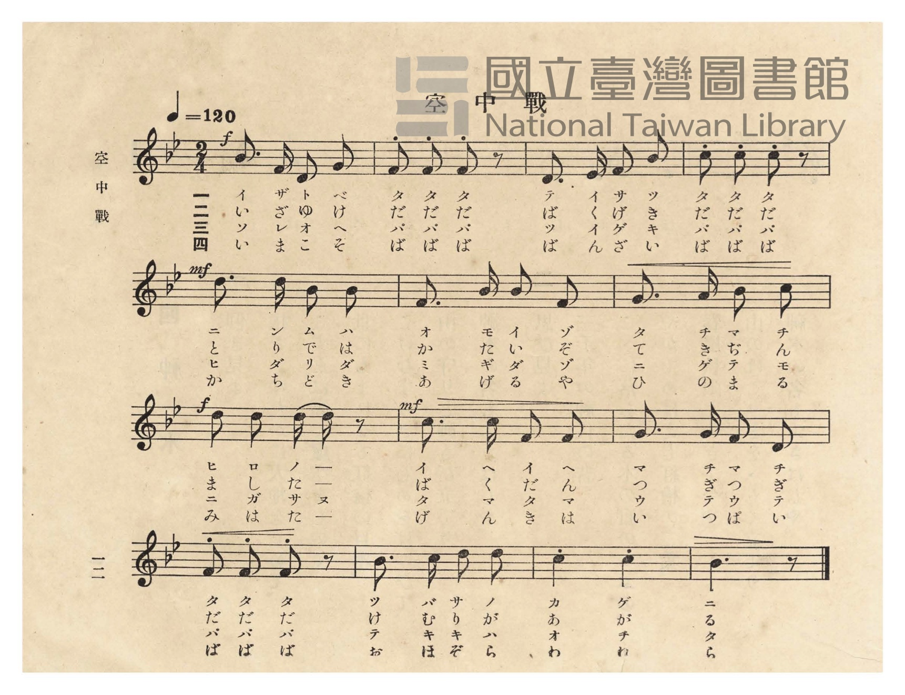
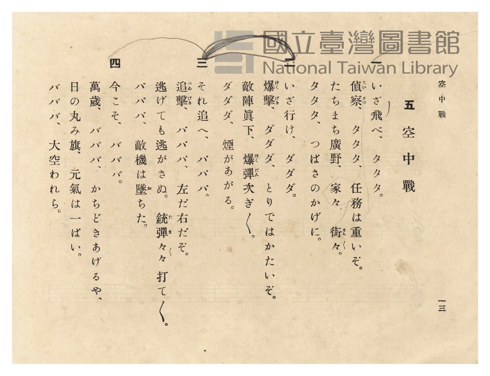

# 空中戰

> Re:Shōka 使用 AI 協助辨識與重建樂譜，可能會有錯誤。歡迎回報。

- **NEUTRINO 歌聲合成版**：<br><audio controls src="kuchusen_neutrino.mp3"></audio>
- **鋼琴伴奏版**：<br><audio controls src="kuchusen.mp3"></audio>


- 臺灣總督府《公學校唱歌》第五學年用（昭和十一年，索書號 523.37 4322-4）

## 說明

原書資訊與歌詞全文（對應 P016.jpg–P017.jpg，原書 pp. 12–13）：
調性與拍號：變ロ長調（Bb 大調，2 降記號）2/4 拍，速度 ♩=120

## 歌詞

```text
一
いざ飛べ、タタタ。
偵察（ていさつ）、タタタ、任務は重いぞ。
たちまち廣野、家々、街々（まち〳〵）。
タタタ、つばさのかげに。

二
いざ行け、ダダダ。
爆撃（ばくげき）、ダダダ、とりではかたいぞ。
敵陣眞下、爆彈（ばくだん）次ぎ〳〵。
ダダダ、煙があがる。

三
それ追へ、パパパ。
追撃（ついげき）、パパパ、左だ右だぞ。
逃げても逃がさぬ。銃彈（たま）々々打て〳〵。
パパパ、敵機は墜（お）ちた。

四
今こそ、バババ。
萬歲、バババ、かちどきあげるや、
日の丸み旗、元氣は一ぱい。
バババ、大空われら。
```

## ABC

```abc
X:1
T:空中戰
M:2/4
L:1/16
Q:1/4=120
K:Bb
V:V1 name="Piano" snm="Pia"
[V:V1]
!f! B3 F D2 G2 | F2 F2 F2 z2 | D3 E F2 B2 | c2 c2 c2 z2 |
w: 1.~イ ザ ト ベ | タ タ タ | テ イ サ ツ | タ タ タ
w: 2.~い ざ ゆ け | だ だ だ | ば く げ き | だ だ だ
w: 3.~ソ レ オ ヘ | パ パ パ | ツ イ ゲ キ | パ パ パ
w: 4.~い ま こ そ | ば ば ば | ば ん ざ い | ば ば ば
!mf! d3 d B2 B2 | F3 B B2 F2 | G3 A B2 c2 | !f! d2 d2 d d z2 |
w: 1.~ニ ン ム ハ | オ モ イ ゾ | タ チ マ チ | ヒ ロ ノ _
w: 2.~と り で は | か た い ぞ | て き ぢ ん | ま し た _
w: 3.~ヒ ダ リ ダ | ミ ギ ダ ゾ | ニ ゲ テ モ | ニ ガ サ ヌ
w: 4.~か ち ど き | あ げ る や | ひ の ま る | み は た _
!mf! c3 c F2 F2 | G3 G F2 D2 | F2 F2 F2 z2 | B3 c d2 d2 |
w: 1.~イ ヘ イ ヘ | マ チ マ チ | タ タ タ | ツ バ サ ノ
w: 2.~ば く だ ん | つ ぎ つ ぎ | だ だ だ | け む り が
w: 3.~タ マ タ マ | ウ テ ウ テ | パ パ パ | テ ッ キ ハ
w: 4.~げ ん き は | い っ ぱ い | ば ば ば | お ほ ぞ ら
c4 c4 | B6 z2 |
w: 1.~カ ゲ | ニ
w: 2.~あ が | る
w: 3.~オ チ | タ
w: 4.~わ れ | ら
```

## TMD 檔案連結

- [主旋律 TMD 檔案](kuchusen.tmd) [[在 TMD Studio 編輯](https://tmdlang.github.io/Tmd-TS/#tmd=s7IKdvYPcrWy4qpTUCpJTLdSSM7PyUlNLsnMz7PKzk9PzM7Ojy_OyM9OVIKrKMvPKc1NtUovSkxJjTdFiBfnlxYlp1oVJ2fk5-fEl6RWlCTl52ejy8cXJKanWgUYGJohZAqK8stS8xLzgLoLijLzSlJTwNoRClLLMlNSQdLFyYl58WWpRZlpmakpSE5KLSoGuRhqRUlRYl5xclFmAcgbCFX5RSUZ-UBnF2RUWmVkFpfkF2UmJ-bEZyfmIfmuJCMV6LnczJzMksSiSnTxxLLMRIihWloKz1fuerJj7bOODQpaWlyKtgqGRgZc9rYKTjpcNkb6JnYgrS_adz1vXPx8x97ncxc_3TXncUPX09Y1T9fueLZg4dMpG5-t7Xnc0P18zZonu6YABZ_u3PJ8yor3ezqezVj7dFLP097GJzsagILv9_Q837Lo2ewdL2bOVzA1MtYzNlcwMTYy0jV5v6dTiYtLX0vBllqAS0FB4WnffJBlm9tfrOh60dEOdOWLlfOetq54Nq0d6LinG3qftXcqgGJQL6sg_VHDZCDTHMQEuhOiVaGgQA8YGkApQ2OgE9_vmQUy9sWq_c8aloMM7O4F-gQo-mJd1-PmtS-nbgdKAU12SlJ4umQ5mN1jpPByZu-LFTPACjuBwakA1AUUf9kw_-muZQqPZq60BQU3yFxgIIGox40tjxunvVw8-3HjzscNjY-b9kNRQxPYU41bn64HmtXxuHEZWOnUx41LgEajKm18snv30-6ZjxvXv2zvBSubB9X_uHH-48aFjxv3Acmnuxe_bO8Dqn66btvjhlYg48XC6UAG2HSQgscNmx83bAWbDtGMZAPQ2seNG8D2r3vc2P24cdLjxtUgdWC_7OpB-OXFwp7HjRNBWpoboAhi3POOtmeTmsG2AQ3qBxsBDBywXxBKgTateNzU9bhxOdA7YJuAPkDy0bOpW1_OXPx8zrwnO7qBqoGGPt3bgWTogsdNk4GGPlsD9DXQsyAfwbyDZMnzVmBoAd3ZBCKbgAZBPbKjE-KRuY-bel7s3_u4cQfYdROhCGIQUALmEWCgAN2G7BG40san24FRtuBp_2aQo-Duf9nQDNaw7HFTE5gNdAUwUNcApV92NcP8AvTzPrCJwGhqfdY5GaQe1S8Ie4Ah8mwlUMP6p4vmgDV3gXSCYn0-zF9PZ88Ge283MFyBZs0Fu3QCFEE9NWHNs7WbUCWAcQEMf6BBK4EeBAfWJFBgNbUApcBxMX0pMDk82bHjceP-Z9OBaanxaWvzsw2LgW4BJu_HjRtBoQNzMMJUYHYBFkKPm_qBgfy4CZbaKC8FoEBBS5-Ly7s0OaO0ODXPKiAzMS_focagphpkiYKNoZmWHZiFrfxRAJVqOxqASVhBw0Th6Yb-5-sbdOCFhiYWDUC7QIbVKFSn1SoYKugCoWm8gnE8kDYDETUgLlgMShiABcEKdBVM4iGCII01CkZAEobBysBG-xjWAHPiErD6x03bgCHZAWI1zwTrAeZOsDiChNj6uLkNqmMJEG8F62jBpwNilxFQvhGkDijXOA0oDzIFmJ0hOhsXgHkIEmpX4waojn4gngRm9eLTAbHLGOSWvRCdzWuA7FVg1gyo-0F2IpMwf0FdB_bXJjBrLT4dELtMkP21D4gng1lzkdyPTKL5q2kyODRAstAwxK4DnNdwJ6xdPeCEZUxiwsoFpixjsEOMwQkFkljA6QbEAXHBnBpIitNVMI8HC4KSEVISau6GBvVmIAZHSHM_xDPggAfxF0ET2uOmfVAZUPIAyTQC8TwoCzWxrIAGUReQvRwcHOuhQQS1r3E-NNiAZSBUZhlUpheIF0EDGCVZNIMSEci2BiCGJIsGaCTPh9q3DioGdyvMf8BEAUn8IP-gJgCYixYC8UqoCyAuaoLKTALqB6kClnFQGVASA8kA7QMmHJAMSJ5QVO_oJCuqoTENwcbQsgKcAECRCYpSREECj24gBRYAlynIEQ7Oic2g3PG4uQ9IQlM1rCwB5jRodMPzHCiC8Ec3OAgap0MjFnsJAE5ckCgF8qC2NfZB2SAWamRDAnwNmNwK5PfAXQpLfvNg5RXYVSAZaBICRjSEDYly5MgGqwcnRlSXQpMWOE-Doh-RYGHlw2Ig3ghmgRMB_qgGVq3kVBdYawVI_WEETwOQKgEiBqFhaiAQvZLAVRVAPdY8AV4VgKMAyFsNNQlSlEJsgOUkCESvHHBVAaACF2QOMMcCywKQbA9UBpK3YCJQO8C5CIsd4ASBq-iHVmnNzdBCH70EgyVYmB2Q5INhBzh54CryQW4Hie2GllfABgrUNJBdED8i-wMki2pHLReXrp0CrAGiAGQrcwEA)]
- [鋼琴伴奏 TMD 檔案](kuchusen_piano.tmd) [[在 TMD Studio 編輯](https://tmdlang.github.io/Tmd-TS/#tmd=s7IKdvYPcrWy4tLSUni-cteTHWufdWx4v6fjZfee5xO2PNmz5enS_uedHe_3dCpoaXEp2ioYGhlw2dsqOOlw2Rjpm9hx1SkovWjf9bxx8fMde5_PXfx015zHDV1PW9c8Xbvj2YKFT6dsfLa253FD9_M1a57smgIUfLpzy_MpK4A2PJux9umknqe9jU92NAAF3-_peb5l0bPZO17MnK9gamSsZ2yuYGJsZKRrArRbiYvLM6-kKN8qIDMxLz_Iw6HGoKaaSwEIbAzNtOzArBqF6rRaBUMFXSA0jVcwjgfSZiCiBsQFi0EJA7AgRKWRgjGYRIhAIFgNVy2KvT7I9pqgWhuvEG0YCzIjHqgVTEWbxiMEQCZ5lyZnlBan5lHTE2AFugom8RBBkMYasG9gGOIPkNE-hjUKj5uWgNU_btqm8Li5A8RqngnW87hpP1gcQUJsfdzcBtWxBIi3gnW04NMBscsIKN8IUgeUa5wGlAeZ8rhxIkRn4wIwD0FC7WrcANXRD8STwKxefDogdhmD3LIXorN5DZC9CsyaAXU_yE5kEuYvqOvA_toEZq3FpwNilwmyv_YB8WQway6S-5FJNH81TQaHBkgWGobYdXDB0kIuMDGA0qcukATFLSR-wVEN4oC4YE4NJJHoKpjHgwXB6RkR683d0NDZDMTgMGzuh9gPDisQfxE0bTxu2geVAcUoSKYRiOdBWajxuwLqqy4geznYB-uhvoLa1zgf6tPHjSATQDLLoDK9QLwIGiYoMdkMineQbQ1ADInJBmi8zIfatw4qBncrzH_AeISkV5B_UOMM5qKFQLwS6gKIi5qgMpOA-kGqHjfB4gaUKkAyQPuAcQ2SAckjYgcaORBsDM2R4DgDhT8oFhDZFR5DQAosAM65yHEETu_NoDT4uLkPSELTDizHAtMzNIbgKRsUpvhjCOzqxunQuMCez8DpARILQB7UtsY-KBvEQo0fSBitAZNbgfweuEthKWYerFQAuwokA411YNxA2JBYQo4fsHpw-kF1KTQ1gHMOKMYQaQyWCxcD8UYwCxxvsNghWOaDMKSshIhBaGy1AKL0xFVGQt3SPAFeRoJDDchbDTUJUsZAbIClVwhELzVxlY2gkghkDjBfAHMcSLYHKgNJwTARqB3gtIrFDnAc4ioToWV9czO0NEQvJ2BpDGYHJMYx7ADHKK6yEOR2kNhuaKnwuKkTahrILogfkf0BkkW1A6MuJbFiBvNN4yEVM1JJi6wWwgDXq_EIVRBFIHPAGkBy0GoeqBIoA1MINRzVNowGga6dArh1oQBkwDwU7QNUj8I3QuMbo_FNwHxlLgA)]

## 分析

```text
================================================================================
📊 TMD Song Profile: [ 空中戰 ]
================================================================================
⏱  Duration:       0:14 (14.0s), 14 measures total
🎼 Key & Tempo:    首調基準 B,, != 120.0 BPM, <2/4>
   - 分析範圍：      由實際發聲的音符與和弦推測調性；播放脈絡另行呈現
🎤 人聲音域:    D4 (MIDI 62) – D5 (MIDI 74) [跨度: 12 個半音 / 1.0 個八度, 難度: easy]
   - 最低音:  D4 in [Kuchusen #1 @ m.1, 0:00]
   - 最高音: D5 in [Kuchusen #1 @ m.5, 0:04]
   - 適合: soprano, mezzo-soprano, contralto, tenor, baritone, bass
🏛  結構:      Kuchusen (14.0s)
⚡ 編曲密度:        Peak 1 軌道同時演奏
🗝  調性診斷：       A# 調性不明確（純淨自然大調，未偵測到可信轉調）
   - 風格氣質:    純淨自然大調（陽光明朗、易唱易記，無明顯調外色彩）
   - 轉調歷程:    全曲維持單一推測調性（未偵測到可信轉調）
   - 核心骨幹音:  F, A#, C, D, G
   - 調性數值:    A# 調性不明確 [相關度: 0.83, 穩定度: Ambiguous, 自然音純度: 100.0%]
   - 候選調性 (K-S): A# 大調 (0.83), F 大調 (0.81), D 小調 (0.66)
   - 五度圈歷程:   -2
   - 各段落調性細節:
     • [Kuchusen #1]: A# 調性不明確 (r: 0.83, 自然音純度: 100.0%)

  [ 五度圈游移軌跡 ]
               C  
         F            G  
     [Bb]*              D  
      Eb               A  
         Ab           E  
            Db       B  
               F# 
     (* = active key center)

  [ 十二半音累積音高分佈 ]
     C  : ███████████████████       20.6%
     C# :                            0.0%
     D  : ███████████████████       20.6%
     D# : █                          1.0%
     E  :                            0.0%
     F  : ████████████████████████  25.5%
     F# :                            0.0%
     G  : ████████                   8.8%
     G# :                            0.0%
     A  : █                          1.0%
     A# : █████████████████████     22.5%
     B  :                            0.0%
--------------------------------------------------------------------------------
Assignment 軌道音域：
  - Piano         : D4 – D5 (12 個半音 / 1.0 個八度, 48 個音符)
================================================================================
```


## 原書掃描頁






