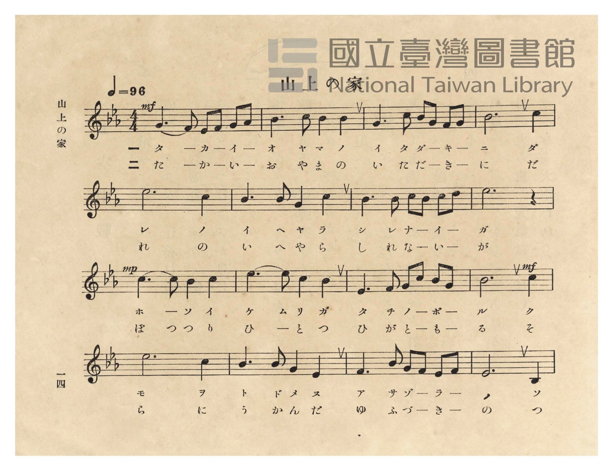
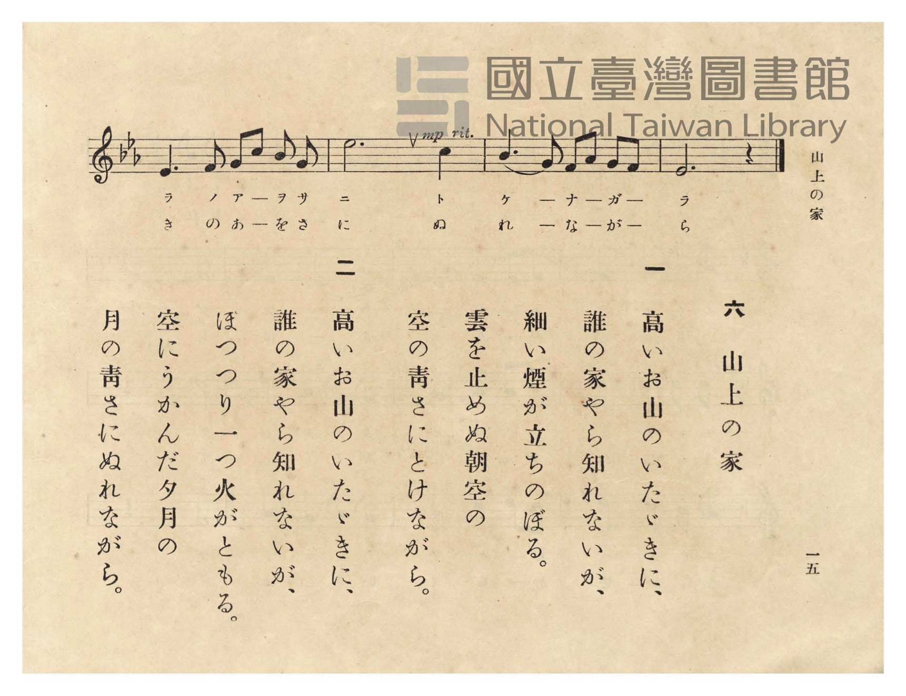

# 山上の家

> Re:Shōka 使用 AI 協助辨識與重建樂譜，可能會有錯誤。歡迎回報。

- **NEUTRINO 歌聲合成版**：<br><audio controls src="sanjo_no_ie_neutrino.mp3"></audio>
- **鋼琴伴奏版**：<br><audio controls src="sanjo_no_ie.mp3"></audio>


- 臺灣總督府《公學校唱歌》第五學年用（昭和十一年，索書號 523.37 4322-4）

## 說明

原書資訊與歌詞全文（對應 P018.jpg–P019.jpg，原書 pp. 14–15）：
調性與拍號：變ホ長調（Eb 大調，3 降記號）4/4 拍，速度 ♩=96

## 歌詞

```text
一
高いお山のいたゞきに、
誰の家やら知れないが、
細い煙が立ちのぼる。
雲を止めぬ朝空の
空の青さにとけながら。

二
高いお山のいたゞきに、
誰の家やら知れないが、
ぽつり一つ火がともる。
空にうかんだ夕月の
月の青さにぬれながら。
```

## ABC

```abc
X:1
T:山上の家
M:4/4
L:1/16
Q:1/4=96
K:Eb
V:V1 name="Piano" snm="Pia"
[V:V1]
!mp! G6 F2 E2 F2 G2 A2 | B6 c2 B4 B4 | G6 c2 B2 G2 F2 G2 | !mf! B12 c4 |
w: 1.~タ カ イ _ オ _ | ヤ マ ノ イ | タ ダ キ _ ニ _ | _ タ
w: 2.~た か い _ お _ | や ま の い | た だ き _ に _ | _ た
e12 c4 | B6 B2 G4 c4 | B6 B2 c2 B2 c2 d2 | e12 z4 |
w: 1.~レ ノ | イ ヘ ヤ ラ | シ レ ナ _ イ _ | ガ
w: 2.~れ の | い へ や ら | し れ な _ い _ | が
!mf! c6 c2 B4 c4 | e6 e2 c4 B4 | E6 F2 G2 c2 B2 G2 | !f! B12 c4 |
w: 1.~ホ ソ イ ケ | ム リ ガ タ | チ ノ ボ _ ル _ | _ ク
w: 2.~ぽ つ り ひ | と つ ひ が | と も _ _ る _ | _ そ
e12 c4 | B6 B2 G4 E4 | F6 B2 G2 F2 E2 F2 | !mf! G12 B,4 |
w: 1.~モ ヲ | ト ド メ ヌ | ア サ ゾ _ ラ _ | ノ ソ
w: 2.~ら に | う か ん だ | ゆ ふ づ _ き _ | の つ
E6 F2 G2 c2 B2 G2 | !mp! e12 c4 | B6 G2 F2 A2 G2 F2 | E12 z4 |
w: 1.~ラ ノ ア _ ヲ サ | ニ ト | ケ ナ _ ガ _ _ | ラ
w: 2.~き の あ _ を さ | に ぬ | れ な _ が _ _ | ら
```

## TMD 檔案連結

- [主旋律 TMD 檔案](sanjo_no_ie.tmd) [[在 TMD Studio 編輯](https://tmdlang.github.io/Tmd-TS/#tmd=s7IKdvYPcrWy4qpTUCpJTLdSSM7PyUlNLsnMz7PKzk9PzM7Ojy_OyM9OVIKrKMvPKc1NtUovSkxJjTdFiBfnlxYlp1oVJ2fk5-fEl6RWlCTl52ejy8cXJKanWgUYGFogZAqK8stS8xLzgLoLijLzSlJTwNoRClLLMlNSQdLFyYl58WWpRZlpmakpSE5KLSoGuRhqRUlRYl5xclFmAcgbCFX5RSUZ-UBnF2RUWmVkFpfkF2UmJ-bEZyfmIfmuJCMV6Lm8xJLSolR00Yz8XKCYlpbC040bn-zoety47um6bQpaWlyKtgqWZlz2tgquOlw2JvomdiCNL9p3PW9c_HzH3udzFz_dNedxQ9fT1jVP1-54tmDh0ykbn63tedzQ_XzNmie7pgAFn-7c8nzKivd7Op7NWPt0Us_T3sYnOxqAgu_39DzfsujZ7B0vZs5XMDUy1jM2VzAxNjLSNXm_p1OJi0tfS8GWWoBLQUHhad98kGWb21-s6HrR0Q505YuV8562rng2rR3ouKcbep-1dyqAYk8vqyD9UcNkINMSxAS6E6JVoaBAT8HQBChlaAp04vs9s0DGvli1_1nDcpCB3b1AnwBFX6zretw8--XU7UApoMmuSQpPlywHs3uMFV7O7H2xYgZYYScwOBWAuoDiLxvmP921TOHRzJW2wNAGGQsMIxD1cvWMx40tjxu7gPECjBQwe_7jpnmPG3sfN65-3NAIccIGSIQ9bmp53NT5fP7Sx009jxtXgVUD4wKs6PkWoKKW560zgULPV3c_blwINm_P46buxw1NYLtmb3rcNOnZ2kWPmxofN655Nmfu85W7gIrAusGsl3MnPW6cCrK4ccXjxolgK3qANoIMADt6Vw91Hf24ce_jxiWPm7qAwQFkPAfZDFS04nFTE8LdYLcBJdoeN3Y_bpr8uHHB0yVTn83pgDodwkJy-hqYRTCnAxVRnsSgQEFLn4srODEvK98v3xNYGmQm5uU71BjUVINsUbCx0LIDM7AlbgVQltnR8GJhj4KGicLTDf3P1zfowFOkJhYNQLtAhtUoVOcW1CoYK-gCoZGCIRAbK5gAhU3BImZgGoRroGpAIsZgVTA1EFidm1YLlAQqBJvrY1ij8LhpP1jqcdNqIF4CZq0CG_W4GcQD8pvnAXEfWAYkgqSnuQHIXgtmdYNlEFaBVINUQW0yAupqnA8Rb-wG4hYwqwtqHogH4u8D4nVgFkgEWc8CIO4Fs1Zj2gRWVQNOorhDflcPOSFvGIdkETjooCEKCmF0EVC4mymYo2szQA3x5jXIbgeHLCgMYKE9Axryj5tXQmW2Q2XWADEoxBDxgGxSPGpoN_WghBAoVEHhCQvpHdBQB2YRqMx0iAxQHzDzoMQBskkQWwik8U7y0jg0ccJSNCRsoSEJpEB8SCo3BAuB0jckpaOlcsxE3jwb6rm98ES-EeK55gXQwF0FDU5osgWKNMIj6HHzHDALS9JrWo8a7I17oQG8BCgHjqzGTdBgXIGQAYtBAhZJpqkJSmPJTI1zCQf809mzaZDEQYFdAwxsmAikAIIVNdAgB8WdKVIKBAf6ImQPNEODobkDyu8E4oVgFjQYmiDqHzdtBeJ9YBloDgDnEUSQg4IYOaWDUjAioCCRBKwuoHxgadM0GcwCRTVIPUwGaE_jUjCrF6oHlEsQJoFzGaFSZQpmkIObFfiDHGwDcgJGiQRwcY8cE6BQNwGTML0QiF6ygMILmmTBoQkKdVB4guRAiQoRG6BYAIUFKBuA-JByBVKeIEyCQLSSBRxakDLlcSMoyQJbFUDWVHAIgkIfEYIg8xBlEaxcgfDQYw5iSy0Xl66dAryCVQBylLkA)]
- [鋼琴伴奏 TMD 檔案](sanjo_no_ie_piano.tmd) [[在 TMD Studio 編輯](https://tmdlang.github.io/Tmd-TS/#tmd=s7IKdvYPcrWy4tLSUni6ceOTHV2PG9c9Xbft_Z6Ol917nk_Y8mTPlqdL-593drzf06mgpcWlaKtgacZlb6vgqsNlY6JvYsdVp6D0on3X88bFz3fsfT538dNdcx43dD1tXfN07Y5nCxY-nbLx2dqexw3dz9esebJrClDw6c4tz6esAFrwbMbap5N6nvY2PtnRABR8v6fn-ZZFz2bveDFzvoKpkbGesbmCibGRka4J0GolLi7PvJKifKuAzMS8_CAPhxqDmmouBSCwsdCyAzNqFKpzC2oVjBV0gdBIwRCIjRVMgMKmYBEzMA2ShYkYA1WYgMkaoGqQCAQagNRw1aLY6INsowmqjYbxCtGGsTAKaBaQYYLGBzJM44G0aTySCJAygNgUnJiXle-X75lKqf9AuAaqBiQC8p0xXA0EVuem1QIlQZ4EmetjWKPwuGk_WOpx02ogXgJmrQIb9bgZxAPym-cBcR9YBiSCpKe5AcheC2Z1g2UQVoFUg1RBbTIC6mqcDxFv7AbiFjCrC2oeiAfi7wPidWAWSARZzwIg7gWzVmPaBFZVwwUNLMM4JDmwb6GBAAoUdBFQUJkpmKNrg6QEeCA1r0G2DhwYIGfDAmgGNLAeN6-EymyHyqwBYpAnEUGHbFI8agA19aB4ChQQoCCABc4OaEA9buqEykyHyAD1PW4ERRoi2JBNgtgCT0nQJABLN5DggHoeSIH4kLQEyRmgVARJT2hpCTMpNc-GumcvPClthLineQE0PFZBQwCaOIAijfAwfdw8B8zCEsFN61FDqnEvNEyWAOXA4du4CerzFQgZsBgkLJBkmpqgNJYk2zgXOawIJCRQ-NQAwwcmAsmZsDwIDSVQcJsixTM4nBYh29kMdXlzB5TfCcQLwSyoy5sg6h83bQXifWAZaDoDp0REKIFCBTk9gdIJwm-QcH3c2AblA7Nh02QwCxQ7IPUwGaA9jUvBrF6oHlBaRJgETsvwUAILIicTlHADF13IgYe_8EUEEsiL0IQBDgBQQIGCACQHijpEAIICDuR8UGID8SEZDpLRECZBIFqWA3sQktkeN4ISxuOmSUDWVLCnQQGG8DTIPEQmhWU4CA89sCG2YBbvlFYmUD62ugQpe5tAVEIpZIUQPrw-wlkxYRoG14xkOHIdB3cmiuFIZuF3F6ZWQu5C14wwHKgQJUTxVb-6dgrgul4ByIDHVbQPUA2qgBFYQJkLAA)]

## 分析

```text
================================================================================
📊 TMD Song Profile: [ 山上の家 ]
================================================================================
⏱  Duration:       0:50 (50.0s), 20 measures total
🎼 Key & Tempo:    首調基準 E,, != 96.0 BPM, <4/4>
   - 分析範圍：      由實際發聲的音符與和弦推測調性；播放脈絡另行呈現
🎤 人聲音域:    A#3 (MIDI 58) – D#5 (MIDI 75) [跨度: 17 個半音 / 1.4 個八度, 難度: challenging]
   - 最低音:  A#3 in [SanjoNoIe #1 @ m.16, 0:39]
   - 最高音: D#5 in [SanjoNoIe #1 @ m.5, 0:10]
   - 適合: soprano, mezzo-soprano, contralto, tenor, baritone, bass
🏛  結構:      SanjoNoIe (50.0s)
⚡ 編曲密度:        Peak 1 軌道同時演奏
🗝  調性診斷：       D# 大調（純淨自然大調，未偵測到可信轉調）
   - 風格氣質:    純淨自然大調（陽光明朗、易唱易記，無明顯調外色彩）
   - 轉調歷程:    全曲維持單一推測調性（未偵測到可信轉調）
   - 核心骨幹音:  A#, D#, C, G, F
   - 調性數值:    D# 大調 [相關度: 0.90, 穩定度: High, 自然音純度: 100.0%]
   - 候選調性 (K-S): D# 大調 (0.90), A# 大調 (0.70), C 小調 (0.64)
   - 五度圈歷程:   -3
   - 各段落調性細節:
     • [SanjoNoIe #1]: D# 大調 (r: 0.90, 自然音純度: 100.0%)

  [ 五度圈游移軌跡 ]
               C  
         F            G  
      Bb               D  
     [Eb]*              A  
         Ab           E  
            Db       B  
               F# 
     (* = active key center)

  [ 十二半音累積音高分佈 ]
     C  : ██████████████            16.7%
     C# :                            0.0%
     D  : █                          0.6%
     D# : ███████████████████████   28.2%
     E  :                            0.0%
     F  : ██████                     7.7%
     F# :                            0.0%
     G  : ██████████████            16.7%
     G# : █                          1.3%
     A  :                            0.0%
     A# : ████████████████████████  28.8%
     B  :                            0.0%
--------------------------------------------------------------------------------
Assignment 軌道音域：
  - Piano         : A#3 – D#5 (17 個半音 / 1.4 個八度, 76 個音符)
================================================================================
```


## 原書掃描頁






