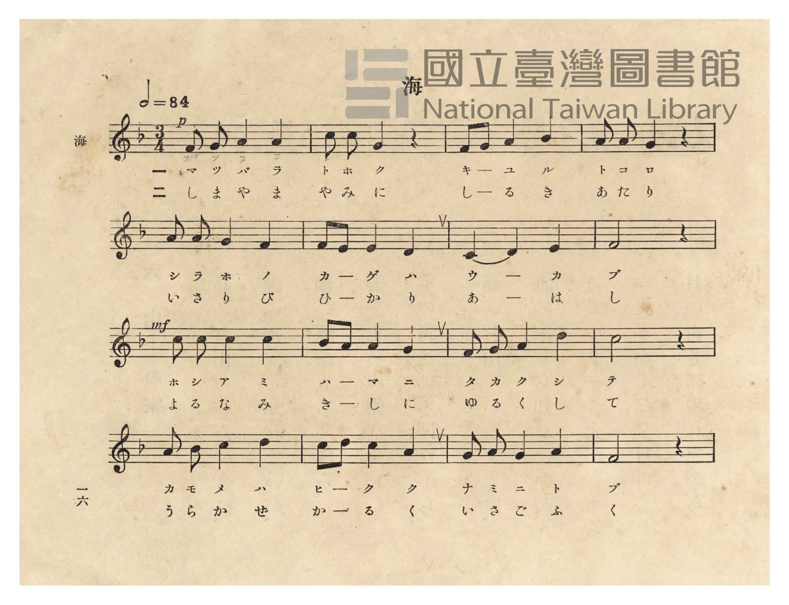
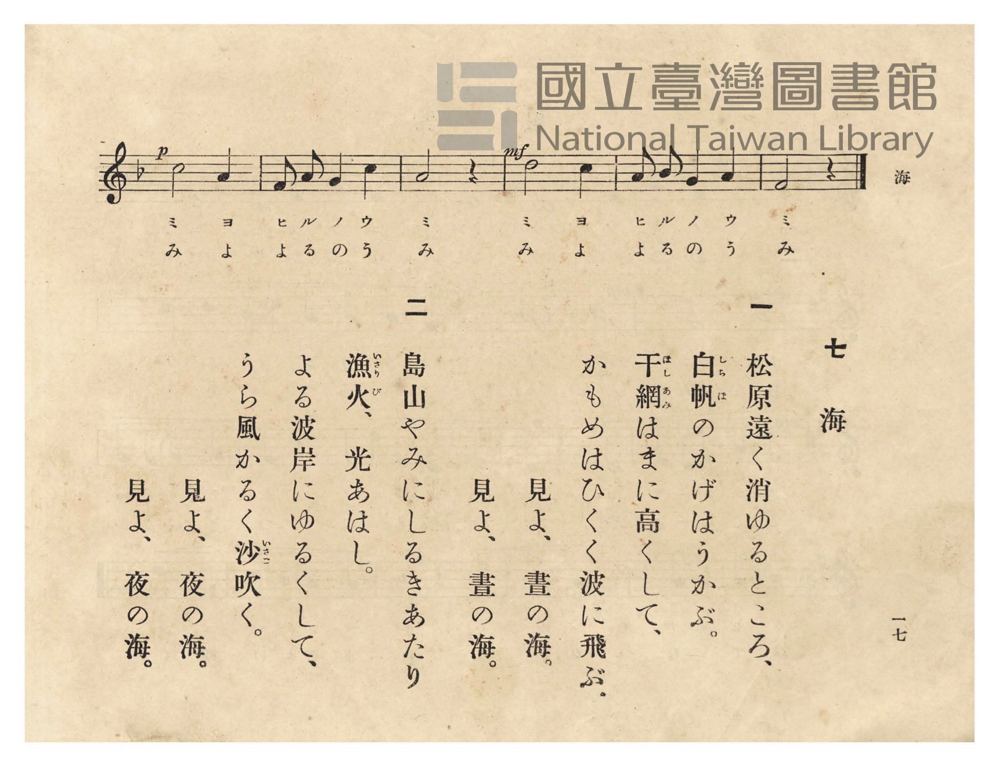

# 海

> Re:Shōka 使用 AI 協助辨識與重建樂譜，可能會有錯誤。歡迎回報。

- **NEUTRINO 歌聲合成版**：<br><audio controls src="umi_neutrino.mp3"></audio>
- **鋼琴伴奏版**：<br><audio controls src="umi.mp3"></audio>


- 詞：文部省唱歌
- 曲：文部省唱歌
- 臺灣總督府《公學校唱歌》第五學年用（昭和十一年，索書號 523.37 4322-4）

## 說明

原書資訊與歌詞全文（對應 P020.jpg–P021.jpg，原書 pp. 16–17）：
調性與拍號：ヘ長調（F 大調，1 降記號）3/4 拍，速度 ♩=84（原譜標示 𝅗𝅥=84）


## 歌詞

```text
一
松原遠く消ゆるところ、
白帆（しらほ）のかげはうかぶ。
干網（ほしあみ）はまに高くして、
かもめはひくく波に飛ぶ。
見よ、晝の海。
見よ、晝の海。

二
島山やみにしるきあたり
漁火（いさりび）、光あはし。
よる波岸にゆるくして、
うら風かるく沙（いさご）吹く。
見よ、夜の海。
見よ、夜の海。
```

## ABC

```abc
X:1
T:海
C:曲：文部省唱歌
M:3/4
L:1/16
Q:1/4=84
K:F
V:V1 name="Piano" snm="Pia"
[V:V1]
!p! F2 G2 A4 A4 | c2 c2 G4 z4 | F2 G2 A4 d4 | A2 A2 G4 z4 |
w: 1.~マ ツ バ ラ | ト ホ ク | キ _ ユ ル | ト コ ロ
w: 2.~し ま や ま | や み に | し _ る き | あ た り
A2 A2 G4 F4 | F2 E2 E4 D4 | C4 D4 E4 | F8 z4 |
w: 1.~シ ラ ホ ノ | カ _ ゲ ハ | ウ _ カ | ブ
w: 2.~い さ り び | ひ _ か り | あ _ は | し
!mf! c2 c2 c4 c4 | d2 c2 c4 B4 | F2 G2 A4 d4 | c8 z4 |
w: 1.~ホ シ ア ミ | ハ _ マ ニ | タ カ ク シ | テ
w: 2.~よ る な み | き _ し に | ゆ る く し | て
A2 B2 c4 d4 | c2 d2 c4 A4 | G2 A2 G4 A4 | F8 z4 |
w: 1.~カ モ メ ハ | ヒ _ ク ク | ナ ミ ニ ト | ブ
w: 2.~う ら か ぜ | か _ る く | い さ ご ふ | く
!p! c8 A4 | F2 A2 G4 c4 | A8 z4 | !mf! d8 c4 |
w: 1.~ミ ヨ | ヒ ル ノ ウ | ミ | ミ ヨ
w: 2.~み よ | よ る の う | み | み よ
A2 B2 G4 A4 | F8 z4 |
w: 1.~ヒ ル ノ ウ | ミ
w: 2.~よ る の う | み
```

## TMD 檔案連結

- [主旋律 TMD 檔案](umi.tmd) [[在 TMD Studio 編輯](https://tmdlang.github.io/Tmd-TS/#tmd=s7IKdvYPcrWy4qpTUCpJTLdSSM7PyUlNLsnMz7PKzk9PzM7Ojy_OyM9OVIKrKMvPKc1NtUovSkxJjTdFiBfnlxYlp1oVJ2fk5-fEl6RWlCTl52ejy8cXJKanWgUYGBkgZAqK8stS8xLzgLoLijLzSlJTwNoRClLLMlNSQdLFyYl58WWpRZlpmakpSE5KLSoGuRhqRUlRYl5xclFmAcgbCFX5RSUZ-UBnF2RUWmVkFpfkF2UmJ-bEZyfmIfmuJCMV6Lm8xJLSolR00fLEktQiJS4tLYVnW7craGlxKdoqWJhw2dsquHHZGOub2IHUv1g57_2eWc-mtb9sXvF8TuPTKRufre0Bm_Rs9iYcMi_adz1vXPx8x97ncxc_3TXncUPX09Y1T9fueLZgIUTV44bu52vWPNk1BSj4dOeW51NWvN_T8WzG2qeTep72Nj7Z0QAUfL-n5_mWRc9m73gxc76CqZGxnrG5gomxkZGuyfs9nUpcXPpaCrbUAlwKCgpP--aDLNvc_mJF14uOdqArgV5_2roC6EGg455u6H3W3qkAimi9rIL0Rw2TgUxDEBPoTohWhYICPQVDM6CUoTnQicCwARn7YtX-Zw3LQQZ29wJ9AhR93Dzj5dTtQHGgsW4KT5csBzN7DBVezux9sWIGWFEnMPgVgDqA4i8b5j_dtUzh0cyVthZAr3cALXuxds6zFTOfL9ml8GFu63QgXgqW6uQCWQgMPRD1bO4-oMqXjQseN_Y_29bxuKntcVP348YVjxsnP27qfdzQCFL0fObepzvagIY-bpz-uKnzceNuoCmPG9c9bgQqnfS4cf3jxjYwe9vjhiZwIO3c9HwbMNqBGnaD9DQ2PW4EOh6oB6h03-PG1S9XzwBaCJZaBrUEZEBT0-OmRrCiTWDp_mebF4FUL56NMPvFMqC6DqCmZzPnAt0ATJN4JcB-3dUDdtXmbU83bnzc1AJ0DNBUsGeAju4FO2_-46YucIDsaXzeuBrsdKC6qUDRx42bQU5vaHzaCvQAUCnQedOhdoIsbOoGuvLpph0gI6HBh-4zoGjny0XAQAW6ECT9bNNMhA2NU4DGP52wE6QNzSdPl8zB7kV0CcrTNhQoaOlzcYXmZloFZCbm5TvUGNRUg8xXsLHQsgMzsOUnBVAu3dHwYmGPgoaJwtMN_c_XN-jAM4EmFg1AW0CG1ShUF9QqGCoYKRgr6IJxjYIpEBoBWQZgHkzODMwzBkK4HNgEH8MahcfN84C4BYgnAMUfN68Eq33c3AHEs4FRtB7Ij4eINa0Fq1gGJlcj1DVtBtIgObA6iMlGQLnG6UC8DyjfAtIBZEFMAdrVuB-IQSZATQaqBKpo6gar64WKNQHxfKBoF9xk_GG4q4ecMISFiiE0xMzjQQgYZhCnmcLZYFGQCl0wRAvFpu3gsAOFGSh0-qB-BfnxcdMmsFg_VAwUfiAIkQWF4TSoCHr4gUJqKjQEgBkJGi5g0xrBYQWWgYQV1MxGUHzBQhRhJoHU10lW6stNqwUnOFOgFSBcA0xoEJ4JluQHEscScOBEBgy8pkXgQJoPDRJQYIGSJogEeRUUcMBEAwwySJIE6YGobMMeeE2ghNkNDIhV4GDZDw0WUOKCJjdwAgSpbIOqBNsJlgOphEUTEQH4dPZs8pKeCThUYOEDCj1YRgaFHChZQni4Eh0wNJoXAfFCcDhBE1jzJHD4QEIJmhyau8BhCwlLUKbFn_BAIdIJS2SNc6AhAklyEDGoXbAk2jgFLLoVKgqSJTbx7ZoCDjsz5LADV_oEiz5YioKFESTEICkRJAYPMUhSBQUzCMIUmBAOYHByBOer5hXwwAWVfZAcDsnLyOqg5Rl5-pAiAJRcIWUENKrgyXkdOKBBiR5ZHawcJUsfVy0Xl66dArDiUgBSylwA)]
- [鋼琴伴奏 TMD 檔案](umi_piano.tmd) [[在 TMD Studio 編輯](https://tmdlang.github.io/Tmd-TS/#tmd=s7IKdvYPcrWy4tLSUni2dfv7PR0vu_c8n7DlyZ4tT5f2P-_seL-nU0FLi0vRVsHChMveVsGNy8ZY38SOq05B6cXKee_3zHo2rf1l84rncxqfTtn4bG2PEkjm2exNOGRetO963rj4-Y69z-cufrprzuOGrqeta56u3fFswUKIqscN3c_XrHmyawpQ8OnOLc-nrAC66dmMtU8n9TztbXyyowEo-H5Pz_Mti57N3vFi5nwFUyNjPWNzBRNjIyNdE6Brlbi4PPNKivKtAjIT8_KDPBxqDGqquRSAwMZCyw7MqFGozi2oVTBUMFIwVtBVMAPiGgVTIAmCIJEaIGkClIXxDKFyBiAeVy2KDT7INpig2RCvEG0YqxBtEgsyBMoBYgjHNB6ZB2QYQAwPzc3E73gkt0PcZwqEINeC3YfmL2MghMuBTfAxrFF43DwPiFuAeAJQ_HHzSrDax80dQDxb4XHTeiA_HiLWtBasYhmYXI1Q17QZSIPkwOogJhsB5RqnA_E-oHwLSAeQBTEFaFfjfiAGmQA1GagSqKKpG6yuFyrWBMTzgaJdcJOh3oZ5BBQZIE-ax4MQ0JsQ00zhbLAoeqTBPd60HexdkDdBHuqDOg_krMdNm8Bi_VAxkJdBECIL8vY0qAi6l0Gemwp19OPGzVCvgE1rBHsPLAPxHtTMRlAQwwIBYSY8-aTVgqMVlCxBuAYYnRCeCZZIhiVe9EgGRSXQv02LwP6aD_UFyH-gBAAiQa4D-RUYNUBfQiIepAeisg27f5tA0d8NdPsqsE_2Q30CikJopIKjGaSyDaoSbCdYDqQSFrJoEWwC9gjMSyAPw1I4yLO48iMiaoEeaF4ExAvBXoNGY_MksJcgHoMGenMXODgg3gelZvzRC_JEJywqG-dAPQGJWIgY1C5YQmicAhbdChUFyWJGMTAboxY6hlBPQuIbJAb3JCRBgEIGBGEKcJdRiCQAinRwgmteAQ8PUD6GJH1IIkdWB82b5OlDCjNQooBkHmjowhPNOnDYgJIWsjpYmUCWPpRiE1eJjFQgo5TBwGIXs6SGSkD1ohbXpvEwrgmQAMuaxINFUYpypJyMYi9QLWatgMxBtRd7BYJwA3oNQsC36OohDgS5CWgJ4cpJ104BXPkpABnAEI_2AUrBmEZgpjIXAA)]

## 分析

```text
================================================================================
📊 TMD Song Profile: [ 海 ]
================================================================================
⏱  Duration:       0:47 (47.1s), 22 measures total
🎼 Key & Tempo:    首調基準 F, != 84.0 BPM, <3/4>
   - 分析範圍：      由實際發聲的音符與和弦推測調性；播放脈絡另行呈現
🎤 人聲音域:    C4 (MIDI 60) – D5 (MIDI 74) [跨度: 14 個半音 / 1.2 個八度, 難度: moderate]
   - 最低音:  C4 in [Umi #1 @ m.7, 0:12]
   - 最高音: D5 in [Umi #1 @ m.3, 0:05]
   - 適合: soprano, mezzo-soprano, contralto, tenor, baritone, bass
🏛  結構:      Umi (47.1s)
⚡ 編曲密度:        Peak 1 軌道同時演奏
🗝  調性診斷：       F 調性不明確（純淨自然大調，未偵測到可信轉調）
   - 風格氣質:    純淨自然大調（陽光明朗、易唱易記，無明顯調外色彩）
   - 轉調歷程:    全曲維持單一推測調性（未偵測到可信轉調）
   - 核心骨幹音:  C, A, F, D, G
   - 調性數值:    F 調性不明確 [相關度: 0.80, 穩定度: Ambiguous, 自然音純度: 100.0%]
   - 候選調性 (K-S): F 大調 (0.80), A 小調 (0.80), C 大調 (0.78)
   - 五度圈歷程:   -1
   - 各段落調性細節:
     • [Umi #1]: F 調性不明確 (r: 0.80, 自然音純度: 100.0%)

  [ 五度圈游移軌跡 ]
               C  
        [F ]*          G  
      Bb               D  
      Eb               A  
         Ab           E  
            Db       B  
               F# 
     (* = active key center)

  [ 十二半音累積音高分佈 ]
     C  : ████████████████████████  25.4%
     C# :                            0.0%
     D  : █████████████             13.6%
     D# :                            0.0%
     E  : ████                       4.2%
     F  : ███████████████           16.1%
     F# :                            0.0%
     G  : █████████████             13.6%
     G# :                            0.0%
     A  : ██████████████████████    23.7%
     A# : ███                        3.4%
     B  :                            0.0%
--------------------------------------------------------------------------------
Assignment 軌道音域：
  - Piano         : C4 – D5 (14 個半音 / 1.2 個八度, 66 個音符)
================================================================================
```


## 原書掃描頁






