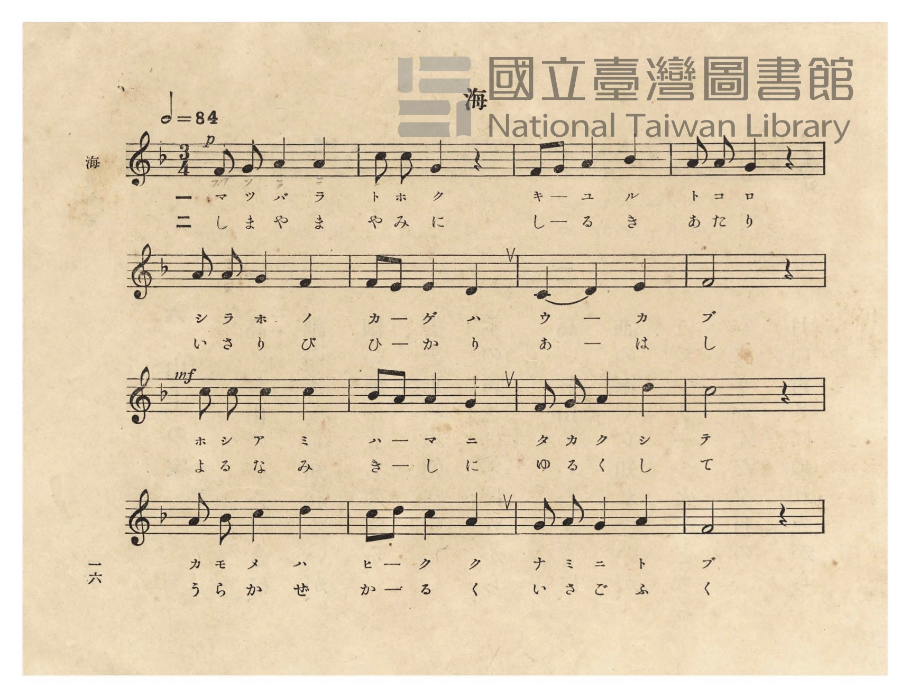
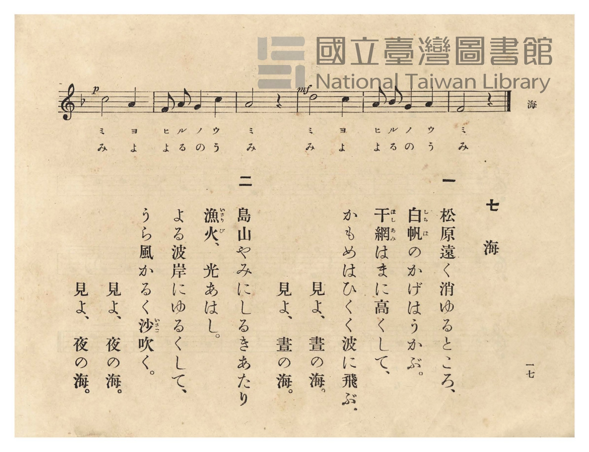

# 海

> Re:Shōka 使用 AI 協助辨識與重建樂譜，可能會有錯誤。歡迎回報。

- **鋼琴伴奏版**：<br><audio controls src="umi.mp3"></audio>
- **NEUTRINO 歌聲合成版**：<br><audio controls src="umi_neutrino.mp3"></audio>

- 詞：文部省唱歌
- 曲：文部省唱歌
- 臺灣總督府《公學校唱歌》第五學年用（昭和十一年，索書號 523.37 4322-4）

## 說明

原書資訊與歌詞全文（對應 P020.jpg–P021.jpg，原書 pp. 16–17）：
調性與拍號：ヘ長調（F 大調，1 降記號）3/4 拍，速度 ♩=84（原譜標示 𝅗𝅥=84）


## 歌詞

```text
一
松原遠く消ゆるところ、
白帆（しらほ）のかげはうかぶ。
干網（ほしあみ）はまに高くして、
かもめはひくく波に飛ぶ。
見よ、晝の海。
見よ、晝の海。

二
島山やみにしるきあたり
漁火（いさりび）、光あはし。
よる波岸にゆるくして、
うら風かるく沙（いさご）吹く。
見よ、夜の海。
見よ、夜の海。
```

## ABC

<div class="abc-score" data-abc-src="umi.abc" aria-label="五線譜載入中"></div>

[下載 ABC 原始檔](umi.abc)

## TMD 檔案連結

- [主旋律 TMD 檔案](umi.tmd) [[在 TMD Studio 編輯](https://tmdlang.github.io/Tmd-TS/#tmd=s7IKdvYPcrWy4qpTUCpJTLdSSM7PyUlNLsnMz7PKzk9PzM7Ojy_OyM9OVIKrKMvPKc1NtUovSkxJjTdFiBfnlxYlp1oVJ2fk5-fEl6RWlCTl52ejy8cXJKanWgUYGBkgZAqK8stS8xLzgLoLijLzSlJTwNoRClLLMlNSQdLFyYl58WWpRZlpmakpSE5KLSoGuRhqRUlRYl5xclFmAcgbCFX5RSUZ-UBnF2RUWmVkFpfkF2UmJ-bEZyfmIfmuJCMV6Lm8xJLSolR00fLEktQiZPMy0zPzrHLz85JKgWGkxKWlpfBs63YFLS0uRVsFCxMue1sFNy4bY30TO5CeFyvnvd8z69m09pfNK57PaXw6ZeOztT1g057N3oRD5kX7rueNi5_v2Pt87uKnu-Y8buh62rrm6dodzxYshKh63ND9fM2aJ7umAAWf7tzyfMqK93s6ns1Y-3RSz9Pexic7GoCC7_f0PN-y6NnsHS9mzlcwNTLWMzZXMDE2MtI1eb-nU4mLS19LwZZagEtBQeFp33yQZZvbX6zoetHRDnQl0OtPW1cAPQh03NMNvc_aOxVAKUAvqyD9UcNkINMQxAS6E6JVoaBAT8HQDChlaA50IjBsQMa-WLX_WcNykIHdvUCfAEUfN894OXU7UBxorJvC0yXLwcweQ4WXM3tfrJgBVtQJDH4FoA6g-MuG-U93LVN4NHOlrQXQ6x1Ay16snfNsxcznS3YpfJjbOh2Il4KlOrlAFgJDD0Q9m7sPqPJl44LHjf3PtnU8bmp73NT9uHHF48bJj5t6Hzc0ghQ9n7n36Y42oKGPG6c_bup83LgbaMrjxnWPG4FKJz1uXP-4sQ3M3va4oQkcSDs3Pd8GjHaght0gPY1NjxuBjgfqASrd97hx9cvVM4AWgqWWQS0BGdDU9LipEaxoE1i6_9nmRSDVi2cjzH6xDKiuA6jp2cy5QDcA0yReCbBfd_WAXbV529ONGx83tQAdAzQV7Bmgo3vBzpv_uKkLHCB7Gp83rgY7HahuKlD0ceNmkNMbGp-2Aj0AVAp03nSonSALm7qBrny6aQfISGjwofsMKNr5chEwUIEuBEk_2zQTYUPjFKDxTyfsBGlD88nTJXOwexFdgvK0DQUKWvpcXKG5mVYBmYl5-Q41BjXVIPMVbCy07MAMbPlJAZRLdzS8WNijoGGi8HRD__P1DTrwTKCJRQPQFpBhNQrVBbUKhgpGCsYKumBco2AKhEZAlgGYB5MzA_OMgRAuBzbBx7BG4XHzPCBuAeIJQPHHzSvBah83dwDxbGAUrQfy4yFiTWvBKpaBydUIdU2bgTRIDqwOYrIRUK5xOhDvA8q3gHQAWRBTgHY17gdikAlQk4EqgSqausHqeqFiTUA8HyjaBTcZfxju6iEnDGGhYggNMfN4EAKGGcRppnA2WBSkQhcM0UKxaTs47EBhBgqdPqhfQX583LQJLNYPFQOFHwhCZEFhOA0qgh5-oJCaCg0BYEaChgvYtEZwWIFlIGEFNbMRFF-wEEWYSSD1dZKV-nLTasEJzhRoBQjXABMahGeCJfmBxLEEHDiRAQOvaRE4kOZDgwQUWKCkCSJBXgUFHDDRAIMMkiRBeiAq27AHXhMoYXYDA2IVOFj2Q4MFlLigyQ2cAEEq26AqwXaC5UAqYdFERAA-nT2bvKRnAg4VWPiAQg-WkUEhB0qWEB6uRAcMjeZFQLwQHE7QBNY8CRw-kFCCJofmLnDYQsISlGnxJzxQiHTCElnjHGiIQJIcRAxqFyyJNk4Bi26FioJkiU18u6aAw84MOezAlT7Bog-WomBhBAkxSEoEicFDDJJUQcEMgjAFJoQDGJwcwfmqeQU8cEFlHySHQ_IysjpoeUaePqQIACVXSBkBjSp4cl4HDmhQokdWBytHydLHVcvFpWunAKy4FICUMhcA)]
- [鋼琴伴奏 TMD 檔案](umi_piano.tmd) [[在 TMD Studio 編輯](https://tmdlang.github.io/Tmd-TS/#tmd=s7IKdvYPcrWy4qpTUCpJTLdSSM7PyUlNLsnMz7PKzk9PzM7Ojy_OyM9OVIKrKMvPKc1NtTJFiBTnlxYlp-JSD5GNL0hMT7UKMDAy0AUShgjpgqL8stS8xDygASWJmeWJefHpQIGivPyi-PTUvNSixByE2tSyzJRUkMqCoszcxKLK-JT8ZKBb8kqQXJdaVAxyfEFmYl5-fGJRUWJeeiqqkvyikoz89KLEgoxKq4zM4pL8oszkxJz47MQ8JFeXZAB1WaWmlCYnggJDiUtLS-HZ1u3v93S87N7zfMKWJ3u2PF3a_7yz4_2eTgUtLS5FWwULEy57WwU3LhtjfRM7kEEvVs57v2fWs2ntL5tXPJ_T-HTKxmdre8BWPJu9CYfMi_ZdzxsXP9-x9_ncxU93zXnc0PW0dc3TtTueLVgIUfW4ofv5mjVPdk0BCj7dueX5lBVANz2bsfbppJ6nvY1PdjQABd_v6Xm-ZdGz2TtezJyvYGpkrGdsrmBibGSkawJ0rRIXl2deSVG-VQAoiII8HGoMaqq5FIDAxkLLDsyoUajOLahVMFQwUjBW0FUwA-IaBVMgCYIgkRogaQKUhfEMoXIGIB5XLYoNPsg2mKDZEK8QbRirEG0SCzIEygFiCMc0HpkHZBhADA_NzcTveCS3Q9xnCoQg14Ldh-YvYyCEy4FN8DGsUXjcPA-IW4B4AlD8cfNKsNrHzR1APFvhcdN6ID8eIta0FqxiGZhcjVDXtBlIg-TA6iAmGwHlGqcD8T6gfAtIB5AFMQVoV-N-IAaZADUZqBKooqkbrK4XKtYExPOBol1wk6HehnkEFBkgT5rHgxDQmxDTTOFssCh6pME93rQd7F2QN0Ee6oM6D-Ssx02bwGL9UDGQl0EQIgvy9jSoCLqXQZ6bCnX048bNUK-ATWsEew8sA_Ee1MxGUBDDAgFhJjz5pNWCoxWULEG4BhidEJ4JlkiGJV70SAZFJdC_TYvA_poP9QXIf6AEACJBrgP5FRg1QF9CIh6kB6KyDbt_m0DR3w10-yqwT_ZDfQKKQmikgqMZpLINqhJsJ1gOpBIWsmgRbAL2CMxLIA_DUjjIs7jyIyJqgR5oXgTEC8Feg0Zj8ySwlyAegwZ6cxc4OCDeB6Vm_NEL8kQnLCob50A9AYlYiBjULlhCaJwCFt0KFQXJYkYxMBujFjqGUE9C4hskBvckJEGAQgYEYQpwl1GIJACKdHCCa14BDw9QPoYkfUgiR1YHzZvk6UMKM1CigGQeaOjCE806cNiAkhayOliZQJY-lGITV4mMVCCjlMHAYhezpIZKQPWiFtem8TCuCZAAy5rEg0VRinKknIxiL1AtZq2AzEG1F3sFgnADeg1CwLfo6iEOBLkJaAnhyknXTgFc-SkAGcAQj_YBSsGYRmCmMhcA)]

## 分析

```text
================================================================================
📊 TMD Song Profile: [ 海 ]
================================================================================
⏱  Duration:       0:47 (47.1s), 22 measures total
🎼 Key & Tempo:    首調基準 F, != 84.0 BPM, <3/4>
   - 分析範圍：      由實際發聲的音符與和弦推測調性；播放脈絡另行呈現
🎤 人聲音域:    C4 (MIDI 60) – D5 (MIDI 74) [跨度: 14 個半音 / 1.2 個八度, 難度: moderate]
   - 最低音:  C4 in [Umi #1 @ m.7, 0:12]
   - 最高音: D5 in [Umi #1 @ m.3, 0:05]
   - 適合: soprano, mezzo-soprano, contralto, tenor, baritone, bass
🏛  結構:      Umi (47.1s)
⚡ 編曲密度:        Peak 1 軌道同時演奏
🗝  調性診斷：       F 調性不明確（純淨自然大調，未偵測到可信轉調）
   - 風格氣質:    純淨自然大調（陽光明朗、易唱易記，無明顯調外色彩）
   - 轉調歷程:    全曲維持單一推測調性（未偵測到可信轉調）
   - 核心骨幹音:  C, A, F, D, G
   - 調性數值:    F 調性不明確 [相關度: 0.80, 穩定度: Ambiguous, 自然音純度: 100.0%]
   - 候選調性 (K-S): F 大調 (0.80), A 小調 (0.80), C 大調 (0.78)
   - 五度圈歷程:   -1
   - 各段落調性細節:
     • [Umi #1]: F 調性不明確 (r: 0.80, 自然音純度: 100.0%)

  [ 五度圈游移軌跡 ]
               C  
        [F ]*          G  
      Bb               D  
      Eb               A  
         Ab           E  
            Db       B  
               F# 
     (* = active key center)

  [ 十二半音累積音高分佈 ]
     C  : ████████████████████████  25.4%
     C# :                            0.0%
     D  : █████████████             13.6%
     D# :                            0.0%
     E  : ████                       4.2%
     F  : ███████████████           16.1%
     F# :                            0.0%
     G  : █████████████             13.6%
     G# :                            0.0%
     A  : ██████████████████████    23.7%
     A# : ███                        3.4%
     B  :                            0.0%
--------------------------------------------------------------------------------
Assignment 軌道音域：
  - Piano         : C4 – D5 (14 個半音 / 1.2 個八度, 66 個音符)
================================================================================
```


## 原書掃描頁






