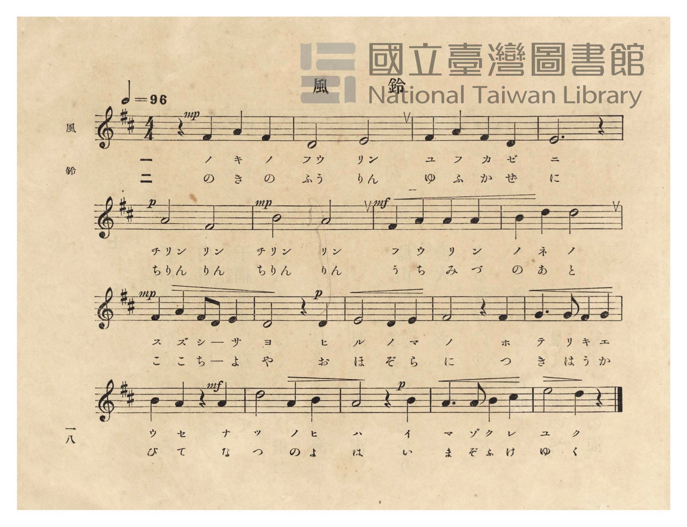
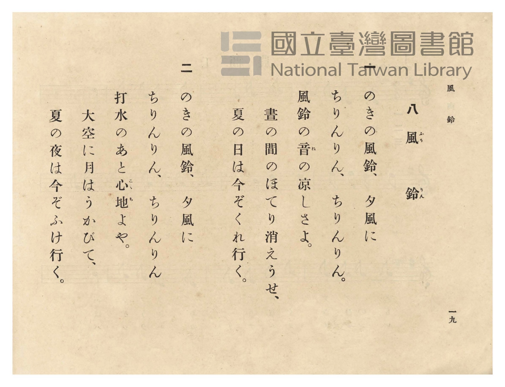

# 風鈴

> Re:Shōka 使用 AI 協助辨識與重建樂譜，可能會有錯誤。歡迎回報。

- **鋼琴伴奏版**：<br><audio controls src="furin.mp3"></audio>
- **NEUTRINO 歌聲合成版**：<br><audio controls src="furin_neutrino.mp3"></audio>

- 臺灣總督府《公學校唱歌》第五學年用（昭和十一年，索書號 523.37 4322-4）

## 說明

原書資訊與歌詞全文（對應 P022.jpg–P023.jpg，原書 pp. 18–19）：
調性與拍號：ニ長調（D 大調，2 升記號）4/4 拍，速度 ♩=96


## 歌詞

```text
一
のきの風鈴、夕風に
ちりんりん、ちりんりん。
風鈴の音（ね）の涼しさよ。
晝の間のほてり消えうせ、
夏の日は今ぞくれ行く。

二
のきの風鈴、夕風に
ちりんりん、ちりんりん
打水のあと心地（こゝち）よや。
大空に月はうかびて、
夏の夜は今ぞふけ行く。
```

## ABC

```abc
X:1
T:風鈴
M:4/4
L:1/16
Q:1/4=96
K:D
V:V1 name="Piano" snm="Pia"
[V:V1]
!mp! z4 F4 A4 F4 | D8 E8 | F4 A4 F4 D4 | E12 z4 |
w: 1.~ノ キ ノ | フウ リン | ユ フ カ ゼ | ニ
w: 2.~の き の | ふう りん | ゆ ふ か ぜ | に
!p! A8 F8 | !mp! B8 A8 | !mf! F4 A4 A4 A4 | B4 d4 d8 |
w: 1.~チリン リン | チリン リン | フ ウ リ ン | ノ ネ ノ
w: 2.~ちりん りん | ちりん りん | う ち み づ | の あ と
!mp! F4 A4 F2 D2 E4 | !p! D8 z4 D4 | E8 D4 E4 | F8 z4 F4 |
w: 1.~ス ズ シ _ サ | ヨ ヒ | ル ノ マ | ノ ホ
w: 2.~こ こ ち _ よ | や お | ほ ぞ ら | に つ
G6 G2 F4 G4 | !mf! B4 A4 z4 A4 | d8 A4 B4 | !p! A8 z4 B4 |
w: 1.~テ リ キ エ | ウ セ ナ | ツ ノ ヒ | ハ イ
w: 2.~き は う か | び て な | つ の よ | は い
A6 A2 B4 c4 | e8 d4 z4 |
w: 1.~マ ゾ ク レ | ユ ク
w: 2.~ま ぞ ふ け | ゆ く
```

## TMD 檔案連結

- [主旋律 TMD 檔案](furin.tmd) [[在 TMD Studio 編輯](https://tmdlang.github.io/Tmd-TS/#tmd=s7IKdvYPcrWy4qpTUCpJTLdSSM7PyUlNLsnMz7PKzk9PzM7Ojy_OyM9OVIKrKMvPKc1NtUovSkxJjTdFiBfnlxYlp1oVJ2fk5-fEl6RWlCTl52ejy8cXJKanWgUYGBkhZAqK8stS8xLzgLoLijLzSlJTwNoRClLLMlNSQdLFyYl58WWpRZlpmakpSE5KLSoGuRhqRUlRYl5xclFmAcgbCFX5RSUZ-UBnF2RUWmVkFpfkF2UmJ-bEZyfmIfmuJCMV6Lni1MTi_LxidOGM_NxUZPMy0zPzrEoSM8uBrspPS8tMzkzMUeLS0lJ4uWjFy44tClpaXIq2CpZmXPa2Ci5cNib6JnYg3S_adz1vXPx8x97ncxc_3TXncUPX09Y1T9fueLZg4dMpG5-t7Xnc0P18zZonu6YABZ_u3PJ8yor3ezqezVj7dFLP097GJzsagILv9_Q837Lo2ewdL2bOVzA1MtYzNlcwMTYy0jV5v6dTiYtLX0vBllqAS0FB4WnffJBlm9tfrOh60dEOdOWLlfOetq54Nq0d6LinG3qftXcqgOJVL6sg_VHDZCDTGMQEuhOiVaGgQE_B0AIoZWgJdOL7PbNAxr5Ytf9Zw3KQgd29QJ8ARR83d7-cuh0oDjTWReHpkuVgZo-RwtNeoN0zwIo6gUGpANQBFH_ZMP_prmUKj2autAUGNMhIYPiAqMeN6x439gJJSGQ8bmh8umQqkP24cTVEeuHjpq7HTZOhZEMjhkgTSB1UN9CY-ZuBLnrcuBZoPZD7bNuex43THzdOfdzUAVX6bOZckLppk8FW737cuAxo0rNtQD1A1Pa4cTbQEnBQLukHGTB96ePG9U92dz1unPe4sf9xU8-LhT0gBtAwsDd29VDDG2CHdU5-tgHkh8eNTY8bVzzd3_x0zgawZ4CKgG5eCPIS0BtNLVCfAEP9-cpdQCuezQEqWg92fffjxs0gLyH74emSOUh-2Pq4cSLCD0BFlKc8KFDQ0uficisFFg5WAZmJefkONQY11SAbFGwstOzADGzpXQGUi3Y0AN2koGGi8HRD__P1DTrwRKqJRQPQHpBhNQoGCroK1bkFtQrGQIYpEIPoGgVDIAmCRlC6BkUeJFsDlwNBkDE1YCN9DGsU4oG8x819ILJpLZxdA6SBqWgZVMvj5lWPmzfDzX_cDJIAqgDrWg0m90BlupFsApkNtckIalPjOjDZC2cD9YAiqQ1mEziBIGxqAkkAVYBJkNmPG-dAdYHsRbUJf6DvAiVmkgO9GhjeoLAEQVB4QtwFjgYzKBcmDRJOQ8QODNeAFRrGwQiwUnj4P25uRAldjKAmIA2JA0h8rAKTIFmQDDhOm8EhDWYj2QuMDXiWxBHwhKQh8bIQTO4Hk0uhMpAYbgKTK-D2EsgQneC4MSUxblAzgyE4mSMyBDi_AFWgZgEQD6IOFp0gdZCsZALmm4B5IDZSNDXtBIfCLjC5HUyCEiUooGGehGSlSVBRWPKERcQ8pGhBqJ4NFYWkf1AUQrNhE8hU5OgCBT6MBAd7UwdEb1MLsomNXdBo2A2zvxFk8-OmTqg4zF0Q1UugoqBkAuKvh0ctKLMRiLans2eTE22g7ACKMUh5BswxkFwCzxwgLkhNDTxnwWISWdQUzDMHixjBtILNQC3goJmjCRQekDCHhlAzLNxgMQSLuX7kEGqChhA4_kD8fUC8Hqx-DVQGXkqCxVELPWAFBQ5NkBpIiIMyKUgcZC4kzMEZBhabwBhAjh-QG0Gi-6Bq58ELw4kQGXABCZEDuRtiey0Xl66dArhyUgAylLkA)]
- [鋼琴伴奏 TMD 檔案](furin_piano.tmd) [[在 TMD Studio 編輯](https://tmdlang.github.io/Tmd-TS/#tmd=s7IKdvYPcrWy4tLSUni5aMXLji3v93S87N7zfMKWJ3u2PF3a_7yz4_2eTgUtLS5FWwVLMy57WwUXLhsTfRM7rjoFpRftu543Ln6-Y-_zuYuf7przuKHraeuap2t3PFuw8OmUjc_W9jxu6H6-Zs2TXVOAgk93bnk-ZQXQ_Gcz1j6d1PO0t_HJjgag4Ps9Pc-3LHo2e8eLmfMVTI2M9YzNFUyMjYx0TYA2K3FxeeaVFOVbBWQm5uUHeTjUGNRUcykAgY2Flh2YUaNQnVtQq2CqoAuGxlC6RsEMyoLJ1IDlQDxjBUMFI7CIIVQOBA1AIly1KDb6INtogmqjYbxCtGEsjKpRMAEyTJD4SPKm8agCBhCL3EqLMvPweg3kJrBlCKcjOxvkCXSv6YJla-ByCK-BjPQxrFGIB_IeN_eByKa1cHYNkJ76uGkZVMvj5lWPmzfDzX_cDJIAqgDrWg0m90BlupFsApkNtckIalPjOjDZC2cD9TRufdzYBrOpqetx02SETU0gCaAKMAky-3HjHKgukL2oNsEiBGsKAIccZjKozk1DBCgMQ9KLYRyMACuFB9nj5kaUAMEIHQLSkGCDBOEqMAmSBcmAo6EZHDhgNpK9wAB83LgQJXjQw4qQNCQoF4LJ_WByKVQGEilNYHIF3F7k9I07t4BTJSgHgEVhCQ3Eg6iDxQBIHSTBmoD5JmAeiI0Usk07wQ7fBSa3g0lQ1IPCBuYuSIKdBBWFJQJY2M1DCkmE6tlQUUgqA4U6NLE3gUxFDmFQeMFIcEg1dUD0NrUgm9jYBQ253TD7G0E2P27qhIrD3AVRvQQqCopZEH89PDZASRoe0qBEBwpkSEYHpktIWoQnQRAXpKYGnn5hgY8sagrmmYNFjGBawWag5nxoEmwCeQESTFBPNcO8CgtUWGD3I3uqCeopcJCD-PuAeD1Y_RqoDLz4AIujlgaPG0GJ_nEjSA0kkEBZASQOMhcSTOBkCYsAYKAhBynIjSDRfVC18-ClxESIDLjkgMiB3A2xHbWcxVGgG6AU6Sjlt2k8lgIcogIuBWKAynREYYSuFGw8eg0BjnAc1QiUgpuJVuOgOMgAZDmkDIS5CIcaJBcgGQ4UhfgAbAzIUWjqMC2CCkB1IgUFonbTtVMA16QKQAY4BqJ9gDoQHCMwR5kLAA)]

## 分析

```text
================================================================================
📊 TMD Song Profile: [ 風鈴 ]
================================================================================
⏱  Duration:       0:45 (45.0s), 18 measures total
🎼 Key & Tempo:    首調基準 D, != 96.0 BPM, <4/4>
   - 分析範圍：      由實際發聲的音符與和弦推測調性；播放脈絡另行呈現
🎤 人聲音域:    D4 (MIDI 62) – E5 (MIDI 76) [跨度: 14 個半音 / 1.2 個八度, 難度: moderate]
   - 最低音:  D4 in [Furin #1 @ m.2, 0:02]
   - 最高音: E5 in [Furin #1 @ m.18, 0:42]
   - 適合: soprano, mezzo-soprano, contralto, tenor, baritone, bass
🏛  結構:      Furin (45.0s)
⚡ 編曲密度:        Peak 1 軌道同時演奏
🗝  調性診斷：       D 大調（純淨自然大調，未偵測到可信轉調）
   - 風格氣質:    純淨自然大調（陽光明朗、易唱易記，無明顯調外色彩）
   - 轉調歷程:    全曲維持單一推測調性（未偵測到可信轉調）
   - 核心骨幹音:  A, D, F#, E, B
   - 調性數值:    D 大調 [相關度: 0.87, 穩定度: Moderate, 自然音純度: 100.0%]
   - 候選調性 (K-S): D 大調 (0.87), A 大調 (0.81), F# 小調 (0.67)
   - 五度圈歷程:   +2
   - 各段落調性細節:
     • [Furin #1]: D 大調 (r: 0.87, 自然音純度: 100.0%)

  [ 五度圈游移軌跡 ]
               C  
         F            G  
      Bb              [D ]*
      Eb               A  
         Ab           E  
            Db       B  
               F# 
     (* = active key center)

  [ 十二半音累積音高分佈 ]
     C  :                            0.0%
     C# : █                          1.5%
     D  : ███████████████████       20.8%
     D# :                            0.0%
     E  : ████████████████          16.9%
     F  :                            0.0%
     F# : ██████████████████        19.2%
     G  : ████                       4.6%
     G# :                            0.0%
     A  : ████████████████████████  26.2%
     A# :                            0.0%
     B  : ██████████                10.8%
--------------------------------------------------------------------------------
Assignment 軌道音域：
  - Piano         : D4 – E5 (14 個半音 / 1.2 個八度, 51 個音符)
================================================================================
```


## 原書掃描頁






