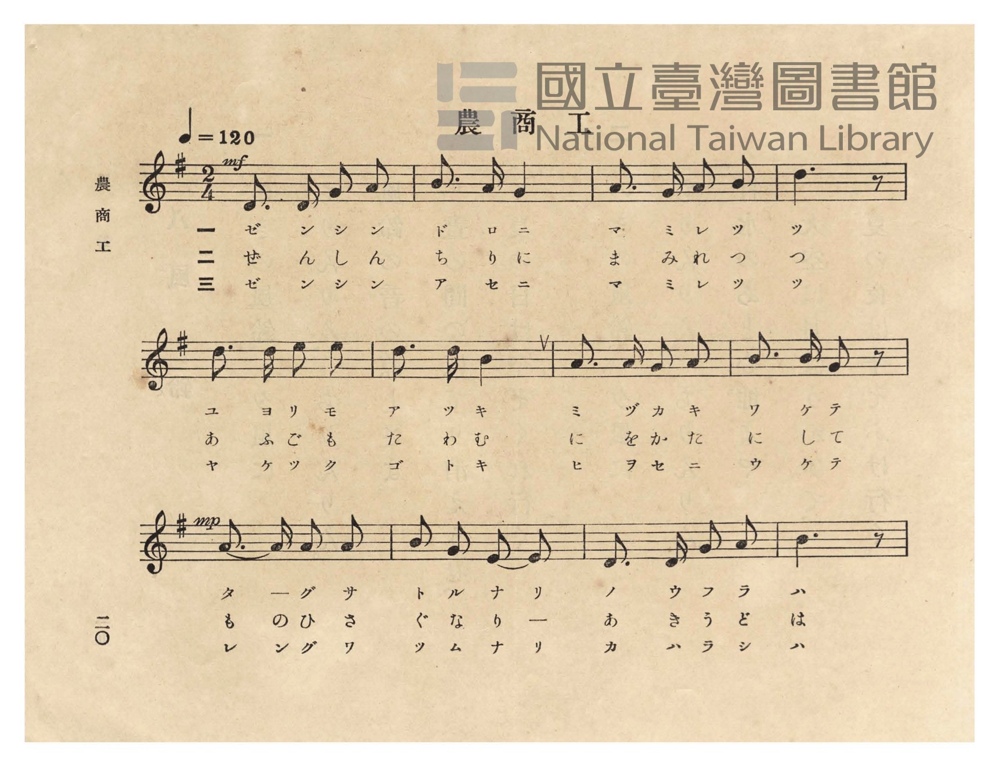
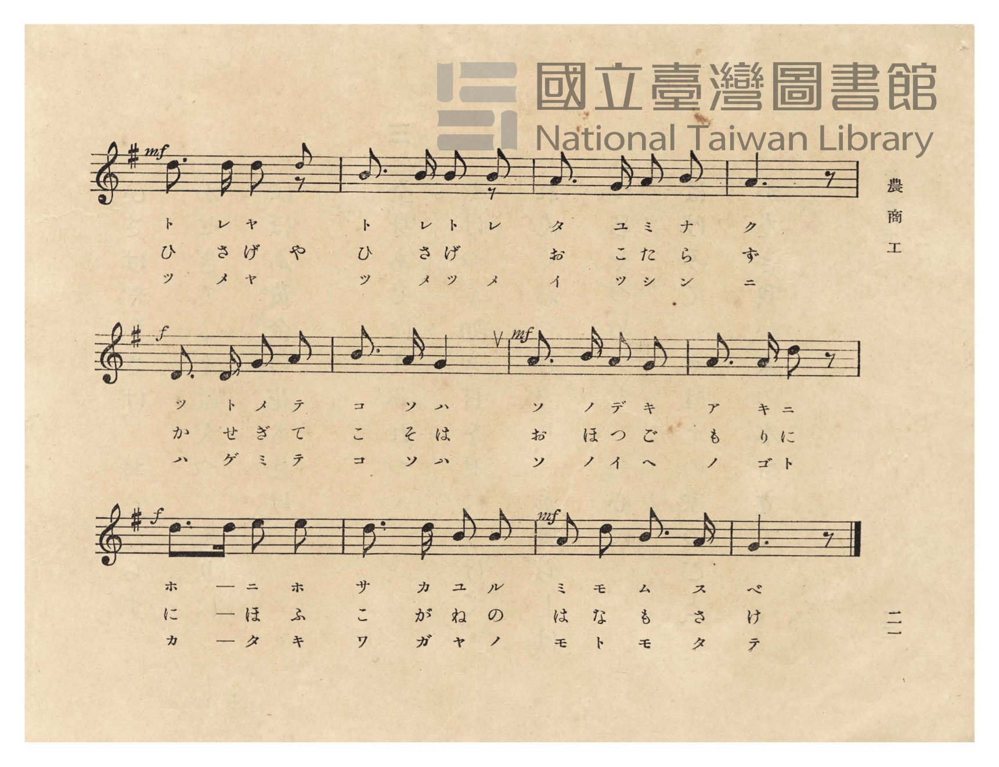
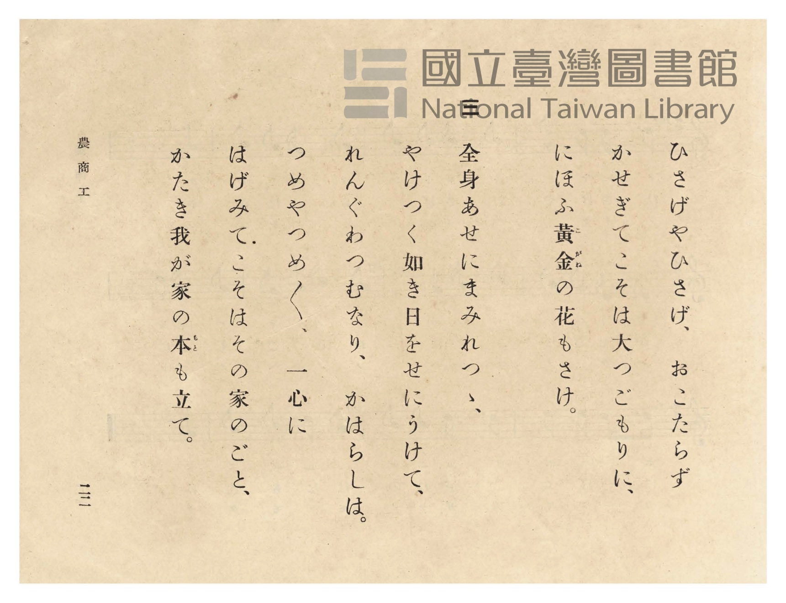
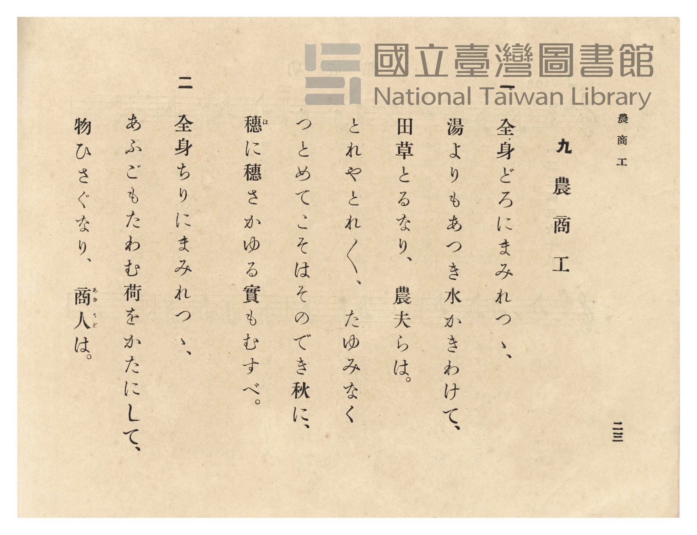

# 農商工

> Re:Shōka 使用 AI 協助辨識與重建樂譜，可能會有錯誤。歡迎回報。

- **鋼琴伴奏版**：<br><audio controls src="no_sho_ko.mp3"></audio>
- **NEUTRINO 歌聲合成版**：<br><audio controls src="no_sho_ko_neutrino.mp3"></audio>

- 曲：宮島慎三郎（臺灣總督府國語學校助教授）
- 臺灣總督府《公學校唱歌》第五學年用（昭和十一年，索書號 523.37 4322-4）

## 說明

原書資訊與歌詞全文（對應 P024.jpg–P027.jpg，原書 pp. 20–23）：
調性與拍號：ト長調（G 大調，1 升記號）2/4 拍，速度 ♩=120


## 歌詞

```text
一
全身どろにまみれつゝ、
湯よりもあつき水かきわけて、
田草とるなり、農夫らは。
とれやとれ〳〵、たゆみなく
つとめてこそはそのでき秋に、
穗（ほ）に穗さかゆる實もむすべ。

二
全身ちりにまみれつゝ、
あふごもたわむ荷をかたにして、
物ひさぐなり、商人（あきうど）は。
ひさげやひさげ、おこたらず
かせぎてこそは大つごもりに、
にほふ黃金（こがね）の花もさけ。

三
全身あせにまみれつゝ、
やけつく如き日をせにうけて、
れんぐわつむなり、かはらしは。
つめやつめ〳〵、一心に
はげみてこそはその家のごと、
かたき我が家の本（もと）も立て。
```

## ABC

<div class="abc-score" data-abc-src="no_sho_ko.abc" aria-label="五線譜載入中"></div>

[下載 ABC 原始檔](no_sho_ko.abc)

## TMD 檔案連結

- [主旋律 TMD 檔案](no_sho_ko.tmd) [[在 TMD Studio 編輯](https://tmdlang.github.io/Tmd-TS/#tmd=s7IKdvYPcrWy4qpTUCpJTLdSSM7PyUlNLsnMz7PKzk9PzM7Ojy_OyM9OVIKrKMvPKc1NtUovSkxJjTdFiBfnlxYlp1oVJ2fk5-fEl6RWlCTl52ejy8cXJKanWgUYGJkgZAqK8stS8xLzgLoLijLzSlJTwNoRClLLMlNSQdLFyYl58WWpRZlpmakpSE5KLSoGuRhqRUlRYl5xclFmAcgbCFX5RSUZ-UBnF2RUWmVkFpfkF2UmJ-bEZyfmIfmuJCMV6Lny_CIklwMVpmfmWZUkZpYDrc9PS8tMzkzMUeLS0lJ4sW_T06ltT7cvVdDS4lK0VTA0MuCyt1Vw57Ix0jexA5nwbPam93tmPV237unmbc9a-57s6HzZ3Pd-T8eL9l3PGxc_37H3-dzFT3fNeTqn-8WqeU_X7ni2YOHTrpXPps581tfxfk8n2BVoah83dD1tXQNVO2Xjs7U9jxu6n69Z82TXFKDg051bnk9ZAbTh2Yy1Tyf1PO1tfLKjASj4fk_P8y2Lns3e8WLmfAVTI2M9Y3MFE2MjI10TsDVc-loKttQCXAoKCk_75oMs29z-YkXXi452oCtfrJz3tHXFs2ntQMc93dD7rL1TAZQQ9LIK0h81TAYyzUFMoDshWhUKCvQUjAyAUkbGQCcCQxFk7ItV-581LAcZ2N0L9AlQ9HFzx8up24HiQGPdFZ4uWQ5m9hgqPO0F2j0DrKgTGB0KQB1A8ZcN85_uWqbwaOZKW1BsgcwEBhDYxa0rXuxa_bhx5eOm3seNQMa-x437Hzf1PG5c8rhp7uOGRpCiZzvXP27qeNzU9bip6XEjEC153Nj7bMOWx43dQMbjpv7HjRMfNy6Dqn4-ZcOL3s7HjSseNwGlV4G0NTSCEs2S1Y-bgOLrHzc0gdSBVfQ8bmqBMho2P27YClT6uHH-46Y2kDOAmhv7IUqBNgIVAeWWPW6c_LhxLsgYELnuceNyoBueLwdatRrmgJXTgcHyuHE3MAyAokDu48apILcCTW3qfrp-GcgbTQ2PG2c-btwJcgw4PHb1IIfHQpCzcYUHOAy2Pm6cAg4PoGv7gca96N3-uGkSOEjmg3UCbYUHSefKx42bwK6YAA8SYCZ6smsX2KVAU4ChD_TzSrCTESEE0TMJHEgwNiiEgG4DhgLQZqBqcBIB2zv7cWMfcggB0wU45MDuhPgH5gGg-3YD_fByd_PL9olgNwD1AH25FuyAdS-6NoL9BrRwIjyEdnQihxBQFmgfrhACORiYJoCW9z9dBvLes-lLwcED0QP0KlKKAScDoP0TwEkJaAwwbqCBBPYXMPUBHQUMT0TAABU1gi0BM2BJB5Tr9zcDbYAoAiYRoI3AdISeaJ6u2wZOOlNAqQoWJJCI633WAXRZD0TFszlrQGEDCglg6dIJZDxfDVQGdDfYGZQXGlCgoKXPxeWXH5yR751vFZCZmJfvUGNQUw2yQ8HG0EzLDszCVlopgMrAHQ0vFvYoaJgoPN3Q_3x9gw68iNHEogFoFciwGoXq3LRaBdN4BV0gBFJmIJY5iKhRMAQLAjlgQRCsgUjpgkTALJCSGgVjqDQIGoBEwGb7GNYA43QPWPRx82YgezuUBdLzuLkTKrMWiLvhFjxungcVnw_Ea8CsFqgMiIZBsBMh9hgB5RrnQHQ1TQayp0NZYF2NC6EyXaAEj7CncR9EvHE_KOWBWUugMiAaiz3GeP3TtAhqz24K_IM_hnf1kBPDpmDzTRXMgCQII0Rg8VajYASmjcDxCWLD4tQYLIIWp83LoD5aAcSrwCyQ35HCAOizx01rkcJgPlS8FSgOigOILEhmPTTUNgLZbajhDY7XJmgsbQXiKWCVIBGQDNTMpn4gbkDYBY1jYDEDys1gvSCVSDLA9AHMvah2geK2GRLvELeA4uZxE8h1IH9tgbq_A81fk6Dim8DxDmKBbATpgIYRmr8I5OBO8nJwQS08AkE0IgJBkQfOvGACGPHwfI4e0dgz736o-OOmDWByK9TbHWCvgiOyuQtMgpIBSKYPqn4ZkD0VLLMSKtOPZA9aJIOjFBQx60CVHZgF0guKsglgHjiRATMwIpJhOnqBGBS8wEoTKgNJUFgzLzj7wTIv2Efg5AfLio-bF2D6CJxcQXxgMgP7BZLtsfsIb_Q-nT0bM3pNiSygwZaYgmlwJMHzJ4gGYVgeNgTTyCJYoxYchSBvrYGme0gCQRWHRDMo0BCJAZT7IfkZElAgGRxBDs6_oOiERCiwGkbYgyEOi1hIJANrami-BVb6UJlZ2G0BRyykJH3cvBDNN8jikCgG1QYgN0PzenMzRr0EK7uJjFZg34OsaCWp2gUnAmjdawhhQLM0VBBIwdMGUizD_A8st8A-h5RFIP-DfAsK3b1ICRkkvheqow-I28Eq1kJlYPXbWmgYocc0JNyAbTsgBhUDkDIWJAOqiUH8uUjZEzmugTUmuM6FlPBIBQK8zkaPb4iLHzcBy11oWiTBX-C4f9w8AyIDL7K2QFM8MVm5dS3ZcQ62DVdtDMm34NgGZV6QFCSjG8ETBvbsPBsqDokaCB_kbVCJDfLcanDGhZXasCoZUnFDyj2Qqp1gmZlI9qBHMqwBBYo0EAmtEeBR3APEoAQDKssR5TGsBIeV2lPBMhOx2wNuZsHtARc7mM0FWLEFiT6QDMQnkCILllT3g2VASQPVnlouLl07BWhTWwHIVOYCAA)]
- [鋼琴伴奏 TMD 檔案](no_sho_ko_piano.tmd) [[在 TMD Studio 編輯](https://tmdlang.github.io/Tmd-TS/#tmd=s7IKdvYPcrWy4tLSUnixb9PTqW1Pty99v6fjZfee5xO2PNmz5enS_uedHe_3dCpoaXEp2ioYGhlw2dsquHPZGOmb2HHVKSg9m73p_Z5ZT9ete7p527PWvic7Ol829wGNeNG-63nj4uc79j6fu_jprjlP53S_WDXv6dodzxYsfNq18tnUmc_6QOYqgcxAU_u4oetp6xqo2ikbn63tedzQ_XzNmie7pgAFn-7c8nzKCqANz2asfTqp52lv45MdDUDB93t6nm9Z9Gz2jhcz5yuYGhnrGZsrmBgbGemagK3h8swrKcq3CshMzMsP8nCoMaip5lIAAhtDMy07MKtGoTo3rVbBVEEXCE0VzIAkCNfARYyBJAjXKBiB-RCeLpBXo2AIZkGgAUgNVy2KlT7IVpqg2mgYrxBtEgsyBMgwBDFM44Es03iomAHENL_84Ix8b6K8EA9xcbyCGYhlDiJgTgRywIIgWAORAvozHsICKamB-grZLyCzfQxrFB437QGLPm7eDGRvh7JAeh43d0Jl1gJxN9yCx83zoOLzgXgNmNUClQHRMAh2IsQeI6Bc4xyIrqbJQPZ0KAusq3EhVKYLyF6NsKdxH0S8cT9QrgfMWgKVAdFY7DHG65-mRVB7dlPgH2ik4E9SEINBSQqUlEBRAGLDosEYLIIWDc3LoI5YAcSrwCyQc5GcDXTM46a1SM6eDxVvBYqDgg0iC5JZD_XoRiC7DTWIwFHRBA3YrUA8BawSJAKSgZrZ1A_EDQi7oNHyuGkSkA0KOohKJBlglD5uBPkBLTqaIVEFcQsoOB83gVwH8tcWqPs70Pw1CSq-CRxVIBbIRpAOaBih-QueTwpq4WEOohFhDgpvcBYBE6DMCFYGpNDjBnsW2Q8Vf9y0AUxuhbq0A-w6cNg3d4FJUMyBZPqg6pcB2VPBMiuhMv1I9qDFCzgWQGG5Dog3gVkgvaBQngDmgdMFMJsg4gWmoxeIQSHyuBFqTyMkDWDNIuBEDssiYB-BUwwswT9uXoDpI3AKA_GBKQPsF0jmwu4jbIUviAaHKzwXoBa-oFgC0cgiWGMDHOogl6yBpi5InKKKQ2IG5E9E_IHyGCTXQPwGksERSuBcAooBSBw8bgSlSag9GOKwuIDEy-NGUAEHtqUJVICCZGZhtwUcF5Ai5nHzQjTfIItDYgVUTILcDM1Rzc0YBTasUMOMCZKqEHC8QesRQwgDmnGggkAKHp1IEQNzMjBDgx0LyaQgJ4McCAqQvUjJBSS-F6qjD4jbwSrWQmVgZfVaqLfQIwfi1ceNs4EYlNkghQ9IBlSrgPhzkTIBcvQAS39w_QEp-pCyHbz-QY8iiIsfNwELJGjyIcFf4Oh63DwDIgMvGLZAEylmNIEV4G-sgCOImBYLIm5mQ8UhoQnhg1wKKspA7lkNzh6w4gxWvUAqIUiBAFK1EywzE8ke9HiB1d-gcAaR0KISHis9QAyKY1AhhyioYEUbrDibCpaZiN0ecC0PtwecuTGrPljhAAlxkAzEJ5CCAZa69oNlQLGJag962wxfWw-pZWcGYprF58IafCAMb-9BtMAbhCgtQywKwdUZaquRgNHwliem-VAzQEwk9bgdD_cYxBpMfZgNXPSwQLRyde0UwM1mBSADGqrRPkA9yFwjVK4xmKvMBQA)]

## 分析

```text
================================================================================
📊 TMD Song Profile: [ 農商工 ]
================================================================================
⏱  Duration:       0:24 (24.0s), 24 measures total
🎼 Key & Tempo:    首調基準 G, != 120.0 BPM, <2/4>
   - 分析範圍：      由實際發聲的音符與和弦推測調性；播放脈絡另行呈現
🎤 人聲音域:    D4 (MIDI 62) – E5 (MIDI 76) [跨度: 14 個半音 / 1.2 個八度, 難度: moderate]
   - 最低音:  D4 in [NoShoKo #1 @ m.1, 0:00]
   - 最高音: E5 in [NoShoKo #1 @ m.5, 0:04]
   - 適合: soprano, mezzo-soprano, contralto, tenor, baritone, bass
🏛  結構:      NoShoKo (24.0s)
⚡ 編曲密度:        Peak 1 軌道同時演奏
🗝  調性診斷：       D 調性不明確（純淨自然大調，未偵測到可信轉調）
   - 風格氣質:    純淨自然大調（陽光明朗、易唱易記，無明顯調外色彩）
   - 轉調歷程:    全曲維持單一推測調性（未偵測到可信轉調）
   - 核心骨幹音:  B, D, A, E, G
   - 調性數值:    D 調性不明確 [相關度: 0.84, 穩定度: Ambiguous, 自然音純度: 100.0%]
   - 候選調性 (K-S): D 大調 (0.84), B 小調 (0.82), G 大調 (0.68)
   - 五度圈歷程:   +2
   - 各段落調性細節:
     • [NoShoKo #1]: D 調性不明確 (r: 0.84, 自然音純度: 100.0%)

  [ 五度圈游移軌跡 ]
               C  
         F            G  
      Bb              [D ]*
      Eb               A  
         Ab           E  
            Db       B  
               F# 
     (* = active key center)

  [ 十二半音累積音高分佈 ]
     C  :                            0.0%
     C# :                            0.0%
     D  : ███████████████████████   21.3%
     D# :                            0.0%
     E  : █████████████████         15.2%
     F  :                            0.0%
     F# : ████████████              11.2%
     G  : ███████████████           13.5%
     G# :                            0.0%
     A  : ██████████████████        16.9%
     A# :                            0.0%
     B  : ████████████████████████  21.9%
--------------------------------------------------------------------------------
Assignment 軌道音域：
  - Piano         : D4 – E5 (14 個半音 / 1.2 個八度, 78 個音符)
================================================================================
```


## 原書掃描頁










