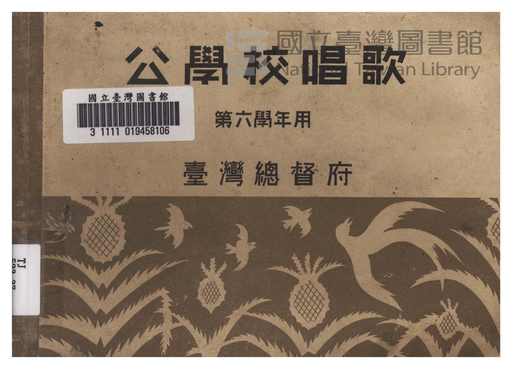
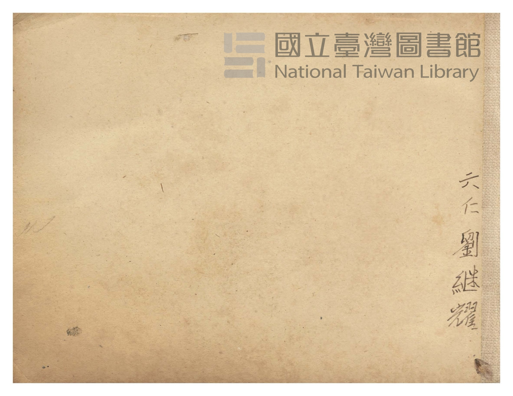
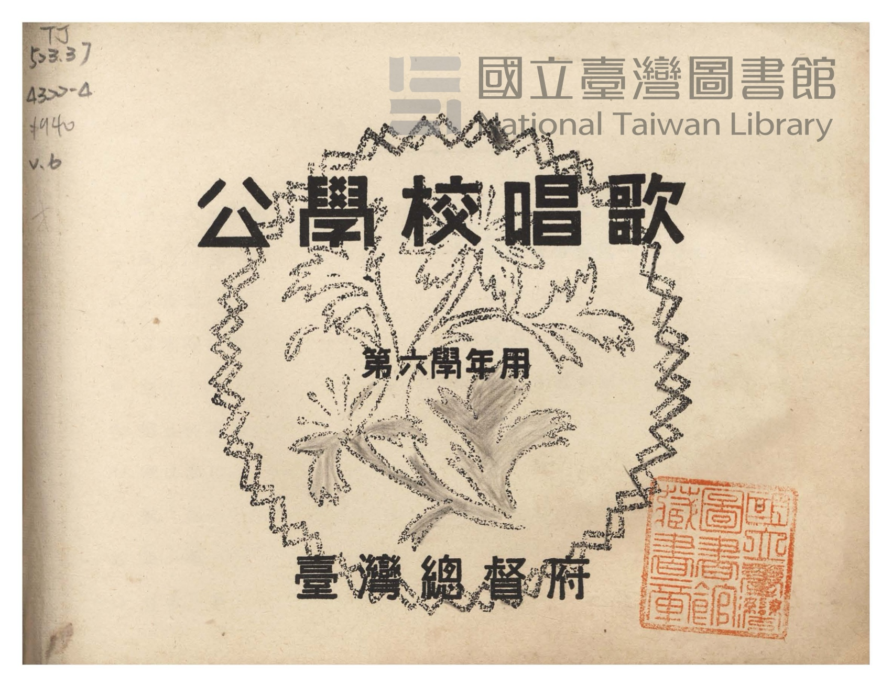
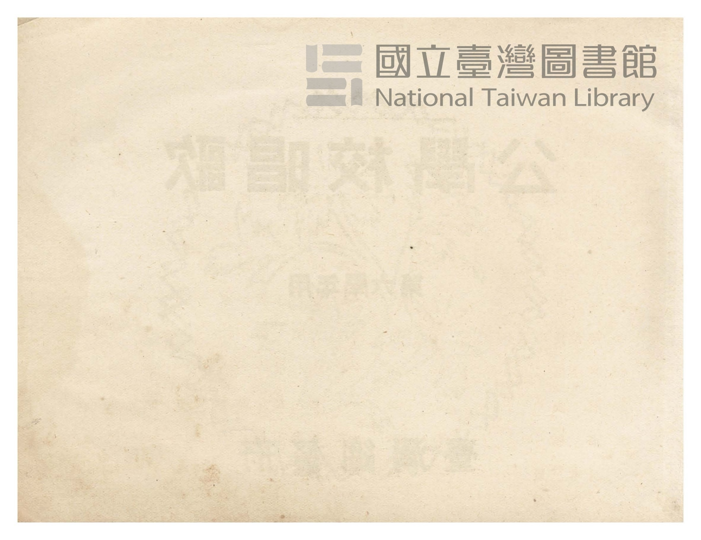
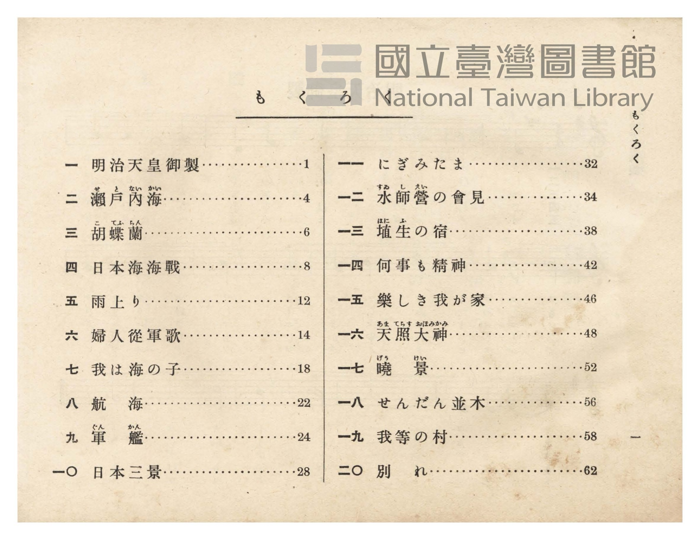
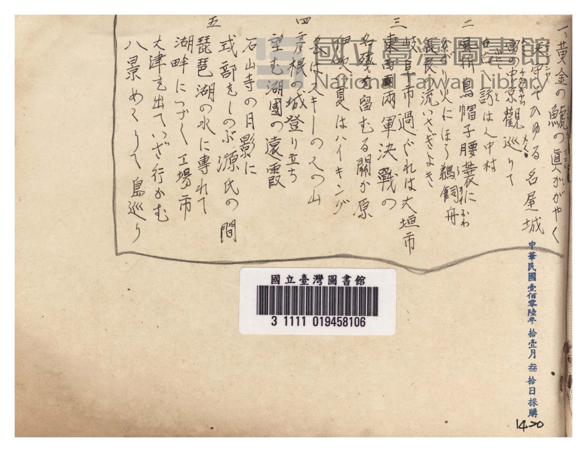
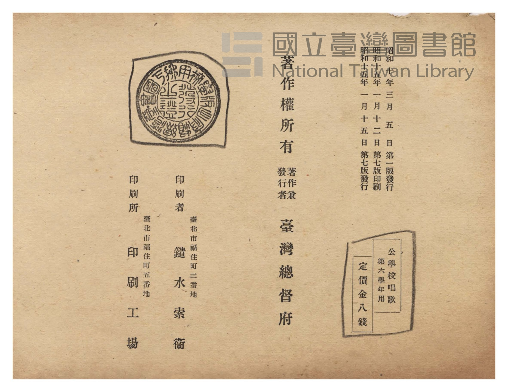
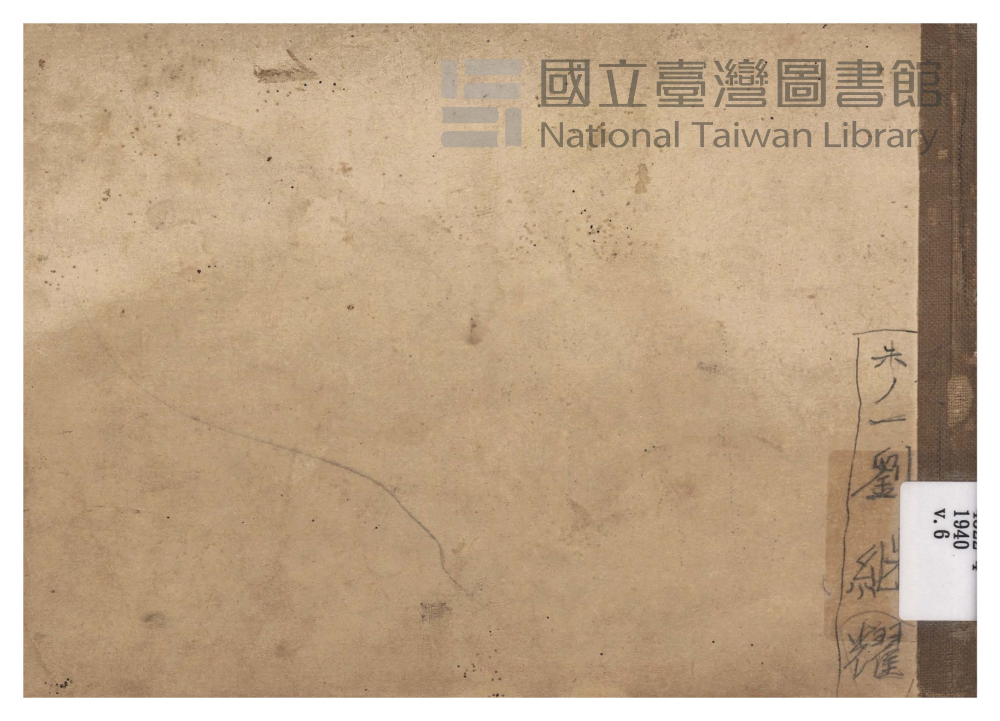

# 書訊與卷首／卷末掃描頁 — 《公學校唱歌》 尋常科 第六學年用（國臺圖 523.37 4322-4）

本頁收錄本冊之封面、扉頁、目次（もくろく）、樂典大要、版權頁與封底等原書掃描圖檔（共 8 頁）。

### P001.jpg

本冊封面（右頁），題「公學校唱歌　第六學年用　臺灣總督府」，下方繪有臺灣鳳梨與烏秋（大卷尾）飛翔圖案，左貼國立臺灣圖書館條碼籤「3 1111 019458106」，書脊下方貼索書號籤「TJ 523.37」。

### P002.jpg

封面裏（見返頁），右側有原持有者毛筆署名「六仁 劉継耀」。

### P003.jpg

扉頁，題「公學校唱歌　第六學年用　臺灣總督府」，左上鉛筆標註索書號「TJ 523.37 4322-4 1940 v.6」，右下蓋有「國立臺灣圖書館藏書章」。

### P004.jpg

扉頁裏留白頁。

### P005.jpg

目次頁（「もくろく」，原書第 1 頁）：列出「一　明治天皇御製」至「二〇　別れ」共 20 首曲名與頁碼。

### P068.jpg

卷末襯頁，上欄有原持有者手抄〈鐵道唱歌〉東海道篇名古屋至琵琶湖五節歌詞，下方貼國立臺灣圖書館條碼籤「3 1111 019458106」，右側蓋有「中華民國壹佰零陸年拾壹月叁拾日採購 1420」館藏採購章。

### P069.jpg

封底裏版權頁：標明「昭和十年三月五日第一版發行、昭和十五年一月十二日第七版印刷、昭和十五年一月十五日第七版發行」、「公學校唱歌 第六學年用 定價金八錢」、「著作權所有　著作兼發行者 臺灣總督府」、「印刷者 臺北市福住町二番地 鑓水索衞」、「印刷所 臺北市福住町五番地 印刷工場」，左上印有臺灣總督府檢定證印。

### P070.jpg

封底外頁，右下有原持有者毛筆署名「六ノ一 劉継耀」及索書號籤「1940 v.6」。

