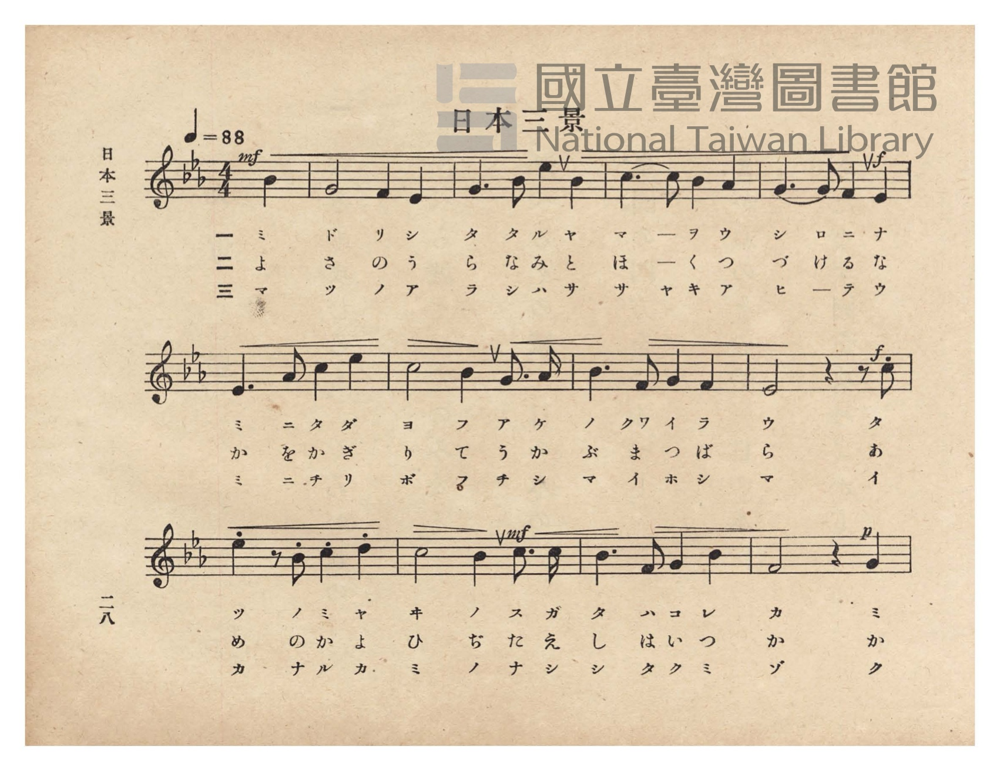
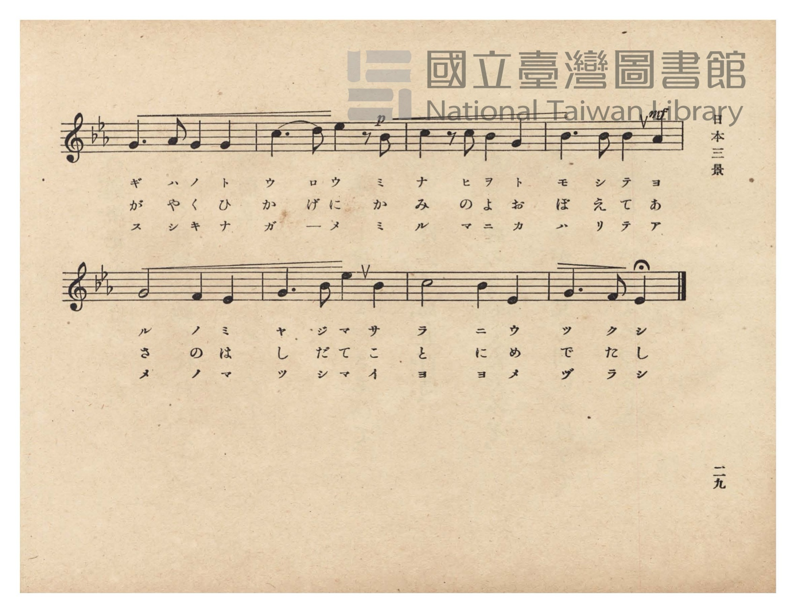
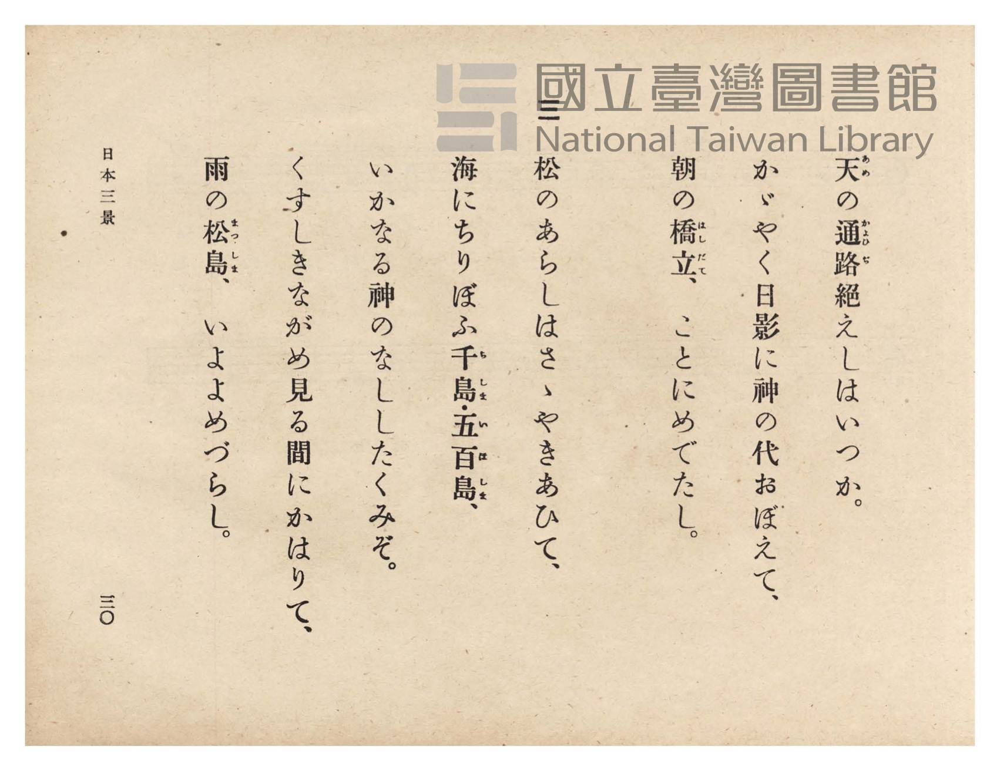
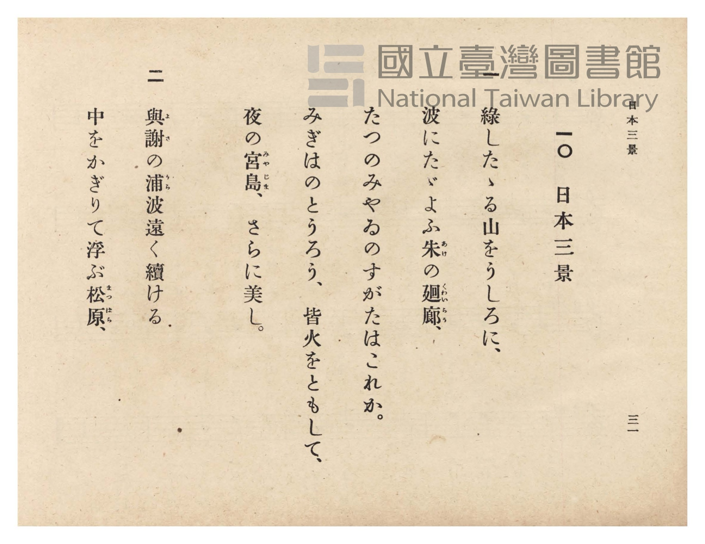

# 日本三景

> Re:Shōka 使用 AI 協助辨識與重建樂譜，可能會有錯誤。歡迎回報。

- **鋼琴伴奏版**：<br><audio controls src="nihon_sankei.mp3"></audio>
- **NEUTRINO 歌聲合成版**：<br><audio controls src="nihon_sankei_neutrino.mp3"></audio>

- 臺灣總督府《公學校唱歌》第六學年用（昭和十五年，索書號 523.37 4322-4）

## 說明

原書資訊與歌詞全文（對應 P032.jpg–P035.jpg，原書 pp. 28–31）：
調性與拍號：變ホ長調（Eb 大調，3 降記號）4/4 拍（弱起 1 拍），速度 ♩=88


## 歌詞

```text
一
綠したゝる山をうしろに、
波にたゞよふ朱（あけ）の廻廊（くゎいらう）、
たつのみやゐのすがたはこれか。
みぎはのとうろう、皆火をともして、
夜の宮島（みやじま）、さらに美し。

二
與謝（よさ）の浦（うら）波遠く續ける
中をかぎりて浮ぶ松原（まつばら）、
天（あめ）の通路（かよひぢ）絕えしはいつか。
かゞやく日影に神の代おぼえて、
朝の橋立（はしだて）、ことにめでたし。

三
松のあらしはさゝやきあひて、
海にちりぼふ千島（ちしま）・五百島（いほしま）、
いかなる神のなししたくみぞ。
くすしきながめ見る間にかはりて、
雨の松島（まつしま）、いよよめづらし。
```

## ABC

<div class="abc-score" data-abc-src="nihon_sankei.abc" aria-label="五線譜載入中"></div>

[下載 ABC 原始檔](nihon_sankei.abc)

## TMD 檔案連結

- [主旋律 TMD 檔案](nihon_sankei.tmd) [[在 TMD Studio 編輯](https://tmdlang.github.io/Tmd-TS/#tmd=s7IKdvYPcrWy4qpTUCpJTLdSSM7PyUlNLsnMz7PKzk9PzM7Ojy_OyM9OVIKrKMvPKc1NtUovSkxJjTdDiBfnlxYlp1oVJ2fk5-fEl6RWlCTl52ejy8cXJKanWgUYGBshZAqK8stS8xLzgLoLijLzSlJTwNoRClLLMlNSQdLFyYl58WWpRZlpmakpSE5KLSoGuRhqRUlRYl5xclFmAcgbCFX5RSUZ-UBnF2RUWmVkFpfkF2UmJ-bEZyfmIfmuJCMV6Lm8xJLSolR00fRUqHZ0ieLk1LzUIiRhoNHpmXlWufl5SaXA4FPi0tJSeDZ96bM5a57s6Hw2c72ClhaXoq2ChQWXva2Cqw6XjYm-iR1I94v2Xc8bFz_fsff53MVPd8153ND1tHXN07U7ni1Y-HTKxmdrex43dD9fs-Zp61qg4NOdW55PWfF-T8ezGWufTup52tv4ZNcUoOD7PT3Ptyx6NnvHi5nzFUyNjPWMzRVMjI2MdE3e7-lU4uLS11KwpRbgUlBQeNo3H2TZ5vYXK7pedLQDXfli5bynrSueTWsHOu7pht5n7Z0KoCjXyypIf9QwGcg0BTGB7oRoVSgo0FMwsgBKGRsCnfh-zyyQsS9W7X_WsBxkYHcv0CdA0Rfruh43z345dTtQCmiya5LC0yXLweweY4WXM3tfrJgBVtgJDE4FoC6Q7Xs2vti6XcEQwgUa3fOyYf7TXcsUHs1caQsMf5BFT3Y0gKjn2xY8bpz-uHH-46a5j5u6n27c-Lhp0uPGNpBgU-_jxtWPGxpB6p5tXgTigNTNe9zU8bhx67M5G4FWPW5setw4EWjJ48Z1T3fvfrq7CyzY_7ip73Fjy-MmoHgbSBZiCkh_4xKg0seN-x83AaUngNkzHzf2gKXWP26c_LgJyO5-3NAE0bD_cSPQJKAEUN0KkMNArmoDmvd8VttzoItArl3xuAnoCqAvlkHtebpkDsg969Y93bwN7B6wbY0zHjfugzjmceNUsNtWP98HNH06yDZwoOzqAUdCR_uLNXNBGkE-nQrx3bOty8BGAV0ADNFOYIC8bASGXf_zXUD3TgSGHSRU14Jd1A1ydVMX0EXPtgIdvu3Z3H3AWAfr3wcOgQ0QU-DuXQkNy6ZGiG0vG2a92L4eLNgNdsWmx42LgFLPt0593AjkAj0LDBOgn4BmIQILqBQYO0DRfmDGe7p3I8iDS-cBjXuye_HjRqBz9oA1w4Lp2Zy5II-t7H6-uhtsFdBIoMFAXwG9CgmmyeBQBwYzkL0cHEeIwNrRCTZkLtBHQD8C3Q50OMRdwMAFpiagO4BxBYwZoNvhVm7dDk5HC8GhA3TO1qe9zbBYWgjWD46i5t3AbP185j6YFNCs3QhZWGoCigJDehUw8CHeBLFBisAJGpgIQalnHjx0gHxgSgPKAV0FVNcD9NSLZcAg6345DehNoKOAZq2HxBrUhpezgZ5fB4o8qDMgkYdwBjiNg5MJKICWQoMAYiHl5QwUKGjpc3H5ZWbk5wUn5mWnZloFZCbm5TvU6BrWVIMsUrAxNNOyA7OwlXIKwLITmNtfLOxR0ICWDNoKJgpPN_Q_X9-gAy-jNLHoBFoMMrVGwUBBFwzR6erctFoFUyinRsEYyoJBIyhtiFUFSJ9hHBIHosQMSQmIDZMxwWoIiA2zphroGLhVYJf7GNYoxENF0OnHzfPhJj5u7kRz-uPmVTBW03aEuqb9yGrAvMfNq-F6liCZOA_FtD1gchNc5zIkM2HmQ1SuBZPdcH4Xqo-M8PioqQNhauNUdB81roOz2pBsR_Y5MGOASZgvgbkfycTdmD5q7IerRPJ741IUMyeC3Qb3EdgOJB8Z44sjWCiCQrQF3UfNfTBW0yIkdSuR1YBD93Ez3J1NWxEq4WyIaSAfPG5ai9XMSSgqIbEJC0Wk2ASXjLiz4a4ecDYkMffB0jQIgnIBLIfAMw9qpgFBWKaBZBUToAqYCAiCMgwsE8EyD6o1IIic2UFZC2QHIlshsg8kSEDRi8gej5sb4OY-boYlIoRqWOKEBfLjpo1glbAIhYitf9wMSrOPm2BpCxG3oNiDhToMIqceiFMQeQZYuqMYDYpPhBiwukYyF5bj4KobYTbBcg5IJ8jMbSiq9oFJuFsbNyCZiV6-oLi1sQnhVmBuwBq0zY1wPjz_ANlz0N2KCFqoDlAOwCiPwCEKbFfC-UhlHIpKDLeCdRJK5zs6yUrnsPQMSnGg9ApL1eZwx-FK5-CKCCJphiexI2oZWLKHQXiNVlALV42c2GFlDzgMwMkUEUuo5T4s1hExgiildkLpNZh1CbiEety0Gc5fgzCzCVbDoMcIUh2GSOlNsJQCSVvgHIRI6Sh1BKw-gruiEVbmAVtQULoDrHI6iqr1YBIWJqhlP3I-Q3ErXAYppcN9BglXUM5Dqk_hsuh5AuJ3eLhC60hoSketTyF1dBPIxWghBhQF5VisboWrJ5DSn86ejZnSjQmmdOQWDKhEh_HhKQ8loYOSP0reACVSUFJGKAOJIjeWEAYhZwUQGyXHwNtUiJTeBGslQEILnCqRQhop9aCUv9B2C1wMEp-gsAbFHaxEhYiCy15EWwjZzGZY-oPEAqTuhtez8IoEuVzvQdEBSpPIrRKYLRg1QCOkBkBJf2AVIJWwnImUg-D5BtiRQjIT1BJAmAlSg1xbgMp1JPeCUzykDEDxIaLNgWjtgUsJ5PCFtDkWIrsMHr6ouQhUfiO1IFFyESxkIGaCW3tI7Rh4i4dQO2YKpakeBCnuHiDLYDcEZAVMBlbEIxfr6AUrclJH7h7ACjhIMO0Ay8OqSZQmJUrjE2IOIiKQGv0ojVlIcYMouGDFEHIyx9echxdWGAX1AjCJSJCTkVRitMrgmQFRhYDULUdRAwoVhC1oLgU3XmBJFBECiDDF1ZyHZXVEmCJXqZjtR5gIwjaQulYUNaCYwBamtVxcunYKSB1qBSBXmQsA)]
- [鋼琴伴奏 TMD 檔案](nihon_sankei_piano.tmd) [[在 TMD Studio 編輯](https://tmdlang.github.io/Tmd-TS/#tmd=s7IKdvYPcrWy4qpTUCpJTLdSSM7PyUlNLsnMz7PKzk9PzM7Ojy_OyM9OVIKrKMvPKc1NtTJDiBTnlxYlp-JSD5GNL0hMT7UKMDA20gUSpgjpgqL8stS8xDygASWJmeWJefHpQIGivPyi-PTUvNSixByE2tSyzJRUkMqCoszcxKLK-JT8ZKBb8kqQXJdaVAxyfEFmYl5-fGJRUWJeeiqqkvyikoz89KLEgoxKq4zM4pL8oszkxJz47MQ8JFeXZAB1WaWmlCYnggJDiUtLS-HZ9KXP5qx5sqPz2cz17_d0vOze83zClid7tjxd2v-8s-P9nk4FLS0uRVsFCwsue1sFVx0uGxN9EzuQkS_adz1vXPx8x97ncxc_3TXncUPX09Y1T9fueLZg4dMpG5-t7Xnc0P18zZqnrWuBgk93bnk-ZQXQgmcz1j6d1PO0t_HJrilAwfd7ep5vWfRs9o4XM-crmBoZ6xmbK5gYGxnpmgCtVuLi8swrKcq3CgB5PMjDocagpppLAQhsDM207MCsGoXq3LRaBWMFXRRoBKUNoXQNigpTkEwcEgeixAzNEJgMdkNAVsBkDGAquGpR3OyD7GYTVCcbxitEG8bHKpjGx4PYNXABGF2jYAJkmaCIAFlQ9QYQy_wyM_LzghPzslMzEcGka4glnGBuRKfBjkEEAtVDEsSGyZhgNQTEhllTDQoZeGiCXO5jWKMQDxVBpx83z4eb-Li5E83pj5tXwVhN2xHqmvYjqwHzHjevhutZgmTiPBTT9oDJTXCdy5DMhJkPUbkWTHbD-V2oPjLC46OmDoSpjVPRfdS4Ds5qQ7Id2eePG0G-ftwI8-XjxhVIJu7G9FFjP1wlkt8bZ6GYORHsNriPwHYg-cgYXxzBQhEUoi3oPmrug7GaFiGpW4msBhy6j5vh7mzailAJZ0NMA_ngcdNarGZOQlEJiU1YKCLFJhc0w8CSIQiCEi4sUcPTO-4SA5K6TYAqYCIgCErjsHQPS--o1oAgcv4E5QaQHYicgEjxEF-AYgSRoh83N8DNfdwMi3eEalh6goXL46aNYJWwOICIrX_cDEpmj5tgyQERHaAAhwUUDCJHOMQpiGT-uBGWZCBGg6IAIfa4EWYxyFxYJoGrboTZBEvsIJ0gM7ehqNoHJuFubdyAZCZ6kYDi1sYmhFuBCRhr0DY3wvnwJA9kz0F3KyJooTpAiRajCAGH6OPm2XA-UrGEohLDrWCdiKQJS4KgRAJKYrCEaA43D1fSBBf3EEkzPOkTUZbDUioMwuuNAkS1i5w-YTkc7GxwykIELErpCk9eiEBElAU7ofQazBIbXA48btoM569BMhNWjqMHIlJNgUicTbDIhSQHcKJHJE6UkhhW6sNd0TgDzoKY_LixA6xyOoqq9WASFiaoJSxy1kBxK1wGKXHCfQYJV1BmQaq14LLoyRjid3i4QmsiaOJErbUgNWETyMVoIQYUBWUyrG6Fq4cnTuSqHVRuwvjwxIKSNkEpFiU5g9IVKPUhlIFEkVsRCIOQUy-IjZLI4Y0NROJsglWfEA-CExJS4CBFOEopB63Q4WKQKAAFDyi4YeUWRBRcwiEaCchmNsMqI0jAQSo1eAUEL66RS88eFB2gZIRcXcNswShnGyHlLEqSAasAqYRlJqRED0_qjxvhTRUgG1RFIswEqUEuk0GlJ5J7wYkUkm1RfIiojBHNIHDGRg5fSGW8ENll8PBFTfigUhKpaYWS8GEhAzET3AxCquDhTQFsCRUEB6zTgCg80Ysv5NSJ3NRFLjofN-0Ay8PqD5TmEUpDCmIOIuyQGrAoDTNIpkYUD7DMjpwy8TVN4UUCRnG4AEwi0tBkJJUYzRV4-kUU1CB1y1HUgEIFYQuaS8G1OixVIUIAEaa4mqaw3IkIU-RuAWbDCiaCsA2UxnehqAHFBLYwxdaLA3UcEb04RM_RAArJ6kMCmQgVIC3gzhZQEGo4TCmMxtYBBWmLNoUIgdgIA8HOgrVPoGJA_aYgNUjmQIpmkCCyUeimG4CrASS3ITq-CH8BjYZ0hPG5E-xPcBcX5Fo091HW99a1UwD39RWADKQYjPYxjMUQMsIUMgYLKXMBAA)]

## 分析

```text
================================================================================
📊 TMD Song Profile: [ 日本三景 ]
================================================================================
⏱  Duration:       0:54 (54.5s), 20 measures total
🎼 Key & Tempo:    首調基準 E,, != 88.0 BPM, <4/4>
   - 分析範圍：      由實際發聲的音符與和弦推測調性；播放脈絡另行呈現
🎤 人聲音域:    D#4 (MIDI 63) – D#5 (MIDI 75) [跨度: 12 個半音 / 1.0 個八度, 難度: easy]
   - 最低音:  D#4 in [NihonSankei #1 @ m.2, 0:04]
   - 最高音: D#5 in [NihonSankei #1 @ m.3, 0:06]
   - 適合: soprano, mezzo-soprano, contralto, tenor, baritone, bass
🏛  結構:      NihonSankei (54.5s)
⚡ 編曲密度:        Peak 1 軌道同時演奏
🗝  調性診斷：       D# 大調（純淨自然大調，未偵測到可信轉調）
   - 風格氣質:    純淨自然大調（陽光明朗、易唱易記，無明顯調外色彩）
   - 轉調歷程:    全曲維持單一推測調性（未偵測到可信轉調）
   - 核心骨幹音:  G, A#, C, D#, F
   - 調性數值:    D# 大調 [相關度: 0.81, 穩定度: Moderate, 自然音純度: 100.0%]
   - 候選調性 (K-S): D# 大調 (0.81), G 小調 (0.74), C 小調 (0.73)
   - 五度圈歷程:   -3
   - 各段落調性細節:
     • [NihonSankei #1]: D# 大調 (r: 0.80, 自然音純度: 100.0%)

  [ 五度圈游移軌跡 ]
               C  
         F            G  
      Bb               D  
     [Eb]*              A  
         Ab           E  
            Db       B  
               F# 
     (* = active key center)

  [ 十二半音累積音高分佈 ]
     C  : ███████████████████       19.1%
     C# :                            0.0%
     D  : ██                         2.0%
     D# : █████████████████         17.8%
     E  :                            0.0%
     F  : ██████████                 9.9%
     F# :                            0.0%
     G  : ████████████████████████  24.7%
     G# : ████                       4.3%
     A  :                            0.0%
     A# : ██████████████████████    22.4%
     B  :                            0.0%
--------------------------------------------------------------------------------
Assignment 軌道音域：
  - Piano         : D#4 – D#5 (12 個半音 / 1.0 個八度, 73 個音符)
================================================================================
```


## 原書掃描頁










