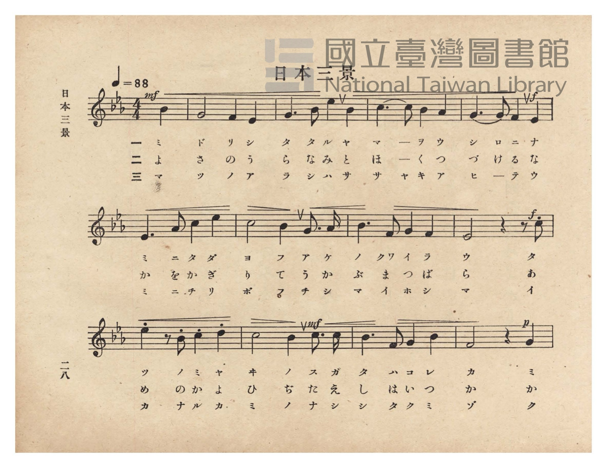
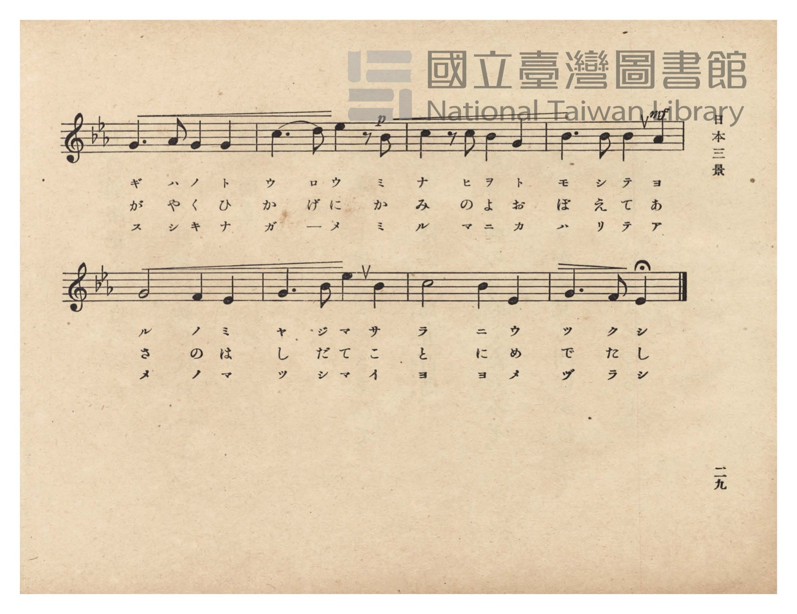
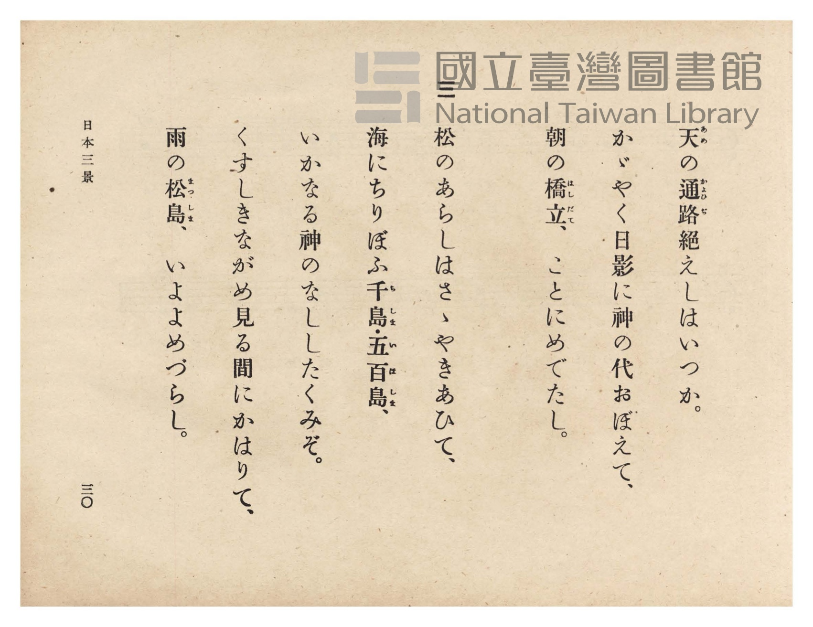
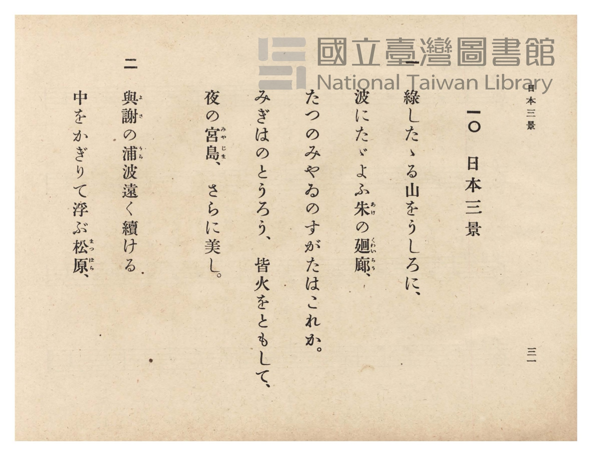

# 日本三景

> Re:Shōka 使用 AI 協助辨識與重建樂譜，可能會有錯誤。歡迎回報。

- **NEUTRINO 歌聲合成版**：<br><audio controls src="nihon_sankei_neutrino.mp3"></audio>
- **鋼琴伴奏版**：<br><audio controls src="nihon_sankei.mp3"></audio>


- 臺灣總督府《公學校唱歌》第六學年用（昭和十五年，索書號 523.37 4322-4）

## 說明

原書資訊與歌詞全文（對應 P032.jpg–P035.jpg，原書 pp. 28–31）：
調性與拍號：變ホ長調（Eb 大調，3 降記號）4/4 拍（弱起 1 拍），速度 ♩=88


## 跨冊／重複收錄參照

> 同名異曲（各冊收錄之不同詞曲版本）

- **[同名異曲]** 《共益商社唱歌教科書》卷一・生徒用（明治38年／1905）：[**〈日本三景〉**](../../../kyoeki_shoka/kan_1_854862/9_nihon_sankei/index.md)（`C` / `4/4` — [原始 TMD](../../../kyoeki_shoka/kan_1_854862/9_nihon_sankei/nihon_sankei.tmd)）
- 總表：[跨冊重複與同名歌曲總索引](../../../duplicate_songs.md)

## 歌詞

```text
一
綠したゝる山をうしろに、
波にたゞよふ朱（あけ）の廻廊（くゎいらう）、
たつのみやゐのすがたはこれか。
みぎはのとうろう、皆火をともして、
夜の宮島（みやじま）、さらに美し。

二
與謝（よさ）の浦（うら）波遠く續ける
中をかぎりて浮ぶ松原（まつばら）、
天（あめ）の通路（かよひぢ）絕えしはいつか。
かゞやく日影に神の代おぼえて、
朝の橋立（はしだて）、ことにめでたし。

三
松のあらしはさゝやきあひて、
海にちりぼふ千島（ちしま）・五百島（いほしま）、
いかなる神のなししたくみぞ。
くすしきながめ見る間にかはりて、
雨の松島（まつしま）、いよよめづらし。
```

## ABC

```abc
X:1
T:日本三景
M:4/4
L:1/16
Q:1/4=88
K:Eb
V:V1 name="Piano" snm="Pia"
[V:V1]
!mf! z4 z4 z4 B4 | G8 F4 E4 | G6 B2 e4 B4 | c6 c2 B4 A4 |
w: 1.~ミ | ド リ シ | タ タ ル ヤ | マ ー ヲ ウ
w: 2.~よ | さ の う | ら な み と | ほ ー く つ
w: 3.~マ | ツ ノ ア | ラ シ ハ サ | サ ヤ キ ア
!f! G6 G2 F4 E4 | E6 A2 c4 e4 | c8 B4 G3 A | B6 F2 G4 F4 |
w: 1.~シ ロ ニ ナ | ミ ニ タ ダ | ヨ フ ア ケ | ノ クヮ イ ラ
w: 2.~づ け る な | か を か ぎ | り て う か | ぶ ま つ ば
w: 3.~ヒ ー テ ウ | ミ ニ チ リ | ボ フ チ シ | マ イ ホ シ
!f! E8 z4 z2 c2 | e4 z2 B2 c4 d4 | !mf! c8 B4 c3 c | B6 F2 G4 B4 |
w: 1.~ウ タ | ツ ノ ミ ヤ | ヰ ノ ス ガ | タ ハ コ レ
w: 2.~ら あ | め の か よ | ひ ぢ た え | し は い つ
w: 3.~マ イ | カ ナ ル カ | ミ ノ ナ シ | シ タ ク ミ
!p! F8 z4 G4 | G6 A2 G4 G4 | !p! c6 d2 e4 z2 B2 | c4 z2 c2 B4 G4 |
w: 1.~カ ミ | ギ ハ ノ ト | ウ ロ ウ ミ | ナ ヒ ヲ ト
w: 2.~か か | が や く ひ | か げ に か | み の よ お
w: 3.~ゾ ク | ス シ キ ナ | ガ ー メ ミ | ル マ ニ カ
!mf! B6 B2 B4 A4 | G8 F4 E4 | G6 B2 e4 B4 | c8 B4 E4 |
w: 1.~モ シ テ ヨ | ル ノ ミ | ヤ ジ マ サ | ラ ニ ウ
w: 2.~ぼ え て あ | さ の は | し だ て こ | と に め
w: 3.~ハ リ テ ア | メ ノ マ | ツ シ マ イ | ヨ ヨ メ
G6 F2 E4 z4 |
w: 1.~ツ ク シ
w: 2.~で た し
w: 3.~ヅ ラ シ
```

## TMD 檔案連結

- [主旋律 TMD 檔案](nihon_sankei.tmd) [[在 TMD Studio 編輯](https://tmdlang.github.io/Tmd-TS/#tmd=s7IKdvYPcrWy4qpTUCpJTLdSSM7PyUlNLsnMz7PKzk9PzM7Ojy_OyM9OVIKrKMvPKc1NtUovSkxJjTdDiBfnlxYlp1oVJ2fk5-fEl6RWlCTl52ejy8cXJKanWgUYGBshZAqK8stS8xLzgLoLijLzSlJTwNoRClLLMlNSQdLFyYl58WWpRZlpmakpSE5KLSoGuRhqRUlRYl5xclFmAcgbCFX5RSUZ-UBnF2RUWmVkFpfkF2UmJ-bEZyfmIfmuJCMV6Lm8xJLSolR00fRUqHZ0ieLk1LzUIqCwlpbCs-lLn81Z82RH57OZ6xW0tLgUbRUsLLjsbRVcdbhsTPRN7EB6X7Tvet64-PmOvc_nLn66a87jhq6nrWuert3xbMHCp1M2Plvb87ih-_maNU9b1wIFn-7c8nzKivd7Op7NWPt0Us_T3sYnu6YABd_v6Xm-ZdGz2TtezJyvYGpkrGdsrmBibGSka_J-T6cSF5e-loIttQCXgoLC0775IMs2t79Y0fWiox3oyhcr5z1tXfFsWjvQcU839D5r71QAxaxeVkH6o4bJQKYpiAl0J0SrQkGBnoKRBVDK2BDoxPd7ZoGMfbFq_7OG5SADu3uBPgGKvljX9bh59sup24FSQJNdkxSeLlkOZvcYK7yc2ftixQywwk5gcCoAdYFs37PxxdbtCoYQLtDonpcN85_uWqbwaOZKW2D4gyx6sqMBRD3ftuBx4_THjfMfN8193NT9dOPGx02THje2gQSbeh83rn7c0AhS92zzIhAHpG7e46aOx41bn83ZCLTqcWPT48aJQEseN657unv3091dYMH-x019jxtbHjcBxdtAshBTQPoblwCVPm7c_7gJKD0BzJ75uLEHLLX-cePkx01AdvfjhiaIhv2PG4EmASWA6laAHAZyVRvQvOez2p4DXQRy7YrHTUBXAH2xDGrP0yVzQO5Zt-7p5m1g94Bta5zxuHEfxDGPG6eC3bb6-T6g6dNBtoEDZVcPOBI62l-smQvSCPLpVIjvnm1dBjYK6AJgiHYCA-RlIzDs-p_vArp3IjDsIKG6FuyibpCrm7qALnq2Fejwbc_m7gPGOlj_PnAIbICYAnfvSmhYNjVCbHvZMOvF9vVgwW6wKzY9blwElHq-derjRiAX6FlgmAD9BDQLEVhApcDYAYr2AzPe070bQR5cOg9o3JPdix83Ap2zB6wZFkzP5swFeWxl9_PV3WCrgEYCDQb6CuhVSDBNBoc6MJiB7OXgOEIE1o5OsCFzgT4C-hHodqDDIe4CBi4wNQHdAYwrYMwA3Q63cut2cDpaCA4doHO2Pu1thsXSQrB-cBQ17wZm6-cz98GkgGbtRsjCUhNQFBjSq4CBD_EmiA1SBE7QwEQISj3z4KED5ANTGlAO6Cqguh6gp14sAwZZ98tpQG8CHQU0az0k1qA2vJwN9Pw6UORBnQGJPIQzwGkcnExAAbQUGgQQCykvZ6BAQUufi8svMyM_LzgxLzs10yogMzEv36HGoKYaZI-CjaGZlh2Yha2QUwAWncDM_mJhj4IGtGDQVjBReLqh__n6Bh14EaWJRSfQXpCpNQoGCrpgiE5X56bVKphCOTUKxlAWDBpBaUOsKkD6DOOQOBAlZkhKQGyYjAlWQ0BsmDXVQMfArQK73MewRiEeKoJOP26eDzfxcXMnmtMfN6-CsZq2I9Q17UdWA-Y9bl4N17MEycR5KKbtAZOb4DqXIZkJMx-ici2Y7Ibzu1B9ZITHR00dCFMbp6L7qHEdnNWGZDuyz4H5AkzCfAnM_Egm7sb0UWM_XCWS3xuXopg5Eew2uI_AdiD5yBhfHMFCERSiLeg-au6DsZoWIalbiawGHLqPm-HubNqKUAlnQ0wD-eBx01qsZk5CUQmJTVgoIsUmuGDEnQ139YCzIYm5D5amQRCUC2A5BJ55UDMNCMIyDSSrmABVwERAEJRhYJkIlnlQrQFB5MwOylogOxDZCpF9IEECil5E9njc3AA393EzLBEhVMMSJyyQHzdtBKuERShEbP3jZlCafdwES1uIuAXFHizUYRA59UCcgsgzwMIdxWhQfCLEgLU1krmwHAdX3QizCZZzQDpBZm5DUbUPTMLd2rgByUz08gXFrY1NCLcCcwPWoG1uhPPh-QfInoPuVkTQQnWAcgBGeQQOUWCzEs5HKuNQVGK4FayTUDrf0UlWOoelZ1CKA6VXWKo2hzsOVzoHV0QQSTM8iR1Ry8CSPQzCa7SCWrhq5MQOK3vAYQBOpohYQi33YbGOiBFEKbUTSq_BrEvAJdTjps1w_hqEmU2wGgY9RpDqMERKb4KlFEjaAucgREpHqSNg9RHcFY2wMg_YgILSHWCV01FUrQeTsDBBLfuR8xmKW-EySCkd7jNIuIJyHlJ9CpdFzxMQv8PDFVpHQlM6an0KqaObQC5GCzGgKCjHYnUrXD2BlP509mzMlG5MMKUjt2BAJTqMD095KAkdlPxR8gYokYKSMkIZSBS5sYQwCDkrgNgoOQbepkKk9CZYKwESWuBUiRTSSKkHpfyFtlvgYpD4BIU1KO5gJSpEFFz2ItpCyGY2w9IfJBYgdTe8noVXJMjleg-KDlCaRG6VwGzBqAEaITUASvoDqwCphOVMpBwEzzfAfhSSmaCWAMJMkBrk2gJUriO5F5ziIWUAig8RbQ5Eaw9cSiCHL6TNsRDZZfDwRc1FoPIbqQWJkotgIQMxE9zaQ2rHwFs8hNoxUyhN9SBIcfcAWQa7ISArYDKwIh65WEcvWJGTOnL3AFbAQYJpB1geVk2iNClRGp8QcxARgdToR2nMQoobRMEFK4aQkzm-5jy8sMIoqBeASUSCnIykEqNVBs8MiCoEpG45ihpQqCBsQXMpuPECS6KIEECEKa7mPCyrI8IUuUrFbD_CRBC2gdS1oqgBxQS2MK3l4tK1U0DqTysAucpcAA)]
- [鋼琴伴奏 TMD 檔案](nihon_sankei_piano.tmd) [[在 TMD Studio 編輯](https://tmdlang.github.io/Tmd-TS/#tmd=s7IKdvYPcrWy4tLSUng2femzOWue7Oh8NnP9-z0dL7v3PJ-w5cmeLU-X9j_v7Hi_p1NBS4tL0VbBwoLL3lbBVYfLxkTfxI6rTkHpRfuu542Ln-_Y-3zu4qe75jxu6Hrauubp2h3PFix8OmXjs7U9jxu6n69Z87R1LVDw6c4tz6esAFrwbMbap5N6nvY2Ptk1BSj4fk_P8y2Lns3e8WLmfAVTI2M9Y3MFE2MjI10ToNVKXFyeeSVF-VYBmYl5-UEeDjUGNdVcCkBgY2imZQdm1ShU56bVKhgr6KJAIyhtCKVrUFSYgmTikDgQJWZohsBksBsCsgImYwBTwVWL4mYfZDeboDrZMF4h2jA-VsE0Ph7EroELwOgaBRMgywRFBMiCqjeAWOaXmZGfF5yYl52aiT-YYE5Ep8FuQYQB1QMSxIbJmGA1BMSGWVMNChh4YIJc7mNYoxAPFUGnHzfPh5v4uLkTzemPm1fBWE3bEeqa9iOrAfMeN6-G61mCZOI8FNP2gMlNcJ3LkMyEmQ9RuRZMdsP5Xag-MsLjo6YOhKmNU9F91LgOzmpDsh3Z548bQb5-3Ajz5ePGFUgm7sb0UWM_XCWS3xuXopg5Eew2uI_AdiD5yBhfHMFCERSiLeg-au6DsZoWIalbiawGHLqPm-HubNqKUAlnQ0wD-eBx01qsZk5CUQmJTVgoIsUmFzTDwJIhCIISLixRw9M77gIDkrpNgCpgIiAISuOwdA9L76jWgCBy_gTlBpAdiJyASPEQX4BiBJGiHzc3wM193AyLd4RqWHqChcvjpo1glbA4gIitf9wMSmaPm2DJAREdoACHBRQMIkc4xCmIZP64EZZkIEaDogAh9rgRZjHIXFgmgatuhNkES-wgnSAzt6Go2gcm4W5t3IBkJnqRgOLWxiaEW4EJGGvQNjfC-fAkD2TPQXcrImihOkCJFqMIAYfo4-bZcD5SsYSiEsOtYJ2IpAlLgqBEAkpisIRoDjcPV9IEF_cQSTM86RNRlsNSKgzC640CRK2LnD5hORzsbHDKQgQsaukKiyhEICLKgp1Qeg1miQ0uBx43bYbz1yDMbIKV4-iBiFRTIBJnEyxyIckBnOgRiROlJIaV-nBXNMJKlseNEJMfN3aAVU5HUbUeTMLCBLWERc4aKG6FyyAlTrjPIOEKyixItRZcFj0ZQ_wOD1doTQRNnKi1FqQmbAK5GC3EgKKgTIbVrXD18MSJXLWDyk0YH55YUNImKMWiJGdQugKlPoQykChyKwJhEHLqBbFREjm8sYFInE2w6hPiQXBCQgocpAhHKeWgFTpcDBIFoOABBTes3IKIgks4RCMB2cxmWJKBBBykUoNXQPDiGrn07EHRAUpGyNU1zBaMcrYRUs6iJBmwCpBKWGZCSvTwpP64Ed5UAbJBVSTCTJAa5DIZVHoiuRecSCHZFsWHiMoY0QwCZ2zk8IVUxguRXQYPX9SEDyolkZpWKAkfFjIQM8HNIKQKHt4UwJZQQXDA-gyIwhO9-EJOnchNXVgxAvHZDrA8rP5AaR6hNKQg5iDCDqkBi9Iwg2RqRPEAy-zIKRNf0xReJGAUhwvAJCINTUZSidFcgadfREENUrccRQ0oVBC2oLkUXKvDUhUiBBBhiqtpCsudiDBFrrgwG1YwEYRtIHWtKGpAMYEtTLF14nD0Gw2gkKweJJCJUAHSAu5rAQWhhsOUwmhs3U-QtmhTiBCIjTAQ7CxY8wQqBtRvClKDZA6kZAYJIhuFbroBuBZAchui24vwF9BoSDcYnzvB_gT3cEGuRXMfZT1vXTsFcE9fAchAisBoH8NYDCEjTCFjsJAyFwA)]

## 分析

```text
================================================================================
📊 TMD Song Profile: [ 日本三景 ]
================================================================================
⏱  Duration:       0:57 (57.3s), 21 measures total
🎼 Key & Tempo:    首調基準 E,, != 88.0 BPM, <4/4>
   - 分析範圍：      由實際發聲的音符與和弦推測調性；播放脈絡另行呈現
🎤 人聲音域:    D#4 (MIDI 63) – D#5 (MIDI 75) [跨度: 12 個半音 / 1.0 個八度, 難度: easy]
   - 最低音:  D#4 in [NihonSankei #1 @ m.2, 0:04]
   - 最高音: D#5 in [NihonSankei #1 @ m.3, 0:06]
   - 適合: soprano, mezzo-soprano, contralto, tenor, baritone, bass
🏛  結構:      NihonSankei (57.3s)
⚡ 編曲密度:        Peak 1 軌道同時演奏
🗝  調性診斷：       D# 大調（純淨自然大調，未偵測到可信轉調）
   - 風格氣質:    純淨自然大調（陽光明朗、易唱易記，無明顯調外色彩）
   - 轉調歷程:    全曲維持單一推測調性（未偵測到可信轉調）
   - 核心骨幹音:  G, A#, C, D#, F
   - 調性數值:    D# 大調 [相關度: 0.81, 穩定度: Moderate, 自然音純度: 100.0%]
   - 候選調性 (K-S): D# 大調 (0.81), G 小調 (0.74), C 小調 (0.73)
   - 五度圈歷程:   -3
   - 各段落調性細節:
     • [NihonSankei #1]: D# 大調 (r: 0.81, 自然音純度: 100.0%)

  [ 五度圈游移軌跡 ]
               C  
         F            G  
      Bb               D  
     [Eb]*              A  
         Ab           E  
            Db       B  
               F# 
     (* = active key center)

  [ 十二半音累積音高分佈 ]
     C  : ███████████████████       19.1%
     C# :                            0.0%
     D  : ██                         2.0%
     D# : █████████████████         17.8%
     E  :                            0.0%
     F  : ██████████                 9.9%
     F# :                            0.0%
     G  : ████████████████████████  24.7%
     G# : ████                       4.3%
     A  :                            0.0%
     A# : ██████████████████████    22.4%
     B  :                            0.0%
--------------------------------------------------------------------------------
Assignment 軌道音域：
  - Piano         : D#4 – D#5 (12 個半音 / 1.0 個八度, 73 個音符)
================================================================================
```


## 原書掃描頁










