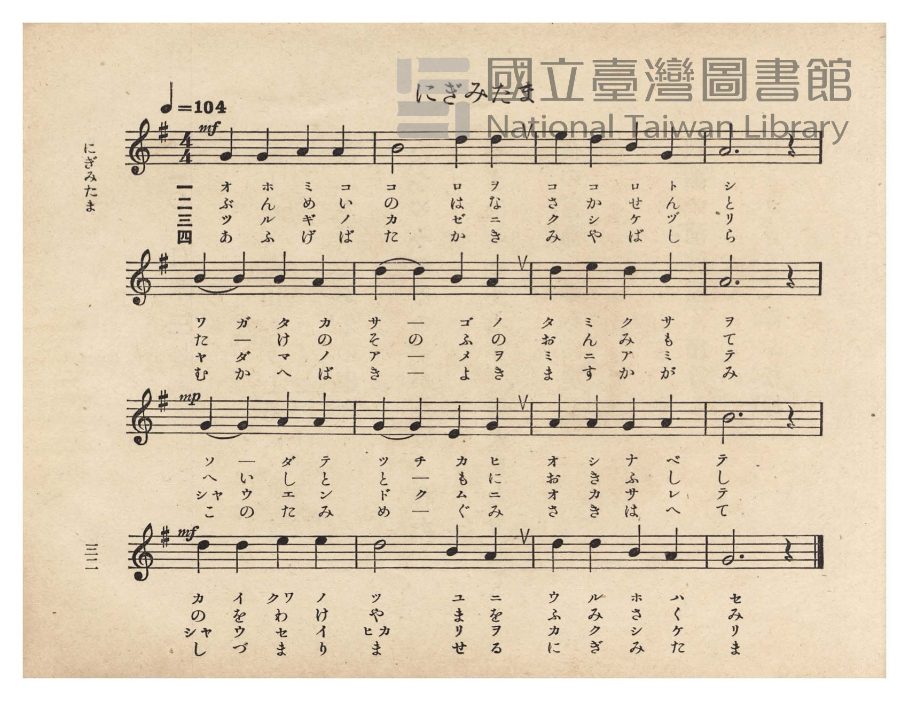
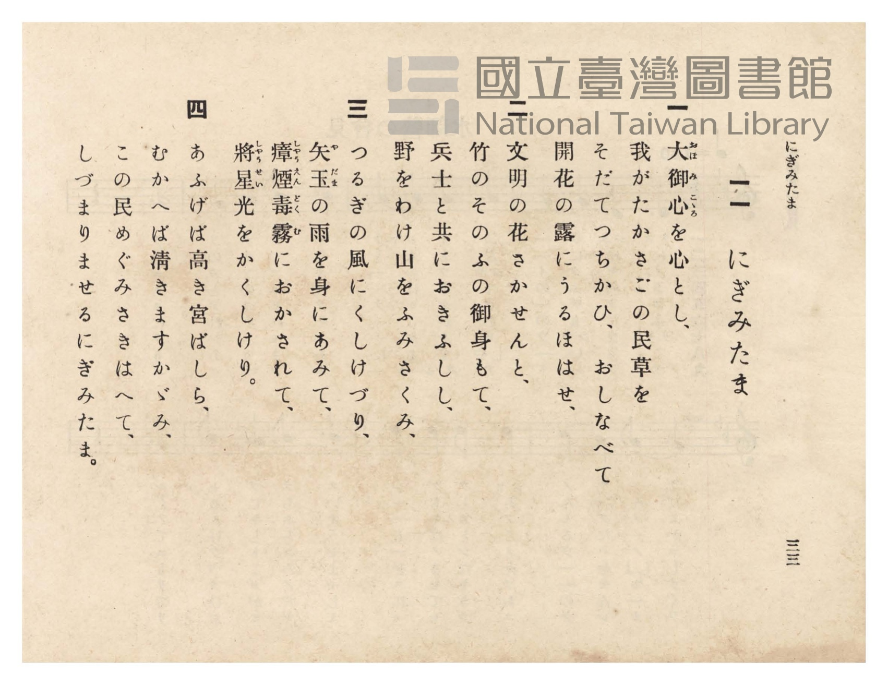

# にぎみたま

> Re:Shōka 使用 AI 協助辨識與重建樂譜，可能會有錯誤。歡迎回報。

- **NEUTRINO 歌聲合成版**：<br><audio controls src="nigimitama_neutrino.mp3"></audio>
- **鋼琴伴奏版**：<br><audio controls src="nigimitama.mp3"></audio>


- 曲：芝葛鎮
- 臺灣總督府《公學校唱歌》第六學年用（昭和十五年，索書號 523.37 4322-4）

## 說明

原書資訊與歌詞全文（對應 P036.jpg–P037.jpg，原書 pp. 32–33）：
調性與拍號：ト長調（G 大調，1 升記號，陽音階／律旋法）4/4 拍，速度 ♩=104


## 跨冊／重複收錄參照

> 同曲（芝葛鎮作曲〈にぎみたま〉；收錄於《公學校唱歌》六年級、《公學校唱歌集》與《新定兒童唱歌》六年級）

- **[同曲]** 《公學校唱歌集》（大正4年／1915，國臺圖 0725 26）：[**〈にぎみたま〉**](../../../kogakko_shokashu_1915/5_06_nigimitama/index.md)（`G` / `4/4` — [原始 TMD](../../../kogakko_shokashu_1915/5_06_nigimitama/nigimitama.tmd)）
- **[同曲]** 《新定兒童唱歌》尋常科第六學年用（2020.006.0847.0006）：[**〈にぎみたま〉**](../../../shintei_jido_shoka/grade_6_2020.006.0847.0006/2_07_nigimitama/index.md)（`G` / `4/4` — [原始 TMD](../../../shintei_jido_shoka/grade_6_2020.006.0847.0006/2_07_nigimitama/nigimitama.tmd)）
- **[同曲]** 《新編小公學校唱歌教材集》高等一、二學年（大正12年／1923，國臺圖 0725-41）：[**〈にぎみたま〉**](../../../shoka_kyozai_shu_1923/koto_1_2/16_nigimitama/index.md)（`G` / `4/4` — [原始 TMD](../../../shoka_kyozai_shu_1923/koto_1_2/16_nigimitama/nigimitama.tmd)）
- 總表：[跨冊重複與同名歌曲總索引](../../../duplicate_songs.md)

## 歌詞

```text
一
大御心（おほみこゝろ）を心とし、
我がたかさごの民草を
そだてつちかひ、おしなべて
開花の露にうるほはせ、

二
文明の花さかせんと、
竹のそのふの御身もて、
兵士と共におきふしし、
野をわけ山をふみさくみ、

三
つるぎの風にくしけづり、
矢玉（やだま）の雨を身にあみて、
瘴煙毒霧（しやうえんどくむ）におかされて、
將星（しやうせい）光をかくしけり。

四
あふげば高き宮ばしら、
むかへば清きますかゞみ、
この民めぐみさきはへて、
しづまりませるにぎみたま。
```

## ABC

```abc
X:1
T:にぎみたま
C:曲：芝葛鎮
M:4/4
L:1/16
Q:1/4=104
K:G
V:V1 name="Piano" snm="Pia"
[V:V1]
!mf! G4 G4 A4 A4 | B8 d4 d4 | e4 d4 B4 G4 | A12 z4 |
w: 1.~オ ホ ミ コ | コ ロ ヲ | コ コ ロ ト | シ
w: 2.~ぶ ん め い | の は な | さ か せ ん | と
w: 3.~ツ ル ギ ノ | カ ゼ ニ | ク シ ケ ヅ | リ
w: 4.~あ ふ げ ば | た か き | み や ば し | ら
B4 B4 B4 A4 | d4 d4 B4 A4 | d4 e4 d4 B4 | A12 z4 |
w: 1.~ワ ガ タ カ | サ ー ゴ ノ | タ ミ ク サ | ヲ
w: 2.~た ー け の | そ の ふ の | お ん み も | て
w: 3.~ヤ ダ マ ノ | ア ー メ ヲ | ミ ニ ア ミ | テ
w: 4.~む か へ ば | き ー よ き | ま す か が | み
!mp! G4 G4 A4 A4 | G4 G4 E4 G4 | A4 A4 G4 A4 | B12 z4 |
w: 1.~ソ ー ダ テ | ツ チ カ ヒ | オ シ ナ ベ | テ
w: 2.~へ い し と | と ー も に | お き ふ し | し
w: 3.~シャ ウ エ ン | ド ク ム ニ | オ カ サ レ | テ
w: 4.~こ の た み | め ー ぐ み | さ き は へ | て
!mf! d4 d4 e4 e4 | d8 B4 A4 | d4 d4 B4 A4 | G12 z4 |
w: 1.~カ イ クワ ノ | ツ ユ ニ | ウ ル ホ ハ | セ
w: 2.~の を わ け | や ま を | ふ み さ く | み
w: 3.~シャ ウ セ イ | ヒカ リ ヲ | カ ク シ ケ | リ
w: 4.~し づ ま り | ま せ る | に ぎ み た | ま
```

## TMD 檔案連結

- [主旋律 TMD 檔案](nigimitama.tmd) [[在 TMD Studio 編輯](https://tmdlang.github.io/Tmd-TS/#tmd=s7IKdvYPcrWy4qpTUCpJTLdSSM7PyUlNLsnMz7PKzk9PzM7Ojy_OyM9OVIKrKMvPKc1NtUovSkxJjTdDiBfnlxYlp1oVJ2fk5-fEl6RWlCTl52ejy8cXJKanWgUYGCPpLCjKL0vNS8wD6i4oyswrSU0Ba0coSC3LTEkFSRcnJ-bFl6UWZaZlpqYgOSm1qBjkYqgVJUWJecXJRZkFIG8gVOUXlWTkA51dkFFplZFZXJJflJmcmBOfnZiH5LuSjFSg54pSczLTUTRDxJPzc3NTc_OLEiEma2kpPG5c_bix73Hj_seN8x837lPQ0uJStFUwNDDhsrdVcOeyMdE3sQMZ8mz2pvd7Zr3omvti4uyXfevABr9o3_W8cfHzHXufz138dNecxw1dT1vXPF2749mChU-nbHy2tudxQ_fzNWuetq4FCj7dueX5lBXv93Q8m7H26aSep72NT3ZNAQq-39PzfMuiZ7N3vJg5X8HUyFjP2FzBxNjISNfk_Z5OJS4ufS0FW2oBLgUFhad980GWbW5_saLrRUc70JUvVs572rri2bR2oOOebuh91t6pAIpfvayC9EcNk4FMcxAT6E6IVoWCAj0FYyOglLEx0InAUAEZ-2LV_mcNy0EGdvcCfQIUfdzc8XLqdqA40Fh3hadLloOZPYYKT3uBds8AK-p5OXPvy_mbX87qe7-n_-m-7mfTu59tngo0FRjsCkCTQCoa5j_dtUzh0cyVtqBYAdn1ZEcD2CdLlj_dt_Dp_magBY8bux437gZH4-THTXMfNwG1dj5umgSUfdy44nHj9McNjSA9zzomPm7sAcd19-PGqY8bpzxuXPdsw8QXvSDVIBWPG-c-blzwuHHZ48YljxsXgtVtAuoG2zD9ceOqx407gbIgpS-ndb_o2gg04OWcTeB01Pa4Caga6Iz1jxtng2wEu3ZXD9jmae3PZgAT2jqwFqDNQJWzHzdNBjkP4rbnq4EGrwPbDyS3Akmg917sWv24qQnkHIiip61bny4GWrXiaSvQGCAD6KpesGqg22C-fNneB_TN46b-x40Tn27cCGKDVAADB2gvUHA_3G07OiF-XgJ2Och5LxcBgwtoLlAZ0ERgaC193NQFc-H8Rc_7gDHe8bipBRxI-0ChDNQzewXQDpBTQTqBrgXaBHPw8xlbnrfOfLZ-0ss5y8ERNR2sue1xI9AUoO9XgqxqagAbBPEOOGKagJEE9_MGYNABUwuy5tmPG1uAep62guINrAfmYJBrm8C-ezp7NsR3QBcBvQ9UtuHl6hnA8Hq6DhjAG8CmdULtADoBbMoOoMSzHa3gQN33uHEmSLBpHjTIwIYB3QxKMY-bgEliAixQgaqBcQ7UDHMz2DFLQWYA3QMyCRjXQONRChuQO4FKKc_XUKCgpc_F5Qcs-HIzSxJzE60CMhPz8h1qDGqqQdYo2Jho2YEZ2IoUBWBBBcxXLxb2KGiYAEO8__n6Bh14OaCJRQPQMpBhNQrVuWm1CoZAaASENQrGCroKpkBYo2AGJI2B4jVAcV0gNFCoAWvxMawBhvcqhcfNs4F4PpC9GagGROoC-WuBeBOUD8ZgkQ6wyHawOfEwc4yAYo3bgOKTgbgRyG4BqWpcBzKncT0QrwLzpwJxNxADbQOqBImsQDXHGCjW3ALEq4Eq1gHpPrBtq0HmNO0B8rvBfKCJQBc8btoIFGkFiTSvQjXHBGR2ExBvBeJJQLwBbNt8sHtALugF8_cDzQDaBpQFphKwyZ1wc_BH0K4eciLIGAxBcQOKFxgLEjtY46YZ5NM1QAxy6WqwC4E-agaGRNMWeOgA5cBxB1K7FRwam7DEDlAFSF_jRHC8gETmglmQMIKIdEFiEBwuTWCRZVjiZwkQNwDxPLgLFkHMbl4ISzEg9wDjCiIzHyzShhlDTUBTwLGxAx5DvVDfdcDjaB8Qz4Sq64HGGnFxtKOTvExUgJyJQCyzeGjeMQILQ3IWei7aCw0DUMi0gX0MSsfAvACMt8fNk8DhBMxpoHTbDAzn5pnYQgUcU6DQAKXK6eD8AcklkFABpWhwKgDFFCiswHEHTrlAEiOmmrY_bl4MpJYBMcgIcOZu7oQkleYF8OwEchYow4GS1hpckdUIShig5AKMWmAUgPQBPQdOUhNgIuAMDnIWKMvvQEtAeCMLWEOQXeKB8pIZEILyki5G_jLEElcgzwJTcdN6cAaDJGJgdIEKPWBYQUMFxAJFHaho7AeL7MYSWcAQaQIWME394KwFUgU2B5RsgeIgFaAoAmYocNiAzUFKwFijajfYdSAnAVsO4KIPWLzBimKQ0xHFH66iD5R0lkJd0QXNRiBXgQpesO-AyQhYAUJdBs6gYBUQc2q5uHTtFBD1lwKQp8wFAA)]
- [鋼琴伴奏 TMD 檔案](nigimitama_piano.tmd) [[在 TMD Studio 編輯](https://tmdlang.github.io/Tmd-TS/#tmd=s7IKdvYPcrWy4tLSUnjcuPpxY9_jxv2PG-c_btz3fk_Hy-49zydsebJny9Ol_c87O97v6VTQ0uJStFUwNDDhsrdVcOeyMdE3seOqU1B6NnvT-z2zXnTNfTFx9su-dUogsRftu543Ln6-Y-_zuYuf7przuKHraeuap2t3PFuw8OmUjc_W9jxu6H6-Zs3T1rVAwac7tzyfsgJo6bMZa59O6nna2_hk1xSg4Ps9Pc-3LHo2e8eLmfMVTI2M9YzNFUyMjYx0TYDOUeLi8swrKcq3CshMzMsP8nCoMaip5lIAAhsTLTswo0ahOjetVsEUCM2AsAZI6yoYKxiBWaZQliFQTFfBQKGGqxbFRB88JhrGK0QbxiqYACmTWJAZEL5ZPJA2i89FEjIFCZnGI4kAKahlfpnpmbmZJYm5iYT9YAiERmD3GgNdC3J9DdBHID8YAllGcD-AtPgY1ig8blql8Lh5NhDPB7I3A9WASF0gfy0Qb4LywRgs0gEW2Q42Jx5mjhFQrHEbUHwyEDcC2S0gVY3rQOY0rgfiVWD-VCDuBmKgbUCVIJEVqOYYA8WaW4B4NVDFOiDdB7ZtNcicpj1AfjeYDzQR6ILHTRuBIq0gkeZVqOaYgMxuAuKtQDwJiDeAbZsPdg_IBb1g_n6gGUDbgLKPG6eDTe6EmwMNU2MwRE0IoEQCYmMNzmaQ49YAMcjw1WBDgY5oBjq-aQvcQ0A5cHCD1G4Fe2ATlgAFqgDpa5wIDkqQyFwwC-ItiEgXJNDBXmkCiyzDEqRLgLgBiOfBXbAIYnbzQlgkg9wDDF6IzHywSBtmoDYBTQEH4A54oPZCfdcBD9Z9QDwTqq4HGtBowVqdW4CcVEEss3hoCjUCC0PSL3pa3Qt1NsgzbWBHglILMMUBg_px8ySw14DpGZQ6moFB0zwTm0fAgQvyACjup4NTISQtQjwCSjfgiAMFLsh74OAGpw8giRG4TdsfNy8GUsuAGGQEOAs1d0Jit3kBPNGCnAVK1qDUsAZX-DaC4hIUw8DYAIYaSB_Qc-BUMAEmAs5GIGeBMtYOtDgnpzhDBC_IfcC00rQenIwhSQUYwqDSAOg9qEdALFBog8qMfrDIbizhC_REEzDnNfWDEzBIFdgcUOIAioNUgEIVmGzB3gGbg5RMsIbubrDrQE6aBC0TgPkeVkaBnI4oF3CVCaDYXgp1RRc0sYJcBSqRwL4DxjywfoO6DJwNwCog5mApioko_DFLdiQRRE0AlQNGEUwWxIDFD9aqA64SS31CyDhIDsTlQhJsQTaSajWerp0CuIZVADIQQR7tA1SEJmKEIWKMIQJ0CFBEmQsA)]

## 分析

```text
================================================================================
📊 TMD Song Profile: [ にぎみたま ]
================================================================================
⏱  Duration:       0:36 (36.9s), 16 measures total
🎼 Key & Tempo:    首調基準 G, != 104.0 BPM, <4/4>
   - 分析範圍：      由實際發聲的音符與和弦推測調性；播放脈絡另行呈現
🎤 人聲音域:    E4 (MIDI 64) – E5 (MIDI 76) [跨度: 12 個半音 / 1.0 個八度, 難度: easy]
   - 最低音:  E4 in [Nigimitama #1 @ m.10, 0:21]
   - 最高音: E5 in [Nigimitama #1 @ m.3, 0:04]
   - 適合: soprano, mezzo-soprano, contralto, tenor, baritone, bass
🏛  結構:      Nigimitama (36.9s)
⚡ 編曲密度:        Peak 1 軌道同時演奏
🗝  調性診斷：       D 大調（純淨自然大調，未偵測到可信轉調）
   - 風格氣質:    純淨自然大調（陽光明朗、易唱易記，無明顯調外色彩）
   - 轉調歷程:    全曲維持單一推測調性（未偵測到可信轉調）
   - 核心骨幹音:  A, D, B, G, E
   - 調性數值:    D 大調 [相關度: 0.78, 穩定度: Moderate, 自然音純度: 100.0%]
   - 候選調性 (K-S): D 大調 (0.78), G 大調 (0.71), B 小調 (0.58)
   - 五度圈歷程:   +2
   - 各段落調性細節:
     • [Nigimitama #1]: D 大調 (r: 0.78, 自然音純度: 100.0%)

  [ 五度圈游移軌跡 ]
               C  
         F            G  
      Bb              [D ]*
      Eb               A  
         Ab           E  
            Db       B  
               F# 
     (* = active key center)

  [ 十二半音累積音高分佈 ]
     C  :                            0.0%
     C# :                            0.0%
     D  : ██████████████████        21.7%
     D# :                            0.0%
     E  : ███████                    8.3%
     F  :                            0.0%
     F# :                            0.0%
     G  : █████████████████         20.0%
     G# :                            0.0%
     A  : ████████████████████████  28.3%
     A# :                            0.0%
     B  : ██████████████████        21.7%
--------------------------------------------------------------------------------
Assignment 軌道音域：
  - Piano         : E4 – E5 (12 個半音 / 1.0 個八度, 50 個音符)
================================================================================
```


## 原書掃描頁






