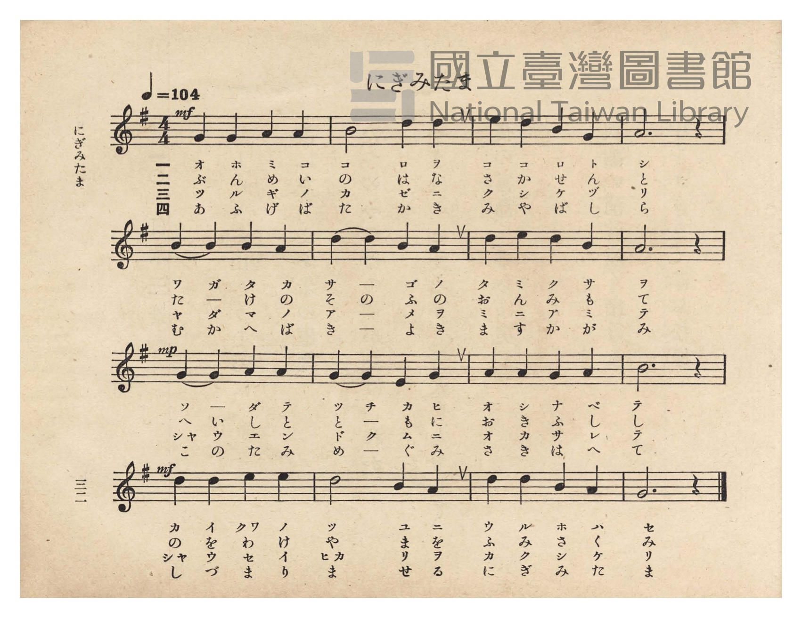
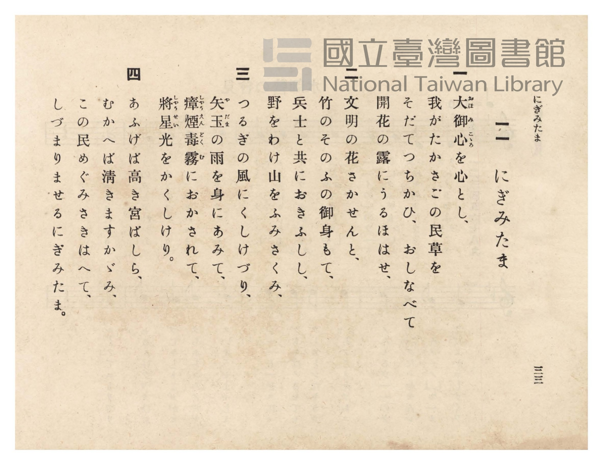

# にぎみたま

> Re:Shōka 使用 AI 協助辨識與重建樂譜，可能會有錯誤。歡迎[回報](https://github.com/TMDLang/reshoka/issues)。

- **鋼琴伴奏版**：<br><audio controls src="nigimitama.mp3"></audio>
- **NEUTRINO 歌聲合成版**：<br><audio controls src="nigimitama_neutrino.mp3"></audio>

- 曲：芝葛鎮
- 臺灣總督府《公學校唱歌》第六學年用（昭和十五年，索書號 523.37 4322-4）

## 說明

原書資訊與歌詞全文（對應 P036.jpg–P037.jpg，原書 pp. 32–33）：
調性與拍號：ト長調（G 大調，1 升記號，陽音階／律旋法）4/4 拍，速度 ♩=104


## 歌詞

```text
一
大御心（おほみこゝろ）を心とし、
我がたかさごの民草を
そだてつちかひ、おしなべて
開花の露にうるほはせ、

二
文明の花さかせんと、
竹のそのふの御身もて、
兵士と共におきふしし、
野をわけ山をふみさくみ、

三
つるぎの風にくしけづり、
矢玉（やだま）の雨を身にあみて、
瘴煙毒霧（しやうえんどくむ）におかされて、
將星（しやうせい）光をかくしけり。

四
あふげば高き宮ばしら、
むかへば清きますかゞみ、
この民めぐみさきはへて、
しづまりませるにぎみたま。
```

## ABC

<div class="abc-score" data-abc-src="nigimitama.abc" aria-label="五線譜載入中"></div>

[下載 ABC 原始檔](nigimitama.abc)

## TMD 檔案連結

- [主旋律 TMD 檔案](nigimitama.tmd) [[在 TMD Studio 編輯](https://tmdlang.github.io/Tmd-TS/#tmd=s7IKdvYPcrWy4qpTUCpJTLdSSM7PyUlNLsnMz7PKzk9PzM7Ojy_OyM9OVIKrKMvPKc1NtUovSkxJjTdDiBfnlxYlp1oVJ2fk5-fEl6RWlCTl52ejy8cXJKanWgUYGCPpLCjKL0vNS8wD6i4oyswrSU0Ba0coSC3LTEkFSRcnJ-bFl6UWZaZlpqYgOSm1qBjkYqgVJUWJecXJRZkFIG8gVOUXlWTkA51dkFFplZFZXJJflJmcmBOfnZiH5LuSjFSg54pSczLTUTRDxJPzc3NTc_OLEtFNBqrOsypJzCwHui8_LS0zOTMxR4lLS0vhcePqx419jxv3P26c_7hxn4KWFpeirYKhgQmXva2CO5eNib6JHcicZ7M3vd8z60XX3BcTZ7_sWwc2-0X7rueNi5_v2Pt87uKnu-Y8buh62rrm6dodzxYsfDpl47O1PY8bup-vWfO0dS1Q8OnOLc-nrHi_p-PZjLVPJ_U87W18smsKUPD9np7nWxY9m73jxcz5CqZGxnrG5gomxkZGuibv93QqcXHpaynYUgtwKSgoPO2bD7Jsc_uLFV0vOtqBrnyxct7T1hXPprUDHfd0Q--z9k4FUPzrZRWkP2qYDGSag5hAd0K0KhQU6CkYGwGljI2BTgSGCsjYF6v2P2tYDjKwuxfoE6Do4-aOl1O3A8WBxrorPF2yHMzsMVR42gu0ewZYUc_LmXtfzt_8clbf-z39T_d1P5ve_WzzVKCpwGBXAJoEUtEw_-muZQqPZq60BcUKyK4nOxrAPlmy_Om-hU_3NwMteNzY9bhxNzgaJz9umvu4Cai183HTJKDs48YVjxunP25oBOl51jHxcWMPOK67HzdOfdw45XHjumcbJr7oBakGqXjcOPdx44LHjcseNy553LgQrG4TUDfYhumPG1c9btwJlAUpfTmt-0XXRqABL-dsAqejtsdNQNVAZ6x_3DgbZCPYtbt6wDZPa382A5jQ1oG1AG0Gqpz9uGkyyHkQtz1fDTR4Hdh-ILkVSAK992LX6sdNTSDnQBQ9bd36dDHQqhVPW4HGABlAV_WCVQPdBvPly_Y-oG8eN_U_bpz4dONGEBukAhg4QHuBgvvhbtvRCfHzErDLQc57uQgYXEBzgcqAJgJDa-njpi6YC-cvet4HjPGOx00t4EDaBwploJ7ZK4B2gJwK0gl0LdAmmIOfz9jyvHXms_WTXs5ZDo6o6WDNbY8bgaYAfb8SZFVTA9ggiHfAEdMEjCS4nzcAgw6YWpA1z37c2ALU87QVFG9gPTAHg1zbBPbd09mzIb4DugjofaCyDS9XzwCG19N1wADeADatE2oH0AlgU3YAJZ7taAUH6r7HjTNBgk3zoEEGNgzoZlCKedwETBITYIEKVA2Mc6BmmJvBjlkKMgPoHpBJwLgGGo9S2IDcCVRKeb6GAgUtfS4uP2BRl5tZkpibaBWQmZiX71BjUFMNskbBxkTLDszAVqQoAAsqYL56sbBHQcMEGOL9z9c36MDLAU0sGoCWgQyrUajOTatVMARCIyCsUTBW0FUwBcIaBTMgaQwUrwGK6wKhgUINWIuPYQ0wvFcpPG6eDcTzgezNQDUgUhfIXwvEm6B8MAaLdIBFtoPNiYeZYwQUa9wGFJ8MxI1AdgtIVeM6kDmN64F4FZg_FYi7gRhoG1AlSGQFqjnGQLHmFiBeDVSxDkj3gW1bDTKnaQ-Q3w3mA00EuuBx00agSCtIpHkVqjkmILObgHgrEE8C4g1g2-aD3QNyQS-Yvx9oBtA2oCwwlYBN7oSbgz-CdvWQE0HGYAiKG1C8wFiQ2MEaN80gn64BYpBLV4NdCPRRMzAkmrbAQwcoB447kNqt4NDYhCV2gCpA-honguMFJDIXzIKEEUSkCxKD4HBpAosswxI_S4C4AYjnwV2wCGJ280JYigG5BxhXEJn5YJE2zBhqApoCjo0d8BjqhfquAx5H-4B4JlRdDzTWiIujHZ3kZaIC5EwEYpnFQ_OOEVgYkrPQc9FeaBiAQqYN7GNQOgbmBWC8PW6eBA4nYE4DpdtmYDg3z8QWKuCYAoUGKFVOB-cPSC6BhAooRYNTASimQGEFjjtwygWSGDHVtP1x82IgtQyIQUaAM3dzJySpNC-AZyeQs0AZDpS01uCKrEZQwgAlF2DUAqMApA_oOXCSmgATAWdwkLNAWX4HWgLCG1nAGoLsEg-Ul8yAEJSXdDHylyGWuAJ5FpiKm9aDMxgkEQOjC1ToAcMKGiogFijqQEVjP1hkN5bIAoZIE7CAaeoHZy2QKrA5oGQLFAepAEURMEOBwwZsDlICxhpVu8GuAzkJ2HIAF33A4g1WFIOcjij-cBV9oKSzFOqKLmg2ArkKVPCCfQdMRsAKEOoycAYFq4CYU8vFpWungKi_FIA8ZS4A)]
- [鋼琴伴奏 TMD 檔案](nigimitama_piano.tmd) [[在 TMD Studio 編輯](https://tmdlang.github.io/Tmd-TS/#tmd=s7IKdvYPcrWy4qpTUCpJTLdSSM7PyUlNLsnMz7PKzk9PzM7Ojy_OyM9OVIKrKMvPKc1NtTJDiBTnlxYlp-JSD5GNL0hMT7UKMDA20wUS5gjpgqL8stS8xDygASWJmeWJefHpQIGivPyi-PTUvNSixByE2tSyzJRUkMqCoszcxKLK-JT8ZKBb8kqQXJdaVAxyfEFmYl5-fGJRUWJeeiqqkvyikoz89KLEgoxKq4zM4pL8oszkxJz47MQ8JFeXZAB1WaWmlCYnggJDiUtLS-Fx4-rHjX2PG_c_bpz_uHHf-z0dL7v3PJ-w5cmeLU-X9j_v7Hi_p1NBS4tL0VbB0MCEy95WwZ3LxkTfxA5k6rPZm97vmfWia-6LibNf9q0D2_SifdfzxsXPd-x9Pnfx011zHjd0PW1d83TtjmcLFj6dsvHZ2p7HDd3P16x52roWKPh055bnU1YALX02Y-3TST1Pexuf7JoCFHy_p-f5lkXPZu94MXO-gqmRsZ6xuYKJsZGRrgnQOUpcXJ55JUX5VgGg8AjycKgxqKnmUgACGxMtOzCjRqE6N61WwRQIzYCwBkjrKhgrGIFZplCWIVBMV8FAoYarFsVEHzwmGsYrRBvGKpgAKZNYkBkQvlk8kDaLz0USMgUJmcYjiQApqGV-memZuZklibmJhP1gCIRGYPcaA10Lcn0N0EcgPxgCWUZwP4C0-BjWKDxuWqXwuHk2EM8HsjcD1YBIXSB_LRBvgvLBGCzSARbZDjYnHmaOEVCscRtQfDIQNwLZLSBVjetA5jSuB-JVYP5UIO4GYqBtQJUgkRWo5hgDxZpbgHg1UMU6IN0Htm01yJymPUB-N5gPNBHogsdNG4F4F0ikeRWqOSYgs5uAeCsQTwLiDWDb5oPdA3JBL5i_H6gfaBtQ9nHjdLDJnXBzoGFqDIaoCQGUSEBsrMHZDHLcGiAGGb4abCjQEc1AxzdtgXsIKAcObpDarWAPbMISoEAVIH2NE8FBCRKZC2ZBvAUR6YIEOtgrTWCRZViCdAkQNwDxPLgLFkHMbl4Ii2SQe4DBC5GZDxZpwwzUJqAp4ADcAQ_UXqjvOuDBug-IZ0LV9UADGi1Yq3MLkJMqiGUWD02hRmBhSPpFT6t7oc4GeaYN7EhQagGmOGBQP26eBPYaMD2DUkczMGiaZ2LzCDhwQR4Axf10cCqEpEWIR0DpBhxxoMAFeQ8c3OD0ASQxArdp--Pm5UBqGRCDjABnoeZOSOw2L4AnWpCzQMkalBrW4ArfRlBcgmIYGBvAUAPpA3oOnAomwETA2QjkLFDG2oEW5-QUZ4jgBbkPmFbAgQlOJ8DgBRUFQL9BfQFigWRBBUY_WGQ3lsAF-qAJmO2a-sGpF6QKbA4oZQDFQSpAQQpMs2C_gM1BSiNYg3Y32GkgJ02CFgjATA8roEDuRhQKuAoEUFTPgrqiC5pSQa4CFUdg3wGjHVi5QV0GzgNgFRBzsJTDRJT8mMU6kgiiGoDKAeMHJgtiwCIHa70BV4mlMiFkHCT74XIhCbYgG0m16k7XTgFcvSoAGYggj_YBKkITMcIQMcYQAToEKKLMBQA)]

## 分析

```text
================================================================================
📊 TMD Song Profile: [ にぎみたま ]
================================================================================
⏱  Duration:       0:36 (36.9s), 16 measures total
🎼 Key & Tempo:    首調基準 G, != 104.0 BPM, <4/4>
   - 分析範圍：      由實際發聲的音符與和弦推測調性；播放脈絡另行呈現
🎤 人聲音域:    E4 (MIDI 64) – E5 (MIDI 76) [跨度: 12 個半音 / 1.0 個八度, 難度: easy]
   - 最低音:  E4 in [Nigimitama #1 @ m.10, 0:21]
   - 最高音: E5 in [Nigimitama #1 @ m.3, 0:04]
   - 適合: soprano, mezzo-soprano, contralto, tenor, baritone, bass
🏛  結構:      Nigimitama (36.9s)
⚡ 編曲密度:        Peak 1 軌道同時演奏
🗝  調性診斷：       D 大調（純淨自然大調，未偵測到可信轉調）
   - 風格氣質:    純淨自然大調（陽光明朗、易唱易記，無明顯調外色彩）
   - 轉調歷程:    全曲維持單一推測調性（未偵測到可信轉調）
   - 核心骨幹音:  A, D, B, G, E
   - 調性數值:    D 大調 [相關度: 0.78, 穩定度: Moderate, 自然音純度: 100.0%]
   - 候選調性 (K-S): D 大調 (0.78), G 大調 (0.71), B 小調 (0.58)
   - 五度圈歷程:   +2
   - 各段落調性細節:
     • [Nigimitama #1]: D 大調 (r: 0.78, 自然音純度: 100.0%)

  [ 五度圈游移軌跡 ]
               C  
         F            G  
      Bb              [D ]*
      Eb               A  
         Ab           E  
            Db       B  
               F# 
     (* = active key center)

  [ 十二半音累積音高分佈 ]
     C  :                            0.0%
     C# :                            0.0%
     D  : ██████████████████        21.7%
     D# :                            0.0%
     E  : ███████                    8.3%
     F  :                            0.0%
     F# :                            0.0%
     G  : █████████████████         20.0%
     G# :                            0.0%
     A  : ████████████████████████  28.3%
     A# :                            0.0%
     B  : ██████████████████        21.7%
--------------------------------------------------------------------------------
Assignment 軌道音域：
  - Piano         : E4 – E5 (12 個半音 / 1.0 個八度, 50 個音符)
================================================================================
```


## 原書掃描頁






