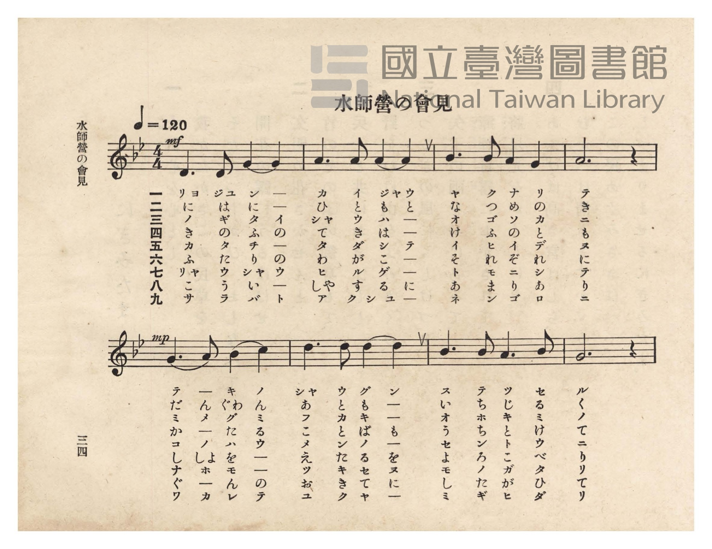
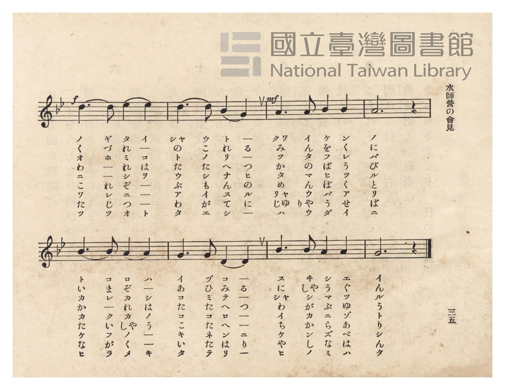
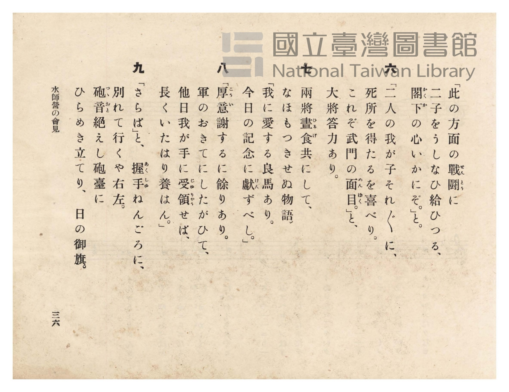
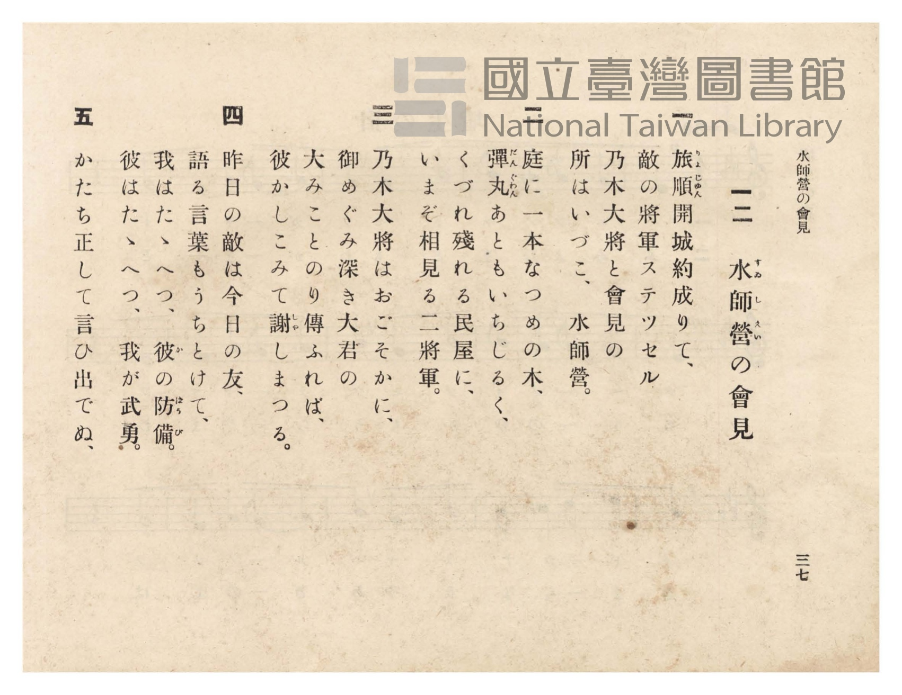

# 水師營の會見

> Re:Shōka 使用 AI 協助辨識與重建樂譜，可能會有錯誤。歡迎回報。

<audio controls src="suishiei_no_kaiken.mp3"></audio>

- 詞：佐佐木信綱
- 曲：岡野貞一
- 臺灣總督府《公學校唱歌》第六學年用（昭和十五年，索書號 523.37 4322-4）

## 說明

原書資訊與歌詞全文（對應 P038.jpg–P041.jpg，原書 pp. 34–37）：
調性與拍號：ト短調（G 小調，2 降記號）4/4 拍，速度 ♩=120


## 跨冊／重複收錄參照

> 同曲（佐佐木信綱詞・岡野貞一曲『尋常小學唱歌』〈水師營の會見〉；《公學校唱歌》與《新定兒童唱歌》第六學年共用教材）

- **[同曲]** 《新定兒童唱歌》尋常科第六學年用（2020.006.0847.0006）：[**〈水師營の會見〉**](../../../shintei_jido_shoka/grade_6_2020.006.0847.0006/2_05_suishiei_no_kaiken/index.md)（`Bb` / `4/4` — [原始 TMD](../../../shintei_jido_shoka/grade_6_2020.006.0847.0006/2_05_suishiei_no_kaiken/suishiei_no_kaiken.tmd)）
- 總表：[跨冊重複與同名歌曲總索引](../../../duplicate_songs.md)

## 歌詞

```text
一
旅順（りよじゆん）開城約成りて、
敵の將軍ステツセル
乃木大將と會見の
所はいづこ、水師營（すゐしえい）。

二
庭に一本なつめの木、
彈丸（だんぐわん）あともいちじるく、
くづれ殘れる民屋に、
いまぞ相見る二將軍。

三
乃木大將はおごそかに、
御めぐみ深き大君の
大みことのり傳ふれば、
彼かしこみて謝（しや）しまつる。

四
昨日の敵は今日の友、
語る言葉もうちとけて、
我はたゝへつ、彼（か）の防備（ばうび）。
彼はたゝへつ、我が武勇。

五
かたち正して言ひ出でぬ、
「此の方面の戰鬪（せんとう）に
二子をうしなひ給ひつる、
閣下（かくか）の心いかにぞ。」と。

六
「二人の我が子それ〴〵に、
死所を得たるを喜べり。
これぞ武門の面目（めんぼく）。」と、
大將答力あり。

七
兩將晝食（ひるげ）共にして、
なほもつきせぬ物語。
「我に愛する良馬あり。
今日の記念に獻（けん）ずべし。」

八
「厚意（こうい）謝するに餘りあり。
軍のおきてにしたがひて、
他日我が手に受領（じゆりやう）せば、
長くいたはり養はん。」

九
「さらば」と、握手（あくしゆ）ねんごろに、
別れて行くや右左。
砲音（つゝおと）絶えし砲臺に
ひらめき立てり、日の御旗。
```

## ABC

```abc
X:1
T:水師營の會見
C:曲：岡野貞一
M:4/4
L:1/16
Q:1/4=120
K:Gm
V:V1 name="Piano" snm="Pia"
[V:V1]
!mf! D6 D2 G4 G4 | A6 A2 A4 A4 | B6 B2 A4 G4 | A12 z4 |
w: 1.~リョ ジュ ン ー | カ イ ジャ ウ | ヤ ク ナ リ | テ
w: 2.~に は に ー | ひ と も と | な つ め の | き
w: 3.~ノ ギ タ イ | シャ ウ ハ ー | オ ゴ ソ カ | ニ
w: 4.~き の ふ の | て き は ー | け ふ の と | も
w: 5.~カ タ チ ー | タ ダ シ テ | イ ヒ イ デ | ヌ
w: 6.~ふ た り の | わ が こ ー | そ れ ぞ れ | に
w: 7.~リャ ウ シャ ウ | ヒ ル ゲ ー | ト モ ニ シ | テ
w: 8.~こ う い ー | しゃ す る に | あ ま り あ | り
w: 9.~サ ラ バ ト | ア ク シュ ー | ネ ン ゴ ロ | ニ
!mp! G6 A2 B4 c4 | d6 d2 d4 d4 | B6 B2 A6 B2 | G12 z4 |
w: 1.~テ ー キ ノ | シャ ウ グ ン | ス テ ッ セ | ル
w: 2.~だ ん ぐわ ん | あ と も ー | い ち じ る | く
w: 3.~ミ メ グ ミ | フ カ キ ー | オ ホ ギ ミ | ノ
w: 4.~か ー た る | こ と ば も | う ち と け | て
w: 5.~コ ノ ホ ウ | メ ン ノ ー | セ ン ト ウ | ニ
w: 6.~し しょ を ー | え た る を | よ ろ こ べ | り
w: 7.~ナ ホ モ ー | ツ キ セ ヌ | モ ノ ガ タ | リ
w: 8.~ぐ ー ん の | お き て に | し た が ひ | て
w: 9.~ワ カ レ テ | ユ ク ヤ ー | ミ ギ ヒ ダ | リ
!f! d6 d2 e4 e4 | d6 d2 B4 G4 | !mf! A6 A2 B4 B4 | A12 z4 |
w: 1.~ノ ギ タ イ | シャ ウ ト ー | クワ イ ケ ン | ノ
w: 2.~く づ れ ー | の こ れ る | み ん を く | に
w: 3.~オ ホ ミ コ | ト ノ リ ー | ツ タ フ レ | バ
w: 4.~わ ー れ は | た た へ つ | か の ば う | び
w: 5.~ニ ー シ ヲ | ウ シ ナ ヒ | タ マ ヒ ツ | ル
w: 6.~こ れ ぞ ー | ぶ も ん の | め ん ぼ く | と
w: 7.~ワ レ ニ ー | ア イ ス ル | リャ ウ バ ア | リ
w: 8.~た じ つ ー | わ が て に | じゅ りゃ う せ | ば
w: 9.~ツ ツ オ ト | タ エ シ ー | ハ ウ ダ イ | ニ
B6 B2 A4 A4 | G6 G2 D4 D4 | B6 B2 A4 A4 | G12 z4 |
w: 1.~ト コ ロ ハ | イ ヅ コ ー | ス ヰ シ エ | イ
w: 2.~い ま ぞ ー | あ ひ み る | に しゃ う ぐ | ん
w: 3.~カ レ カ シ | コ ミ テ ー | シャ シ マ ツ | ル
w: 4.~か ー れ は | た た へ つ | わ が ぶ ゆ | う
w: 5.~カ ッ カ ノ | コ コ ロ ー | イ カ ニ ゾ | ト
w: 6.~た い しゃ う | こ た へ ー | ち か ら あ | り
w: 7.~ケ ー フ ノ | キ ネ ン ニ | ケ ン ズ ベ | シ
w: 8.~な が く ー | い た は り | や し な は | ん
w: 9.~ヒ ラ メ キ | タ テ リ ー | ヒ ノ ミ ハ | タ
```

## TMD 檔案連結

- [主旋律 TMD 檔案](suishiei_no_kaiken.tmd) [[在 TMD Studio 編輯](https://tmdlang.github.io/Tmd-TS/#tmd=s7IKdvYPcrWy4qpTUCpJTLdSSM7PyUlNLsnMz7PKzk9PzM7Ojy_OyM9OVIKrKMvPKc1NtUovSkxJjTdDiBfnlxYlp1oVJ2fk5-fEl6RWlCTl52ejy8cXJKanWgUYGFsgZAqK8stS8xLzgLoLijLzSlJTwNoRClLLMlNSQdLFyYl58WWpRZlpmakpSE5KLSoGuRhqRUlRYl5xclFmAcgbCFX5RSUZ-UBnF2RUWmVkFpfkF2UmJ-bEZyfmIfmuJCMV6LnczJzMksSiSnRxiDagsJaWwrMNW57uWP28ff7jxnXP5jS_WNatoKXFpWirYGhkwGVvq-Ckw5WdWmmr4J7LZWOib2IHMurFynnv98x6sncCED2bs-LJ_oXPt20EW_Js9iagzNNNC1-2973YNO_Jjgaw8Iv2Xc8bFz_fsff53MVPd8153ND1tHXN07U7ni1Y-HTKxmdrex43dD9fs-Zp61qg4NOdW55PWfF-T8ezGWufTup52tv4ZNcUoOD7PT3Ptyx6NnvHi5nzFUyNjPWMzRVMjI2MdE3e7-lU4uLS11KwpRbgUlBQeNo3H2TZ5vYXK7pedLQDXQn099PWFc-mtQMd93RD77P2TgVQEtDLKkh_1DA5wMDEEMQEuhOiVaGgQE_B2AQoZWwOdCIwYEDGvli1_1nDcpCB3b1AnwBFHzd3PJ-_FigONNZd4emGfjCzx0jh5czeFytmgBV1AsNeAagDKP6yYf7TXcsUHs1caQuKI5CZwHAGUc-mt75c0AY05XFT1-OmjseNMx43tT1umgzU_nJa99P5fc-3tDzrmACSbVz2uKERrGfqVmDMP93Q_mJ37-OmnY-b2x43tzxu2v24eTXY5J3NwBh-umQ5UMXjxhWQFALUANba2fC4cf3jxpbHjUsfN04GGghPTCA3NM583DThceP0x41AdgvQDY8bmiCu3dUDDt9dax83rgY6_dmcNY8bVz1uXPK4qRGcCldA3fZ0b8eTHTvAZi0AeuNxI9Dp_RD_PG5sAjrncROQBFq_EOxVoLv6oTpBLKCjmnqerQNK9ADlnm2Y-HQjUMVquAqgvn2PG-c9B8Yx0EtN3UBnQYMB5s4dnZhBAPQvMPSmPG6c-7gRybin-xaCXQ_08P5n2zc-buwFaZgwGxpUQA5QAhRIQEc3rgPGwNOmzY8bt4Lc1rgB7t09YDOBIQZUB1S97MWauWDfT3_cBA5AkBTQzcCA6oY58uns2eC4mLHi2XRgLKwDx-f6J7u7INyn_UCVYNNfrJoH1PZiRcOLiZ3gcGsDhxvQORORUkMHkAP04vzHTUD_7QBZ1dAIdBfYFd1gJ6x7OWPT06aZYJENYFM2Q-MW5gV0_WBDe56tXfa0ux2RBqZAYgHoX2DRs_DZ2sVg3y0DOvBx46an7bseNwKDbA0sthqA-peAvDdt58u5i0CMjg0v16wCu2I2OG0APQJM-kAHQtItMDLXApPLJLALgQYD09em51uXAUlY-IENfjlt8ZMdQI-BvAdONFBPPt3fDE4h4ChunAd09uOGXpAlsGBvXQt1F9CmJ7uArgW6CORNkK3AtAGM14YtjxuAcQFLIc_W7gZlmKZJT_cBnQMMIGCam_R02pzHjTtBGRISfqCYByWJecDQejkNGBLrgL59PnsdOE83gv0JDOB-SIDDXARJPOD0-XztlKddwETXBDUSkoybIS5eCVTwbObcl4sh2XMTOMdMApr1tBWYYIHeBIU_PHsAA2w3OJ0Agx1oD9DQNc87V4JSEdSpwCgB-Xj1sxagHDCvd7_oXP9yGTArwywH2Q1Lh8By7Ol-UGg8790Ntn0iLB_PAgUA0Gqwf6BhC45CoAVP-2Y9awH6Fqge6HNgRIJyATBTQOwDmvZyCTB7A_MjkpWgDAzMYaBcCmQAIxziMWAiA4YrMPJhPnyyexrQadC02Qky7Gn_9JcLZoBtgxScwEIUmAQgqQroR1g-fTl1OzipAOWApq4Hqnu5BGgbkAEsA-G-eLJzLtQXjxunPm4CGgHUD42wZ_0LgVaCbQIGMNAoYAaHWLMWHMdTHjcBVcLLlg5QSQbKGwuBJLAAbHnav_npdqBHwB5-vmDTy_nAPAg0DJiwgWEDdAuw-ux8vnUbuOidDlQArIChGQMc78ACAFhW9T5fDfT2MnDQNUKLi30Ln00HxQVIKeXVKBQoaOlzcQWXZhZnZKZm-uV7J2Zmp-ZZBWQm5uU71BjUVIMsU7Cx0LIDM7DV4wrA1gGwpgAGgIKGCaiKfL6-QQde-Wpi0QC0EmRYjUJ1blqtgnG8gi4QAikzEAtM1CiYQ0SBFJgFJmoUDMGChhAuqkoINAAJgU33MaxReNy86nHzcrDE46Ydj5uXAkU2gzjNe8BaHzethkougShYDOYsg0g2L4FKrgeyu8DaVkFl2pCsBLsCYqURUK4RamQjUBeYDbescRNUZgXQzCYoCyIDMhfEBzmjEcxaB5XpxW6TMcgVfVD3rQPi_VBvQLy1HeIViGceN_ej-BlqWdMWIN4LZoGcCTKwG7tlJgiHgBwGrBtRnAgKLhC_F-xpZA9PhMpshaqGexjsfSw2mSLHyX6gSeDAgLsc5EkQvwHkRTALFBEgGWhUNU-Csh83t0P91IPdJjOQ-0D-ALlqPlAXOIJhfmoChRiI3wMq9lH8NBfqOpDMPCgLIgNxN4ZN5tB0iBQhsPhBJLVJUPevBoqBkgncvuYOqMwiaPxAfI4nEVqA3AJyM8j9baDGFIr7gcVZM1RyJtAwsJFgp4MkIdECbMjAAwQkAgoQEA-LZZYgOWgwNq8E4glgFsjRIJlFUD8D8wLIz0tRfAZNUcAcCUqLINZaqAxmOsRf-uzqIa_0KaiFFCLg8gVUthiBHWAMFjIG0yCMVu6AGDUwjRCIXuxAogbk1cdNIE9B8ipmzmzaAA0BiOROqDZgrDVDI6lpNzhEcKQtcIGzAKpyMpANaoVDOagxCi9z4AkBlCxAMguBeAbUiG6wDCTxY1gGLnPmQ50I1AV1PEgEJDMVagYoCUP8jFbgNM8Gl1UQ9nywHkgJhmETuMCBJAJwGAIzKMR1EJfDEjfQT41gN4B9BpKBhjvYT6CiBsSeiFRIYdgELnBAwQ-JI5AbkbPlQqgMMImC3Yrw024kGWgWBerCU4iCC5zpUDcBM2E7UAMo1yMiBGoMuDSC5HSQPMgymAW9SJ7fiS9bgssciBw42IGlB3LOg0Y9MJogHoGUkiAZaIYFBUXTGqiq_WAZSCRi2AQubUCZHpbcwaUlvG6AugFcN4ACFVHUwIIC6FtgKQthb8IXVaCiphlUv0ATWTPIffAaoBlaC4Era0gNAPMtNMmCqkl4OduAw08EWjmdmOWMJeFyBtTIAdthrGACJEEYUciAihZoSwbcHEI0fEAyIEygiUN0KwCUihAJeD0iMEGtjo1gSWhBhCtfgosbWNUIbEyBqz5EAobmbWAShcrAcyy04gYVUZBEDzYFT6UJKmuQyw1wJEJyKnKlCMqxIFWYSRvUeACVSJBkApKBJFIMm0BlDay6BydgsMvBDRmQ-6CJB5xMd4BZ0NCFlU_gBhG4FAKXPiAZSHmCYROorIGWDhCbIE0YUHUPcgMsAW-HZl1IYgXJwJo986BiEF_iqRbAZQ20oEA0VODxtA0q04SeXcFtT2g8NYJUI-IJUppi2AQuaKDpCBjS0CYKPJHB6n9QCgNVbhAXg7MeatoENxvAygmVNbAImQGNCoRlyG021LIG2GVshVoG7Dc2Q6MK2HGEyoOiD4t94BIHmqCANCRBIho3sEQNqlohUQlLhFCXgH3WAA0AiAyJLRvgCBI5JQ5KcwXadYK2V4AUuMMFJvCqhED00gZWFYHqvbVgT0NTCLwJ3grNp4iIgTVrNsACChhkyHowAh5czsDaJ8C2KFr6hbVpNkFLFkQ5A-t7gRu5sFgGpS2QZZAMgWEZuKiBagQlYTAb3sqGNw6ABQC4rkF4C6l4BeVZiBsJ5Ez0lg2xpQ1K4gblX-CgBFQPjm4AclcK2JiEegveDoV6CykeYd6C9XpBVSykGbIP6idI3GPYBC5tYC4HZhNYFwNRIMLaLHBvwaMS2sACBglw5APMItDhABU44MoKGoDQQh7mLZBXQPxeIIYkQmjSgOsB9TZ2gVkzoTKgmMZiE7i0gXXMQcGO0ouGJ0-Qn8C9XrCLQebBZKZD9cOjF1cKBJczsJYJqBMFChWIX5CL_zZoyYgoZ2B6QNUguIKEZ0aIHmSbarm4dO0U0Ed6FIBiylwA)]
- [鋼琴伴奏 TMD 檔案](suishiei_no_kaiken_piano.tmd) [[在 TMD Studio 編輯](https://tmdlang.github.io/Tmd-TS/#tmd=s7IKdvYPcrWy4tLSUni2YcvTHauft89_3Lju2ZzmF8u63-_peNm95_mELU_2bHm6tP95Z8f7PZ0KWlpcirYKhkYGXPa2Ck46XNmplbYK7rlcNib6JnZcdQpKL1bOe79n1pO9E4Do2ZwVT_YvfL5toxJI5tnsTUCZp5sWvmzve7Fp3pMdDWDhF-27njcufr5j7_O5i5_umvO4oetp65qna3c8W7Dw6ZSNz9b2PG7ofr5mzdPWtUDBpzu3PJ-yAui0ZzPWPp3U87S38cmuKUDB93t6nm9Z9Gz2jhcz5yuYGhnrGZsrmBgbGemaAB2txMXlmVdSlG8VkJmYlx_k4VBjUFPNpQAENhZadmBGjUJ1blqtgqGCLhAaKpjHAykwUaNgBqJ0QZQxiAUmavCphEADkBBXLYrVPshWm6BabRYfrxBtFp8bq2AKYpnGx4JNhAkiWMiiOJUaQOwOLs0szshMzfTL907MzE7NIxwCYO-BfQn2DZiogXgQ7E9k_6KEAapK5DAAme5jWKPwuHnV4-blYInHTTseNy8FimwGcZr3gLU-bloNlVwCUbAYzFkGkWxeApVcD2R3gbWtgsq0IVkJdgXESiOgXCPUyEagLjAbblnjJqjMCqCZTVAWRAZkLogPckYjmLUOKtOL3SZjkCv6oO5bB8T7od6AeGs7xCsQzzxu7kfxM9Sypi1AvBfMAjkTZGA3dstMEA4BOexx41YUJ4KCC8TvBXsa2cMToTJboarhHgZ7H4tNpshxsh9oEjgw4C4HeRLEbwB5EcwCRQRIBhpVzZOg7MfN7VA_9WC3yQzkPpA_QK6aD9QFjmCYn5pAIQbi9wDxZBQ_zYW6DiQzD8qCyEDcjWGTOTQdIkUILH4QSW0S1P2rgWKgZAK3r7kDKrMIGj8Qn-NJhBYgt4DcDHJ_GxC3oLh_-uOmZqjkTKBhYCPBTgdJQqLlceM-eICAREABAuJhscwSJAcNxuaVQDwBzAI5GiSzCOpnYF4A-Xkpis-gKQqYI0FpEcRaC5XBTIfwAqMAVG6BJYD5HlQcGIH1GIOFjME0CKMVFSAG1tISUVJAQhPkusdNIHdAshdmZmraAHU0RHInVBswoJuh4dq0G-wJHMkBXEYsgKqcDGRPgKQ2EAc1EuDFBDzuQDEJklkIxDOgRnSDZSDpFcMycDExH-pEoC6o40EiIJmpUDNAqQ7iZ7Qyonk2uHiBsOeD9UAKHQybwGUEJN7AYQjMUxDXQVwOS49APzWC3QD2GUgGGu5gP4FKBxB7IlK5gmETuIwABT8kjkBuRM5JC6EywFQFdivCT7uRZKC5CqgLT7kHLiOmQ90EzDftQA2gjIqIEKgx4AIEkjlB8iDLYBb0Inl-J76cBC4mIHLgYAdmeOTMAo16YDRBPAIp2EAy0DwGCoqmNVBV-8EykEjEsAlcQIDyKSy5gws4eHEOdQO4OAcFKqJ0gAUF0LfAghHC3oQvqkClQzOoSoAmsmaQ--CFdjO04gDXr5BCG-ZbaJIF1WzworEBh59gRQOoKQEWNlYwAZIgjCgXQKUBtL0AbnQgmhcgGRAm0JAguq4FRTwiza1H-B9Ut28ES0LLDlxZCVxCwCogYJMFXMEg0hw0OwJTFVQGnsmg1SOoVIGkU7ApeKomUPGAnNXB4Q7JXMhVDyiTgVRhpkZQFQ0qRCAxC5KBpCsMm0DFA6xSBac5sMvBzQWQ-6DxDU5ZO8AsaOjCihRwswNccIALDJAMpAjAsAlUPEAzNMQmSEMBVKmC3ABLc9uhuQ2SvkAysMbFPKgYxJd4SnJw8QDN24jmADyetkFlmtBzGLiFB42nRpBqRDxBCkAMm8BlAzQdAUMa2hCAJzJYLQtKYaD6COJicG5BTZvgyhmsnFDxAIuQGdCoQFiG3DJCLR5mPG5qhVrWBWpkQKLqcSOofAbJg6IPi33gQgKaoIA0JEEimhCwRA2qDSFRCUuEUJeAfdYADQCIDM72A9V7W4gCAlbgg2qXtWB3QiMV3jZthWYtRFjCGg8bYH4D-hJZD0ZYgYsGWCsA2EhDS3KwlsMmaGGAKBpgnRJw6w8WMaDkALIMkoYxLAOXDlCNoFQHZsObn_AqGJhnwSU6wltIJSIom0HcSCAzobcfiC0gUNIjKMs9boIVEDjax8h9DGCTDeoteGsP6i2keIR5C9YdBFVkkMp-H9RPkLjHsAlcQMBcDkzZsLY3ogyDtQzg3oJHJbQZAwySx02dYBaBljiojADXL9AAhJbLMG-BvALi9wIxJBFCkwZcD6gZvgvMmgmVAcU0FpvABQSsxwoKdpTuJTx5gvwE7g6CXQwyDyYzHaofHr24UiC4aIDV_6DeBShUIH5BLrHboIUZomiA6QHVXOA6DZ4ZIXqQbcI5aEHc2AnyMAl8cITggAqKStDQCUr_BlwUgZVDzDAEsgxjYRT6cAwIYxuNQbSLoBpNgJQJknnIDgL7Cu4qIpxKk9EjXTsF8OCVApCBHinRPkAnYxU3wiFujEMcGAZYxU1xiJvhEDfHIW6BQ9wSLK7MBQA)]

## 分析

```text
================================================================================
📊 TMD Song Profile: [ 水師營の會見 ]
================================================================================
⏱  Duration:       0:32 (32.0s), 16 measures total
🎼 Key & Tempo:    首調基準 B,, != 120.0 BPM, <4/4>
   - 分析範圍：      由實際發聲的音符與和弦推測調性；播放脈絡另行呈現
🎤 人聲音域:    D4 (MIDI 62) – D#5 (MIDI 75) [跨度: 13 個半音 / 1.1 個八度, 難度: moderate]
   - 最低音:  D4 in [SuishieiNoKaiken #1 @ m.1, 0:00]
   - 最高音: D#5 in [SuishieiNoKaiken #1 @ m.9, 0:17]
   - 適合: soprano, mezzo-soprano, contralto, tenor, baritone, bass
🏛  結構:      SuishieiNoKaiken (32.0s)
⚡ 編曲密度:        Peak 1 軌道同時演奏
🗝  調性診斷：       G 小調（純淨自然小調，未偵測到可信轉調）
   - 風格氣質:    純淨自然小調（陰鬱抒情、旋律集中，無明顯調外色彩）
   - 轉調歷程:    全曲維持單一推測調性（未偵測到可信轉調）
   - 核心骨幹音:  A, G, A#, D, D#
   - 調性數值:    G 小調 [相關度: 0.70, 穩定度: Moderate, 自然音純度: 100.0%]
   - 候選調性 (K-S): G 小調 (0.70), D 大調 (0.56), D 小調 (0.53)
   - 五度圈歷程:   +1
   - 各段落調性細節:
     • [SuishieiNoKaiken #1]: G 小調 (r: 0.70, 自然音純度: 100.0%)

  [ 五度圈游移軌跡 ]
               C  
         F           [G ]*
      Bb               D  
      Eb               A  
         Ab           E  
            Db       B  
               F# 
     (* = active key center)

  [ 十二半音累積音高分佈 ]
     C  : █                          1.7%
     C# :                            0.0%
     D  : ███████████████           20.0%
     D# : ███                        3.3%
     E  :                            0.0%
     F  :                            0.0%
     F# :                            0.0%
     G  : █████████████████         22.5%
     G# :                            0.0%
     A  : ████████████████████████  31.7%
     A# : ████████████████          20.8%
     B  :                            0.0%
--------------------------------------------------------------------------------
Assignment 軌道音域：
  - Piano         : D4 – D#5 (13 個半音 / 1.1 個八度, 52 個音符)
================================================================================
```


## 原書掃描頁










