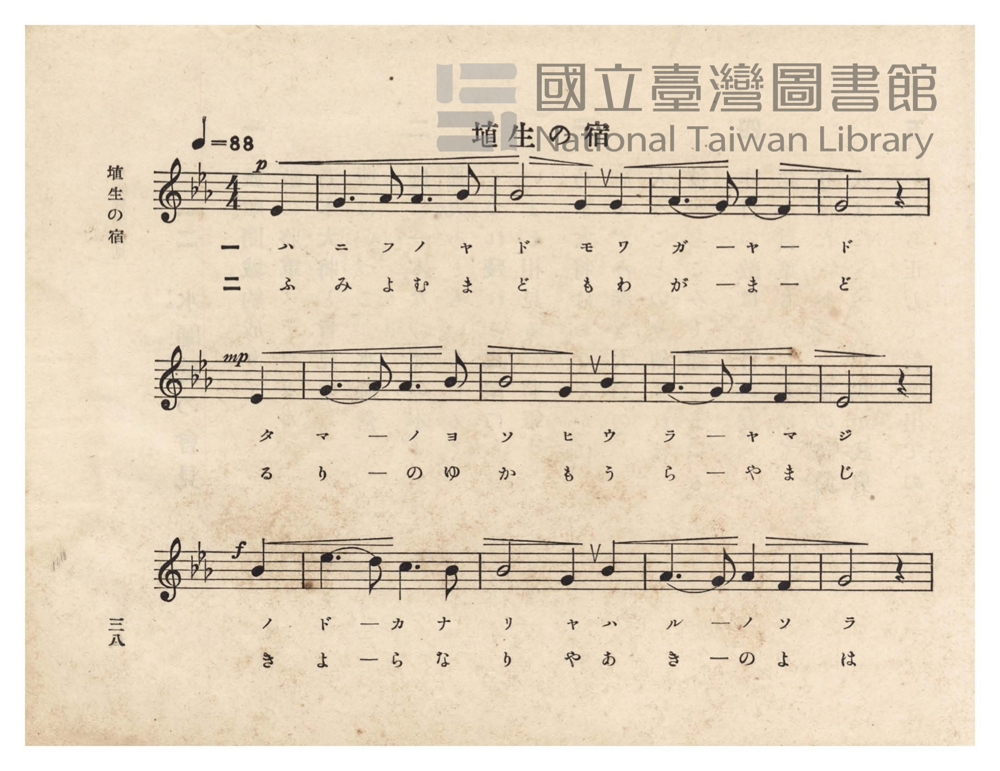
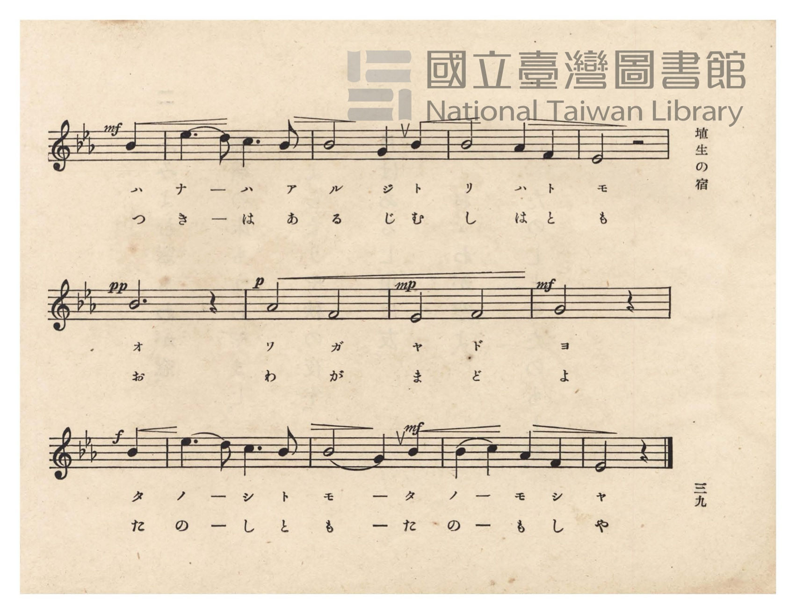
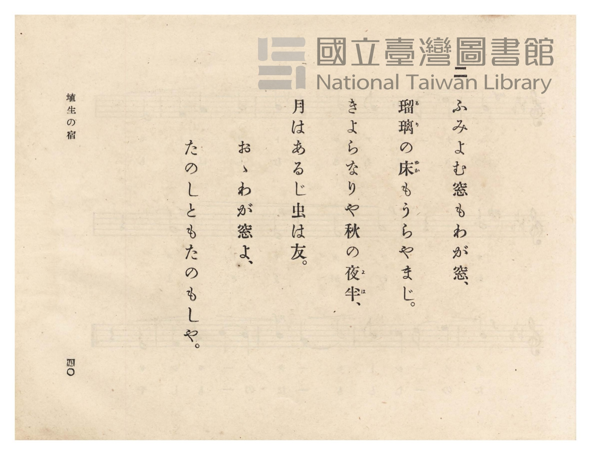
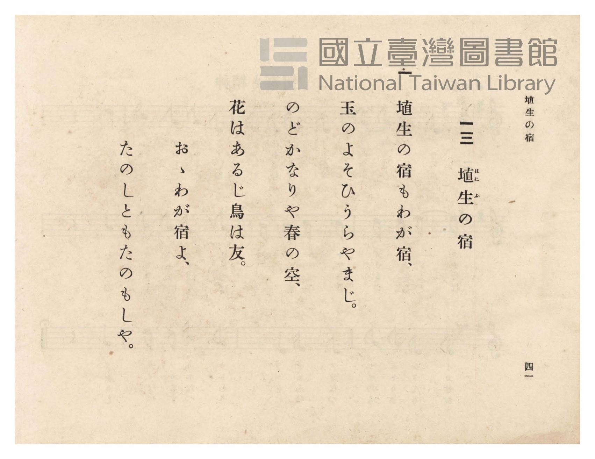

# 埴生の宿

> Re:Shōka 使用 AI 協助辨識與重建樂譜，可能會有錯誤。歡迎回報。

- **NEUTRINO 歌聲合成版**：<br><audio controls src="hanyu_no_yado_neutrino.mp3"></audio>
- **鋼琴伴奏版**：<br><audio controls src="hanyu_no_yado.mp3"></audio>


- 詞：里見義
- 曲：Henry Rowley Bishop
- 臺灣總督府《公學校唱歌》第六學年用（昭和十五年，索書號 523.37 4322-4）

## 說明

原書資訊與歌詞全文（對應 P042.jpg–P045.jpg，原書 pp. 38–41）：
調性與拍號：變ホ長調（E♭ 大調，3 降記號）4/4 拍（弱起 1 拍），速度 ♩=88


## 歌詞

```text
一
埴生（はにふ）の宿もわが宿、
玉のよそひうらやまじ。
のどかなりや春の空、
花はあるじ鳥は友。
おゝわが宿よ、
たのしともたのもしや。

二
ふみよむ窓もわが窓、
瑠璃（るり）の床（ゆか）もうらやまじ。
きよらなりや秋の夜半（よは）、
月はあるじ虫は友。
おゝわが窓よ、
たのしともたのもしや。
```

## ABC

```abc
X:1
T:埴生の宿
C:曲：Henry Rowley Bishop
M:4/4
L:1/16
Q:1/4=88
K:Eb
V:V1 name="Piano" snm="Pia"
[V:V1]
!p! z4 z4 z4 E4 | G6 A2 A6 B2 | B8 G4 G4 | A6 G2 A4 F4 |
w: 1.~ハ | ニ フ ノ ヤ | ド モ ワ | ガ ー ヤ ー
w: 2.~ふ | み よ む ま | ど も わ | が ー ま ー
!mp! G8 z4 E4 | G6 A2 A6 B2 | B8 G4 B4 | A6 G2 A4 F4 |
w: 1.~ド タ | マ ー ノ ヨ | ソ ヒ ウ | ラ ー ヤ マ
w: 2.~ど る | り ー の ゆ | か も う | ら ー や ま
!f! E8 z4 B4 | e6 d2 c6 B2 | B8 G4 B4 | A6 G2 A4 F4 |
w: 1.~ジ ノ | ド ー カ ナ | リ ヤ ハ | ル ー ノ ソ
w: 2.~じ き | よ ー ら な | り や あ | き ー の よ
!mf! G8 z4 B4 | e6 d2 c6 B2 | B8 G4 B4 | B8 A4 F4 |
w: 1.~ラ ハ | ナ ー ハ ア | ル ジ ト | リ ハ ト
w: 2.~は つ | き ー は あ | る じ む | し は と
E8 z8 | !pp! B12 z4 | !p! A8 F8 | !mp! E8 F8 |
w: 1.~モ | オ | ワ ガ | ヤ ド
w: 2.~も | お | わ が | ま ど
!mf! !f! G8 z4 B4 | e6 d2 c6 B2 | !mf! B8 G4 B4 | B4 c4 A4 F4 |
w: 1.~ヨ タ | ノ ー シ ト | モ ー タ | ノ ー モ シ
w: 2.~よ た | の ー し と | も ー た | の ー も し
E8 z4 z4 |
w: 1.~ヤ
w: 2.~や
```

## TMD 檔案連結

- [主旋律 TMD 檔案](hanyu_no_yado.tmd) [[在 TMD Studio 編輯](https://tmdlang.github.io/Tmd-TS/#tmd=s7IKdvYPcrWy4qpTUCpJTLdSSM7PyUlNLsnMz7PKzk9PzM7Ojy_OyM9OVIKrKMvPKc1NtUovSkxJjTdDiBfnlxYlp1oVJ2fk5-fEl6RWlCTl52ejy8cXJKanWgUYmBghZAqK8stS8xLzgLoLijLzSlJTwNoRClLLMlNSQdLFyYl58WWpRZlpmakpSE5KLSoGuRhqRUlRYl5xclFmAcgbCFX5RSUZ-UBnF2RUWmVkFpfkF2UmJ-bEZyfmIfmuJCMV6Lm0xNzMnEp00Yz83FQlLi0thafztzyfMv9x47qn6_YraGlxKdoqWFhw2dsquOpw2Zjom9iBNL5YOe_9nlkv23teLOt-vm8l2LBnszcBxTxS84oqFYLyy3NSKxWcMoHhWwCWfdG-63nj4uc79j6fu_jprjmPG7qetq55unbHswULn07Z-Gxtz-OG7udr1jxtXQsUfLoT6IYV7_d0PJux9umknqe9jU92TQEKvt_T83zLomezd7yYOV_B1MhYz9hcwcTYyEjX5P2eTiUuLn0tBVtqAS4FBYWnffNBlm1uf7Gi60VHO9CVQI8_bV3xbFo70HFPN_Q-a-9UAMW3XlZB-qOGyUCmKYgJdCdEq0JBgZ6CsQVQysQQ6ERg-ICMfbFq_7OG5SADu3uBPgGKvljX9bh59sup24FSQJNdH81cq_B0yXIwr8dY4eXM3hcrZoCVdgKjQAGoD2T_no0vtm5XMIRwgYb3vGyY_3TXMoVHM1faAuMMZNWTHQ1gj4AjFajnceP6x42rHzduBWqAxPHjpqbHTf2PG3tA7IZGkOrnfSC5x01A1XMfN2563Nj2uKnzcVPL48Z9jxtnPG5oAikCqWhc-bix-3HjqsdNXUDpZzOWAgWfr9wFNeZF10awdUDzgYpmvNwMlF7_tL8bbgBQ01yE3UDrIPoeN4KS3-PG6Y8bV4BcB-GCGNNBjgDqBvtsVw9E8dbHjWDNTQ3PV02G-wbEhvpm4oLnk5pBfgc6o6kL6vFdQAZQpA3oAZAIyHTsvuwFmw3UA_Xl8-VAz6x7umTO016IEaAwBRkBse3ZHEgYQz39YiYwsHF4Guxc4j0NVER5qoYCBS19Li6PxLzKUr_8yMSUfKuAzMS8fIcag5pqkD0KNhZadmAGthylAMynwHT1YmGPggY0DWorGCs83dD_fH0DkAmUVjCBcp929gKlgAlUB55PNLGYCHQOyLYaBQMFXTiuLqgFJm5doKgxkNQFmmkCpk2BIqZgli5YBoRroHLGYNoIJAI20cewRiEeyIPhx839YNWPm7vB6h83TwXiPih7CVimE2r24-ZFYHI9REfTGqjoHrBKCAtujxGaPY1bIboa90N0NXUAcQOE3bgPLLMSZk9TE5iEuqyxB2EPUCXCHvwRsqsHHCHIgf9szmpgyGNGjgWZkQOJBmjk5BIZOyA2vthBhDc43JpA4QUSnYcU2rD4WQGOh73w-JkE1rEMqgMSnsjxAzIDET-IEIfYBEoBIPO6kMJ7HTRG2sAxAUkj8BhqbIPqgLgYrKOpBRqjhGNoRyc8hmAxgCuGDI3IjCJQjMCjKK0WGvqGcWBBcwUz8qKoaQdywIGjAxFxkGBYDWV3gWVWwaMIEhGwTAdTBYtUSGQiR9EMZJsae6EB3oFkE9TWxlVIkQcyCRIRoIgCmQPSiRypEDMIRNHT2bPhUQSPAngcwbIVOCqMScwtpMUFTAQeFygRC4LIGQglWcPDGilZg8VAYbAIKRZAfFC8Pm4GhwxKrIHUI8RBxSDMfCS7wfEFKhwR8QWKbfTQh6gAxQwovuBZChzTkCIRpGM6XBykHlgJQsTBGQ_VbgLF4BRwDKLlJyMDrPmJcCRWFwCLOVhswMIfJFwLzS-Q-AG7DFEmogsDIx8lNcASA1IOg4U9zK-gcIeFLazqgYiCwhgSurCCEyQKCi94PEAKUaRYguUSJNPB1Q0kxCEVDiQeQAUZRBSWqhD5DxbL88Gm489JrWvhOQke-OTmJAJZBilzgUiQIuz5Bhx3SPkGVq2ASpXtUHYHSoqHVL2ISglcZkHEII0DsD7kWIE1AJBDH1qpgHMDJJ2D0jdy6oaaCQlZWIkFtRtS9YD0gXSASjlUe2q5uHTtFJAacwpArjIXAA)]
- [鋼琴伴奏 TMD 檔案](hanyu_no_yado_piano.tmd) [[在 TMD Studio 編輯](https://tmdlang.github.io/Tmd-TS/#tmd=s7IKdvYPcrWy4tLSUng6f8vzKfMfN657um7_-z0dL7v3PJ-w5cmeLU-X9j_v7Hi_p1NBS4tL0VbBwoLL3lbBVYfLxkTfxI6rTkHpxcp57_fMetne82JZ9_N9K5VAYs9mbwKKeaTmFVUqBOWX56RWKjhlFmfkF4BlX7Tvet64-PmOvc_nLn66a87jhq6nrWuert3xbMHCp1M2Plvb87ih-_maNU9b1wIFn-4EOmwF0EnPZqx9OqnnaW_jk11TgILv9_Q837Lo2ewdL2bOVzA1MtYzNlcwMTYy0jUBOlaJi8szr6Qo3yogMzEvP8jDocagpppLAQhsLLTswIwaherctFoFwzgFXSA0VzAD06ZAcVMwS1fBGMzXhYqA5E2A2AgsYghVYwCla7hqUaz0QbbSBM3KeAXjeAWT-HgFMyAGmhWvEG0YC6MgfJP4WAVToGy0KZABV2IAhGCbPBLzKkv98iMTU_B7EeQ8GK4uAFoNdjzIYyDPgLyD6WUQroHKGSO8DDbRx7BGIR7Ig-HHzf1g1Y-bu8HqHzdPBeI-KHsJWKYTavbj5kVgcj1ER9MaqOgesEoIC26PEZo9jVshuhr3Q3Q1dQBxA4TduA8ssxJmT1MTmIS6rLEHYQ9QJcIeaBBBAgMaRLlEhhEkWeAOI4Svwa5vArkaJDoPyc-wUFoBDo298FCaBNaxDKoD4ivkUAKZgQglhL8hNoHiAWReF5Kv10HDpQ0cHpCYgodTYxtUB8TFYB1NLdBwRQon5BRfDUzFkCAgKvvgCaemHciuB4cJIvQgblkNZXeBZVbBwwkSGrD0B1MFC1lIiCKH0wxkmxp7ob7uQLIJamvjKqQQBJkECQ1QaIHMAelEDlmIGTjSE2kBBRPBV84gkhhKxMMDAiniwWIgBy5CCiIQHxToj5vBzkYJUpB6hDgou8LMR7IbHJigTIwITFBUoAcNRAUo2ECBCU904GiAZF2QjulwcZD6x40rIOLgpIlqN6wELQBmUVg4wUIGJFwLTWaQkAPrQeRndGFgtKDEEyyakBImLFRgrgCFCMzXsMILIgryPcTfsEwPEgX5BB5CkAIAKfxgiQvJdHCBBQkLSJEFCSFQJoSIwuIbkWxh4T8fbDoso-JPaUhpEn-1Bg5YpOQGK69AOWU7lN2BklAgJSuitAPnQ4gYpOwH60MOMlj5jhw00NIKnIggyQOULJATBdRMiLdhuRBqN6RMA-kD6QDlXFR7sFWeOCprUG1rAE5ZwFoXVAUDEajWNsJWaYMqaxiGVNqw6IBV3eDESB2TgDEINQhvQ4IYNxFpFJSBq0mCnDdhSkAMkNGgAASxgZ5F0g7JmhimwhpIKB5FuBqHG8G6iG486dopgFtqCkAGUlqI9gEqQhcyAgspcwEA)]

## 分析

```text
================================================================================
📊 TMD Song Profile: [ 埴生の宿 ]
================================================================================
⏱  Duration:       1:08 (68.2s), 25 measures total
🎼 Key & Tempo:    首調基準 E,, != 88.0 BPM, <4/4>
   - 分析範圍：      由實際發聲的音符與和弦推測調性；播放脈絡另行呈現
🎤 人聲音域:    D#4 (MIDI 63) – D#5 (MIDI 75) [跨度: 12 個半音 / 1.0 個八度, 難度: easy]
   - 最低音:  D#4 in [HanyuNoYado #1 @ m.1, 0:02]
   - 最高音: D#5 in [HanyuNoYado #1 @ m.10, 0:24]
   - 適合: soprano, mezzo-soprano, contralto, tenor, baritone, bass
🏛  結構:      HanyuNoYado (68.2s)
⚡ 編曲密度:        Peak 1 軌道同時演奏
🗝  調性診斷：       D# 大調（純淨自然大調，未偵測到可信轉調）
   - 風格氣質:    純淨自然大調（陽光明朗、易唱易記，無明顯調外色彩）
   - 轉調歷程:    全曲維持單一推測調性（未偵測到可信轉調）
   - 核心骨幹音:  A#, G, G#, D#, F
   - 調性數值:    D# 大調 [相關度: 0.86, 穩定度: High, 自然音純度: 100.0%]
   - 候選調性 (K-S): D# 大調 (0.86), A# 大調 (0.65), G 小調 (0.61)
   - 五度圈歷程:   -3
   - 各段落調性細節:
     • [HanyuNoYado #1]: D# 大調 (r: 0.86, 自然音純度: 100.0%)

  [ 五度圈游移軌跡 ]
               C  
         F            G  
      Bb               D  
     [Eb]*              A  
         Ab           E  
            Db       B  
               F# 
     (* = active key center)

  [ 十二半音累積音高分佈 ]
     C  : █████                      6.2%
     C# :                            0.0%
     D  : █                          1.7%
     D# : ██████████████            16.5%
     E  :                            0.0%
     F  : ████████                  10.2%
     F# :                            0.0%
     G  : ████████████████          18.7%
     G# : ███████████████           17.6%
     A  :                            0.0%
     A# : ████████████████████████  29.0%
     B  :                            0.0%
--------------------------------------------------------------------------------
Assignment 軌道音域：
  - Piano         : D#4 – D#5 (12 個半音 / 1.0 個八度, 70 個音符)
================================================================================
```


## 原書掃描頁










