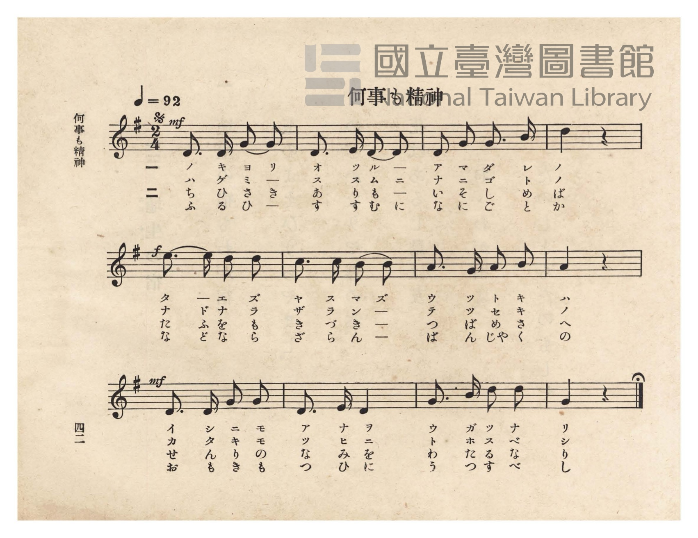
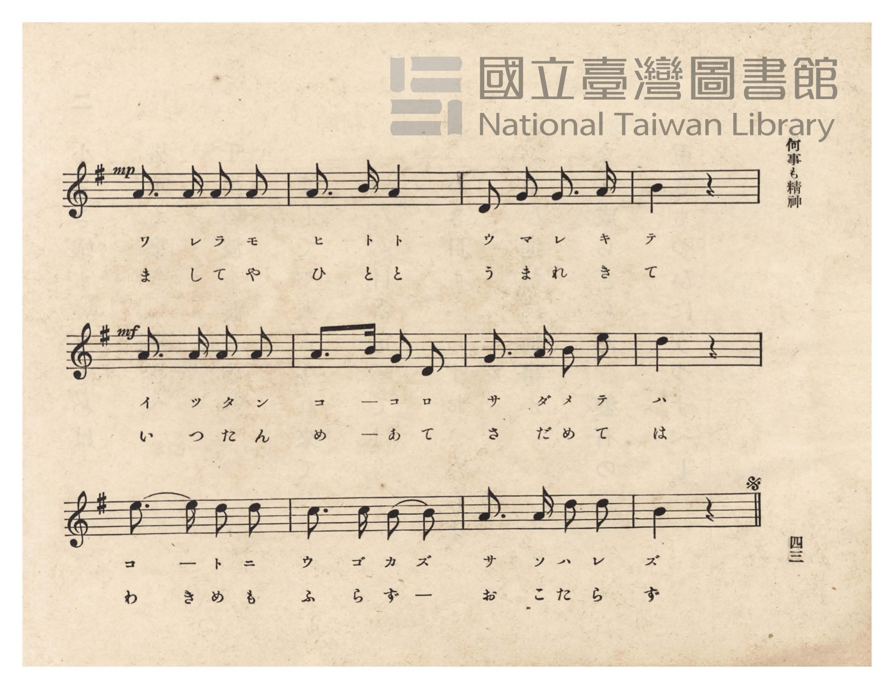
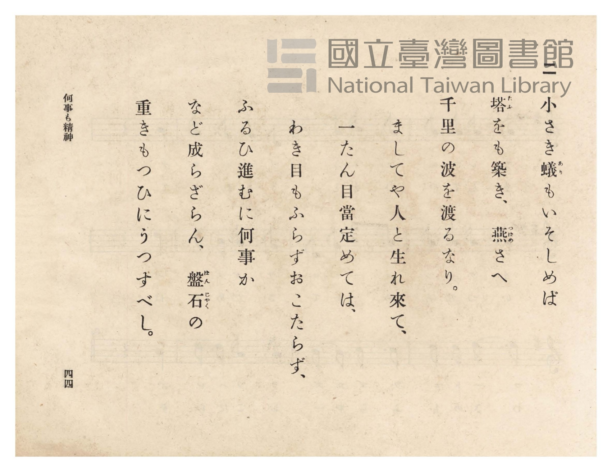
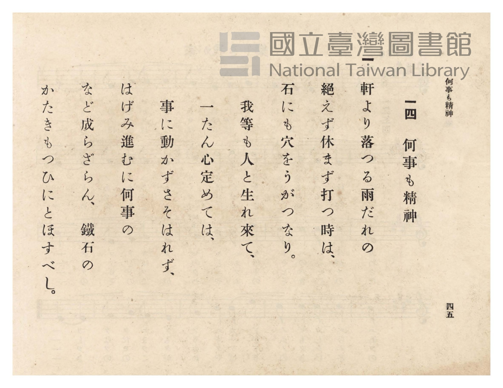

# 何事も精神

> Re:Shōka 使用 AI 協助辨識與重建樂譜，可能會有錯誤。歡迎回報。

- **鋼琴伴奏版**：<br><audio controls src="nanigoto_mo_seishin.mp3"></audio>
- **NEUTRINO 歌聲合成版**：<br><audio controls src="nanigoto_mo_seishin_neutrino.mp3"></audio>

- 臺灣總督府《公學校唱歌》第六學年用（昭和十五年，索書號 523.37 4322-4）

## 說明

原書資訊與歌詞全文（對應 P046.jpg–P049.jpg，原書 pp. 42–45）：
調性與拍號：ト長調（G 大調，1 升記號）2/4 拍，速度 ♩=92
曲式結構：三段體 Dal Segno（P046 共 12 小節為 A 段，句尾附延長記號 Fine；
P047 共 12 小節為 B 段，句尾附 𝄋 記號返始重唱 P046 12 小節，全長 36 小節）


## 歌詞

```text
一
軒より落つる雨だれの
絶えず休まず打つ時は、
石にも穴をうがつなり。
我等も人と生れ來て、
一たん心定めては、
事に動かずさそはれず、
はげみ進むに何事の
など成らざらん、鐵石の
かたきもつひにとほすべし。

二
小さき蟻（あり）もいそしめば
塔（たふ）をも築き、燕（つばめ）さへ
千里の波を渡るなり。
ましてや人と生れ來て、
一たん目當定めては、
わき目もふらずおこたらず、
ふるひ進むに何事か
など成らざらん、盤石（ばんじやく）の
重きもつひにうつすべし。
```

## ABC

```abc
X:1
T:何事も精神
M:2/4
L:1/16
Q:1/4=92
K:G
V:V1 name="Piano" snm="Pia"
[V:V1]
!mf! D3 D G2 G2 | D3 E D2 D2 | D2 G2 G3 B | d4 z4 |
w: 1.~ノ キ ヨ リ | オ ツ ル ー | ア マ ダ レ | ノ
w: 2.~ち ひ さ き | あ り も ー | い そ し め | ば
!f! e3 e d2 d2 | c3 c B2 B2 | A3 G A2 B2 | A4 z4 |
w: 1.~タ ー エ ズ | ヤ ス マ ズ | ウ ツ ト キ | ハ
w: 2.~た ふ を も | き づ き ー | つ ば め さ | へ
!mf! D3 D G2 G2 | D3 E D4 | G3 B d2 d2 | G4 z4 |
w: 1.~イ シ ニ モ | ア ナ ヲ | ウ ガ ツ ナ | リ
w: 2.~せ ん り の | な み を | わ た る な | り
!mp! A3 A A2 A2 | A3 B A4 | D2 G2 G3 A | B4 z4 |
w: 1.~ワ レ ラ モ | ヒ ト ト | ウ マ レ キ | テ
w: 2.~ま し て や | ひ と と | う ま れ き | て
!mf! A3 A A2 A2 | A3 B G2 D2 | G3 A B2 e2 | d4 z4 |
w: 1.~イ ッ タ ン | コ ー コ ロ | サ ダ メ テ | ハ
w: 2.~い つ た ん | め ー あ て | さ だ め て | は
e3 e d2 d2 | c3 c B2 B2 | A3 A d2 d2 | B4 z4 |
w: 1.~コ ー ト ニ | ウ ゴ カ ズ | サ ソ ハ レ | ズ
w: 2.~わ き め も | ふ ら ず ー | お こ た ら | ず
!mf! D3 D G2 G2 | D3 E D2 D2 | D2 G2 G3 B | d4 z4 |
w: 1.~ハ ゲ ミ ー | ス ス ム ニ | ナ ニ ゴ ト | ノ
w: 2.~ふ る ひ ー | す す む に | な に ご と | か
!f! e3 e d2 d2 | c3 c B2 B2 | A3 G A2 B2 | A4 z4 |
w: 1.~ナ ド ナ ラ | ザ ラ ン ー | テ ツ セ キ | ノ
w: 2.~な ど な ら | ざ ら ん ー | ば ん じゃ く | の
!mf! D3 D G2 G2 | D3 E D4 | G3 B d2 d2 | G4 z4 |
w: 1.~カ タ キ モ | ツ ヒ ニ | ト ホ ス ベ | シ
w: 2.~お も き も | つ ひ に | う つ す べ | し
```

## TMD 檔案連結

- [主旋律 TMD 檔案](nanigoto_mo_seishin.tmd) [[在 TMD Studio 編輯](https://tmdlang.github.io/Tmd-TS/#tmd=s7IKdvYPcrWy4qpTUCpJTLdSSM7PyUlNLsnMz7PKzk9PzM7Ojy_OyM9OVIKrKMvPKc1NtUovSkxJjTdDiBfnlxYlp1oVJ2fk5-fEl6RWlCTl52ejy8cXJKanWgUYmCDpLCjKL0vNS8wD6i4oyswrSU0Ba0coSC3LTEkFSRcnJ-bFl6UWZaZlpqYgOSm1qBjkYqgVJUWJecXJRZkFIG8gVOUXlWTkA51dkFFplZFZXJJflJmcmBOfnZiH5LuSjFSg53LzixJz0AVTMnMy00HOQDYyMz0zD6g8L6kUGExKXFpaCk_2Tn2yq_txU9PzTfueL52noKXFpWirYGnEZW-r4M5lY6RvYgfS_6J91_PGxc937H0-d_HTXXMeN3Q9bV3zdO2OZwsWPp2y8dnanscN3c_XrHnauhYo-HTnludTVrzf0_Fsxtqnk3qe9jY-2TUFKPh-T8_zLYuezd7xYuZ8BVMjYz1jcwUTYyMjXZP3ezqVuLj0tRRsqQW4FBQUnvbNB1m2uf3Fiq4XHe1AV75YOe9p64pn09qBjnu6ofdZe6cCKHL1sgrSHzVMBjItQUygOyFaFQoK9BRMjIBSJqZAJ77fMwtk7ItV-581LAcZ2N0L9AlQ9HFzx8up24HiQGPdFZ4uWQ5m9hgqPO0F2j0DrKgTGJQKQB1A8ZcN85_uWqbwaOZKW2BAA018NnvT0z39z7dOeLa8G2jckx2dz9Ztfbl6ioJLYo5CcGp6Xj7QYJBDFZ62blQwNFJ4uqH_-fqG5027FBwVgEpBDu5f-nTDvpczW57u3gZyC9hWBbfMvNT3e2aD7EAAoEHmmAY5oRuk8GFuS7cCxKAX-6c8Xd79sr0XGNngEEPoBWlpXQG0UsEY6DyoUCcXyMonOxrA4bV70uOmjsdNXS8m7H3cuORxU_fL2SseNy543NTzuHEdSMXzrdseN3Y8bpz1ZM_Ex437gIxnnZOBSp_NbHrcuP5xQyNY0fzNjxtXg1Lqyi2PmyY9bmx73Ag0YMnjxlVAsx83NIFDsmPi87WdQEVPdu163Lji-ZT5QFue7AMqXQY1Buiox41A0clP9zc_XTfrcVMjSA5uCygzNK5-2j31cSOQMetxI5AxFyQNcuwsqCIQvxHogv0vGzY9bgKatxqajSDeAbmoceWzjgmPmzofN04DkU2TgVpfTtgK9gRUEVD5_MeNvUDHgn2xCeS7RmDA7H7cOPNx487HjdNBnoI4qgecnjf0g93T-2L-bmCCeNzYBPQ4MLDBJrSA3Tkd7J8NYNULp4AVAe0AxitQETAWmp6vB7qoF-iW5-1TwbJAizcA9YAUgIzeAdbZ2_yyHRQ3zzYvAmp7tmMhMM5QghkcSdNBAdfUQjikn89e93zqNiyB_bgJ6KFeoDTYB1vBwQUM8q7HjcDYB-oEc2FBDpQGOmITRpB34wvy57OXAIMc7FOgN4GmzgC6-HFjP9i_4HgAJmqMSAB6AshGigSgOsqLJChQ0NLn4vJLzMtMzy_J980PTs0szgCWygGZiXn5DjUGNdXg3GpjaKZlB2ZhKxUVgGUtMHhfLOxR0ACXAEC-giGonIJmQR14uaaJRTfQBSCTaxSqc9NqFUzjFXSBEEgZAikQroGJmcVDWGACKgpTpKtgDBICs3QVDKB0DdhkH8MahcfNfWCRx01rgewVIFbzKrAxj5tANIjfAsSrwaw9UJlFYN48MNkAVbUGJAM1TVcB4jK4TUZAucaFEJWNm4B4KpjVCzGvsQnqhi4gBrHhNjW2gNXNBZPToaoawTIbMGzCHxG7elAjwhQYERYkRgQwHswgQQ4OUhCuUTABi5gAAxoU2CARI7CIIZhGFsEaAU37oQG4B8gGRwCwnAd7vnkJ1MM7YYENk2lahhQ1HdDog-jpxxMB86ERsBWofhJYFyiwQTKgiADJLIWyEREAdQMwuEEBD2KBog4ks4PECNjRiRoBlsAIgFdQVM4KYPfAMwAiriAi2OMBFtrbgb7vBocBKJnDkjuID0yezZvgpsNjoWkNOCYgKiCxAMk62GNhNlTXZHCCB4XoOmiIQjNc435o_MDsgcQpKP6ApSuYBcuiIP0kxMHT2bPBcQBuRoBLI2NQJMCaBOBIMCciEgpqoSnaCEyDMCyNG8PTOkZJZAQUAmUHHBHQvB4azKDgXIkcAc2QwAAldUhyR44AWDm0Bhqsa8E62vBEwD5ocE4HYrAJTaDIA8lAIhdYUYIx3J5GkGkQfcDqE6qmFywDSQIklEJT0CLAHBgBRgakRgAwF-COAFBoQ-sCWMCDgh1UcuGtCmA5oLkZWio9bt4MDWgQDSujQOzHzWuhMluhMg1ADCrgIUFPqCQCBTgoEJdASyVQboCYBypjoDaBqwVIEIP0gModEH8BvCSCyUASDvG5oHUtaiQYgSplI5RaGRwJOgqQdja4kY03RoivFYyQ1ODJDMghDinhwWUScqmzBYjB1TK8VoDGRdNeaOhDMgVIBqQCR1zAS5deWLjCawWYeZ1A9iyoayAykHIH2AKEx18nVAakjti4gHRYkFpJLnrBeqAYUjAC1c5GpFbPNG0nQYOpCdh6aQZ7Gd4a2gmVAVXTC5CjClwdQCsTYHRBIrSDYDsJFuzd0BIJEewzocE-EygLancB28FQGVCFAOE9bpwCVbUCLAOynfQIgbaWEBECqq2NSa2tadFeAgcqKFCAqRIawKDKAhQR26AyK6ElFzzgoNUBuL3UtBscuGuhMvgiAlYfA82DBDA8lU-DRhHQDeCSCxFFkGYpuHYHdWOawQaA0g5IElTRk5E5IA0neFwYgypteD8eERc64JGEAWs_gRIfyOeg1gsodBHVN7S0B1bjkMwAMR1WlT9ung3NRI-bQQkcZNZ2PLECjX9gKQVtq8LLK1hbFdTBgLgGUX3DahuQDcAuI1QG0qVAtqeWi0vXTgGj56cAFFTmAgA)]
- [鋼琴伴奏 TMD 檔案](nanigoto_mo_seishin_piano.tmd) [[在 TMD Studio 編輯](https://tmdlang.github.io/Tmd-TS/#tmd=s7IKdvYPcrWy4tLSUniyd-qTXd2Pm5qeb9r3fOm893s6XnbveT5hy5M9W54u7X_e2fF-T6eClhaXoq2CpRGXva2CO5eNkb6JHVedgtKL9l3PGxc_37H3-dzFT3fNedzQ9bR1zdO1O54tWPh0ysZna3seN3Q_X7PmaetaoODTnVueT1kBNP_ZjLVPJ_U87W18smsKUPD9np7nWxY9m73jxcz5CqZGxnrG5gomxkZGuiZAm5W4uDzzSoryrQIyE_PygzwcagxqqrkUgMDG0EzLDsyqUajOTatVMI1X0AVCIGUIpEC4BiZmFg9jgQRBUroKxgqmINVIIroKBjA1XLUo9vog22uCaq1hvEK0YSzYLiDLNB7EBInBWQYQ4_wS8zLT80vyffODUzOLMzLzqOMlMAEVhSkCeQ4ohOEpkMk-hjUKj5v7wCKPm9YC2StArOZVYGMeN4FoEL8FiFeDWXugMovAvHlgsgGqag1IBmqargI8iCE2GQHlGhdCVDZuAuKpYFYvxLzGJqgbuoAYxIbb1NgCVjcXTE6HqmoEy2zAsAkWXMDQMoMEDFK8moBFTIDBAQoSkIgRWMQQTCOLYA2mpv1Qb-4BssHB1LQL4sTmJVBn7YQFCUymaRlSAHZAAxmipx9PMM2HBtNWoPpJYF2gIAHJgIILJLMUykYEE9QNwEABBQ-IBQpgkMwOnMFE9YyCCCxYkGwHOrEb7FBQioGlHBAfGNPNm-Cmw4OqaQ04uCAqIEEFSYXYg2o2VNdkcNoBeXsd1NvQtNu4HxqIMHsgAQ8K5MdNYJeBVYJkQPpxBFRBLTRpGIFpEIYlFmN4osHIeEZAIVC6whFIzeuhQQHy8krkQGqGOBiUZiDpBjmQYNluDdTra8E62vAE0j6ol6cDMdiEJlAAg2QgEfC4cQUYw-1pBJkG0fe4qQeqphcsA4kmXKkJdyCBQgRaPMECBxQ0oGyKt3SCpaTmZmgWfNy8GRoYIBqWIUHsx81roTJboTINQAwqcyDBQyjbgQIF5NEl0CwISlUQ80AZCmoTuKSCBANIDyiTgfgL4NkOJgOJXCwBRXzJZISkBk86Qg4ISCkDznLImWoLEIMLcHjJBA2ipr3QQIGkJ5AMSAWOIIJnnl6Yd-ElE8y8TiB7FtQ1EBlItnrcCMyi0GDthMqA1OFOSzSr76CeaALWQs1gB8FrtZ1QGVBBvgA5IMFlEbQkAwYmJLg7CNZ3sEDphmY1RKDMhAbKTKAsqP583AiKHli5BeE9bpwCVbUCLAOyHXtw0aK-A3sZ5GRgjEK9DyqjQMG0DSqzEpoZ4d6ClkLg-q5pN9jra6Ey-IIJVlQDzYN4H55CpkEDEOgGcGZEBCCk8gcX_I0zHjc1gw0AxSxIElQHUJSwwJpIrPJAUQZyEajCAfkaUZpDCxZgqQ5JQhDTYSX74-bZ0KT3uBmULEBmbccTWtB4AeY8aBsAngdhbQBQ8wriGkRpDivYQDY8bgTZBpKBNKiQ7cHdOCWn3QsXA7V7EYnVBCZlhKzGDIgxVBPdqkaqqpGUoeqA2ICmAZwiUDWALYOrR3URdrdjd8vgCBlglOraKYB7MApABkb0RvsAjcAuYQSWUOYCAA)]

## 分析

```text
================================================================================
📊 TMD Song Profile: [ 何事も精神 ]
================================================================================
⏱  Duration:       0:46 (47.0s), 36 measures total
🎼 Key & Tempo:    首調基準 G, != 92.0 BPM, <2/4>
   - 分析範圍：      由實際發聲的音符與和弦推測調性；播放脈絡另行呈現
🎤 人聲音域:    D4 (MIDI 62) – E5 (MIDI 76) [跨度: 14 個半音 / 1.2 個八度, 難度: moderate]
   - 最低音:  D4 in [NanigotoMoSeishin #1 @ m.1, 0:00]
   - 最高音: E5 in [NanigotoMoSeishin #1 @ m.5, 0:05]
   - 適合: soprano, mezzo-soprano, contralto, tenor, baritone, bass
🏛  結構:      NanigotoMoSeishin (47.0s)
⚡ 編曲密度:        Peak 1 軌道同時演奏
🗝  調性診斷：       D 大調（純淨自然大調，未偵測到可信轉調）
   - 風格氣質:    純淨自然大調（陽光明朗、易唱易記，無明顯調外色彩）
   - 轉調歷程:    全曲維持單一推測調性（未偵測到可信轉調）
   - 核心骨幹音:  D, G, A, B, E
   - 調性數值:    D 大調 [相關度: 0.86, 穩定度: Moderate, 自然音純度: 95.2%]
   - 候選調性 (K-S): D 大調 (0.86), G 大調 (0.81), D 小調 (0.61)
   - 五度圈歷程:   +2
   - 各段落調性細節:
     • [NanigotoMoSeishin #1]: D 大調 (r: 0.86, 自然音純度: 95.2%, 調外音: C)

  [ 五度圈游移軌跡 ]
               C  
         F            G  
      Bb              [D ]*
      Eb               A  
         Ab           E  
            Db       B  
               F# 
     (* = active key center)

  [ 十二半音累積音高分佈 ]
     C  : ███                        4.8%
     C# :                            0.0%
     D  : ████████████████████████  34.9%
     D# :                            0.0%
     E  : █████                      7.1%
     F  :                            0.0%
     F# :                            0.0%
     G  : ██████████████            20.6%
     G# :                            0.0%
     A  : ██████████████            19.8%
     A# :                            0.0%
     B  : █████████                 12.7%
--------------------------------------------------------------------------------
Assignment 軌道音域：
  - Piano         : D4 – E5 (14 個半音 / 1.2 個八度, 114 個音符)
================================================================================
```


## 原書掃描頁










