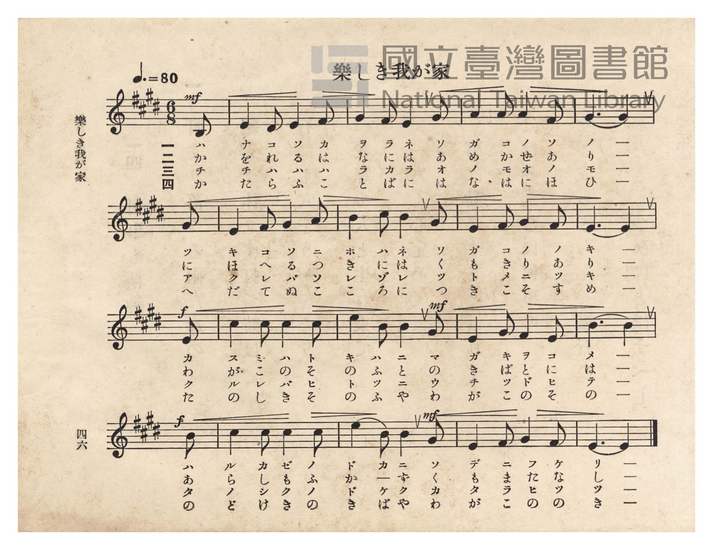
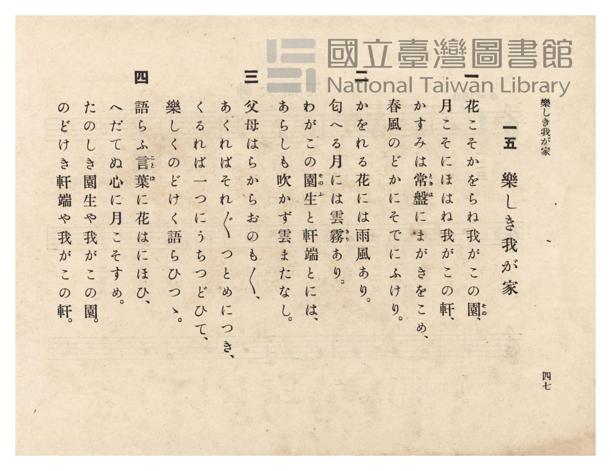

# 樂しき我が家

> Re:Shōka 使用 AI 協助辨識與重建樂譜，可能會有錯誤。歡迎回報。

- **鋼琴伴奏版**：<br><audio controls src="tanoshiki_wagaya.mp3"></audio>
- **NEUTRINO 歌聲合成版**：<br><audio controls src="tanoshiki_wagaya_neutrino.mp3"></audio>

- 臺灣總督府《公學校唱歌》第六學年用（昭和十五年，索書號 523.37 4322-4）

## 說明

原書資訊與歌詞全文（對應 P050.jpg–P051.jpg，原書 pp. 46–47）：
調性與拍號：ホ長調（E 大調，4 升記號）6/8 拍（弱起 1 拍），速度 ♩.=80


## 歌詞

```text
一
花こそかをらね我がこの園（その）、
月こそにほはね我がこの軒、
かすみは常盤（ときは）にまがきをこめ、
春風のどかにそでにふけり。

二
かをれる花には雨風あり。
匂へる月には雲霧（きり）あり。
わがこの園生（そのふ）と軒端とには、
あらしも吹かず雲またなし。

三
父母はらからおのも〳〵、
あくればそれ〴〵つとめにつき、
くるれば一つにうちつどひて、
樂しくのどけく語らひつゝ。

四
語らふ言葉（ことは）に花はにほひ、
へだてぬ心に月こそすめ。
たのしき園生や我がこの園。
のどけき軒端や我がこの軒。
```

## ABC

<div class="abc-score" data-abc-src="tanoshiki_wagaya.abc" aria-label="五線譜載入中"></div>

[下載 ABC 原始檔](tanoshiki_wagaya.abc)

## TMD 檔案連結

- [主旋律 TMD 檔案](tanoshiki_wagaya.tmd) [[在 TMD Studio 編輯](https://tmdlang.github.io/Tmd-TS/#tmd=s7IKdvYPcrWy4qpTUCpJTLdSSM7PyUlNLsnMz7PKzk9PzM7Ojy_OyM9OVIKrKMvPKc1NtUovSkxJjTdDiBfnlxYlp1oVJ2fk5-fEl6RWlCTl52ejy8cXJKanWgUYmBogZAqK8stS8xLzgLoLijLzSlJTwNoRClLLMlNSQdLFyYl58WWpRZlpmakpSE5KLSoGuRhqRUlRYl5xclFmAcgbCFX5RSUZ-UBnF2RUWmVkFpfkF2UmJ-bEZyfmIfmuJCMV6Lm0xNzMnEp00Yz83FRk4zLTM_OsclMzszKRvKulpfBsRdPjxumPG3ufdUx83NjzdN02BS0tLkVbBQsDLntbBVcuGzN9CzuQQS_adz1vXPx8x97ncxc_3TXncUPX09Y1T9fueLZg4dMpG5-t7Xnc0P18zZqnrWuBgk93bnk-ZcX7PR3PZqx9OqnnaW_jk11TgILv9_Q837Lo2ewdL2bOVzA1MtYzNlcwMTYy0jV5v6dTiYtLX0vBllqAS0FB4WnffJBlm9tfrOh60dEOdOWLlfOetq54Nq0d6LinG3qftXcqgGJYL6sg_VHDZCDTEMQEuhOiVaGgQE_BxAwoZWIOdOL7PbNAxr5Ytf9Zw3KQgd29QJ8ARR83z345dTtQHGisq8LTJcvBzB4Thae9QLtngBV1AoNSAagDZPOejS-2blcwhHCBxva8bJj_dNcyhUczV-rZAsMeZMuTHQ1gy7o2Pm6c_Lhx7uPG7sdNkx43dT5uXAuJLrD4uqdzJgGNBCtYBzTscUMjSNuzOUAhiLbVjxt3P25cj6btxe5JUKUggxtnPm7cD1T0dMeO57OXgM1bAUwWQBGQkSAj9oF19oKcANTf1AizZ8bSl4uAStc9blwJNgioFGjncjBj6-PGiY-buh43NEF8tKsHZh_IIz2Pm7rBvgOqXP9y9gqwOU1Q9aDY6wEmzh1ARWC_QBRtejlnOdh1QId0gZ2GpOFxUz9yqDyfAgx1aMAA3QJWvQLo7eergWEBtApkIjwIgMYApac_bmp6OmEn2COzgLaBvT3_ceMqkBTMFzs6QdTzjm3P1oMCCKwR6CMg2QWyqanpccPmxw1bkYxu7Af5tnEDyC1ARsMWkHTjEpArgAEJcgiQ3QvXAFQNNA-kAZgGwHJAFW2PGxeC2cBgBrprGSz8oTkY6HNIFABjuP_Fqnlg9wDVLXncNBfm8qezZ0OSL0R264sVDS8mAlMfJKUAQwQa2eBIAYYRJOFsgrtrx-PGBSCbG9c83d8MlEZKYzPBKQISC6AAA7oFVKxAYuFxUwtagoUrhbu5FxoxqErBiRSslPICAQoUtPS5uEIS8_KLMzKzM8MT0xMrE60CMoECDjW6hjXVIMsUbCy07MAMbCWSArCcA0bMi4U9ChrQnKytYKzwdEP_8_UNQCZQWgGY88Hcp529CqagbK4DL2c0sZgIdBPIthoFAziszk2rVTCNB4oZKugqmMeDKSMg1xhMg3jGQJ4JkDYBkzA5kDhYDmykj2GNQjwcPm7uB6p63NwFVPG4aTMQ7wWzVoNFN4HYzSuBuBfMWg8SbVoDU9vcB2btBasFsUFq9oDJFphtRii2NXaDTZgE1tcDxN0gViPY3MZVYPZqMB_EagKrbQSzu4F4DpIoyL1w24B6oLYZo_qtEewysAlAf4IwhAUSXQn1J4y1Cu6Lx82LwHwQqw8sugjZtqZFMNtMsPitcT5YTSeQtRXstslg0RVg9gawW9F9vB4uuhssCgp1hN92AG3Dn_J29YBTHnIqezZnNTCJYaZCCzJTISSpgZKRCZBnCqTNwCQowSHkQAkOxNMFk9XA5GqIlOgeN61FTWTN4ABrng2PHjyJDBIRYBMQEQGPdmAiAwUeJLhgiWoJODDBZiIlKnDkNzWB2b3QhIQ1UTUBVcIT1eMmsO7mNUA8ASnRQ1y5D8YCJXsg2QFmLwT7EC6K5nagL-GJCFiKgl2xDIjB5kATzWSwSqArockD2UeTgXgumDUTnk0QiWY-wUSzoxOeaGCJAleiMTQiM9WYgdMJhASmjDggwxScbMBFGSztGAPTDSjFQNIVSAkk7ZiipJ2dYN_Nh2fiDniYQtIOJKTnIaWdtbACDJiKQLGyEDmEQIUAUtrpgYfpOjBrLjikIeyt8Oy7Din8QVkZIgouKsGpCxH-wPSESDvN4NhDpJ3mSUippAXm9qZlSIUVSLQTSW0bStrZj5J2IK6cDncZmtubWmCpGa8_EW4H-hJ_2gG2GuBpB5424IkHVgRRNY1gK18MkNMHJIxBxXkTJH4hBTc4DMGFPCSMIbm2HawCWKU0TwWLbgSLggpjWCgAa1lE6gAW5tAQhpYbW8GhBklxe4CsWWBR5JIFWCJAKgJgEQ9SOx2b2eC0AalCt8NLGGR3b4SJQqpjYLyDVICqY3AFCi1tQPGLYTY4ZYArtsaJ8JSBln7xpgyEWmSza7m4dO0U0BpLCkAhZS4A)]
- [鋼琴伴奏 TMD 檔案](tanoshiki_wagaya_piano.tmd) [[在 TMD Studio 編輯](https://tmdlang.github.io/Tmd-TS/#tmd=s7IKdvYPcrWy4qpTUCpJTLdSSM7PyUlNLsnMz7PKzk9PzM7Ojy_OyM9OVIKrKMvPKc1NtTJDiBTnlxYlp-JSD5GNL0hMT7UKMDA10AUShgjpgqL8stS8xDygASWJmeWJefHpQIGivPyi-PTUvNSixByE2tSyzJRUkMqCoszcxKLK-JT8ZKBb8kqQXJdaVAxyfEFmYl5-fGJRUWJeeiqqkvyikoz89KLEgoxKq4zM4pL8oszkxJz47MQ8JFeXZAB1WaWmlCYnggJDiUtLS-HZiqbHjdMfN_Y-65j4uLHn6bpt7_d0vOze83zClid7tjxd2v-8s-P9nk4FLS0uRVsFCwMue1sFVy4bM30LO5C5L9p3PW9c_HzH3udzFz_dNedxQ9fT1jVP1-54tmDh0ykbn63tedzQ_XzNmqeta4GCT3dueT5lBdD8ZzPWPp3U87S38cmuKUDB93t6nm9Z9Gz2jhcz5yuYGhnrGZsrmBgbGemaAG1W4uLyzCspyrcKAPk-yMOhxqCmmksBCGwstOzAjBqF6ty0WgUzBV0ghpA1CoZxQIYpEOoqGIO4QNoIyAKREJ4umDRQqOGqRbHCB48VJvHxCtEm8bEQApUHNBXINQTygBjIBJsNYZgCFYKwrkK0KS6VIFeEAK0vzsjMzgxPTE-sTER4WdcQ00EGcAh2mmk81F_m8VDP1kC9C-KBgsAESJuASZgcSBwsBzbSx7BGIR4OHzf3A1U9bu4CqnjctBmI94JZq8Gim0Ds5pVA3AtmrQeJNq2BqW3uA7P2gtWC2CA1e8BkC8w2IxTbGrvBJkwC6-sB4m4QqxFsbuMqMHs1mA9iNYHVNoLZ3UA8B0kU5F64bUA9UNuMUf3WCHYZ2ASgP0EYwgKJroT6E8ZaBffF4-ZFYD6I1QcWXYRsW9MimG0mWPzWOB-sphPI2gp222Sw6AowewPYreg-Xg8X3Q0WBYU6wm87gLZB0wIidZsAeaA0b0Yw5VcDE40hUtQ_blqLGtXNYGc3z4YHEp6ohgQH2AREcMADHxjVIC9AHA2L2iVgL4HNRIpacBQ0NYHZvdDoxBq1TUCV8Kh93ATW3bwGiCcgJT2IK_fBWKDEByQ7wOyFYB_CRdHcDvQlPCofNy4Au2IZEIPNgUbdZLBKoCuhkYTso8lAPBfMmglPrIiom4-IOpylFjhXwyLQGBh5oGiDRC5ICSQCTVEicCfYivnw9NwB9xgkAiHenYcUgWtheRkYlaCgWYjsTFB-QIrAHrjH1oFZc8HehbC3wlPyOqRAAKVqiCi41ABHMSIQgJGKiMBmcBAiIrB5ElJUtcDc3rQMKd-CRDuR1LahROB-lAiEuHI63GVobm9qgSUpvP5EuB3oS9IiEFfdA488SACAip0mSOBDChiwB8GFESQAIOm6HawCWPQ1TwWLbgSLggoNmBOBtQEi6oCFDtT70Jy1FewlSHLYA2TNAosi5z1gnoEUWMCiCKR2OjazwREHKeq3w_Mgsrs3wkQh1QYwUkAqQNUGuKCH5kdQ4GOYDY42cAHcOBEebWiJC2-0IdQim42rlgXV-kTUsvAq3RhYy8KqdqRaHswAVevA6haldWAE5BjlAjkgAnsDAFqUoxgFMgSY58FtBxAbwgJKEduyABUSCMNJa7-g-hgkjGQ9iAm2E0xAJKhnGbEtJl07BXDTTQHIQIvXaB-gWmzCRtiFjbELm4CFlbkA)]

## 分析

```text
================================================================================
📊 TMD Song Profile: [ 樂しき我が家 ]
================================================================================
⏱  Duration:       0:36 (36.0s), 16 measures total
🎼 Key & Tempo:    首調基準 E, != 80.0 BPM, <6/8>
   - 分析範圍：      由實際發聲的音符與和弦推測調性；播放脈絡另行呈現
🎤 人聲音域:    B3 (MIDI 59) – E5 (MIDI 76) [跨度: 17 個半音 / 1.4 個八度, 難度: challenging]
   - 最低音:  B3 in [TanoshikiWagaya #1 @ m.1, 0:01]
   - 最高音: E5 in [TanoshikiWagaya #1 @ m.11, 0:22]
   - 適合: soprano, mezzo-soprano, contralto, tenor, baritone, bass
🏛  結構:      TanoshikiWagaya (36.0s)
⚡ 編曲密度:        Peak 1 軌道同時演奏
🗝  調性診斷：       E 大調（純淨自然大調，未偵測到可信轉調）
   - 風格氣質:    純淨自然大調（陽光明朗、易唱易記，無明顯調外色彩）
   - 轉調歷程:    全曲維持單一推測調性（未偵測到可信轉調）
   - 核心骨幹音:  E, G#, B, C#, F#
   - 調性數值:    E 大調 [相關度: 0.95, 穩定度: High, 自然音純度: 100.0%]
   - 候選調性 (K-S): E 大調 (0.95), C# 小調 (0.74), G# 小調 (0.57)
   - 五度圈歷程:   +4
   - 各段落調性細節:
     • [TanoshikiWagaya #1]: E 大調 (r: 0.94, 自然音純度: 100.0%)

  [ 五度圈游移軌跡 ]
               C  
         F            G  
      Bb               D  
      Eb               A  
         Ab          [E ]*
            Db       B  
               F# 
     (* = active key center)

  [ 十二半音累積音高分佈 ]
     C  :                            0.0%
     C# : ██████████                13.5%
     D  :                            0.0%
     D# : █                          1.0%
     E  : ████████████████████████  31.2%
     F  :                            0.0%
     F# : ████████                  10.4%
     G  :                            0.0%
     G# : ███████████████           19.8%
     A  : █████                      6.2%
     A# :                            0.0%
     B  : ██████████████            17.7%
--------------------------------------------------------------------------------
Assignment 軌道音域：
  - Piano         : B3 – E5 (17 個半音 / 1.4 個八度, 60 個音符)
================================================================================
```


## 原書掃描頁






