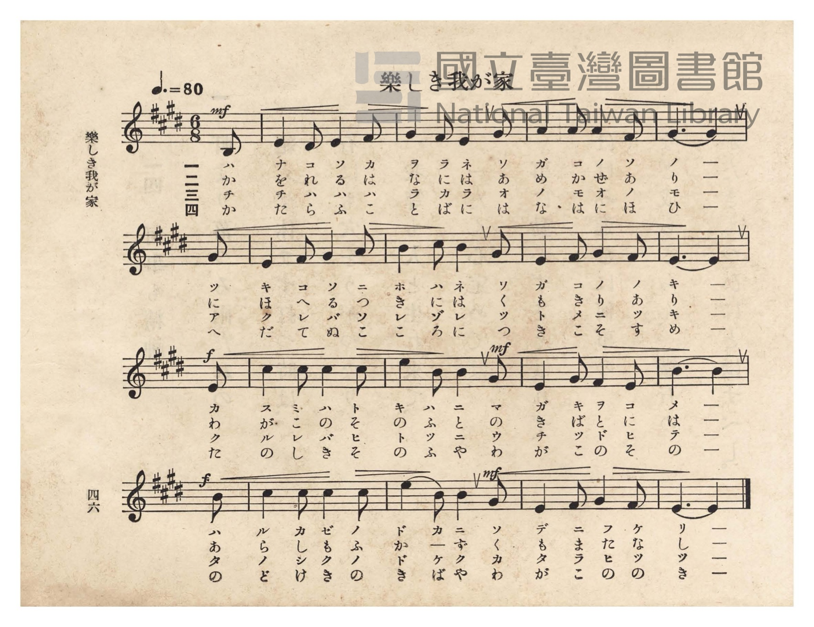
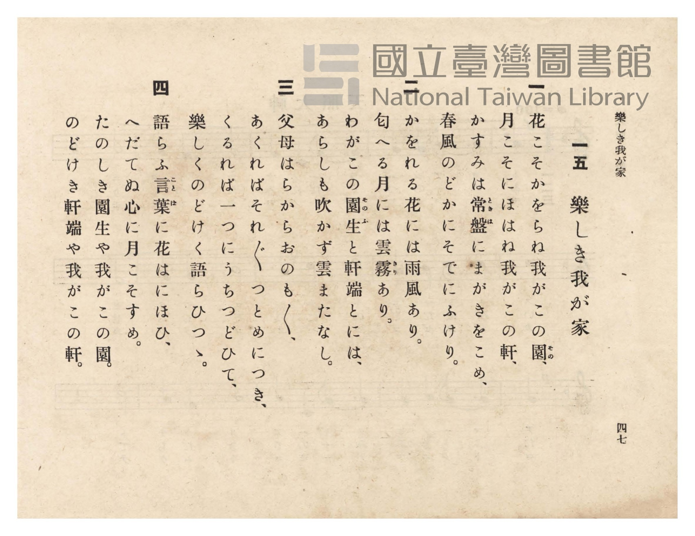

# 樂しき我が家

> Re:Shōka 使用 AI 協助辨識與重建樂譜，可能會有錯誤。歡迎回報。

<audio controls src="tanoshiki_wagaya.mp3"></audio>

- 臺灣總督府《公學校唱歌》第六學年用（昭和十五年，索書號 523.37 4322-4）

## 說明

原書資訊與歌詞全文（對應 P050.jpg–P051.jpg，原書 pp. 46–47）：
調性與拍號：ホ長調（E 大調，4 升記號）6/8 拍（弱起 1 拍），速度 ♩.=80


## 跨冊／重複收錄參照

> 同曲＋同詞異曲＋同名異曲（《公學校唱歌》六年級、《新定兒童唱歌》六年級與《共益商社唱歌教科書》卷四為同曲；《唱歌帖》P027 同採「花こそ薫らね…」歌詞而譜曲不同；《唱歌帖》P102 則採 *Home! Sweet Home!* 旋律）

- **[同曲]** 《共益商社唱歌教科書》卷四・教師用（明治33年／1900）：[**〈樂しき我家〉**](../../../kyoeki_shoka/kan_4_854865/12_tanoshiki_wagaya/index.md)（`E` / `6/8` — [原始 TMD](../../../kyoeki_shoka/kan_4_854865/12_tanoshiki_wagaya/tanoshiki_wagaya.tmd)）
- **[同曲]** 《新定兒童唱歌》尋常科第六學年用（2020.006.0847.0006）：[**〈樂しき我家〉**](../../../shintei_jido_shoka/grade_6_2020.006.0847.0006/3_04_tanoshiki_wagaya/index.md)（`E` / `6/8` — [原始 TMD](../../../shintei_jido_shoka/grade_6_2020.006.0847.0006/3_04_tanoshiki_wagaya/tanoshiki_wagaya.tmd)）
- **[同名異曲]** 楊金土手抄《唱歌帖》第 2 冊・II（2020.006.0843）：[**〈樂しき我家〉**](../../../shokacho/vol_02/p102_tanoshiki_wagaya/index.md)（`B,` / `4/4` — [原始 TMD](../../../shokacho/vol_02/p102_tanoshiki_wagaya/tanoshiki_wagaya.tmd)）
- **[同詞異曲]** 楊金土手抄《唱歌帖》第 8 冊・VIII（2020.006.0843）：[**〈樂シキ我家（快樂的我家）〉**](../../../shokacho/vol_08/p027_tanoshiki_waga_ie/index.md)（`B,` / `4/4` — [原始 TMD](../../../shokacho/vol_08/p027_tanoshiki_waga_ie/tanoshiki_waga_ie.tmd)）
- 總表：[跨冊重複與同名歌曲總索引](../../../duplicate_songs.md)

## 歌詞

```text
一
花こそかをらね我がこの園（その）、
月こそにほはね我がこの軒、
かすみは常盤（ときは）にまがきをこめ、
春風のどかにそでにふけり。

二
かをれる花には雨風あり。
匂へる月には雲霧（きり）あり。
わがこの園生（そのふ）と軒端とには、
あらしも吹かず雲またなし。

三
父母はらからおのも〳〵、
あくればそれ〴〵つとめにつき、
くるれば一つにうちつどひて、
樂しくのどけく語らひつゝ。

四
語らふ言葉（ことは）に花はにほひ、
へだてぬ心に月こそすめ。
たのしき園生や我がこの園。
のどけき軒端や我がこの軒。
```

## ABC

```abc
X:1
T:樂しき我が家
M:6/8
L:1/16
Q:3/8=53
K:E
V:V1 name="Piano" snm="Pia"
[V:V1]
!mf! z2 z2 z2 z2 z2 B,2 | E4 D2 E4 F2 | G4 F2 E4 G2 | A4 A2 A4 F2 |
w: 1.~ハ | ナ コ ソ カ | ヲ ラ ネ ワ | ガ コ ノ ソ
w: 2.~か | を れ る は | な に は あ | め か ぜ あ
w: 3.~チ | チ ハ ハ ハ | ラ カ ラ オ | ノ モ オ ノ
w: 4.~か | た ら ふ こ | と ば に は | な は に ほ
G6 G4 G2 | E4 F2 G4 A2 | B4 c2 B4 G2 | E4 F2 G4 F2 |
w: 1.~ノ ー ツ | キ コ ソ ニ | ホ ハ ネ ワ | ガ コ ノ ノ
w: 2.~り ー に | ほ へ る つ | き に は く | も き り あ
w: 3.~モ ー ア | ク レ バ ソ | レ ゾ レ ツ | ト メ ニ ツ
w: 4.~ひ ー へ | だ て ぬ こ | こ ろ に つ | き こ そ す
!f! E6 E4 E2 | c4 c2 c4 c2 | !mf! e4 B2 B4 G2 | E4 G2 F4 E2 |
w: 1.~キ ー カ | ス ミ ハ ト | キ ハ ニ マ | ガ キ ヲ コ
w: 2.~り ー わ | が こ の そ | の ふ と の | き ば と に
w: 3.~キ ー ク | ル レ バ ヒ | ト ツ ニ ウ | チ ツ ド ヒ
w: 4.~め ー た | の し き そ | の ふ や わ | が こ の そ
!f! B6 B4 B2 | c4 c2 c4 c2 | !mf! e4 B2 B4 G2 | E4 F2 G4 F2 |
w: 1.~メ ー ハ | ル カ ゼ ノ | ド カ ニ ソ | デ ニ フ ケ
w: 2.~は ー あ | ら し も ふ | か ー ず く | も ま た な
w: 3.~テ ー タ | ノ シ ク ノ | ド ケ ク カ | タ ラ ヒ ツ
w: 4.~の ー の | ど け き の | き ば や わ | が こ の の
E6 E4 z2 |
w: 1.~リ ー
w: 2.~し ー
w: 3.~ツ ー
w: 4.~き ー
```

## TMD 檔案連結

- [主旋律 TMD 檔案](tanoshiki_wagaya.tmd) [[在 TMD Studio 編輯](https://tmdlang.github.io/Tmd-TS/#tmd=s7IKdvYPcrWy4qpTUCpJTLdSSM7PyUlNLsnMz7PKzk9PzM7Ojy_OyM9OVIKrKMvPKc1NtUovSkxJjTdDiBfnlxYlp1oVJ2fk5-fEl6RWlCTl52ejy8cXJKanWgUYmBogZAqK8stS8xLzgLoLijLzSlJTwNoRClLLMlNSQdLFyYl58WWpRZlpmakpSE5KLSoGuRhqRUlRYl5xclFmAcgbCFX5RSUZ-UBnF2RUWmVkFpfkF2UmJ-bEZyfmIfmuJCMV6Lm0xNzMnEp00Yz83FQlLi0thWcrmh43Tn_c2PusY-Ljxp6n67YpaGlxKdoqWBhw2dsquHLZmOlb2IF0v2jf9bxx8fMde5_PXfx015zHDV1PW9c8Xbvj2YKFT6dsfLa253FD9_M1a562rgUKPt255fmUFe_3dDybsfbppJ6nvY1Pdk0BCr7f0_N8y6Jns3e8mDlfwdTIWM_YXMHE2MhI1-T9nk4lLi59LQVbagEuBQWFp33zQZZtbn-xoutFRzvQlS9WznvauuLZtHag455u6H3W3qkAikK9rIL0Rw2TgUxDEBPoTohWhYICPQUTM6CUiTnQie_3zAIZ-2LV_mcNy0EGdvcCfQIUfdw8--XU7UBxoLGuCk-XLAcze0wUnvYC7Z4BVtQJDEoFoA6QzXs2vti6XcEQwgUa2_OyYf7TXcsUHs1cqWcLDHuQLU92NIAt69r4uHHy48a5jxu7HzdNetzU-bhxLSS6wOLrns6ZBDQSrGAd0LDHDY0gbc_mAIUg2lY_btz9uHE9mrYXuydBlYIMbpz5uHE_UNHTHTuez14CNm8FMFkARUBGgozYB9bZC3ICUH9TI8yeGUtfLgIqXfe4cSXYIKBSoJ3LwYytjxsnPm7qetzQBPHRrh6YfSCP9Dxu6gb7Dqhy_cvZK8DmNEHVg2KvB5g4dwAVgf0CUbTp5ZzlYNcBHdIFdhqShsdN_cih8nwKMNShAQN0C1j1CqC3n68GhgXQKpCJ8CAAGgOUnv64qenphJ1gj8wC2gb29vzHjatAUjBf7OgEUc87tj1bDwogsEagj4BkF8impqbHDZsfN2xFMrqxH-Tbxg0gtwAZDVtA0o1LQK4ABiTIIUB2L1wDUDXQPJAGYBoAywFVtD1uXAhmA4MZ6K5lsPCH5mCgzyFRAIzh_her5oHdA1S35HHTXJjLn86eDUm-ENmtL1Y0vJgITH2QlAIMEWhkgyMFGEaQhLMJ7q4djxsXgGxuXPN0fzNQGimNzQSnCEgsgAIM6BZQsQKJhcdNLWgJFq4U7uZeaMSgKgUnUrBSygsEKFDQ0ufiCknMyy_OyMzODE9MT6xMtArIBAo41BjUVIPsUrCx0LIDM7AVSArAYg4YLy8W9ihoQDOytoKxwtMN_c_XNwCZQGkFYMYHc5929iqYgnK5DryY0cRiItBJINtqFAzgsDo3rVbBNB4oZqigq2AeD6aMgFxjMA3iGQN5JkDaBEzC5EDiYDmwkT6GNQrxcPi4uR-o6nFzF1DF46bNQLwXzFoNFt0EYjevBOJeMGs9SLRpDUxtcx-YtResFsQGqdkDJltgthmh2NbYDTZhElhfDxB3g1iNYHMbV4HZq8F8EKsJrLYRzO4G4jlIoiD3wm0D6oHaZozqt0awy8AmAP0JwhAWSHQl1J8w1iq4Lx43LwLzQaw-sOgiZNuaFsFsM8Hit8b5YDWdQNZWsNsmg0VXgNkbwG5F9_F6uOhusCgo1BF-2wG0DX_K29UDTnnIqezZnNXAJIaZCi3ITIWQpAZKRiZAnimQNgOToASHkAMlOBBPF0xWA5OrIVKie9y0FjWRNYMDrHk2PHrwJDJIRIBNQEQEPNqBiQwUeJDggiWqJeDABJuJlKjAkd_UBGb3QhMS1kTVBFQJT1SPm8C6m9cA8QSkRA9x5T4YC5TsgWQHmL0Q7EO4KJrbgb6EJyJgIQp2xTIgBpsDTTSTwSqBroQmD2QfTQbiuWDWTHg2QSSa-QQTzY5OeKKBJQpcicbQiMxUYwZOJxASmDLigAxTcLIBF2WwtGMMTDegFANJVyAlkLRjipJ2doJ9Nx-eiTvgYQpJO5CQnoeUdtbCCjBgKgLFykLkEAIVAkhppwcepuvArLngkIawt8Kz7zqk8AdlZYgouKgEpy5E-APTEyLtNINjD5F2michpZIWmNubliEVViDRTiS1bShpZz9K2oG4cjrcZWhub2qBpWa8_kS4HehL_GkH2GiApx142oAnHlgRRNU0gq18MUBOH5AwBhXnTZD4hRTc4DAEF_KQMIbk2nawCmCV0jwVLLoRLAoqjGGhAKxlEakDWJhDQxhabmwFhxokxe0BsmaBRZFLFmCJAKkIgEU8SO10bGaD0wakCt0OL2GQ3b0RJgqpjoHxDlIBqo7BFSi0tAHFL4bZ4JQBrtgaJ8JTBlr6xZsyEGqRza7l4tK1U0BrKykAhZS5AA)]
- [鋼琴伴奏 TMD 檔案](tanoshiki_wagaya_piano.tmd) [[在 TMD Studio 編輯](https://tmdlang.github.io/Tmd-TS/#tmd=s7IKdvYPcrWy4tLSUni2oulx4_THjb3POiY-bux5um7b-z0dL7v3PJ-w5cmeLU-X9j_v7Hi_p1NBS4tL0VbBwoDL3lbBlcvGTN_CjqtOQelF-67njYuf79j7fO7ip7vmPG7oetq65unaHc8WLHw6ZeOztT2PG7qfr1nztHUtUPDpzi3Pp6wAmv9sxtqnk3qe9jY-2TUFKPh-T8_zLYuezd7xYuZ8BVMjYz1jcwUTYyMjXROgzUpcXJ55JUX5VgGZiXn5QR4ONQY11VwKQGBjoWUHZtQoVOem1SqYKegCMYSsUTCMAzJMgVBXwRjEBdJGQBaIhPB0waSBQg1XLYoVPnisMImPV4g2iY-FEKg8oKlAriGQB8RAJthsCMMUqBCEdRWiTXGpBLkiBGh9cUZmdmZ4YnpiZSJeLxvAIdhlpvFQb5nHQ_1aA_UtiAcKARMgbQImYXIgcbAc2EgfwxqFeDh83NwPVPW4uQuo4nHTZiDeC2atBotuArGbVwJxL5i1HiTatAamtrkPzNoLVgtig9TsAZMtMNuMUGxr7AabMAmsrweIu0GsRrC5javA7NVgPojVBFbbCGZ3A_EcJFGQe-G2AfVAbTNG9Vsj2GVgE4D-BGEICyS6EupPGGsV3BePmxeB-SBWH1h0EbJtTYtgtplg8VvjfLCaTiBrK9htk8GiK8DsDWC3ovt4PVx0N1gUFOoIv-0A2gZNC4jEbQLkgZK8GcGEXw1MNIZIUf-4aS1qVDeDnd08Gx5IeKIaEhxgExDBAQ98YFSDvABxNCxql4C9BDYTKWrBUdDUBGb3QqMTa9Q2AVXCo_ZxE1h38xognoCU9CCu3AdjgRIfkOwAsxeCfQgXRXM70JfwqHzcuADsimVADDYHGnWTwSqBroRGErKPJgPxXDBrJjyxIqJuPiLqcBZa4FwNi0BjYOSBog0SuSAlkAg0RYnAnWAr5sPTcwfcY5AIhHh3HlIEroXlZWBUgoJmIbIzQfkBKQJ74B5bB2bNBXsXwt4KT8nrkAIBlKohouBSAxzFiEAARioiApvBQYiIwOZJSFHVAnN70zKkfAsS7URS24YSgftRIhDiyulwl6G5vakFlqTw-hPhdqAvSYtAXFUPPPIgAQAqdpoggQ8pYMAeBBdGkACApOt2sApg0dc8FSy6ESwKKjRgTgTWBoioAxY6UO9Dc9ZWsJcgyWEPkDULLIqc94B5BlJgAYsikNrp2MwGRxykqN8Oz4PI7t4IE4VUG8BIAakAVRvggh6aH0GBj2E2ONrABXDjRHi0oSUuvNGGUItsNq5KFkelj1bJwit0Y2AlC6vYkep4MANUqQNrW5S2gRGQY5QL5IAI7NU_tCRHMQpkCDDLg1sOIDaEBZQitl0BKiMQhpPWekH1MUgYyXoQE2wnmIBIUM8yYttLunYK4IabApCBFq3RPkC12ISNsAsbYxc2AQsrcwEA)]

## 分析

```text
================================================================================
📊 TMD Song Profile: [ 樂しき我が家 ]
================================================================================
⏱  Duration:       0:38 (38.2s), 17 measures total
🎼 Key & Tempo:    首調基準 E, != 80.0 BPM, <6/8>
   - 分析範圍：      由實際發聲的音符與和弦推測調性；播放脈絡另行呈現
🎤 人聲音域:    B3 (MIDI 59) – E5 (MIDI 76) [跨度: 17 個半音 / 1.4 個八度, 難度: challenging]
   - 最低音:  B3 in [TanoshikiWagaya #1 @ m.1, 0:01]
   - 最高音: E5 in [TanoshikiWagaya #1 @ m.11, 0:22]
   - 適合: soprano, mezzo-soprano, contralto, tenor, baritone, bass
🏛  結構:      TanoshikiWagaya (38.2s)
⚡ 編曲密度:        Peak 1 軌道同時演奏
🗝  調性診斷：       E 大調（純淨自然大調，未偵測到可信轉調）
   - 風格氣質:    純淨自然大調（陽光明朗、易唱易記，無明顯調外色彩）
   - 轉調歷程:    全曲維持單一推測調性（未偵測到可信轉調）
   - 核心骨幹音:  E, G#, B, C#, F#
   - 調性數值:    E 大調 [相關度: 0.95, 穩定度: High, 自然音純度: 100.0%]
   - 候選調性 (K-S): E 大調 (0.95), C# 小調 (0.74), G# 小調 (0.57)
   - 五度圈歷程:   +4
   - 各段落調性細節:
     • [TanoshikiWagaya #1]: E 大調 (r: 0.95, 自然音純度: 100.0%)

  [ 五度圈游移軌跡 ]
               C  
         F            G  
      Bb               D  
      Eb               A  
         Ab          [E ]*
            Db       B  
               F# 
     (* = active key center)

  [ 十二半音累積音高分佈 ]
     C  :                            0.0%
     C# : ██████████                13.5%
     D  :                            0.0%
     D# : █                          1.0%
     E  : ████████████████████████  31.2%
     F  :                            0.0%
     F# : ████████                  10.4%
     G  :                            0.0%
     G# : ███████████████           19.8%
     A  : █████                      6.2%
     A# :                            0.0%
     B  : ██████████████            17.7%
--------------------------------------------------------------------------------
Assignment 軌道音域：
  - Piano         : B3 – E5 (17 個半音 / 1.4 個八度, 60 個音符)
================================================================================
```


## 原書掃描頁






