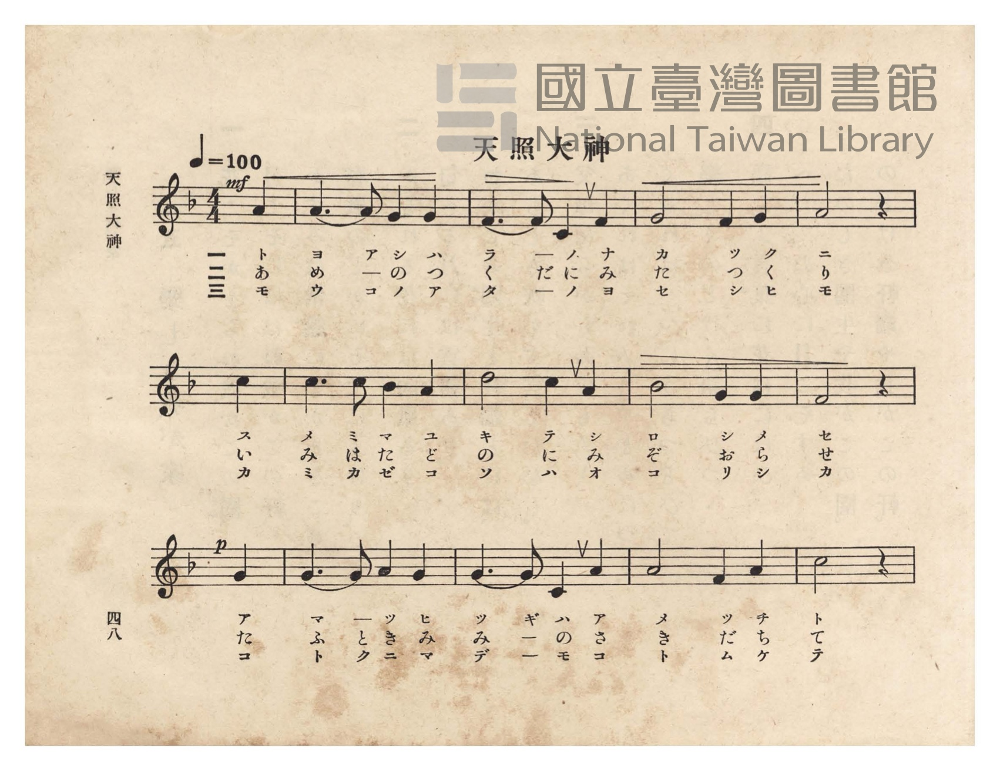
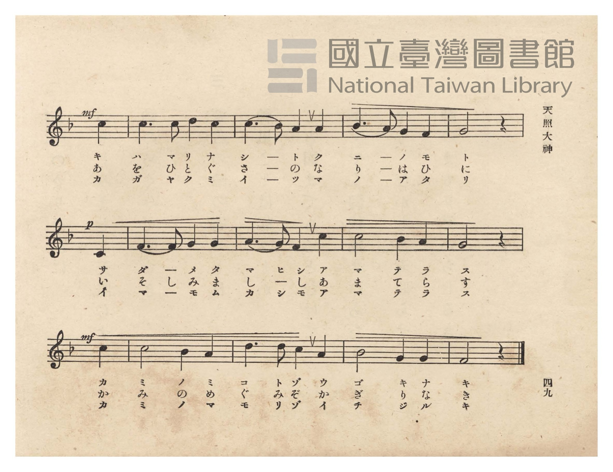
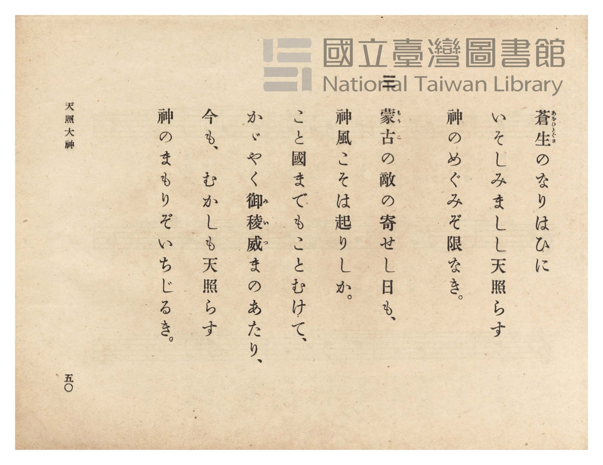
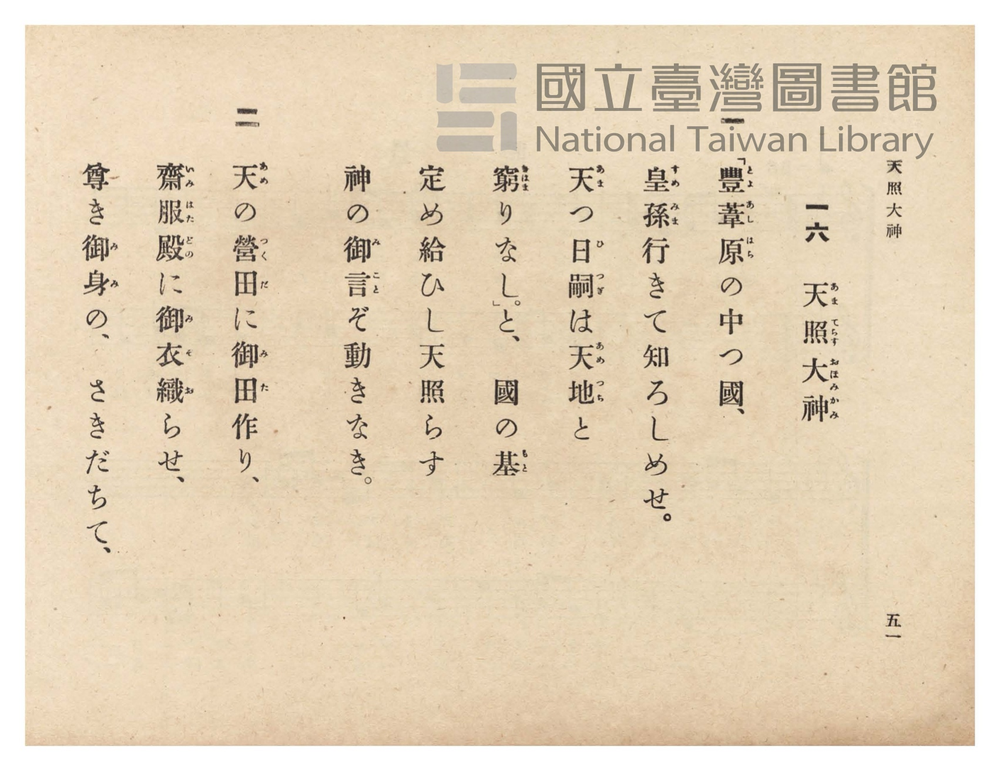

# 天照大神

> Re:Shōka 使用 AI 協助辨識與重建樂譜，可能會有錯誤。歡迎回報。

- **NEUTRINO 歌聲合成版**：<br><audio controls src="amaterasu_omikami_neutrino.mp3"></audio>
- **鋼琴伴奏版**：<br><audio controls src="amaterasu_omikami.mp3"></audio>


- 詞：文部省
- 曲：文部省
- 臺灣總督府《公學校唱歌》第六學年用（昭和十五年，索書號 523.37 4322-4）

## 說明

原書資訊與歌詞全文（對應 P052.jpg–P055.jpg，原書 pp. 48–51）：
調性與拍號：ヘ長調（F 大調，1 降記號）4/4 拍（弱起 1 拍），速度 ♩=100


## 歌詞

```text
一
「豐葦原（とよあしはら）の中つ國、
皇孫（すめみま）行きて知ろしめせ。
天（あま）つ日嗣（ひつぎ）は天地（あめつち）と
窮（きはま）りなし。」と、國の基（もと）
定め給ひし天照（あまて）らす
神の御言（みこと）ぞ動きなき。

二
天（あめ）の營田（つくだ）に御田（みた）作り、
齋服殿（いみはたどの）に御衣（みそ）織（お）らせ、
尊き御身（みみ）の、さきだちて、
蒼生（あをひとぐさ）のなりはひに
いそしみましし天照らす
神のめぐみぞ限なき。

三
蒙古（もうこ）の敵の寄せし日も、
神風こそは起りしか。
こと國までもことむけて、
かゞやく御稜威（みいつ）まのあたり、
今も、むかしも天照らす
神のまもりぞいちじるき。
```

## ABC

```abc
X:1
T:天照大神
C:曲：文部省
M:4/4
L:1/16
Q:1/4=100
K:F
V:V1 name="Piano" snm="Pia"
[V:V1]
!mf! z12 A4 | A6 A2 G4 G4 | F6 F2 C4 F4 | G8 F4 G4 |
w: 1.~ト | ヨ ア シ ハ | ラ _ ノ ナ | カ ツ ク
w: 2.~あ | め _ の つ | く だ に み | た つ く
w: 3.~モ | ウ コ ノ ア | タ _ ノ ヨ | セ シ ヒ
A8 z4 c4 | c6 c2 B4 A4 | d8 c4 A4 | B8 G4 G4 |
w: 1.~ニ ス | メ ミ マ ユ | キ テ シ | ロ シ メ
w: 2.~り い | み は た ど | の に み | そ お ら
w: 3.~モ カ | ミ カ ゼ コ | ソ ハ オ | コ リ シ
!p! F8 z4 G4 | G6 G2 A4 G4 | G6 G2 C4 A4 | A8 F4 A4 |
w: 1.~セ ア | マ _ ツ ヒ | ツ ギ ハ ア | メ ツ チ
w: 2.~せ た | ふ と き み | み _ の さ | き だ ち
w: 3.~カ コ | ト ク ニ マ | デ _ モ コ | ト ム ケ
!mf! c8 z4 c4 | c6 c2 d4 c4 | c6 B2 A4 A4 | B6 A2 G4 F4 |
w: 1.~ト キ | ハ マ リ ナ | シ _ ト ク | ニ _ ノ モ
w: 2.~て あ | を ひ と ぐ | さ _ の な | り _ は ひ
w: 3.~テ カ | ガ ヤ ク ミ | イ _ ツ マ | ノ _ ア タ
!p! G8 z4 C4 | F6 F2 G4 G4 | A6 G2 F4 c4 | c8 B4 A4 |
w: 1.~ト サ | ダ _ メ タ | マ ヒ シ ア | マ テ ラ
w: 2.~に い | そ し み ま | し _ し あ | ま て ら
w: 3.~リ イ | マ _ モ ム | カ シ モ ア | マ テ ラ
!mf! G8 z4 c4 | c8 B4 A4 | d6 d2 c4 A4 | B8 G4 G4 |
w: 1.~ス カ | ミ ノ ミ | コ ト ゾ ウ | ゴ キ ナ
w: 2.~す か | み の め | ぐ み ぞ か | ぎ り な
w: 3.~ス カ | ミ ノ マ | モ リ ゾ イ | チ ジ ル
F8 z4 z4 |
w: 1.~キ
w: 2.~き
w: 3.~キ
```

## TMD 檔案連結

- [主旋律 TMD 檔案](amaterasu_omikami.tmd) [[在 TMD Studio 編輯](https://tmdlang.github.io/Tmd-TS/#tmd=s7IKdvYPcrWy4qpTUCpJTLdSSM7PyUlNLsnMz7PKzk9PzM7Ojy_OyM9OVIKrKMvPKc1NtUovSkxJjTdDiBfnlxYlp1oVJ2fk5-fEl6RWlCTl52ejy8cXJKanWgUYmBohZAqK8stS8xLzgLoLijLzSlJTwNoRClLLMlNSQdLFyYl58WWpRZlpmakpSE5KLSoGuRhqRUlRYl5xclFmAcgbCFX5RSUZ-UBnF2RUWmVkFpfkF2UmJ-bEZyfmIfmuJCMV6Lmi1JzMdBTNEHGItkp04eTUotTc_LzMxBwlLi0thadLVj5vXf50yfLnS-cpaGlxKdoqGBoYcNnbKrhx2Zjom9iBtL9YOe_9nlnPprW_bF7xfE4j2MhnszdhiL1o3_W8cfHzHXufz138dNecxw1dT1vXPF2749mChU-nbHy2tudxQ_fzNWuetq4FCj7dueX5lBXv93Q8m7H26aSep72NT3ZNAQq-39PzfMuiZ7N3vJg5X8HUyFjP2FzBxNjISNfk_Z5OJS4ufS0FW2oBLgUFhad980GWbW5_saLrRUc70JVA7z5tXQH0GtBxTzf0PmvvVAAlAr2sgvRHDZOBTFMQE-hOiFaFggI9BRMLoJSpIdCJwFABGfti1f5nDctBBnb3An0CFH3cPOPl1O1AcaCxbsCAXw5m9hgqvJzZ-2LFDLCiTmCQKwB1gGzes_HF1u0KhhAu0Nielw3zn-5apvBo5kpbUByBbHmyowFEPW7oebFxwouJy4AuAmp93LjicROQbHrcOP1x4_rHTUDdnY8b1z3ZsfZx45Knc7ofNzSCtD2f1f507WqwhpmPmxofN-5_3LgPqPTFwp7Hjb2PG5c9n7_0cROQMR0sO_txQxM4xJasBOsBGg9SDTTy2fSlT6cvBgtuAnIfN_aBxdcDVT6dswGqGGQEUGohWGoF2P5V68ByQBvWQ81q6nrcuApkYUPT4wag-AqgU0EOblz3dP4ukOImoK3AVNMJdsi6WUBTn29dBrZ2OiQtw50GdD_YRKBtM8G2LZ0HMmbfwhcrGsCKgL6dDDHsceO8p91TwQ4BWt4L8ic4dHf1oPq3qRESkM_b5z-fAvEX0Ef9jxsXgMVXAw2HiQMNB8Xnk71zQH6ChPfLvd3P5vQ-WwdKAY8bW8CKgB6f_7hxJdBQuBEvFkKCEig7Fyj4fOcUMLcL5htgPICNe7oBGFi9IA27IJEI1AA0GuRAoIrHjRAPLQAGOTAooHpeTNrzfAokjQC9MwkccCseN04AqobqBIYAKBKA7gJKrQanLpBT54LTEiiBgBnQwEYPXXAkAw0Dqpv3ciaQgRKcO8Cx9mLSzKf9S2Bx2QaMBIjNz6ZuBcXPeqBls4EWANMUSAE0pS6d93IR0J3A-AI6ZD0wY4AdCXQIMC2DEyUkLsFJBehCoMOAZoNEHjc1PG6ciAgAkI6meY-bgLb0g6JrxZynK4CxCgk9oCDQYUDHAI0AhgTQiPmI2HuyuwviILCRQHuAuaIJRzAADQAqBTkRyAWaCoyBGY-bgHrAgQFUR3nZBQUKWvpcXI65iSWpRYnFpf65mdmJuZlWAZmJefkONQY11SDLFGwstOzADGyFpwKwSAaWI8BMr6CBXOgoaCsYA9NY__P1DWAmUEgHXhBqYjEH6BKQHTUKBgq6cFidm1YL1KwLFAaRukDSCEiCcA3QHpCIoYJpPJgCCYEkIIJQRWAzfQxrFEBqYPBxcwdY9ePmFRB-0yIg3g6W6YfKrISr7QOTXRDxptVw8RawzvUIW4zQbGlsgupphIusA5NLIOKNILtA_AVADDIXmIqgMvPhOkBqISqhthij-2UR1JZlUL9shrkZ6CuIDMhUZL-AfA0S3w0Th_p9EtgW_FG9qwcc1UTFJCTKdMExagq2E0SC2CZAEhKtZlA1IBmICEgOBOERDY_Dx83dUDlQCDxu2gnxR_NCqO_mA_E8MAsUFiAfroX7vA3uT5AOuDjU5yATELEIzHrI9jSCYhoUK5BwBJYg0BgClrxQGVC8QuRQ43EuXBxkIjCjI-wBxiMk7hD-AekFiUJiH8R_3LQHzNoM9c9euH9AKeJx0yqoOEgeIg4SgfqTQEzuANXURMYkJKtBYrK6oBaaASG5zQgcb6gi4CyJnG8hWRIsgohOeAKEeB-aXMFRiJTFIMkSygOpWwf3PkwHJAEgdIAyHFJ0Ns5GtgccdSDRrRA9jSuAuBfMgkUbPMNAM-xUqDhIFSzLgkikZAOKTnjhAPEPNNLAhQ2kqIAkYIgPQTLtcHeDfIKuAyQOtqdpI9gevNH5dPZsWHQaE4xOSDaERieoiEXNnaA8iSxiAo445NwJKYbBZS5S7oQ5G-J9UB4DiUJLOaCnoakTXpaCUilEDqQTWpYi5XJYeQWOZqTohJR0sOiElbKgZALibwJHKYg1ASIDjj7k6ITlGlguB-VoiE7U3AkqMzByZ9MaqNuWQF0Mya8gGVBZjZwMYdEM8gUkCUCiGZzMCJWzU4iPTlitB8ud4NyHqB8RNSYkLxqBZZAjGBTFGLkTLTpBuQUk2gD3JCj1Qz0Dz7Wg3AotVLHkZ3AhDK5akaMTJdfAC1tI0QlsJ0HzI7BVBJWZDjMPzIInALA8RByUQDALW1C0I_wDrYSRXAeOHHCOQ-RlkF9guRO_f_Dnzta1ZEYneu5Eiipo3WmGr-5EKblBGLn4BdWfGOkbWvsgch8sdUPqGFCyeNwECmpIiwMkswWmA5znEfkbxIOZD06SSJE-E9nuRlCOx1LwgltOIHFQToYU0MA2MYoORN4C17CwvA0vqtHsBhfTxPkblnshdTQo-cD8DUs68HZd0w6wClgJgenvWi4uXTsF9Ia2AlBMmQsA)]
- [鋼琴伴奏 TMD 檔案](amaterasu_omikami_piano.tmd) [[在 TMD Studio 編輯](https://tmdlang.github.io/Tmd-TS/#tmd=s7IKdvYPcrWy4tLSUni6ZOXz1uVPlyx_vnTe-z0dL7v3PJ-w5cmeLU-X9j_v7Hi_p1NBS4tL0VbB0MCAy95WwY3LxkTfxI6rTkHpxUqghlnPprW_bF7xfE6jEkjs2exNGGIv2nc9b1z8fMfe53MXP90153FD19PWNU_X7ni2YOHTKRufre153ND9fM2ap61rgYJPd255PmUF0CHPZqx9OqnnaW_jk11TgILv9_Q837Lo2ewdL2bOVzA1MtYzNlcwMTYy0jUBOlGJi8szr6Qo3yogMzEvP8jDocagpppLAQhsLLTswIwaherctFoFUwVdMDQBYmMgrlEwA_PNwDIQEZAcCBpBcY2CIVTEAIpruGpRbPRBttEE1UbDeIVow1gFEwgFNB3IMImFCcP5pvFA2jQeJAKVMgBCsEWOuYklqUWJxaX-uZnZibmZeH0Jch4Mgu2H-AlEgvyH7idDoMVgCiQEkoAIQhWBzfQxrFEAqYHBx80dYNWPm1dA-E2LgHg7WKYfKrMSrrYPTHZBxJtWw8VbwDrXI2wxQrOlsQmqpxEusg5MLoGIN4LsAvEXADHI3MeN-6Ey8-E6QGohKqG2GKP7ZRHUlmVQv2yGuRnoK4gMyFRkv4B8DRLfDROH-n0S2BZoNEDCG5JaQCmrBpryTDFSHkQeR8qDR8Dj5m6oHMj5j5t2QhzRvBDqtPlAPA_MAnkE5Ly1cGe3wR0J0gEXhzobZAIiCh43gaIKbk8jKJpAQQoJhMeN66HB-7gRFMUgGVCkQORQI2EuXBxk4uOmToQ9wEiABDzCPyC9IFFI1IH4j5v2gFmbof7ZC_cPKDofN62CioPkIeIgEag_YdGAnHGrC2qhSR-Szo3AgY4qAs4MyDkGkhnAIoi4gEc9xO3QhAIOf6TEDUkQUB5I3Tq422E6ILGH0AFK6khx0Tgb2R5wuINEt0L0NK4A4l4wCxbm8KQKzSpToeIgVbDMAiKR4hwUF_BsCfEPNMTB2RySSSGpD-JDkEw73N0gn6DrAImD7WnaCLYHGhewohccF7CyGJEvQLkBWcQEHOrI-QJSeoGLKqR8AbMT4nZQ6gaJQgsHoIuh6QJeBIHSB0QOpBNaBCHlL1g2B8cRUlxACghYXMAKJ1Acg_ibwPEBYk2AyIDDHjkuYOkVlr9AeQmiEzVfgHIrRr5oWgN12xKoiyE5BSQDKuKQ0xAsjkC-gMQfJI7AaQQWF7CSHpYvwOkeUScgaglILjACyyDHDlINijMuQOkUJNoAdyEo3UFdAs8voHwCLYuw5CRw2QWuTpDjAiW9wssoSInzuHE6NCc8btwHlZkOMw_MgsceWB4iDopdzDIKFGcI_0ArHiTXgUMWnNYRuQjkF1i-wO8fbHGBni8ob6kgSi1QnYGRsqAlLiLdw9IVpFwFxenjJlA4QapIkMwWmA5wbkPkLBAPZj44PSHF2ExkuxtBeQ1LeQWu6kHioDwEKdceN4JrNbgORKoG1yqwXAUv4dDsBpduxPkblm8g9RIo7mH-hsU7vCHStAOsApY3Mf2Ns9GGo6EIauqBm3soTUbMJiFIBMgEJg6YFJAHYkO8i9p0JL3lic0QSOmAZhtCBO4iqCaY4bAyH6YO03dwZ0ENRXYWQgiXQUBXYQ0lFJMQNuExiTptdF07BXB_QAHIQI_6aB-gSqziRjjEjcHiylwA)]

## 分析

```text
================================================================================
📊 TMD Song Profile: [ 天照大神 ]
================================================================================
⏱  Duration:       1:00 (60.0s), 25 measures total
🎼 Key & Tempo:    首調基準 F, != 100.0 BPM, <4/4>
   - 分析範圍：      由實際發聲的音符與和弦推測調性；播放脈絡另行呈現
🎤 人聲音域:    C4 (MIDI 60) – D5 (MIDI 74) [跨度: 14 個半音 / 1.2 個八度, 難度: moderate]
   - 最低音:  C4 in [AmaterasuOmikami #1 @ m.3, 0:06]
   - 最高音: D5 in [AmaterasuOmikami #1 @ m.7, 0:14]
   - 適合: soprano, mezzo-soprano, contralto, tenor, baritone, bass
🏛  結構:      AmaterasuOmikami (60.0s)
⚡ 編曲密度:        Peak 1 軌道同時演奏
🗝  調性診斷：       C 調性不明確（流行色彩大調，未偵測到可信轉調）
   - 風格氣質:    流行大調（略帶和弦色彩音與裝飾副屬和弦）
   - 轉調歷程:    全曲維持單一推測調性（未偵測到可信轉調）
   - 核心骨幹音:  G, C, A, F, A#
   - 調性數值:    C 調性不明確 [相關度: 0.75, 穩定度: Ambiguous, 自然音純度: 90.0%]
   - 候選調性 (K-S): C 大調 (0.75), F 大調 (0.73), A 小調 (0.58)
   - 五度圈歷程:   +0
   - 各段落調性細節:
     • [AmaterasuOmikami #1]: C 調性不明確 (r: 0.75, 自然音純度: 90.0%, 調外音: A#)

  [ 五度圈游移軌跡 ]
              [C ]*
         F            G  
      Bb               D  
      Eb               A  
         Ab           E  
            Db       B  
               F# 
     (* = active key center)

  [ 十二半音累積音高分佈 ]
     C  : ███████████████████████   23.9%
     C# :                            0.0%
     D  : █████                      5.6%
     D# :                            0.0%
     E  :                            0.0%
     F  : ██████████████            14.4%
     F# :                            0.0%
     G  : ████████████████████████  25.0%
     G# :                            0.0%
     A  : ████████████████████      21.1%
     A# : ██████████                10.0%
     B  :                            0.0%
--------------------------------------------------------------------------------
Assignment 軌道音域：
  - Piano         : C4 – D5 (14 個半音 / 1.2 個八度, 77 個音符)
================================================================================
```


## 原書掃描頁










