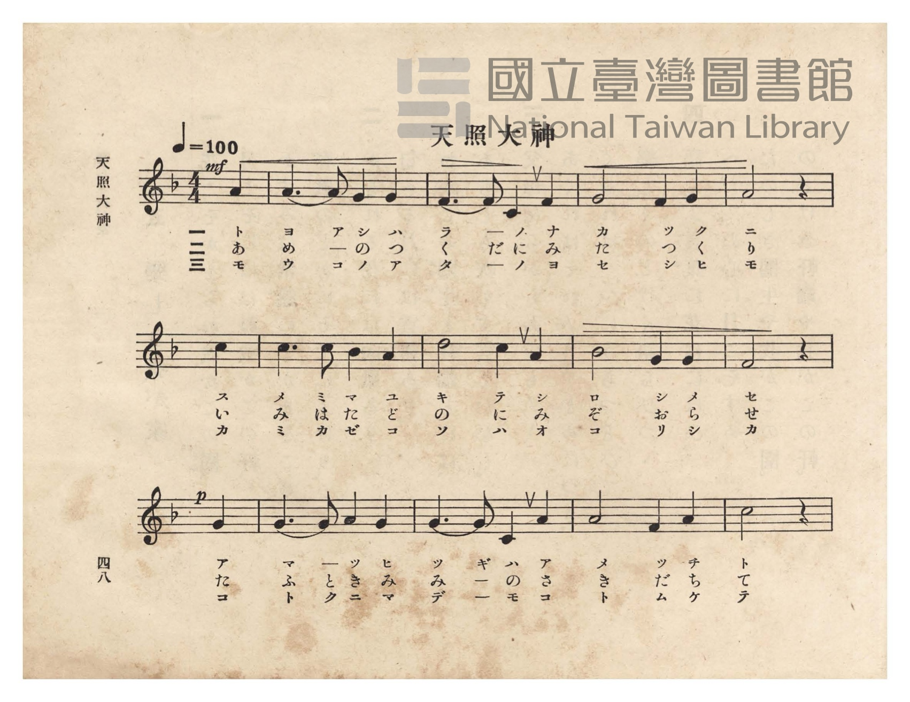
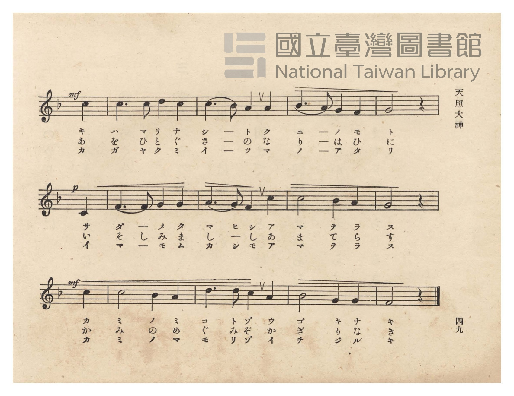
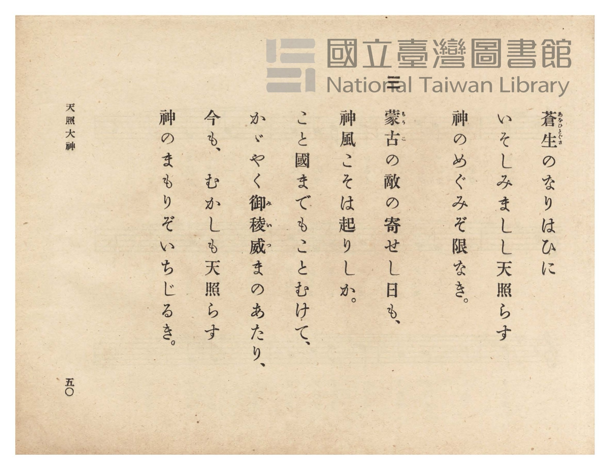
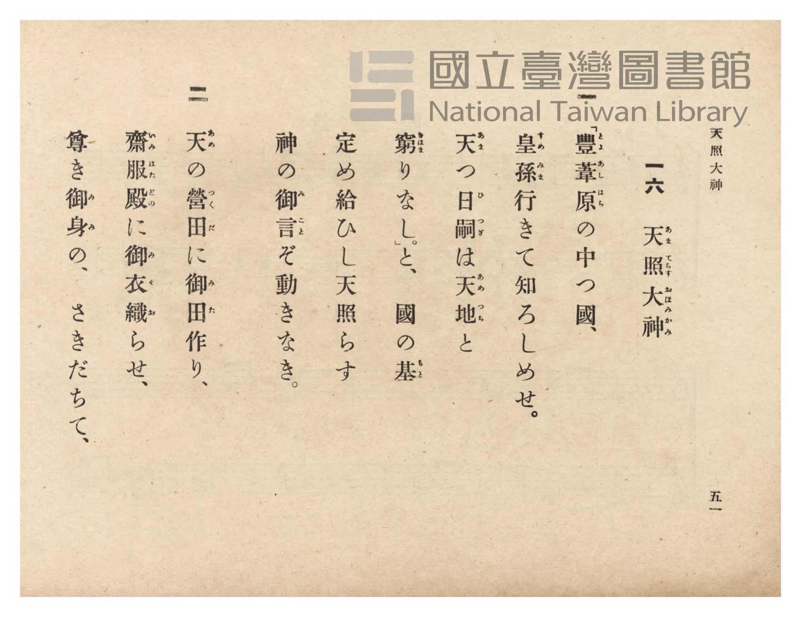

# 天照大神

> Re:Shōka 使用 AI 協助辨識與重建樂譜，可能會有錯誤。歡迎回報。

- **鋼琴伴奏版**：<br><audio controls src="amaterasu_omikami.mp3"></audio>
- **NEUTRINO 歌聲合成版**：<br><audio controls src="amaterasu_omikami_neutrino.mp3"></audio>

- 詞：文部省
- 曲：文部省
- 臺灣總督府《公學校唱歌》第六學年用（昭和十五年，索書號 523.37 4322-4）

## 說明

原書資訊與歌詞全文（對應 P052.jpg–P055.jpg，原書 pp. 48–51）：
調性與拍號：ヘ長調（F 大調，1 降記號）4/4 拍（弱起 1 拍），速度 ♩=100


## 歌詞

```text
一
「豐葦原（とよあしはら）の中つ國、
皇孫（すめみま）行きて知ろしめせ。
天（あま）つ日嗣（ひつぎ）は天地（あめつち）と
窮（きはま）りなし。」と、國の基（もと）
定め給ひし天照（あまて）らす
神の御言（みこと）ぞ動きなき。

二
天（あめ）の營田（つくだ）に御田（みた）作り、
齋服殿（いみはたどの）に御衣（みそ）織（お）らせ、
尊き御身（みみ）の、さきだちて、
蒼生（あをひとぐさ）のなりはひに
いそしみましし天照らす
神のめぐみぞ限なき。

三
蒙古（もうこ）の敵の寄せし日も、
神風こそは起りしか。
こと國までもことむけて、
かゞやく御稜威（みいつ）まのあたり、
今も、むかしも天照らす
神のまもりぞいちじるき。
```

## ABC

<div class="abc-score" data-abc-src="amaterasu_omikami.abc" aria-label="五線譜載入中"></div>

[下載 ABC 原始檔](amaterasu_omikami.abc)

## TMD 檔案連結

- [主旋律 TMD 檔案](amaterasu_omikami.tmd) [[在 TMD Studio 編輯](https://tmdlang.github.io/Tmd-TS/#tmd=s7IKdvYPcrWy4qpTUCpJTLdSSM7PyUlNLsnMz7PKzk9PzM7Ojy_OyM9OVIKrKMvPKc1NtUovSkxJjTdDiBfnlxYlp1oVJ2fk5-fEl6RWlCTl52ejy8cXJKanWgUYmBohZAqK8stS8xLzgLoLijLzSlJTwNoRClLLMlNSQdLFyYl58WWpRZlpmakpSE5KLSoGuRhqRUlRYl5xclFmAcgbCFX5RSUZ-UBnF2RUWmVkFpfkF2UmJ-bEZyfmIfmuJCMV6Lmi1JzMdBTNEHGItkp04eTUotTc_LzMxBxk24Am5FkBhZNKgSGoxKWlpfB0ycrnrcufLln-fOk8BS0tLkVbBUMDAy57WwU3LhsTfRM7kO4XK-e93zPr2bT2l80rns9pBJv4bPYmDLEX7bueNy5-vmPv87mLn-6a87ih62nrmqdrdzxbsPDplI3P1vY8buh-vmbN09a1QMGnO7c8n7Li_Z6OZzPWPp3U87S38cmuKUDB93t6nm9Z9Gz2jhcz5yuYGhnrGZsrmBgbGemavN_TqcTFpa-lYEstwKWgoPC0bz7Iss3tL1Z0vehoB7oS6N2nrSuAXgM67umG3mftnQqg1KGXVZD-qGEykGkKYgLdCdGqUFCgp2BiAZQyNQQ6ERgqIGNfrNr_rGE5yMDuXqBPgKKPm2e8nLodKA401g0Y8MvBzB5DhZcze1-smAFW1AkMcgWgDpDNeza-2LpdwRDCBRrb87Jh_tNdyxQezVxpC4ojkC1PdjSAqMcNPS82TngxcRnQRUCtjxtXPG4Ckk2PG6c_blz_uAmou_Nx47onO9Y-blzydE7344ZGkLbns9qfrl0N1jDzcVPj48b9jxv3AZW-WNjzuLH3ceOy5_OXPm4CMqaDZWc_bmgCh9iSlWA9QONBqoFGPpu-9On0xWDBTUDu48Y-sPh6oMqnczZAFYOMAEotBEutANu_ah1YDmjDeqhZTV2PG1eBLGxoetwAFF8BdCrIwY3rns7fBVLcBLQVmGo6wQ5ZNwto6vOty8DWToekZbjTgO4Hmwi0bSbYtqXzQMbsW_hiRQNYEdC3kyGGPW6c97R7KtghQMt7Qf4Eh-6uHlT_NjVCAvJ5-_znUyD-Avqo_3HjArD4aqDhMHGg4aD4fLJ3DshPkPB-ubf72ZzeZ-tAKeBxYwtYEdDj8x83rgQaCjfixUJIUAJl5wIFn--cAuZ2wXwDjAewcU83AAOrF6RhFyQSgRqARoMcCFTxuBHioQXAIAcGBVTPi0l7nk-BpBGgdyaBA27F48YJQNVQncAQAEUC0F1AqdXg1AVy6lxwWgIlEDADGtjooQuOZKBhQHXzXs4EMlCCcwc41l5Mmvm0fwksLtuAkQCx-dnUraD4WQ-0bDbQAmCaAimAptSl814uAroTGF9Ah6wHZgywI4EOAaZlcKKExCU4qQBdCHQY0GyQyOOmhseNExEBANLRNO9xE9CWflB0rZjzdAUwViGhBxQEOgzoGKARwJAAGjEfEXtPdndBHAQ2EmgPMFc04QgGoAFApSAnArlAU4ExMONxE1APODCA6igvu6BAQUufi8sxN7EktSixuNQ_NzM7MTfTKiAzMS_foUbXsKYaZJuCjYWWHZiBrfRUAJbJwIIEmOsVNJBLHQVtBWNgIut_vr4BzAQK6cBLQk0s5gCdArKjRsFAQRcOq3PTaoGadYHCIFIXSBoBSRCuAdoDEjFUMI0HUyAhkAREEKoIbKaPYY0CSA0MPm7uAKt-3LwCwm9aBMTbwTL9UJmVcLV9YLILIt60Gi7eAta5HmGLEZotjU1QPY1wkXVgcglEvBFkF4i_AIhB5gKTEVRmPlwHSC1EJdQWY3S_LILasgzql80wNwN9BZEBmYrsF5CvQeK7YeJQv08C24I_qnf1gKOaqJiERJkuOEZNwXaCSBDbBEhCotUMqgYkAxEByYEgPKLhcfi4uRsqBwqBx007If5oXgj13XwgngdmgcIC5MO1cJ-3wf0J0gEXh_ocZAIiFoF5D9meRlBMg2IFEo7AIgQaQ8CiFyoDileIHGo8zoWLg0wE5nSEPcB4hMQdwj8gvSBRSOyD-I-b9oBZm6H-2Qv3DyhFPG5aBRUHyUPEQSJQfxKIyR2gqprImIRkNUhMVhfUQjMgJLcZgeMNVQScJZHzLSRLgkUQ0QlPgBDvQ5MrOAqRshgkWUJ5IHXr4N6H6YAkAIQOUIZDis7G2cj2gKMOJLoVoqdxBRD3glmwaINnGGiGnQoVB6mCZVkQiZRsQNEJLxwg_oFGGriwgRQVkAQM8SFIph3ubpBP0HWAxMH2NG0E24M3Op_Ong2LTmOC0QnJhtDoBBWxqLkTlCeRRUzAEYecOyHFMLjMRcqdMGdDvA_KYyBRaCkH9DQ0dcLLUlAqhciBdELLUqRcDiuvwNGMFJ2Qkg4WnbBSFpRMQPxN4CgFsSZAZMDRhxydsFwDy-WgHA3RiZo7QWUGRu5sWgN12xKoiyH5FSQDKquRkyEsmkG-gCQBSDSDkxmhcnYK8dEJq_VguROc-xD1I6LGhORFI7AMcgSDohgjd6JFJyi3gEQb4J4EpX6oZ-C5FpRboYUqlvwMLoTBVStydKLkGnhhCyk6gQ0laH4ENougMtNh5oFZ8AQAloeIgxIIZmELinaEf6CVMJLrwJEDznGIvAzyCyx34vcP_tzZupbM6ETPnUhRBa07zfDVnSglNwgjF7-g-hMjfUNrH0Tug6VuSB0DShaPm0BBDWlxgGS2wHSA8zwif4N4MPPBSRIp0mci290IyvFYCl5wywkkDsrJkAIa2ChG0YHIW-AaFpa34UU1mt3gYpo4f8NyL6SOBiUfmL9hSQfermvaAVYBKyEw_V3LxaVrp4De0lYAiilzAQA)]
- [鋼琴伴奏 TMD 檔案](amaterasu_omikami_piano.tmd) [[在 TMD Studio 編輯](https://tmdlang.github.io/Tmd-TS/#tmd=s7IKdvYPcrWy4qpTUCpJTLdSSM7PyUlNLsnMz7PKzk9PzM7Ojy_OyM9OVIKrKMvPKc1NtTJDiBTnlxYlp-JSD5GNL0hMT7UKMDA10gUSpgjpgqL8stS8xDygASWJmeWJefHpQIGivPyi-PTUvNSixByE2tSyzJRUkMqCoszcxKLK-JT8ZKBb8kqQXJdaVAxyfEFmYl5-fGJRUWJeeiqqkvyikoz89KLEgoxKq4zM4pL8oszkxJz47MQ8JFeXZAB1WaWmlCYnggJDiUtLS-HpkpXPW5c_XbL8-dJ57_d0vOze83zClid7tjxd2v-8s-P9nk4FLS0uRVsFQwMDLntbBTcuGxN9EzuQkS9WAjXMejat_WXziudzGsHWPJu9CUPsRfuu542Ln-_Y-3zu4qe75jxu6Hrauubp2h3PFix8OmXjs7U9jxu6n69Z87R1LVDw6c4tz6esADrk2Yy1Tyf1PO1tfLJrClDw_Z6e51sWPZu948XM-QqmRsZ6xuYKJsZGRromQCcqcXF55pUU5VsFgAIoyMOhxqCmmksBCGwstOzAjBqF6ty0WgVTBV0wNAFiYyCuUTAD883AMhARkBwIGkFxjYIhVMQAimu4alFs9EG20QTVRsN4hWjDWAUTCAU0HcgwiYUJw_mm8UDaNB4kApUyAEKwRY65iSXAJFNc6p-bmZ2Ym4nwpa4hpjdB7oNBsAMgngKRIA-ie8oQaDOYAgmBJCCCUEVgM30MaxRAamDwcXMHWPXj5hUQftMiIN4OlumHyqyEq-0Dk10Q8abVcPEWsM71CFuM0GxpbILqaYSLrAOTSyDijSC7QPwFQAwy93HjfqjMfLgOkFqISqgtxuh-WQS1ZRnUL5thbgb6CiIDMhXZLyBfg8R3w8Shfp8EtgUaDZDwhiQXUNKqgSY9U4ykB5HHkfTgEfC4uRsqB3L-46adEEc0L4Q6bT4QzwOzQB4BOW8t3NltcEeCdMDFoc4GmYCIgsdNoKiC29MIiiZQkEIC4XHjemjwPm4ERTFIBhQpEDnUSJgLFweZ-LipE2EPMBIgAY_wD0gvSBQSdSD-46Y9YNZmqH_2wv0Dis7HTaug4iB5iDhIBOpPWDQg59zqglpo0oekcyNwoKOKgDMDco6BZAawCCIu4FEPcTs0oYDDHylxQxIElAdStw7udpgOSOwhdICSOlJcNM5Gtgcc7iDRrRA9jSuAuBfMgoU5PKlCs8pUqDhIFSyzgEikOAfFBTxbQvwDDXFwNodkUkjqg_gQJNMOdzfIJ-g6QOJge5o2gu2BxgWs7AXHBawwRuQLUG5AFjEBhzpyvoCUXuCiCilfwOyEuB2UukGi0MIB6GJouoAXQaD0AZED6YQWQUj5C5bNwXGEFBeQAgIWF7DCCRTHIP4mcHyAWBMgMuCwR44LWHqF5S9QXoLoRM0XoNyKkS-a1kDdtgTqYkhOAcmAijjkNASLI5AvIPEHiSNwGoHFBaykh-ULcLpH1AmIWgKSC4zAMsixg1SF4owLUDoFiTbAXQhKd1CXwPMLKJ9AyyIsOQlcdoGrE-S4QEmv8DIKUuI8bpwOzQmPG_dBZabDzAOz4LEHloeIg2IXs4wCxRnCP9CKB8l14JAFp3VELgL5BZYv8PsHW1yg5wvKmyqIUgtUZ2CkLGiJi0j3sHQFKVdBcfq4CRROkCoSJLMFpgOc2xA5C8SDmQ9OT0gxNhPZ7kZQXsNSXoGrepA4KA9ByrXHjeBaDa4DkarBtQosV8FLODS7waUbcf6G5RtIvQSKe5i_YfEOb4g07QCrgOVNTH_jbLWBWoqIVhuiqQhq7IEbfCiNRsxGIUgEyASmDpgUkAdiQ_yL2ngkve2JzRBI8YBmG0IE7iKoJpjhsEIfpg7Td3BnQQ1FdhZCCJdBQFdhDSUUkxA24TGJOq10XTsFcI9AAchAj_toH6BKrOJGOMSNweLKXAA)]

## 分析

```text
================================================================================
📊 TMD Song Profile: [ 天照大神 ]
================================================================================
⏱  Duration:       0:57 (57.6s), 24 measures total
🎼 Key & Tempo:    首調基準 F, != 100.0 BPM, <4/4>
   - 分析範圍：      由實際發聲的音符與和弦推測調性；播放脈絡另行呈現
🎤 人聲音域:    C4 (MIDI 60) – D5 (MIDI 74) [跨度: 14 個半音 / 1.2 個八度, 難度: moderate]
   - 最低音:  C4 in [AmaterasuOmikami #1 @ m.3, 0:06]
   - 最高音: D5 in [AmaterasuOmikami #1 @ m.7, 0:14]
   - 適合: soprano, mezzo-soprano, contralto, tenor, baritone, bass
🏛  結構:      AmaterasuOmikami (57.6s)
⚡ 編曲密度:        Peak 1 軌道同時演奏
🗝  調性診斷：       C 調性不明確（流行色彩大調，未偵測到可信轉調）
   - 風格氣質:    流行大調（略帶和弦色彩音與裝飾副屬和弦）
   - 轉調歷程:    全曲維持單一推測調性（未偵測到可信轉調）
   - 核心骨幹音:  G, C, A, F, A#
   - 調性數值:    C 調性不明確 [相關度: 0.75, 穩定度: Ambiguous, 自然音純度: 90.0%]
   - 候選調性 (K-S): C 大調 (0.75), F 大調 (0.73), A 小調 (0.58)
   - 五度圈歷程:   +0
   - 各段落調性細節:
     • [AmaterasuOmikami #1]: C 大調 (r: 0.75, 自然音純度: 89.8%, 調外音: A#)

  [ 五度圈游移軌跡 ]
              [C ]*
         F            G  
      Bb               D  
      Eb               A  
         Ab           E  
            Db       B  
               F# 
     (* = active key center)

  [ 十二半音累積音高分佈 ]
     C  : ███████████████████████   23.9%
     C# :                            0.0%
     D  : █████                      5.6%
     D# :                            0.0%
     E  :                            0.0%
     F  : ██████████████            14.4%
     F# :                            0.0%
     G  : ████████████████████████  25.0%
     G# :                            0.0%
     A  : ████████████████████      21.1%
     A# : ██████████                10.0%
     B  :                            0.0%
--------------------------------------------------------------------------------
Assignment 軌道音域：
  - Piano         : C4 – D5 (14 個半音 / 1.2 個八度, 77 個音符)
================================================================================
```


## 原書掃描頁










