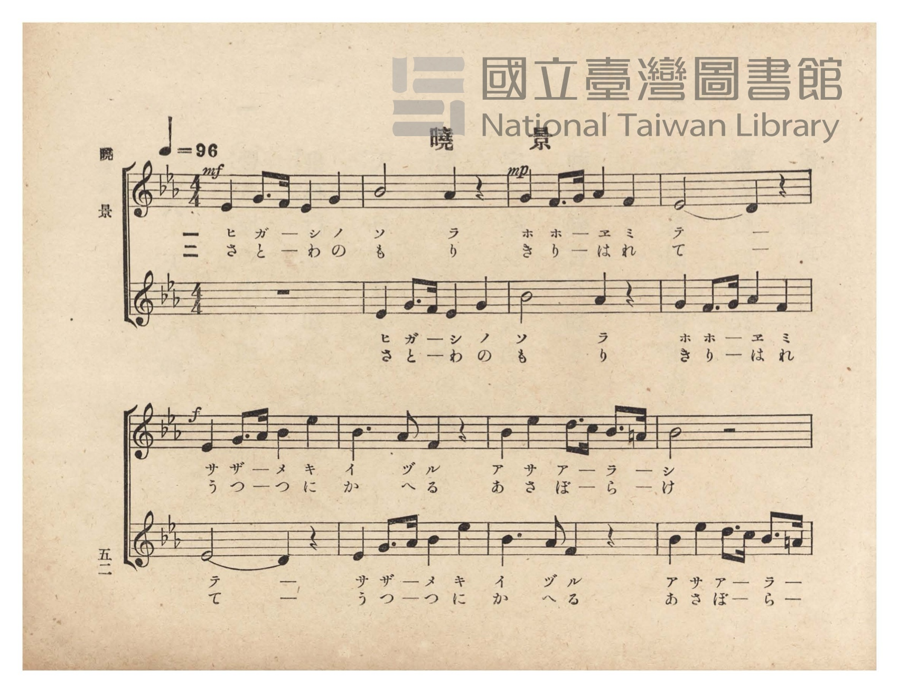
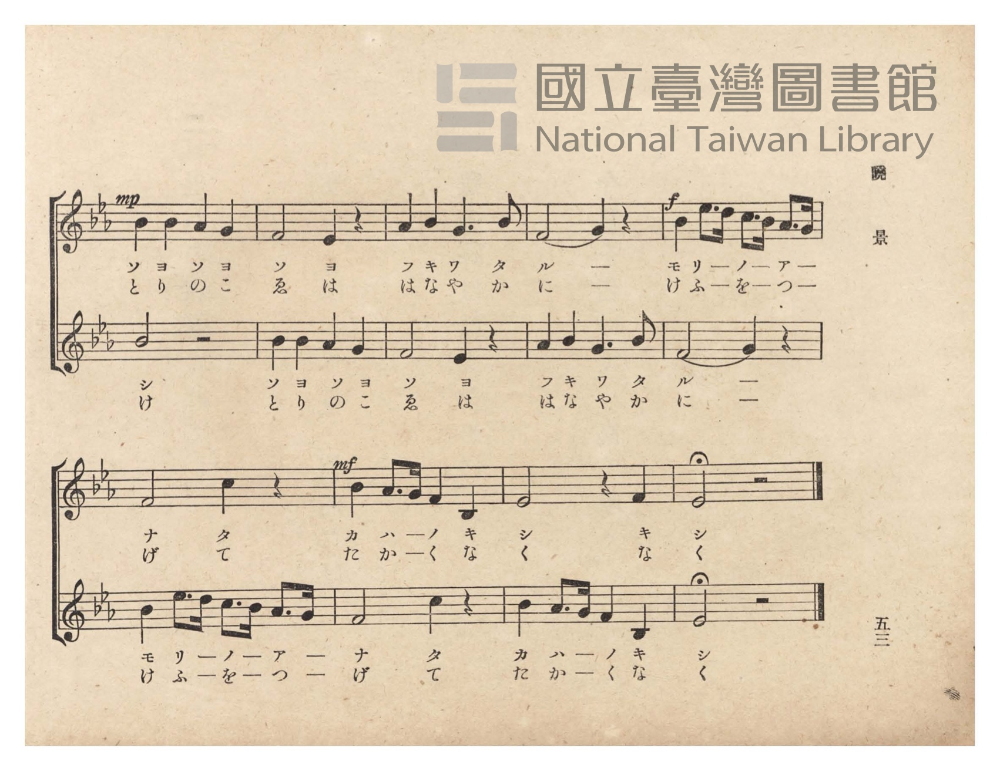
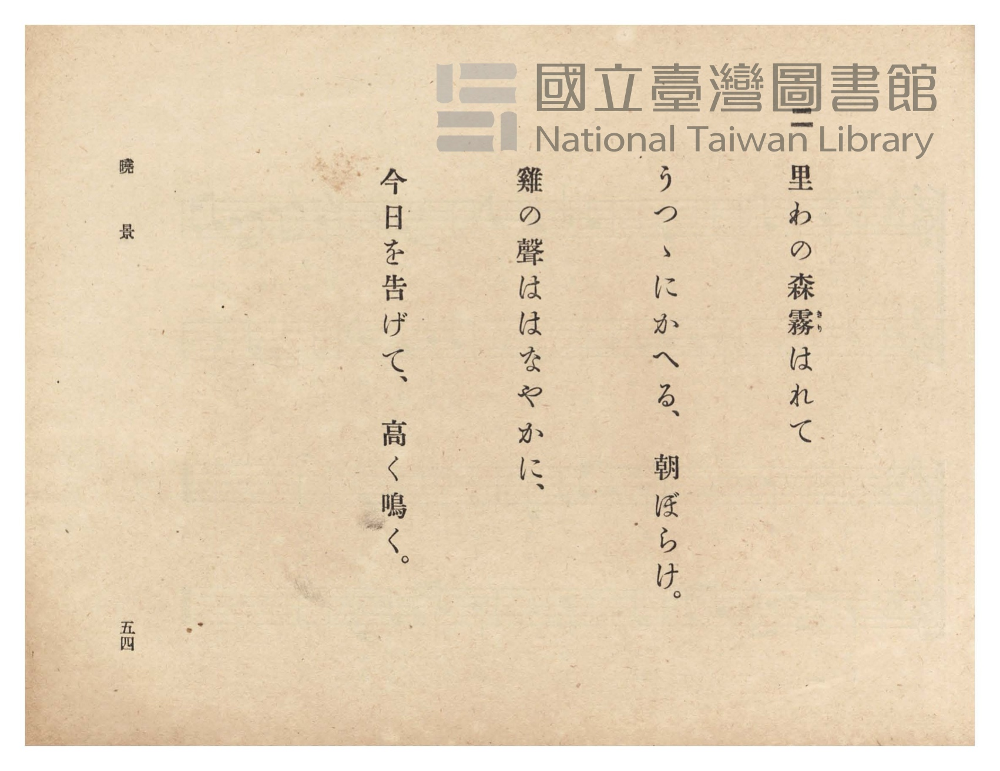
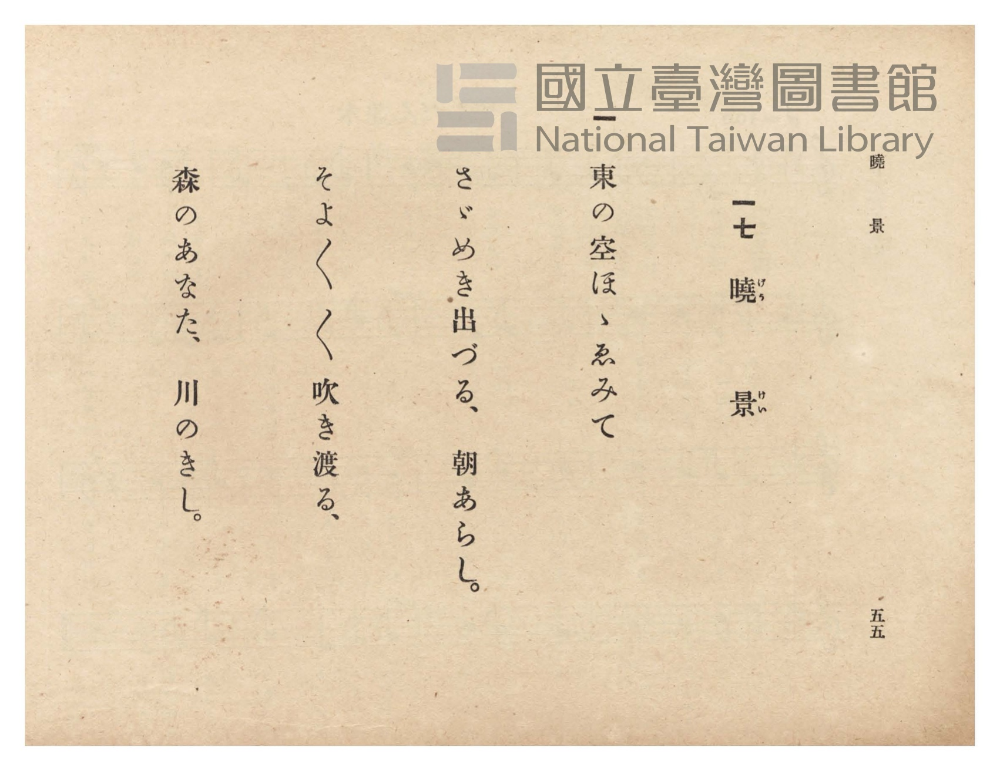

# 曉景

> Re:Shōka 使用 AI 協助辨識與重建樂譜，可能會有錯誤。歡迎回報。

- **NEUTRINO 歌聲合成版**：<br><audio controls src="gyokei_neutrino.mp3"></audio>
- **鋼琴伴奏版**：<br><audio controls src="gyokei.mp3"></audio>


- 臺灣總督府《公學校唱歌》第六學年用（昭和十五年，索書號 523.37 4322-4）

## 說明

原書資訊與歌詞全文（對應 P056.jpg–P059.jpg，原書 pp. 52–55）：
調性與拍號：變ホ長調（Eb 大調，3 降記號）4/4 拍，速度 ♩=96（二部輪唱）


## 跨冊／重複收錄參照

> 同曲（二部輪唱曲〈曉景〉；收錄於《公學校唱歌》六年級、《新定兒童唱歌》六年級與《唱歌帖》P090）

- **[同曲]** 《新定兒童唱歌》尋常科第六學年用（2020.006.0847.0006）：[**〈曉景〉**](../../../shintei_jido_shoka/grade_6_2020.006.0847.0006/4_08_gyokei/index.md)（`E,` / `4/4` — [原始 TMD](../../../shintei_jido_shoka/grade_6_2020.006.0847.0006/4_08_gyokei/gyokei.tmd)）
- **[同曲]** 楊金土手抄《唱歌帖》第 2 冊・II（2020.006.0843）：[**〈曉景（二部輪唱）〉**](../../../shokacho/vol_02/p090_gyokei/index.md)（`E,` / `4/4` — [原始 TMD](../../../shokacho/vol_02/p090_gyokei/gyokei.tmd)）
- 總表：[跨冊重複與同名歌曲總索引](../../../duplicate_songs.md)

## 歌詞

```text
一
東の空ほゝゑみて
さゞめき出づる、朝あらし。
そよ〳〵〳〵吹き渡る、
森のあなた、川のきし。

二
里わの森霧はれて
うつゝにかへる、朝ぼらけ。
雞の聲ははなやかに、
今日を告げて、高く鳴く。
```

## ABC

```abc
X:1
T:曉景
M:4/4
L:1/16
Q:1/4=96
K:Eb
V:V1 name="Piano1" snm="Pia"
V:V2 name="Piano2" snm="Pia"
[V:V1]
!mf! E4 G3 F E4 G4 | B8 A4 z4 | !mp! G4 F3 G A4 F4 | E8 D4 z4 |
w: 1.~ヒ ガ ー シ ノ | ソ ラ | ホ ホ ー ヱ ミ | テ ー
w: 2.~さ と ー わ の | も り | き り ー は れ | て ー
!f! E4 G3 A B4 e4 | B6 A2 F4 z4 | B4 e4 d3 c B3 =A | B8 z4 z4 |
w: 1.~サ ザ ー メ キ | イ ヅ ル | ア サ ア ー ラ ー | シ
w: 2.~う つ ー つ に | か へ る | あ さ ぼ ー ら ー | け
!mp! B4 B4 A4 G4 | F8 E4 z4 | A4 B4 G6 B2 | F8 G4 z4 |
w: 1.~ソ ヨ ソ ヨ | ソ ヨ | フ キ ワ タ | ル ー
w: 2.~と り の こ | ゑ は | は な や か | に ー
!f! B4 e3 d c3 B A3 G | F8 c4 z4 | !mf! B4 A3 G F4 B,4 | E8 z4 F4 |
w: 1.~モ リ ー ノ ー ア ー | ナ タ | カ ハ ー ノ キ | シ キ
w: 2.~け ふ ー を ー つ ー | げ て | た か ー く な | く な
E8 z4 z4 |
w: 1.~シ
w: 2.~く
[V:V2]
z16 | E4 G3 F E4 G4 | B8 A4 z4 | G4 F3 G A4 F4 |
w: 1.~ヒ ガ ー シ ノ | ソ ラ | ホ ホ ー ヱ ミ
w: 2.~さ と ー わ の | も り | き り ー は れ
E8 D4 z4 | E4 G3 A B4 e4 | B6 A2 F4 z4 | B4 e4 d3 c B3 =A |
w: 1.~テ ー | サ ザ ー メ キ | イ ヅ ル | ア サ ア ー ラ ー
w: 2.~て ー | う つ ー つ に | か へ る | あ さ ぼ ー ら ー
B8 z4 z4 | B4 B4 A4 G4 | F8 E4 z4 | A4 B4 G6 B2 |
w: 1.~シ | ソ ヨ ソ ヨ | ソ ヨ | フ キ ワ タ
w: 2.~け | と り の こ | ゑ は | は な や か
F8 G4 z4 | B4 e3 d c3 B A3 G | F8 c4 z4 | B4 A3 G F4 B,4 |
w: 1.~ル ー | モ リ ー ノ ー ア ー | ナ タ | カ ハ ー ノ キ
w: 2.~に ー | け ふ ー を ー つ ー | げ て | た か ー く な
E8 z4 z4 |
w: 1.~シ
w: 2.~く
```

## TMD 檔案連結

- [主旋律 TMD 檔案](gyokei.tmd) [[在 TMD Studio 編輯](https://tmdlang.github.io/Tmd-TS/#tmd=s7IKdvYPcrWy4qpTUCpJTLdSSM7PyUlNLsnMz7PKzk9PzM7Ojy_OyM9OVIKrKMvPKc1NtUovSkxJjTdDiBfnlxYlp1oVJ2fk5-fEl6RWlCTl52ejy8cXJKanWgUYmCLpLCjKL0vNS8wD6i4oyswrSU0Ba0coSC3LTEkFSRcnJ-bFl6UWZaZlpqYgOSm1qBjkYqgVJUWJecXJRZkFIG8gVOUXlWTkA51dkFFplZFZXJJflJmcmBOfnZiH5LuSjFSg5_ISS0qLUpW4tLQUns3ufDZzvYKWFpeirYKlGZe9rYKrDpeNib6JHUjTi_ZdzxsXP9-x9_ncxU93zXnc0PW0dc3TtTueLVj4dMrGZ2t7Hjd0P1-z5mnrWqDg051bnk9Z8X5Px7MZa59O6nna2_hk1xSg4Ps9Pc-3LHo2e8eLmfMVTI2M9YzNFUyMjYx0Td7v6VTi4tLXUrClFuBSUFB42jcfZNnm9hcrul50tANd-WLlvKetK55Nawc67umG3mftnQqgONLLKkh_1DAZyLQEMYHuhGhVKCjQAzoUKGVqCnTi-z2zQMa-WLX_WcNykIHdvUCfAEVfrOt63Dz75dTtQCmgya5JCk-XLAeze4wVXs7sfbFiBlhhJzA4FYC6gOIvG-Y_3bVM4dHMlbaWZkA9T3b1vGxe8WLPKmBwAhVygSx6sqMBRD2bu_Fx47rnK3c9btz9uGnu46aJjxv3P25cBpJ73Dj1cdO8x02Njxt7n7YDVSx93NT9uKHx2Zy5jxubHjd1Pm6c_rihCaIUqLXjccPmxw1bIeTTCTuB2p7tWAjRA7Zr8TqgXSCtjaseN84Hij7dDjQJKNILNQnssF09IOple8_jpn6gLFDXyznLHzeuf9zUA3dY2-PGJSDnNq5-3Nj9uHEHksP2gB02Eeqwl7PnAc140bgJZAAIrXrc1ALWsxrqqie7u55NB_ps0tOJXY8bJwGtAEq8XD3jcWP_y81bgCTUJMqTDRQoaOlzcblX5menZloFZCbm5Rs61BjUVIPsULAxNNOyA7OwpVcFYC4AxtuLhT1PdnQB_QSMVAUNE4WnG_qfr2_Qgac2TSw6gXaCTK1RqM5Nq1UwVNAFQ2MwaYTG1wUqM4WyYNAEShvAVVTnFtTCNRhBtcOUQfggZTCjYdA8Ht0ksMN8DGsUHjdPgoo9bloDoZv3ANnbYaLNfXBjHzftRTP4cfNKKAtmA8jE2XBZCAtsYvNGuOh8JLVtGCbuQTcR4lYjoOrGqTBVjSuQ3NoPF12H5NYmdJObujDd2tiLJgs2sXE9XLQHSe0yItyKPx3t6qEsHWEkIxN4ojGMg7sUOR2BEgcsYSDSEYYmczBpBpUwUceSGmG6saShpq2wEGnaBg-Zx80L4aJr4TY_blqCZObj5lYwuRrKR4qZpkVw3QjTIWIQ0yEpD8QGqYalVxiEmYQtFcHSHLA8Q5gHZYNEYa4Bqe1Gdm3jDrArYGLI6QiW2pDTKCR1QNJoJ7JrGycSdC2B8qgTNR2ZIqcjcyLKI2AxAotfGA0rRhDlESzdwCAs6SHSEUwPzAyYXpgYphkwFUhlGjBRo6VHc2BKhBgBscAYJbHBCqHHQJ9DWVjEsBdXMFnk4goeYfBk-rgZVgBAxPdDVcISBsI8jAIAKAZPuM2r4KpgxSgkMSCSMXKyRPgGVlAhCrTHjZOR_IWefBAFFnKShBdijRB3gExuQdEFSsgglUT5C55oHzdCMiTEL5DqAzkLQfyFNwE_nT0bT0FIOAGjpypIckGtKZGSFSwVwbSZIryFXlXCTMBdmeIpB5thEQcPSHDSQQvIJlhwP26G1FzICQS9tMRVrhGnClvpB6vv4W6E12vIkQ2ro2ElICSCETUtLEmB1MJEMdxIlCqEG2tRm2hG5DTRusmsWmGxiQsi0gEl7TeCTTd4WoKFCm73DGjLDZ6eiHDnQLbaiGuPkZtoCLez6dZcQyqEiGhSD3yTDalAIqJZPfCNNuIaZPCERGKDjGBbe7C01pCaYQTrnMHeVENKggTb44O9eUZccwt7OUd88sTdPCeiRUZBYwxbU4ukVjZdm2b4EhhRbWe6NtJQml-6dgqQFpgCkKXMBQA)]
- [鋼琴伴奏 TMD 檔案](gyokei_piano.tmd) [[在 TMD Studio 編輯](https://tmdlang.github.io/Tmd-TS/#tmd=s7IKdvYPcrWy4tLSUng2u_PZzPXv93S87N7zfMKWJ3u2PF3a_7yz4_2eTgUtLS5FWwVLMy57WwVXHS4bE30TO646BaUX7bueNy5-vmPv87mLn-6a87ih62nrmqdrdzxbsPDplI3P1vY8buh-vmbN09a1QMGnO7c8n7ICaMGzGWufTup52tv4ZNcUoOD7PT3Ptyx6NnvHi5nzFUyNjPWMzRVMjI2MdE2AVitxcXnmlRTlWwVkJublB3k41BjUVHMpAIGNoZmWHZhVo1Cdm1arYKSgiwLNoLQBlK5RMIWyTMCkMVyHaTxciSGaITDNMKW4VcCt4apFcbMPsptNUJ1sGh-vEG0aH6tgEg_UD3QgjA9nAO0DsgxjgdIgMSQuUD3IJvfK_OzUTCKCB-ZuY6h_UPnIwQODkGBCDsDq3IJauAZIkBjDleEOInNY-CLCCOQwH8MahcfNk6Bij5vWQOjmPUD2dphocx_c2MdNe9EMfty8EspCxODj5tlwWQgLbGLzRrjofCS1bRgm7kE3EeJWI6DqxqkwVY0rkNzaDxddh-TWJnSTm7ow3drYiyYLNrFxPVy0B0ntMiLcCotxjAg3gUevYRzcTOQYB0UjLAoxswxckzmYNINKmKhjSTeYOQIe201bYW5v2gb3w-PmhXDRtXCbHzctQTLzcXMrmFwN5SOFYdMiuG6E6RAxiOmQNAJig1TDUhYMwkzCFt-w1PG4EeIWSOzA3PW4EeYakNpuZNc27gC7AiaGHOOwdIGcmiDxCElNnciubZxI0LXwPA7MmrCYQC3okPM4eiEJSySIGIfpgZkB0wsTwzQDpgKpnACVbTAbICnHHFoem8JLX-RkAcvYj5shGQsUeJhi2IsAmCxyEQAPWniCetwMy1QQ8f1QlbAoRJiHkamAYvAk1rwKrgpWNEGiDZHgkBMQwjewzI8oJB43TkbyF3pEIwoB5MQDLxgaIe4AmdyCoguU5EAqifIXPHk9boRkHYhfIEUycmKH-Aua1AhXtJDKDcqlcW2LqElgQQz3MjiS0bzcBAuYx82Qchs5KtFLIFxlBXGqsJUosNoO7kZ4qY4cLbAaClaqQKICUc_AIh-kFiaK4UaiVCHciNaWQGm2wNsS-loKwPbck109Lxo3vWxe8XT3tpeNm4CR9HRD__P1DS8bNj1tXfpizypg409BSx-aXGBRhQtCggfcsoEIGEMYRvEYQvA2CDwNwSCwAQVhIBIhXA_QIKgZcFVQIYTl4AoT3VBzYIsL3VR0JwGNhDsGllhBDTl0t8FtRKpb0fVB20lmcCNN1IFNPpQCHt2JGPkBoQTOgPsaKRThzoFBuL-QagIMk-AGwEUhIYdhGlwhaj7F8DPQx0DfQk2D2gfUC2vRoxsLVYvVuwjdcG2gFjNMHUbkYm2369opgJvuCkAGJDdE-wBb20g8IzBPmQsA)]

## 分析

```text
================================================================================
📊 TMD Song Profile: [ 曉景 ]
================================================================================
⏱  Duration:       0:42 (42.5s), 17 measures total
🎼 Key & Tempo:    首調基準 E,, != 96.0 BPM, <4/4>
   - 分析範圍：      由實際發聲的音符與和弦推測調性；播放脈絡另行呈現
🎤 人聲音域:    A#3 (MIDI 58) – D#5 (MIDI 75) [跨度: 17 個半音 / 1.4 個八度, 難度: challenging]
   - 最低音:  A#3 in [Gyokei #1 @ m.15, 0:36]
   - 最高音: D#5 in [Gyokei #1 @ m.5, 0:11]
   - 適合: soprano, mezzo-soprano, contralto, tenor, baritone, bass
🏛  結構:      Gyokei (42.5s)
⚡ 編曲密度:        Peak 2 軌道同時演奏
🗝  調性診斷：       D# 大調（純淨自然大調，未偵測到可信轉調）
   - 風格氣質:    純淨自然大調（陽光明朗、易唱易記，無明顯調外色彩）
   - 轉調歷程:    全曲維持單一推測調性（未偵測到可信轉調）
   - 核心骨幹音:  A#, D#, F, G, G#
   - 調性數值:    D# 大調 [相關度: 0.88, 穩定度: Moderate, 自然音純度: 99.5%]
   - 候選調性 (K-S): D# 大調 (0.88), A# 大調 (0.81), G 小調 (0.55)
   - 五度圈歷程:   -3
   - 各段落調性細節:
     • [Gyokei #1]: D# 大調 (r: 0.88, 自然音純度: 99.5%, 調外音: A)

  [ 五度圈游移軌跡 ]
               C  
         F            G  
      Bb               D  
     [Eb]*              A  
         Ab           E  
            Db       B  
               F# 
     (* = active key center)

  [ 十二半音累積音高分佈 ]
     C  : ███                        3.6%
     C# :                            0.0%
     D  : ███                        3.6%
     D# : ███████████████████       21.2%
     E  :                            0.0%
     F  : █████████████████         18.9%
     F# :                            0.0%
     G  : ████████████              14.0%
     G# : ██████████                11.3%
     A  :                            0.5%
     A# : ████████████████████████  27.0%
     B  :                            0.0%
--------------------------------------------------------------------------------
Assignment 軌道音域：
  - Piano1        : A#3 – D#5 (17 個半音 / 1.4 個八度, 58 個音符)
  - Piano2        : A#3 – D#5 (17 個半音 / 1.4 個八度, 56 個音符)
================================================================================
```


## 原書掃描頁










