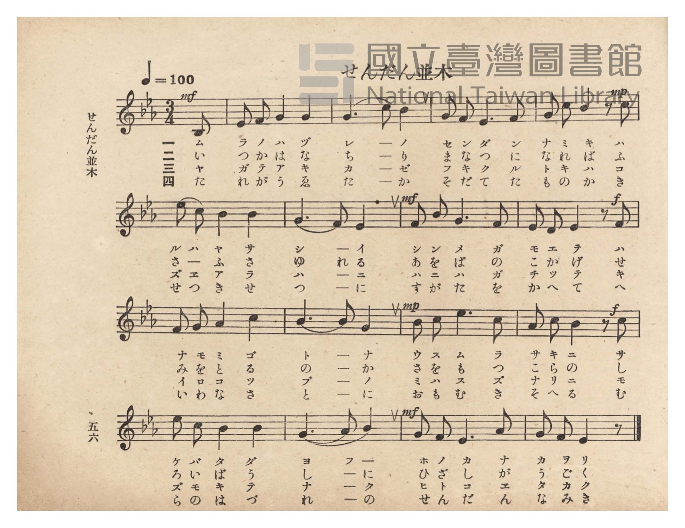
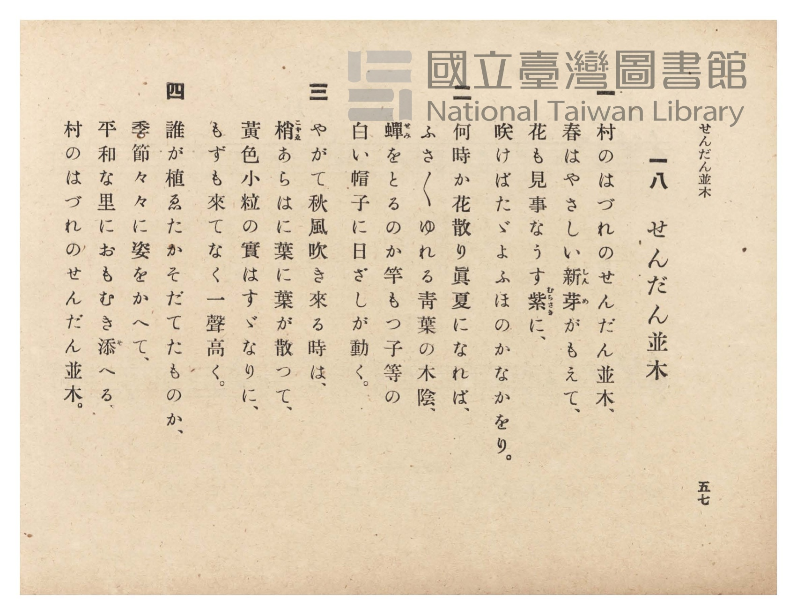

# せんだん並木

> Re:Shōka 使用 AI 協助辨識與重建樂譜，可能會有錯誤。歡迎回報。

- **鋼琴伴奏版**：<br><audio controls src="sendan_namiki.mp3"></audio>
- **NEUTRINO 歌聲合成版**：<br><audio controls src="sendan_namiki_neutrino.mp3"></audio>

- 臺灣總督府《公學校唱歌》第六學年用（昭和十五年，索書號 523.37 4322-4）

## 說明

原書資訊與歌詞全文（對應 P060.jpg–P061.jpg，原書 pp. 56–57）：
調性與拍號：變ホ長調（Eb 大調，3 降記號）3/4 拍（弱起半拍），速度 ♩=100


## 歌詞

```text
一
村のはづれのせんだん並木、
春はやさしい新芽（しんめ）がもえて、
花も見事なうす紫（むらさき）に、
咲けばたゞよふほのかなかをり。

二
何時か花散り眞夏になれば、
ふさ〳〵ゆれる青葉の木陰、
蟬（せみ）をとるのか竿もつ子等の
白い帽子に日ざしが動く。

三
やがて秋風吹き來る時は、
梢（こずゑ）あらはに葉に葉が散つて、
黃色小粒の實はすゞなりに、
もずも來てなく一聲高く。

四
誰が植ゑたかそだてたものか、
季節々に婆をかへて、
平和な里におもむき添（そ）へる、
村のはづれのせんだん並木。
```

## ABC

<div class="abc-score" data-abc-src="sendan_namiki.abc" aria-label="五線譜載入中"></div>

[下載 ABC 原始檔](sendan_namiki.abc)

## TMD 檔案連結

- [主旋律 TMD 檔案](sendan_namiki.tmd) [[在 TMD Studio 編輯](https://tmdlang.github.io/Tmd-TS/#tmd=s7IKdvYPcrWy4qpTUCpJTLdSSM7PyUlNLsnMz7PKzk9PzM7Ojy_OyM9OVIKrKMvPKc1NtUovSkxJjTdDiBfnlxYlp1oVJ2fk5-fEl6RWlCTl52ejy8cXJKanWgUYmBkgZAqK8stS8xLzgLoLijLzSlJTwNoRClLLMlNSQdLFyYl58WWpRZlpmakpSE5KLSoGuRhqRUlRYl5xclFmAcgbCFX5RSUZ-UBnF2RUWmVkFpfkF2UmJ-bEZyfmIfmuJCMV6Lm8xJLSolR00YKcxLySYoRoUWo6yNaSxMzyRBR7MtMzYcLx-WlpmcmZiTm45JPzgR4uLok3tDQ2VuLS0lJ43Dj7cdPkx40LgOSTHcuezVmhoKXFpWirYGhgwGVvq-Cqw2VjrG9iBzLvRfuu542Ln-_Y-3zu4qe75jxu6Hrauubp2h3PFix8OmXjs7U9jxu6n69Z87R1LVDw6c4tz6eseL-n49mMtU8n9TztbXyyawpQ8P2enudbFj2bvePFzPkKpkbGesbmCibGRka6Ju_3dCpxcelrKdhSC3ApKCg87ZsPsmxz-4sVXS862oGufLFy3tPWFc-mtQMd93RD77P2TgVQCtHLKkh_1DAZyDQEMYHuhGhVKCjQUzA1A0qZmgOd-H7PLJCxL1btf9awHGRgdy_QJ0DRF-u6HjfPfjl1O1AKaLJrksLTJcvB7B5jhZcze1-smAFW2AkMTgWgLpDteza-2Lr9aW8XmAs0uudlw_ynu5YpPJq50hYUASCbnuxoAFHP5k583LjuceP6x41LHzf1gNnoUfe4oRGsdMZSkLqmlseNUx83Tn_c2PJs2oYXXXuBNoK4QD1NjUDrHjf2PG5qetwIFFwG1fmiayNQ6MWy7ie7uh83rnrc2Pa4cebzLatBOpsaHjcB9QBNBLn1ceNqqJ6nkzY9bgS6bcPjxvmPm-Y9bgKat_Vx426wCyGmdD9umvS4qetxQxPER7t6wNTeqc9mAu3vBtr6bOpioILnc-Y9XdIPMhqoC-THDVA7wCZOfdyw-XHD1sdNbSC5pu6Xcye9mAh0yDqgz1_OhCl9MX8N2J-zHzcCg74TZHPjCqBqiHOer94P9vOSp2snPF8L0gzS83zmXmAgPd2xFygKtP3ZdGD4TQOHXM_TbqCH--Eu39EJdg4oaIHOW_Z8effLRSueTtgJDJQn-4Du6gb7aD0sIhYtArsFGEmzHjdNBAdbEzgUgbG4Gux4CNkD8n_jEkREvNzd_KJz09MN_c83Ad2_7un6ZWA9M0EBDAqbLkT4g_0DNL4J5ACgAaAA7wcmmheNm16unoHk-KezZ0NSLjCmep4t6QW6CBRloDiaC0pFIL3AGASaBo44aOyuXfx8fcPjhlaghU9XAn0IdA5Qww6EU5_u3AzM30BrX7YDSWDUdYHMAKaWxt5n23eD_T8X7PMdoFiABgxRibkJpJTyUgAKFLT0ubiCU_NSEvP8EnMzszOtAjIT8_IdanQNa6pBNinYWGjZgRnYyiAFYMkGCtWFPQoayPlWQVvBWAEUUesbgEwjPVNQ3taBlyiaWEwCOgRkS42CgYIuFFbnptUqmMYDxQwVjIAG6oJxDZjUVTBTMIXyjIDyIBEjMA8ibgDUXVAL5NSAjfUxrFGIhxv8uHkBUOnj5pVA3AfE_WCxVrBxj5vXQNXsAcuCxZp2A9mbgbgBKrcZrLILiOcDZdcCxeLB5kBtM0KxrbEFpLpxCRB3A_F6sNgqiMmNCxG2NXVBxfaB5UE6IPpXg0WBIk09QHoDxLbGrTDbjFH9tgTs4jVAVhuQXgQSA7sQJLoaybY9UP9OBcs_bgK5CyQHtq25AyIKDhugbU1AH0NsM0H123ywuSB3gXAb2LaJUH_MR9gG9DlEbC4QLwDiZSj6m4CsdVBVIL_1Am3Dn-p29YBTHVFJyjAOmipgKQaSWkCppgaSyoyAUjBhUHIziwfLAlMRWBKRiEDBAwoUUDCDvLoVGrDbkQIWJAMRgyQaaBQDowSkfxGQtQIcOZiJBlieQ4MLZC6IBzEJpBZkAjCIm2ABCQyypknQ5ABSuw4sOhmayCZBA3I2UiJ53LQLaPpGWKIAJn9IAgBFMSzBQ00H-xBoDkwO6vZGIG5GuB2YQBCJAmQXJJH3gt0zG-pOaCIG-wqU_EBiM6HJBZpAgP4AiYLcvQOaNEBu30EwEezoJD4RgEoQE6DJZmA3gFICKD1AShRwWWEKlAKmFEjZUgNUCy9JgGkAuSCBZHxgPAIzP8j1W6Bh1oEUjtCs3LQMiHeCCxyI3Eqw6FZo5oImdyAfOQ3sh8bsCrDpsPhehyUzgbIuUCUw-0DSADjrg9JAUydUBygcp6OkAWAMNYOy-2awaS1Qt09Dcju00AMVbaB0AHQ_JJZ2wQs9YFEEczswHJDTQAtQHVAPuHiDp1-wT9DTANAcULZvghapoCwPLR6AaQDsa1DINBBKA8AKnMKCwATKAxcEiNrEBKVuMUCO_yZgHmqeAKT3g30F8gEoZGC-hORhiBgwT4CqGHjB2wUthh83bwKHI0gUWMMhYr-pFxKKjSATIAUqKFymYwlBoAmN0xBywBwFEgUW-o1TgBiSc-Fmw_M_qPwBVQeQXAyJUUTZBaoEQGLAVAWuAkCpBBT3K8DuBqVMoNuhVQXcbFDMQ1McrHpbCjEHWGIh3A1Kj9ByoglUTkHzBJANEgVVeEDzwaUHxOxaLi5dOwXk1okCkK_MBQA)]
- [鋼琴伴奏 TMD 檔案](sendan_namiki_piano.tmd) [[在 TMD Studio 編輯](https://tmdlang.github.io/Tmd-TS/#tmd=s7IKdvYPcrWy4qpTUCpJTLdSSM7PyUlNLsnMz7PKzk9PzM7Ojy_OyM9OVIKrKMvPKc1NtTJDiBTnlxYlp-JSD5GNL0hMT7UKMDAz0AUShgjpgqL8stS8xDygASWJmeWJefHpQIGivPyi-PTUvNSixByE2tSyzJRUkMqCoszcxKLK-JT8ZKBb8kqQXJdaVAxyfEFmYl5-fGJRUWJeeiqqkvyikoz89KLEgoxKq4zM4pL8oszkxJz47MQ8JFeXZAB1WaWmlCYnggJDiUtLS-Fx4-zHTZMfNy4Akk92LHs2Z8X7PR0vu_c8n7DlyZ4tT5f2P-_seL-nU0FLi0vRVsHQwIDL3lbBVYfLxljfxA5k8ov2Xc8bFz_fsff53MVPd8153ND1tHXN07U7ni1Y-HTKxmdrex43dD9fs-Zp61qg4NOdW55PAdnwbMbap5N6nvY2Ptk1BSj4fk_P8y2Lns3e8WLmfAVTI2M9Y3MFE2MjI10ToN1KXFyeeSVF-VYBIP8HeTjUGNRUcykAgY2Flh2YUaNQnZtWq2AYp2CmYKqgC8Y1CsZAUlfBBM4zUjCEiiDzDBRquGpRrPBBtsIEzYp4BZN4hWjDWKAAkG0aj8QBMYCSNWBRIB9qcnBqXkpinl9ibmZ2JsIPuoaYnjAAOwgEwXaZgswyBDoU5BEQhnkJ4klkTxiBeRBxA6DuglogpwZsrI9hjUI83ODHzQuASh83rwTiPiDuB4k17QIb97h5DVTNHrAsWKxpN5C9GYgboHKbwSq7gHg-UHYtUCwebA7UNiMU2xpbQKoblwBxNxCvB4utgpjcuBBhW1MXVGwfWB6kA6J_NVgUKNLUA6Q3QGxr3AqzzRjVb0vALl4DZLUB6UVgv4FcCBJdjWTbHqh_p4LlHzeB3AWSA9vW3AERBYcN0LYmoI8htpmg-m0-2FyQu0C4DSzWAfXHfIRtQJ9DxOYC8QIgXoaivwnIWgdVBfJbL9A2aHrAmp4hUQ5NjkZAKZgwKK2YARMeJAmAJREpAOQ3kI9AYQQKla3QUNmOFCogGYgYJMah8QMMT5D-RUDWCnDIYsb440ZgSIL9CjIXxIOYBFILMgEYPk2wUAD6t2kSNC5BateBRSdDU8gkaCjMRophUPoE2w2JUWDahcQeKH5gqRVqOtiHQHNgclC3NwJxM8LtwNhFxCjILkgK7QW7ZzbUndAUCPYVKO2AxGZC4xoau0B_gERB7t4BjVeQ23cgYhCUd02AwmZgA0DRCIpMSF4G51JToBQwmiG5ugaoFp6HgRGInIUhWQ4YCcBsB7J6C9TDoAQHCwRoJmpaBsQ7wVkdIrcSLLoVmqyhCQ3IR47A_dBoWQE2HRZZ67AkY1CmAaoEJlxIBIIzHSgCmzqhOkCBMB0lAoHB2wzKaJvBprVA3T4Nye3Q4gZUqIAiEeh-SBDvghc3wEIA5nZgOCBHYAtQHVAPuGCBJz6wT9AjEGgOKMM1QQszUGaDZkxgBIJ9DQqZBgJZEFalgLMgvnoFHnlNG4EOmQCk94OdBLIe5C2YEyG5ByIGTI2gkhleXnVBS6_HzZvAgQASBVYMiKhr6oUEQSPIBEg5BPLUdCzeB5rQOA0hB0zLIFFgWdk4BYgheQZuNizngXM-qBSF5B9IdCBKDVDZCRIDJglwyQmKYlDErQC7G5SsgG6HlrBws0HRBk0usFphFsQcYFmBcDcoMUFzaBOohIAmaCAbJAqqJ4Dmg_MtxGystS2oOkfUtoj63AAMEfU6qPqG1-XAehxUi8PrdTgHKAGLWWgWxtIkAFJQc6E8iHYzRLsAqh-qwghsBNwyiFnIhpuABIAMDN042yPIvsLSKNG1UwC3eBSADOQgi_YBqscQM8IiZoxFDOhMoJgyFwA)]

## 分析

```text
================================================================================
📊 TMD Song Profile: [ せんだん並木 ]
================================================================================
⏱  Duration:       0:28 (28.8s), 16 measures total
🎼 Key & Tempo:    首調基準 E,, != 100.0 BPM, <3/4>
   - 分析範圍：      由實際發聲的音符與和弦推測調性；播放脈絡另行呈現
🎤 人聲音域:    A#3 (MIDI 58) – D#5 (MIDI 75) [跨度: 17 個半音 / 1.4 個八度, 難度: challenging]
   - 最低音:  A#3 in [SendanNamiki #1 @ m.1, 0:01]
   - 最高音: D#5 in [SendanNamiki #1 @ m.6, 0:09]
   - 適合: soprano, mezzo-soprano, contralto, tenor, baritone, bass
🏛  結構:      SendanNamiki (28.8s)
⚡ 編曲密度:        Peak 1 軌道同時演奏
🗝  調性診斷：       D# 大調（純淨自然大調，未偵測到可信轉調）
   - 風格氣質:    純淨自然大調（陽光明朗、易唱易記，無明顯調外色彩）
   - 轉調歷程:    全曲維持單一推測調性（未偵測到可信轉調）
   - 核心骨幹音:  G, A#, D#, C, F
   - 調性數值:    D# 大調 [相關度: 0.88, 穩定度: High, 自然音純度: 100.0%]
   - 候選調性 (K-S): D# 大調 (0.88), G 小調 (0.73), A# 大調 (0.67)
   - 五度圈歷程:   -3
   - 各段落調性細節:
     • [SendanNamiki #1]: D# 大調 (r: 0.86, 自然音純度: 100.0%)

  [ 五度圈游移軌跡 ]
               C  
         F            G  
      Bb               D  
     [Eb]*              A  
         Ab           E  
            Db       B  
               F# 
     (* = active key center)

  [ 十二半音累積音高分佈 ]
     C  : █████████████             12.9%
     C# :                            0.0%
     D  :                            0.0%
     D# : █████████████████████     21.5%
     E  :                            0.0%
     F  : ██████████                10.8%
     F# :                            0.0%
     G  : ████████████████████████  24.7%
     G# : █████                      5.4%
     A  :                            0.0%
     A# : ████████████████████████  24.7%
     B  :                            0.0%
--------------------------------------------------------------------------------
Assignment 軌道音域：
  - Piano         : A#3 – D#5 (17 個半音 / 1.4 個八度, 60 個音符)
================================================================================
```


## 原書掃描頁






