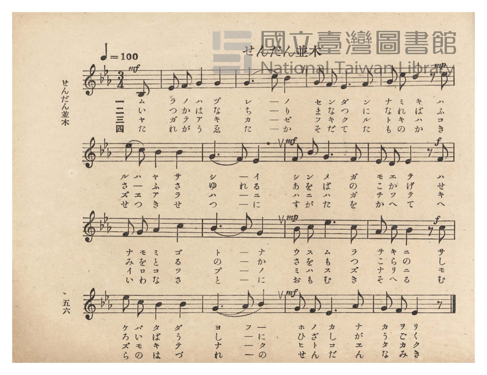
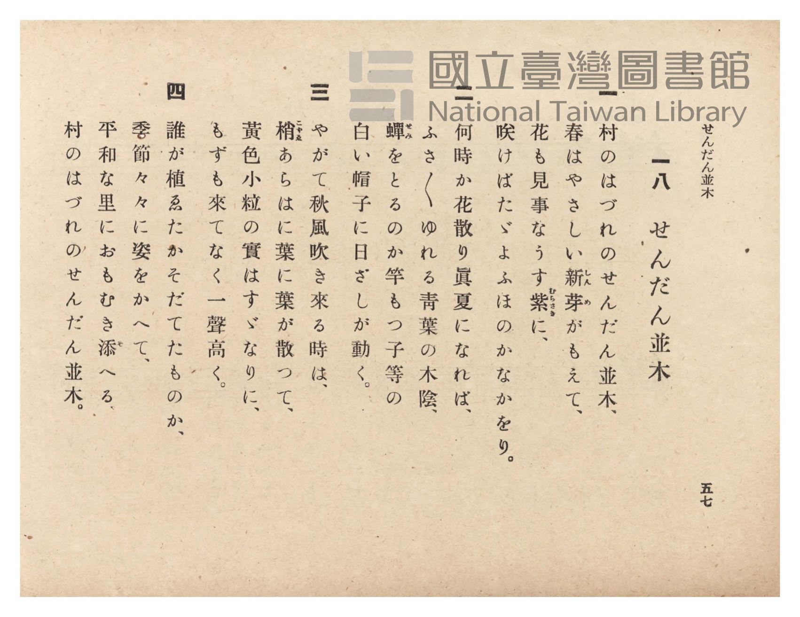

# せんだん並木

> Re:Shōka 使用 AI 協助辨識與重建樂譜，可能會有錯誤。歡迎回報。

- **NEUTRINO 歌聲合成版**：<br><audio controls src="sendan_namiki_neutrino.mp3"></audio>
- **鋼琴伴奏版**：<br><audio controls src="sendan_namiki.mp3"></audio>


- 臺灣總督府《公學校唱歌》第六學年用（昭和十五年，索書號 523.37 4322-4）

## 說明

原書資訊與歌詞全文（對應 P060.jpg–P061.jpg，原書 pp. 56–57）：
調性與拍號：變ホ長調（Eb 大調，3 降記號）3/4 拍（弱起半拍），速度 ♩=100


## 歌詞

```text
一
村のはづれのせんだん並木、
春はやさしい新芽（しんめ）がもえて、
花も見事なうす紫（むらさき）に、
咲けばたゞよふほのかなかをり。

二
何時か花散り眞夏になれば、
ふさ〳〵ゆれる青葉の木陰、
蟬（せみ）をとるのか竿もつ子等の
白い帽子に日ざしが動く。

三
やがて秋風吹き來る時は、
梢（こずゑ）あらはに葉に葉が散つて、
黃色小粒の實はすゞなりに、
もずも來てなく一聲高く。

四
誰が植ゑたかそだてたものか、
季節々に婆をかへて、
平和な里におもむき添（そ）へる、
村のはづれのせんだん並木。
```

## ABC

```abc
X:1
T:せんだん並木
M:3/4
L:1/16
Q:1/4=100
K:Eb
V:V1 name="Piano" snm="Pia"
[V:V1]
!mf! z10 B,2 | E2 F2 G4 G4 | G6 c2 B4 | G2 F2 E6 F2 |
w: 1.~ム | ラ ノ ハ ヅ | レ ー ノ | セ ン ダ ン
w: 2.~い | つ か は な | ち ー り | ま な つ に
w: 3.~ヤ | ガ テ ア キ | カ ー ゼ | フ キ ク ル
w: 4.~た | れ が う ゑ | た ー か | そ だ て た
!mp! G2 c2 B4 z2 c2 | e2 c2 B4 B4 | G6 F2 E4 | !mf! F2 B2 G6 F2 |
w: 1.~ナ ミ キ ハ | ル ハ ヤ サ | シ ー イ | シ ン メ ガ
w: 2.~な れ ば ふ | さ ー ふ さ | ゆ れ る | あ を ば の
w: 3.~ト キ ハ コ | ズ ヱ ア ラ | ハ ー ニ | ハ ニ ハ ガ
w: 4.~も の か き | せ つ き せ | つ ー に | す が た を
!f! E2 C2 E4 z2 F2 | F2 G2 A4 c4 | B6 B2 G4 | !mp! B2 c2 e6 c2 |
w: 1.~モ エ テ ハ | ナ モ ミ ゴ | ト ー ナ | ウ ス ム ラ
w: 2.~こ か げ せ | み を と る | の ー か | さ を も つ
w: 3.~チ ッ テ キ | イ ロ コ ツ | ブ ー ノ | ミ ハ ス ズ
w: 4.~か へ て へ | い わ な さ | と ー に | お も む き
!f! A2 c2 B4 z2 c2 | e2 c2 B4 B4 | G6 A2 B4 | !mf! G2 F2 E6 A2 |
w: 1.~サ キ ニ サ | ケ バ タ ダ | ヨ フ ー | ホ ノ カ ナ
w: 2.~こ ら の し | ろ い ぼ う | し ー に | ひ ざ し が
w: 3.~ナ リ ニ モ | ズ モ キ テ | ナ ー ク | ヒ ト コ エ
w: 4.~そ へ る む | ら の は づ | れ ー の | せ ん だ ん
G2 F2 E6 z2 |
w: 1.~カ ヲ リ
w: 2.~う ご く
w: 3.~タ カ ク
w: 4.~な み き
```

## TMD 檔案連結

- [主旋律 TMD 檔案](sendan_namiki.tmd) [[在 TMD Studio 編輯](https://tmdlang.github.io/Tmd-TS/#tmd=s7IKdvYPcrWy4qpTUCpJTLdSSM7PyUlNLsnMz7PKzk9PzM7Ojy_OyM9OVIKrKMvPKc1NtUovSkxJjTdDiBfnlxYlp1oVJ2fk5-fEl6RWlCTl52ejy8cXJKanWgUYmBkgZAqK8stS8xLzgLoLijLzSlJTwNoRClLLMlNSQdLFyYl58WWpRZlpmakpSE5KLSoGuRhqRUlRYl5xclFmAcgbCFX5RSUZ-UBnF2RUWmVkFpfkF2UmJ-bEZyfmIfmuJCMV6Lm8xJLSolR00YKcxLySYoRoUWo6yNaSxMzyRKA9WloKjxtnP26a_LhxAZB8smPZszkrFLS0uBRtFQwNDLjsbRVcdbhsjPVN7EBGvGjf9bxx8fMde5_PXfx015zHDV1PW9c8Xbvj2YKFT6dsfLa253FD9_M1a562rgUKPt255fmUFe_3dDybsfbppJ6nvY1Pdk0BCr7f0_N8y6Jns3e8mDlfwdTIWM_YXMHE2MhI1-T9nk4lLi59LQVbagEuBQWFp33zQZZtbn-xoutFRzvQlS9WznvauuLZtHag455u6H3W3qkAil29rIL0Rw2TgUxDEBPoTohWhYICPQVTM6CUqTnQie_3zAIZ-2LV_mcNy0EGdvcCfQIUfbGu63Hz7JdTtwOlgCa7Jik8XbIczO4xVng5s_fFihlghZ3A4FQA6gLZvmfji63bn_Z2gblAo3teNsx_umuZwqOZK21BEQCy6cmOBhD1bO7Ex43rHjeuf9y49HFTD5iNHnWPGxrBSmcsBalranncOPVx4_THjS3Ppm140bUXaCOIC9TT1Ai07nFjz-OmpseNQMFlUJ0vujYChV4s636yq_tx46rHjW2PG2c-37IapLOp4XETUA_QRJBbHzeuhup5OmnT40ag2zY8bpz_uGne4yageVsfN-4GuxBiSvfjpkmPm7oeNzRBfLSrB0ztnfpsJtD-bqCtz6YuBip4Pmfe0yX9IKOBukB-3AC1A2zi1McNmx83bH3c1AaSa-p-OXfSi4lAh6wD-vzlTJjSF_PXgP05-3EjMOg7QTY3rgCqhjjn-er9YD8vebp2wvO1IM0gPc9n7gUG0tMde4GiQNufTQeG3zRwyPU87QZ6uB_u8h2dYOeAghbovGXPl3e_XLTi6YSdwEB5sg_orm6wj9bDImLRIrBbgJE063HTRHCwNYFDERiLq8GOh5A9IP83LkFExMvdzS86Nz3d0P98E9D9656uXwbWMxMUwKCw6UKEP9g_QOObQA4AGgAK8H5gonnRuOnl6hlIjn86ezYk5QJjqufZkl6gi0BRBoqjuaBUBNILjEGgaeCIg8bu2sXP1zc8bmgFWvh0JdCHQOcANexAOPXpzs3A_A209mU7kARGXRfIDGBqaex9tn032P9zwT7fAYoFaMAQlZibQEopLwWgQEFLn4srODUvJTHPLzE3MzvTKiAzMS_foUbXsKYaZJOCjYWWHZiBrQxSAJZsoFBd2KOggZxvFbQVjBVAEbW-Acg00jMF5W0deImiicUkoENAttQoGCjoQmF1blqtgmk8UMxQwQhooC4Y14BJXQUzBVMozwgoDxIxAvMg4gZA3QW1QE4N2FgfwxqFeLjBj5sXAJU-bl4JxH1A3A8WawUb97h5DVTNHrAsWKxpN5C9GYgboHKbwSq7gHg-UHYtUCwebA7UNiMU2xpbQKoblwBxNxCvB4utgpjcuBBhW1MXVGwfWB6kA6J_NVgUKNLUA6Q3QGxr3AqzzRjVb0vALl4DZLUB6UUgMbALQaKrkWzbA_XvVLD84yaQu0ByYNuaOyCi4LAB2tYE9DHENhNUv80HmwtyFwi3gW2bCPXHfIRtQJ9DxOYC8QIgXoaivwnIWgdVBfJbL9A2_KluVw841RGVpAzjoKkClmIgqQWUamogqcwIKAUTBiU3s3iwLDAVgSURiQgUPKBAAQUzyKtboQG7HSlgQTIQMUiigUYxMEpA-hcBWSvAkYOZaIDlOTS4QOaCeBCTQGpBJgCDuAkWkMAga5oETQ4gtevAopOhiWwSNCBnIyWSx027gKZvhCUKYPKHJABQFMMSPNR0sA-B5sDkoG5vBOJmhNuBCQSRKEB2QRJ5L9g9s6HuhCZisK9AyQ8kNhOaXKAJBOgPkCjI3TugSQPk9h0EE8GOTuITAagEMQGabAZ2AyglgNIDpEQBlxWmQClgSoGULTVAtfCSBJgGkAsSSMYHxiMw84NcvwUaZh1I4QjNyk3LgHgnuMCByK0Ei26FZi5ocgfykdPAfmjMrgCbDovvdVgyEyjrAlUCsw8kDYCzPigNNHVCdYDCcTpKGgDGUDMou28Gm9YCdfs0JLdDCz1Q0QZKB0D3Q2JpF7zQAxZFMLcDwwE5DbQA1QH1gIs3ePoF-wQ9DQDNAWX7JmiRCsry0OIBmAbAvgaFTAOhNACswCksCEygPHBBgKhNTFDqFgPk-G8C5qHmCUB6P9hXIB-AQgbmS0gehogB8wSoioEXvF3QYvhx8yZwOIJEgTUcIvabeiGh2AgyAVKggsJlOpYQBJrQOA0hB8xRIFFgod84BYghORduNjz_g8ofUHUAycWQGEWUXaBKACQGTFXgKgCUSkBxvwLsblDKBLodWlXAzQbFPDTFwaq3pRBzgCUWwt2g9AgtJ5pA5RQ0TwDZIFFQhQc0H1x6QMyu5eLStVNAbp0oAPnKXAA)]
- [鋼琴伴奏 TMD 檔案](sendan_namiki_piano.tmd) [[在 TMD Studio 編輯](https://tmdlang.github.io/Tmd-TS/#tmd=s7IKdvYPcrWy4tLSUnjcOPtx0-THjQuA5JMdy57NWfF-T8fL7j3PJ2x5smfL06X9zzs73u_pVNDS4lK0VTA0MOCyt1Vw1eGyMdY3seOqU1B60b7reePi5zv2Pp-7-OmuOY8bup62rnm6dsezBQufTtn4bG3P44bu52vWPG1dCxR8unPL8ykgG57NWPt0Us_T3sYnu6YABd_v6Xm-ZdGz2TtezJyvYGpkrGdsrmBibGSkawK0W4mLyzOvpCjfKiAzMS8_yMOhxqCmmksBCGwstOzAjBqF6ty0WgXDOAUzBVMFXTCuUTAGkroKJnCekYIhVASZZ6BQw1WLYoUPshUmaFbEK5jEK0QbxgIFgGzTeCQOiAGUrAGLAvlQk4NT81IS8_wSczOzMxF-0DXE9IQB2EEgCLbLFGSWIdChII-AMMxLEE8ie8IIzIOIGwB1F9QCOTVgY30MaxTi4QY_bl4AVPq4eSUQ9wFxP1isFWzc4-Y1UDV7wLJgsabdQPZmIG6Aym0Gq-wC4vlA2bVAsXiwOVDbjFBsa2wBqW5cAsTdQLweLLYKYnLjQoRtTV1QsX1geZAOiP7VYFGgSFMPkN4Asa1xK8w2Y1S_LQG7eA2Q1QakF4HEwC4Eia5Gsm0P1L9TwfKPm0DuAsmBbWvugIiCwwZoWxPQxxDbTFD9Nh9sLshdINwGtm0i1B_zEbYBfQ4RmwvEC4B4GYr-JiBrHVQVyG-9QNug6QFreoZEOTQ5GgGlYMKgtGIGTHiQJACWRKQAkN9APgKFEcidW6Ghsh0pVEAyEDFIjEPjBxieIP2LgKwV4JDFjPHHjcCQBPsVZC6IBzEJpBZkAjB8mmChAPRv0yRoXILUrgOLToamkEnQUJiNFMOPm3YBTd8Ii1Fg2oXEHih-YKkVajrYh0BzYHJQtzcCcTPC7cDYRcQoyC5ICu0Fu2c21J3QFAj2FSjtgMRmQuMaGrtAf4BEQe7eAY1XkNt3IGIQlHdNgMJmYANA0QiKTEheBudSU6AUMJohuboGqBaeh4ERiJyFIVkOGAnAbAeyegvUwx1IgQDNRE3LgHgnOKtD5FaCRbdCkzU0oQH5yBG4HxotK8CmwyJrHZZkDMo0QJXAhAuJQHCmA0VgUydUBygQpqNEIDB4m0EZbTPYtBao26chuR1a3IAKFVAkAt0PCeJd8OIGWAjA3A4MB-QIbAGqA-oBFyzwxAf2CXoEAs0BZbgmaGEGymzQjAmMQLCvQSHTQCALwqoUcBbEV6_AI68JmHqbJwDp_WAngawHeQvmREjugYgBUyOoZIaXV13Q0utx8yZwIIBEgRUDIuqaeiFB0AgyAVIOgTw1HYv3gSY0TkPIAdMySBRYVjZOAWJInoGbDc95oJwPKkUh-QcSHYhSA1R2gsSASQJccoKiGBRxK8DuBiUroNuhJSzcbFC0QZMLrFZYCjEHWFYg3A1KTNAc2gQqIaAJGsgGiYLqCaD54HwLMRtrbQuqzhG1LaI-NwBDRL0Oqr7hdTmwHgfV4vB6Hc4BSsBiFpqFsTQJgBTUXCgPot0M0S6A6oeqMAIbAbcMYhay4SYgASADQzfO9giyr7A0SnTtFMAtHgUgAznIon2A6jHEjLCIGWMRAzoTKKbMBQA)]

## 分析

```text
================================================================================
📊 TMD Song Profile: [ せんだん並木 ]
================================================================================
⏱  Duration:       0:28 (28.8s), 16 measures total
🎼 Key & Tempo:    首調基準 E,, != 100.0 BPM, <3/4>
   - 分析範圍：      由實際發聲的音符與和弦推測調性；播放脈絡另行呈現
🎤 人聲音域:    A#3 (MIDI 58) – D#5 (MIDI 75) [跨度: 17 個半音 / 1.4 個八度, 難度: challenging]
   - 最低音:  A#3 in [SendanNamiki #1 @ m.1, 0:01]
   - 最高音: D#5 in [SendanNamiki #1 @ m.6, 0:09]
   - 適合: soprano, mezzo-soprano, contralto, tenor, baritone, bass
🏛  結構:      SendanNamiki (28.8s)
⚡ 編曲密度:        Peak 1 軌道同時演奏
🗝  調性診斷：       D# 大調（純淨自然大調，未偵測到可信轉調）
   - 風格氣質:    純淨自然大調（陽光明朗、易唱易記，無明顯調外色彩）
   - 轉調歷程:    全曲維持單一推測調性（未偵測到可信轉調）
   - 核心骨幹音:  G, A#, D#, C, F
   - 調性數值:    D# 大調 [相關度: 0.88, 穩定度: High, 自然音純度: 100.0%]
   - 候選調性 (K-S): D# 大調 (0.88), G 小調 (0.73), A# 大調 (0.67)
   - 五度圈歷程:   -3
   - 各段落調性細節:
     • [SendanNamiki #1]: D# 大調 (r: 0.86, 自然音純度: 100.0%)

  [ 五度圈游移軌跡 ]
               C  
         F            G  
      Bb               D  
     [Eb]*              A  
         Ab           E  
            Db       B  
               F# 
     (* = active key center)

  [ 十二半音累積音高分佈 ]
     C  : █████████████             12.9%
     C# :                            0.0%
     D  :                            0.0%
     D# : █████████████████████     21.5%
     E  :                            0.0%
     F  : ██████████                10.8%
     F# :                            0.0%
     G  : ████████████████████████  24.7%
     G# : █████                      5.4%
     A  :                            0.0%
     A# : ████████████████████████  24.7%
     B  :                            0.0%
--------------------------------------------------------------------------------
Assignment 軌道音域：
  - Piano         : A#3 – D#5 (17 個半音 / 1.4 個八度, 60 個音符)
================================================================================
```


## 原書掃描頁






