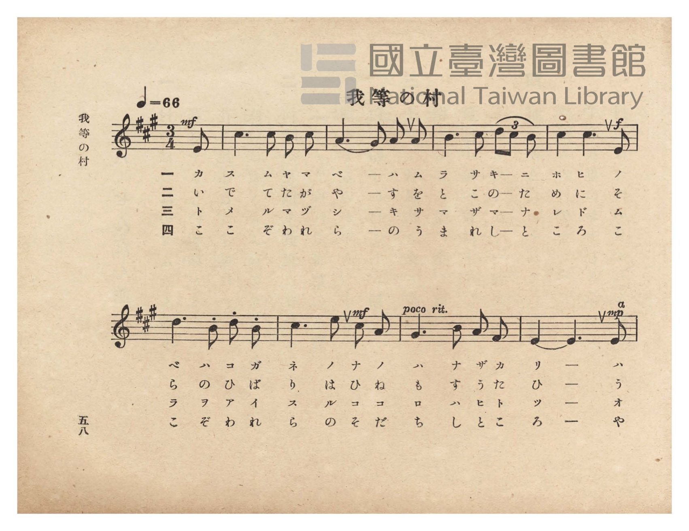
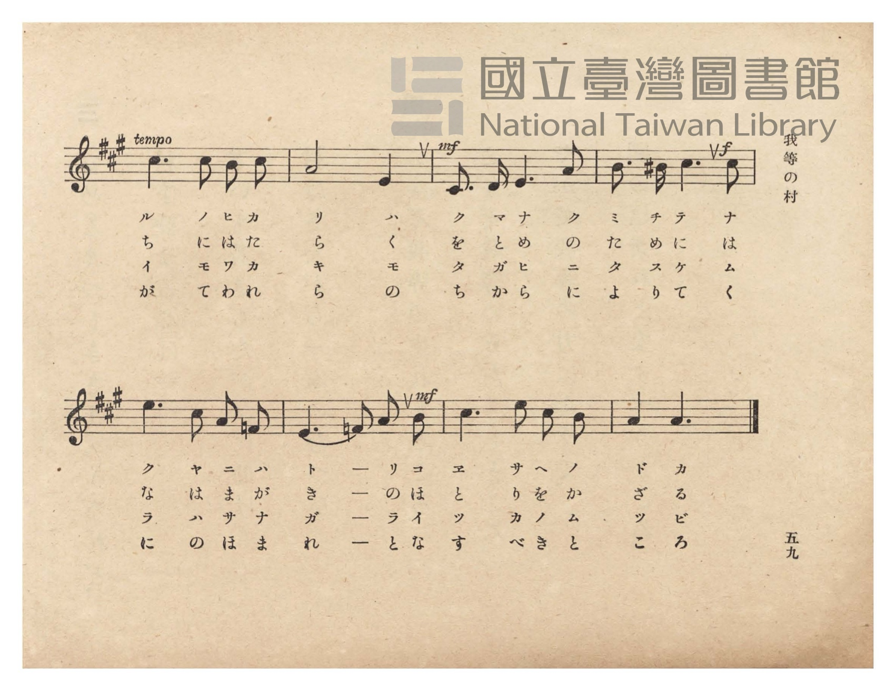
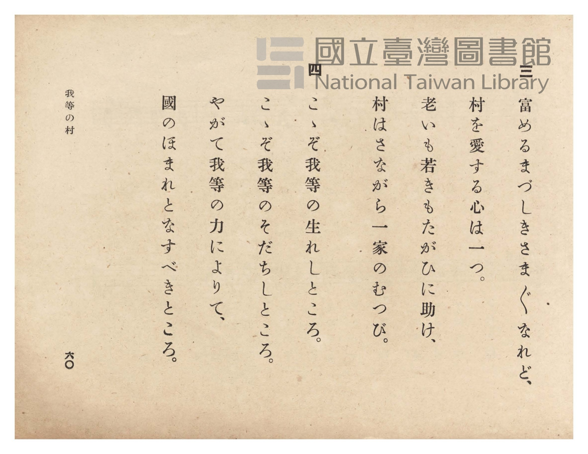
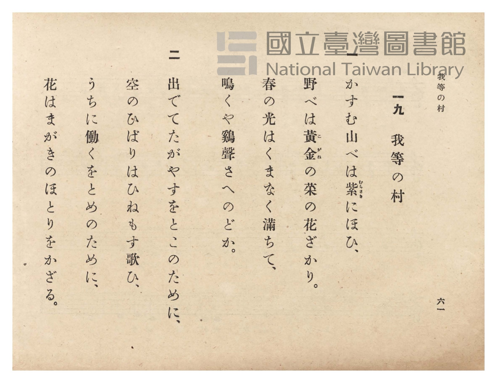

# 我等の村

> Re:Shōka 使用 AI 協助辨識與重建樂譜，可能會有錯誤。歡迎回報。

- **NEUTRINO 歌聲合成版**：<br><audio controls src="warera_no_mura_neutrino.mp3"></audio>
- **鋼琴伴奏版**：<br><audio controls src="warera_no_mura.mp3"></audio>


- 詞：文部省
- 曲：文部省
- 臺灣總督府《公學校唱歌》第六學年用（昭和十五年，索書號 523.37 4322-4）

## 說明

原書資訊與歌詞全文（對應 P062.jpg–P065.jpg，原書 pp. 58–61）：
調性與拍號：イ長調（A 大調，3 升記號）3/4 拍（弱起半拍），速度 ♩=66


## 歌詞

```text
一
かすむ山べは紫（むらさき）にほひ、
野べは黃金（こがね）の菜の花ざかり。
春の光はくまなく滿ちて、
鳴くや鷄聲さへのどか。

二
出でてたがやすをところのために、
空のひばりはひねもす歌ひ、
うちに働くをとめのために、
花はまがきのほとりをかざる。

三
富めるまづしきさま〴〵なれど、
村を愛する心は一つ。
老いも若きもたがひに助け、
村はさながら一家のむつび。

四
こゝぞ我等の生れしところ。
こゝぞ我等のそだちしところ。
やがて我等の力によりて、
國のほまれとなすべきところ。
```

## ABC

```abc
X:1
T:我等の村
C:曲：文部省
M:3/4
L:1/16
Q:1/4=66
K:A
V:V1 name="Piano" snm="Pia"
[V:V1]
!mf! z10 E2 | c6 c2 B2 c2 | A6 G2 A2 A2 | B6 c2 d4/3 c4/3 B4/3 |
w: 1.~カ | ス ム ヤ マ | ベ ー ハ ム | ラ サ キ ー ニ
w: 2.~い | で て た が | や す を と | こ の ー た め
w: 3.~ト | メ ル マ ヅ | シ キ サ マ | ザ マ ー ナ レ
w: 4.~こ | こ ぞ わ れ | ら の う ま | れ し ー と こ
!f! c4 c6 E2 | d6 B2 d2 B2 | !mf! c6 e2 c2 A2 | G6 B2 A2 F2 |
w: 1.~ホ ヒ ノ | ベ ハ コ ガ | ネ ノ ナ ノ | ハ ナ ザ カ
w: 2.~に そ ら | の ひ ば り | は ひ ね も | す う た ひ
w: 3.~ド ム ラ | ヲ ア イ ス | ル コ コ ロ | ハ ヒ ト ツ
w: 4.~ろ こ こ | ぞ わ れ ら | の そ だ ち | し と こ ろ
!mp! E10 E2 | c6 c2 B2 c2 | A8 E4 | !mf! C3 D E6 A2 |
w: 1.~リ ハ | ル ノ ヒ カ | リ ハ | ク マ ナ ク
w: 2.~ー う | ち に は た | ら く | を と め の
w: 3.~ー オ | イ モ ワ カ | キ モ | タ ガ ヒ ニ
w: 4.~ー や | が て わ れ | ら の | ち か ら に
!f! B3 ^B c6 c2 | e6 c2 A2 =F2 | !mf! E6 =F2 A2 B2 | c6 e2 c2 B2 |
w: 1.~ミ チ テ ナ | ク ヤ ニ ハ | ト ー リ コ | ヱ サ ヘ ノ
w: 2.~た め に は | な は ま が | き ー の ほ | と り を か
w: 3.~タ ス ケ ム | ラ ハ サ ナ | ガ ー ラ イ | ッ カ ノ ム
w: 4.~よ り て く | に の ほ ま | れ ー と な | す べ き と
A4 A6 z2 |
w: 1.~ド カ
w: 2.~ざ る
w: 3.~ツ ビ
w: 4.~こ ろ
```

## TMD 檔案連結

- [主旋律 TMD 檔案](warera_no_mura.tmd) [[在 TMD Studio 編輯](https://tmdlang.github.io/Tmd-TS/#tmd=s7IKdvYPcrWy4qpTUCpJTLdSSM7PyUlNLsnMz7PKzk9PzM7Ojy_OyM9OVIKrKMvPKc1NtUovSkxJjTdDiBfnlxYlp1oVJ2fk5-fEl6RWlCTl52ejy8cXJKanWgUYmBkhZAqK8stS8xLzgLoLijLzSlJTwNoRClLLMlNSQdLFyYl58WWpRZlpmakpSE5KLSoGuRhqRUlRYl5xclFmAcgbCFX5RSUZ-UBnF2RUWmVkFpfkF2UmJ-bEZyfmIfmuJCMV6LmUxMycyviczLRUdJm8xJLSIqColpbCs46Jz9d2Pm5c92zuRAUtLS5FWwUzMy57WwVHLhtjfRM7kM4XK-e93zPr2bT2l80rns9pBJv2bPYmDLEX7bueNy5-vmPv87mLn-6a87ih62nrmqdrdzxbsPDplI3P1vY8buh-vmbN09a1QMGnO7c8n7Li_Z6OZzPWPp3U87S38cmuKUDB93t6nm9Z9Gz2jhcz5yuYGhnrGZsrmBgbGemavN_TqcTFpa-lYEstwKWgoPC0bz7Iss3tL1Z0vehoB7oS6N2nrSuAXgM67umG3mftnQqgqNbLKkh_1DAZyDQFMYHuhGhVKCjQUzC1AEqZGQKdCAwVkLEvVu1_1rAcZGB3L9AnQNHHTUteTt0OFAca66jwdMlyMLPHWOFpL9DuGWBFncAgVwDqANm8Z-OLrduf9naBuUBje142zH-6a5nCo5krbYFRBLLkyY4GEPW4sftx48zHTQ1PN2583LjzceP651tWA40AijxuAsbt1MeNICMeN65-3Lj7ceOmxw2NIG0v2_sgql_ubn7ZPhGkoXHy48aex41rwarXveifAyK7gIZOA9nR1PW4oQmk89mMpUCJp61AResfN_Y_btz3uHEVkPFs9_7HjQsfNy6D2bB5C0i6qeXl9pYXQHtBLtkB1Pm4cSXIPKBhYF_s6gFHRPuux43LQZob54Nc0dQC9tSkx40rQO5q6gVrnP-4qRHkEYgFz1cC9QBFgUZvADkP5Bwge-3jpiagZlCKg_v2cWMb2G2rnzYDTQI6CmwwyDAMU8E-BpoE9BXQAIi9wHADqu4CawOG9rTHTQj37-gEu3890M2NIHGQRmAATQfrBXp53-OGLY8btoLCqAlo4EqoNcAcBzTuWctssD-7n-5vBtoKjNLHjUug4fyiAeiqFqBnXnQDzesF-wocNiBPrn7aBQzFiUiGgdwMtA4YE0CXdAJNerpuG8jxwGQANLJxM8zBT2fPhoQIMFTnPm6cBy8Dnk8BBgTQdKDLYWEOcQim0seNQO4CcIhiqgZFHdCYZXDVT7uAnlz9uAmYJIGRBEseT-cAwwoStvvA9gKNATp-JjhVAoMO1VTKszsUKGjpc3GFJxalFiX65fuWFiVaBWQm5uU71BjUVIMsUrAxNNOyA7OwFTYKwCIMGLYvFvYoaCBnUgVtBWBe3tD_fH0DkGmkZwrKyDrwokMTi0lAh4BsqVEwUNDFgNW5abUKpvFAVg3QYIQ4iG0EpWsUDJFkzEGKQQIgXANWhKxJwwRIGWmqaugCgSaSqcimV8MtBTvNx7BGAcRDh4-bVoPteNy0E1m0eQGYXAIm50FUNM9EUbEHTPbDVYNUrEQxeSvIrY-b1oIVP27uBjn1cfNsuAmTUMzrQ7jVCIdbG1sg9jQuRxFdBibng8keqG9AKhEqQC4HZlEwewXUjMkoKtaB3QpyJ9AgYPYHu7URFDYQ-bkoPutEuNUYh1ubOyD2NC9EEQWZCAnRx82tULduRzF7LZgEhR085Ju2oZgBEoW4tbkLiNdAwhXkJkTcIVSD4gTqVhNc4QoKC8wwAbuyCRzDTbBwhdmCCDVgeQwm90FVgFQiVEyHuxUY8EALwG5t6kWxGc0d4KINd47d1QPOsURlRxMk00G5CMQH0agZ0RSIwZkUJAjJcuAciKwTJGwGycPgXIUOq3MLMPIbeo6BhORmMLkGElrNsJCAqADlAVCkwvMDVBdCBVgOnB7gObd5FRb3QPQh8hMkrhAhvQlMbgCbAzITpGI9FhVrwSqaoCpQ_AONd0i-A6kGuQVUKmC4BawSkV8eN4NUw2WbFoFJcFkDLoVAKmA5D6ICEmZgshnkIsxwAedtcJ573AwtJbC7pQkUWoj8AEnlCFlEaofmcoyQA5UEwBoTTILyNkgFKJUjVIBKGEhahqR03G4Bu5RAet_RCUvvxgTTO3HVCwjCE3ENNOlD-CbxqMkbuQIyUseoYMBmI6V3lFiDpmZwzOBMq4h4BJULkBQIKuEgKR0RUiAZkH5QagOpaARiUKpCmANOxUjpHaXcBZfkkBQOSbHoZRlEFbJbILUTuNhqakRRBUoPIBugbgHKImoKiAqwaxHpHZy2ES4Fp_dmsFvgte9adLeAVcHcsh9q0xqMWrMbTcVOIN6IogJcNyOld9TyGVx34injET6GugUarsDGM0ZtAPMLKBdCyhWI-ajhSyC9A9u0xKd3UMkNg7DC20wHSzENEQRJg1M79joAlmMQuQU514CadkhpHZpWYaEMaSmBYgNa8kJLI4QKSHsJlP4hJRlIBUpMQev8GWASVvrDa3VwSoFBpHoGnNaRcxUslYPqY3h7qLEX0y3Q2ns3VAWo1EK4BVLPQFpM0DTWOA0uCxLB4hZw2Y7SBoTWeRCfQesZcN2HHi4gXZB8AjKjGcUtkDYTpDSBtTRh7bvHzcgtCCS3gNM6aq5E-BdHawUaLpDyG1xPYNR5oPoJEpqYLUlEuwbhllouLl07BeROigKQr8wFAA)]
- [鋼琴伴奏 TMD 檔案](warera_no_mura_piano.tmd) [[在 TMD Studio 編輯](https://tmdlang.github.io/Tmd-TS/#tmd=s7IKdvYPcrWy4tLSUnjWMfH52s7HjeuezZ34fk_Hy-49zydsebJny9Ol_c87O97v6VTQ0uJStFUwM-Oyt1Vw5LIx1jex46pTUHqxct77PbOeTWt_2bzi-ZxGJZDYs9mbMMRetO963rj4-Y69z-cufrprzuOGrqeta56u3fFswcKnUzY-W9vzuKH7-Zo1T1vXAgWf7tzyfMoKoDuezVj7dFLP097GJ7umAAXf7-l5vmXRs9k7Xsycr2BqZKxnbK5gYmxkpGsCdKESF5dnXklRvlVAZmJefpCHQ41BTTWXAhDYGJpp2YFZNQrVuWm1CqYKunBoDMSGQGymEw8kaxRMQRQMQgRB0kZgSZBiGAQZAuJDZEBqQBBGg6ABSIarFsVdPsjuMkF1lmE8CJnEg4wD06bxUHa0YSwqxwBicHhiUWpRol--b2lRIn5_g9yCDiFhAfE2ss9gvgLRCJ-BoDksOEC4BqwIWZOGCZAy0lTV0AUCTSRTkU2vhlsKdpqPYY0CcpDD4OOm1WA7HjftRBZtXgAml4DJeRAVzTNRVOwBk_1w1SAVK1FM3gpy6-OmtWDFj5u7QU593DwbbsIkFPP6EG41wuHWxhaIPY3LUUSXgcn5YLIH6huQSoQKkMsfN4Hse9y4AmrGZBQV68BuBbkTaNDjpkawWxtBYQORn4vis06EW41xuLW5A2JP80IUUZCJkBB93NwKdet2FLPXgklQ2MFDvmkbihkgUYhbm7uAeA0kXEFuQsQdQjUoTqBuNcEVrqCwwAwTsCubwDHcBAtXmC2IUHvc2AYm90FVgFQiVEyHuxUY8EALwG5t6kWxGc0dXNC8ZIIkBcoCID728gGcw2AlTA0k-yDrBBc8WModGKzOLcDILOjJHRIMm8HkGohXm2HegKgAJWBQjMATM1QXQgVYDhyZ8GzXvAqLeyD6EJkBEtCIYNoEJjeAzQGZCVKxHouKtWAVTVAVKP6BRhok04BUg9wCytIYbgGrRCT2x80g1XDZpkVgElxQgIsQkApYtoGogIQZmGwGuQgzXMAZE5xhHjdDszh2tzSBQguRmCFJFCGLSKrQLIoRcqBs_LgRXLg1gjImSAUoiSJUgIoHSEKEJFPcbgG7FJZYiSvYQRCeAqHVkTGED66HkJQhF_1G6hhFO9hspMSKEuTQpAgOVpwJDREJoBwJST6gsgWSTBHeBMmA9IOSCkhFIxCDkgTCHHASREqsKCUeuAyFJE9IckMvRSCqkN0CqRfABUZTI4oqUGSCbIC6BSiLKKMhKsCuRSRWcMJEuBScWJvBboHXe2vR3QJWBXPLfqhNazDqq240FTuBeCOKCnCtiJRYUUtGcK2Fp3RF-BjqFmi4Pm7sxiiHYX4BZSFIoQAxHzV84YmVjIYZOKmS3zqDJ1RoQoMFEaSBAQpKaJkHLQcQKiDNDFDihZQhIBUowQytKmeASVi5C68MwdEMg0glPDihImcJWBIFVWPwZkRjL6ZboJXebqgKUHmBcAukhIc0NKAJpHEaXBYkgsUt4FIVpekErW0gPoOW8OBaBz1cQLogiRxkRjOKWyBNDUhRAGugwZpFj5uRK14kt4ATKmqWQvgXRyUPDRdIyQkuoTFqG1DNAAlNzAYYojmAcAvWRjeORr0BGCIa9yiteBADSIHSNZiB0byHdgyAWoElsBFQ3Cg3FqECZiZEP1DaDKwfxIk2jUcxAdSGwNaHAGGE49Ddg-oEjK4JtO9AoH-ia6cA7vsoABnIwRbtA1SDIWaERcwYi5gJWEyZCwA)]

## 分析

```text
================================================================================
📊 TMD Song Profile: [ 我等の村 ]
================================================================================
⏱  Duration:       0:46 (46.4s), 17 measures total
🎼 Key & Tempo:    首調基準 A, != 66.0 BPM, <3/4>
   - 分析範圍：      由實際發聲的音符與和弦推測調性；播放脈絡另行呈現
🎤 人聲音域:    C#4 (MIDI 61) – E5 (MIDI 76) [跨度: 15 個半音 / 1.2 個八度, 難度: moderate]
   - 最低音:  C#4 in [WareraNoMura #1 @ m.12, 0:30]
   - 最高音: E5 in [WareraNoMura #1 @ m.7, 0:17]
   - 適合: soprano, mezzo-soprano, contralto, tenor, baritone, bass
🏛  結構:      WareraNoMura (46.4s)
⚡ 編曲密度:        Peak 1 軌道同時演奏
🗝  調性診斷：       C# 小調（流行色彩小調，未偵測到可信轉調）
   - 風格氣質:    流行小調（略帶和弦色彩音與裝飾副屬和弦）
   - 轉調歷程:    全曲維持單一推測調性（未偵測到可信轉調）
   - 核心骨幹音:  C#, E, A, B, D
   - 調性數值:    C# 小調 [相關度: 0.82, 穩定度: Moderate, 自然音純度: 92.0%]
   - 候選調性 (K-S): C# 小調 (0.82), A 大調 (0.77), E 大調 (0.61)
   - 五度圈歷程:   -5
   - 各段落調性細節:
     • [WareraNoMura #1]: C# 小調 (r: 0.82, 自然音純度: 92.0%, 調外音: C, D, F)

  [ 五度圈游移軌跡 ]
               C  
         F            G  
      Bb               D  
      Eb               A  
         Ab           E  
           [Db]*      B  
               F# 
     (* = active key center)

  [ 十二半音累積音高分佈 ]
     C  :                            0.5%
     C# : ████████████████████████  32.5%
     D  : ████                       5.4%
     D# :                            0.0%
     E  : ████████████████          21.9%
     F  : ██                         2.1%
     F# : █                          1.0%
     G  :                            0.0%
     G# : ███                        4.2%
     A  : ███████████████           19.8%
     A# :                            0.0%
     B  : █████████                 12.7%
--------------------------------------------------------------------------------
Assignment 軌道音域：
  - Piano         : C#4 – E5 (15 個半音 / 1.2 個八度, 59 個音符)
================================================================================
```


## 原書掃描頁










