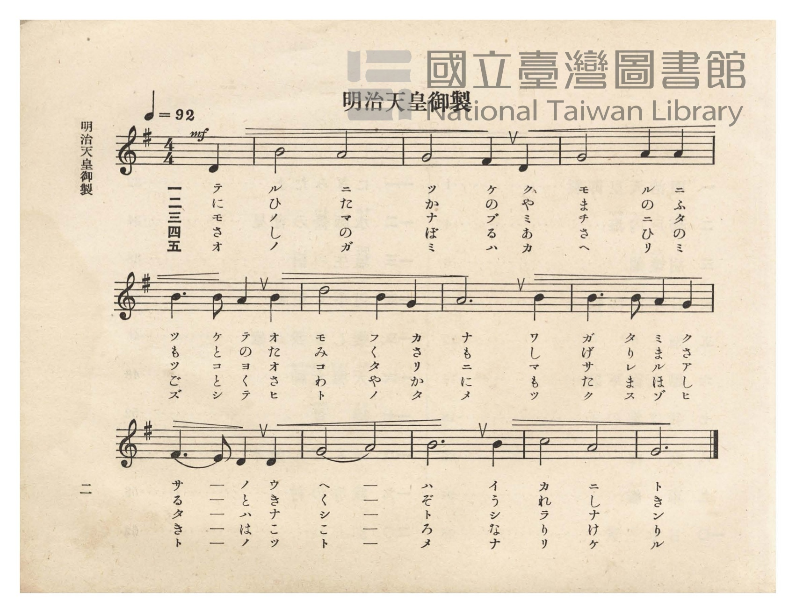
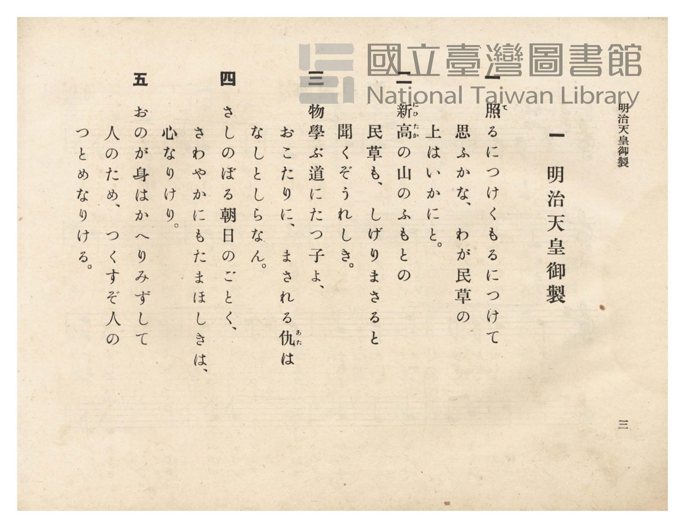

# 明治天皇御製

> Re:Shōka 使用 AI 協助辨識與重建樂譜，可能會有錯誤。歡迎回報。

- **NEUTRINO 歌聲合成版**：<br><audio controls src="meiji_tenno_gyosei_neutrino.mp3"></audio>
- **鋼琴伴奏版**：<br><audio controls src="meiji_tenno_gyosei.mp3"></audio>


- 詞：明治天皇御製
- 臺灣總督府《公學校唱歌》第六學年用（昭和十五年，索書號 523.37 4322-4）

## 說明

原書資訊與歌詞全文（對應 P006.jpg–P007.jpg，原書 pp. 1–3）：
調性與拍號：ト長調（G 大調）4/4 拍（弱起 1 拍），速度 ♩=92
版本考證：本課採用與 1915 年《公學校唱歌集》第五學年第八課〈明治天皇御製〉相同之曲調，
歌詞則擴充為五首御製，其中第二首「新高の山のふもとの民草も、しげりまさると聞くぞうれしき」
為明治 36 年（1903 年）明治天皇詠臺灣玉山（新高山）與臺灣人民之御製，第三、五首則亦見於
《新定兒童唱歌》第六學年之〈明治天皇御製〉。


## 跨冊／重複收錄參照

> 同曲（明治天皇御製和歌吟唱譜；《公學校唱歌集》收錄二首，《新定兒童唱歌》六年級收錄二首，《公學校唱歌》六年級擴充收錄五首並包含臺灣新高山御製「新高の山のふもとの民草も…」）

- **[同曲]** 《公學校唱歌集》（大正4年／1915，國臺圖 0725 26）：[**〈明治天皇御製〉**](../../../kogakko_shokashu_1915/5_08_meiji_tenno_gyosei/index.md)（`G` / `4/4` — [原始 TMD](../../../kogakko_shokashu_1915/5_08_meiji_tenno_gyosei/meiji_tenno_gyosei.tmd)）
- **[同曲]** 《新定兒童唱歌》尋常科第六學年用（2020.006.0847.0006）：[**〈明治天皇御製〉**](../../../shintei_jido_shoka/grade_6_2020.006.0847.0006/2_10_meiji_tenno_gyosei/index.md)（`G` / `4/4` — [原始 TMD](../../../shintei_jido_shoka/grade_6_2020.006.0847.0006/2_10_meiji_tenno_gyosei/meiji_tenno_gyosei.tmd)）
- 總表：[跨冊重複與同名歌曲總索引](../../../duplicate_songs.md)

## 歌詞

```text
一
照（て）るにつけくもるにつけて思ふかな、わが民草の上はいかにと。

二
新高（にひたか）の山のふもとの民草も、しげりまさると聞くぞうれしき。

三
物學ぶ道にたつ子よ、おこたりに、まされる仇（あた）はなしとしらなん。

四
さしのぼる朝日のごとく、さわやかにもたまほしきは、心なりけり。

五
おのが身はかへりみずして人のため、つくすぞ人のつとめなりける。
```

## ABC

```abc
X:1
T:明治天皇御製
M:4/4
L:1/16
Q:1/4=92
K:G
V:V1 name="Piano" snm="Pia"
[V:V1]
!mf! z4 z4 z4 D4 | B8 A8 | G8 F4 D4 | G8 A4 A4 |
w: 1.~テ | ル ニ | ツ ケ ク | モ ル ニ
w: 2.~に | ひ た | か の や | ま の ふ
w: 3.~モ | ノ マ | ナ ブ ミ | チ ニ タ
w: 4.~さ | し の | ぼ る あ | さ ひ の
w: 5.~オ | ノ ガ | ミ ハ カ | ヘ リ ミ
B6 B2 A4 B4 | d8 B4 G4 | A12 B4 | B6 B2 A4 G4 |
w: 1.~ツ ケ テ オ | モ フ カ | ナ ワ | ガ タ ミ ク
w: 2.~も と の た | み く さ | も し | げ り ま さ
w: 3.~ツ コ ヨ オ | コ タ リ | ニ マ | サ レ ル ア
w: 4.~ご と く さ | わ や か | に も | た ま ほ し
w: 5.~ズ シ テ ヒ | ト ノ タ | メ ツ | ク ス ゾ ヒ
F6 E2 D4 D4 | G8 A8 | B12 B4 | c8 A8 |
w: 1.~サ ー ノ ウ | ヘ ー | ハ イ | カ ニ
w: 2.~る ー と き | く ー | ぞ う | れ し
w: 3.~タ ー ハ ナ | シ ー | ト シ | ラ ナ
w: 4.~き ー は こ | こ ー | ろ な | り け
w: 5.~ト ー ノ ツ | ト ー | メ ナ | リ ケ
G12 z4 |
w: 1.~ト
w: 2.~き
w: 3.~ン
w: 4.~り
w: 5.~ル
```

## TMD 檔案連結

- [主旋律 TMD 檔案](meiji_tenno_gyosei.tmd) [[在 TMD Studio 編輯](https://tmdlang.github.io/Tmd-TS/#tmd=s7IKdvYPcrWy4qpTUCpJTLdSSM7PyUlNLsnMz7PKzk9PzM7Ojy_OyM9OVIKrKMvPKc1NtUovSkxJjTdDiBfnlxYlp1oVJ2fk5-fEl6RWlCTl52ejy8cXJKanWgUYGCDpLCjKL0vNS8wD6i4oyswrSU0Ba0coSC3LTEkFSRcnJ-bFl6UWZaZlpqYgOSm1qBjkYqgVJUWJecXJRZkFIG8gVOUXlWTkA51dkFFplZFZXJJflJmcmBOfnZiH5LuSjFSg5yDSlejCmbkFQLsTc5S4tLQUns3oe7Zp99MlK5_Pan-6b-GLxXsVtLS4FG0VLI247G0V3LlsTPRN7EAmvFg57_2eWZjqwca_aN_1vHHx8x17n89d_HTXnMcNXU9b1zxdu-PZgoVPp2x8trbncUP38zVrnrauBQo-3bnl-ZQV7_d0PJux9umknqe9jU92TQEKvt_T83zLomezd7yYOV_B1MhYz9hcwcTYyEjX5P2eTiUuLn0tBVtqAS4FBYWnffNBlm1uf7Gi60VHO9CVQD8-bV3xbFo70HFPN_Q-a-9UAEWyXlZB-qOGyUCmOYgJdCdEq0JBgZ6CIVDGGOhAYOCADH2xav-zhuUg47p7gf4Aij5u7ng5dTtQHGiou8LTJcvBzE5guCoA1YBs2rPxxdbtCoYQLtCgnpcN85_uWqbwaOZKW2A8AE193tnxbM6aFw3NL9aCLAKxV2161rcQGI5AqxQMLQ1NFYAhiBnuL2e3QYIeFMSQoAdFw2qg9scNwAhAj83HDZ3PZ-94OqHnyc7uZ7M3gZ3aA3IBNHQ6259N3vK0tfV50y6giS-XTYNoAwVJ67YnO9aCbeoBij9u6Hk2bcPL1TMeN657unEjkHzcuPVxU9PjxhVA9rMNE1_0doK4DY2PG6c_bpz0uKnrceO-x41THzd1A9W8aJz3uLH_MYhse9zUA1bT-7ihFxwYTbsgDlcwNgP5GhiEhpYGxhBmJ7KfXqxcAE2ZfZ1AR4CSHNhNYHYnMOQgsk927QI6COhjuGdA3tjRCXQc1JOd7U92LXuxrPvZtD0gFwDDGWjQ03WznrZOer56KdYkDjQOVwg_bmjiAhnzZEcD2D-ty4Eue9y4DOgmsO9XP25c8rhxIigAgCGEIrLsWcNcUEA2AgVXgQKvCRhIPdDgbFz3ZAcwFNc_bmwBKwDqWgG3axckGsH-B1sHlN30uHE-UCXIXmrGEsx3nZCkuxIYII8bt71snAy2FGjjkqdrJzxu6gAbCzQQKD4fbPJqsAjE_B6gFU92g3Li40age4A5CehIoNdWgW0BOm_64yagyKrHTZNhNj6dPRscO0DtIDVAv-wBGvJsztxn05eCuVPAGvvBtgCtAAYvLKBAXgY6DGj1bqgvgHY1ND7d3wy2Aui2iSASHphTIBYBxYHG9rzYBfQX0G1Ao3aAFe9_3DgLbM4yYNoCqwF6sBFsLzAegSE2ExhoMCmgyAqQLMIiYMppAllAeTkHBQpa-lxcvqmZWZkhqXl5-e6V-cWpmVYBmYl5-Q41BjXVIMsUbCy07MAMbAWtAjhLNLxY2KOggVxgKWgrAHPehv7n6xt04IWlJhb9QBeAzK5RMFDQhePq3LRaBdN4IKsGaIwuGBpB6RqgBRCWOUgBVBVMDKQKhGvApvoY1iiA5GH4cXMbWPXj5tVQ9Y-bu-HmPm5ugYk2bQST66Hii-CqQfogeqA2GKHZ0AhSAdTTuAmmp3E-woZGmG3AGAbbALIRJL4PVbxxK8IGY3Q_gFwDclUf3FXzkPzQBRedBiZBtoPEG1F8_LhpP8IGE3Q_TIW6ajqKq2B-2AMPJbBJjU1QcZAuiGqQ3yF6oDaYotnQtArdD01rkPwAC7HHzf1gOWiYNs-Ai4P0Q_0Gznq4E-euHnDiNCEtNUJSnTE4LYHYNQqmULtBPFBqq4GnSJgoqi6wGngqhKUtUMqCpEJEGCBSFygEEb6FxSREDpoWoeEEij-I_6GpFJ4agWUWNBZWwFMTNA00guIcIgcOV1g8Q3XA5ECxDlI9CWpTFzR9QtXDUyXCT5uB7BXIfgKKwOIVZCckvkA6YOkfkW5BqkGpHcRfA8thTeA0Dk-dwCIayU-obgfxIDaBXAPJYSAdsBwOkYOlUUjKAvkHWKQjfAtPpY-bdkF1bIfFUzMoHEBu74C7G5RqoTkIyFuI4idojgbHCkjVTiAGhx7EHAKpdUcnOLUCm22kpFZwSairYBYPKQ6xlImQnAUrSxEp1gRDDUwXCILKYqQ0DI-nPfAwWAYNA0TOhJUOIFFY3EBCYgk0ZLCXvbDQBUGw-5FSNEQd2F5gCgDFWi9EFzgtYNjbCCsPIXENLfObeuAisHINpBZkEhZ7QekbHMMw_4JTHThPgmS2Y_Uvsh8gakCiK-FqYTkaJArLIWj2glM7xE0Q_4LSEbAtBHUtiMawtwnZD8D2AlQUXhM0TkRSi1yqINkLSvtQ9yPFLyw1I6V9ZP-ipnxo2IDzOiQEQLUoTC1yfoTYW8vFpWungN78UACKKXMBAA)]
- [鋼琴伴奏 TMD 檔案](meiji_tenno_gyosei_piano.tmd) [[在 TMD Studio 編輯](https://tmdlang.github.io/Tmd-TS/#tmd=s7IKdvYPcrWy4tLSUng2o-_Zpt1Pl6x8Pqv96b6FLxbvfb-n42X3nucTtjzZs-Xp0v7nnR3v93QqaGlxKdoqWBpx2dsquHPZmOib2HHVKSi9WDnv_Z5ZmIYogSXbdz1vXPx8x97ncxc_3TXncUPX09Y1T9fueLZg4dMpG5-t7Xnc0P18zZqnrWuBgk93bnk-ZQXQ8mcz1j6d1PO0t_HJrilAwfd7ep5vWfRs9o4XM-crmBoZ6xmbK5gYGxnpmgCdpcTF5ZlXUpRvFZCZmJcf5OFQY1BTzaUABDYWWnZgRo1CdW5BrYKhgi4YGkHpGgVjKAsEQewaBRMMNTBdIGgAEuGqRbHRB9lGEzQb4xWiDWMVTOOBtGl8LMg0iAiUAtoHZJjgUGEAscs3NTMrMyQ1Ly_fvTK_ODUTr0dBLoTh6ty0WqDJKD7F9Jc5SAFUFXIIgXAN2FQfwxoFkDwMP25uA6t-3Lwaqv5xczfc3MfNLTDRpo1gcj1UfBFcNUgfRA_UBiM0GxpBKoB6GjfB9DTOR9jQCLPtceM6sA0gG0Hi-1DFG7cibDBG9wPINSBX9cFdNQ_JD11w0WlgEmQ7SLwRxcePm_YjbDBB98NUqKumo7gK5oc98FACm9TYBBUH6YKoBvkdogdqgymaDU2r0P3QtAbJD7AQe9zcD5aDhmnzDLg4SD_Ub1zQBARJKMbg6IdkCVOochAPlEBq4IkIkW2QdYHVwBMOLDmAEgMk4SCcjUgQIE8jHAgLfIgcNPlAvQYKcoiToQkLnoAeN4GCEBRkK-AJABptjaBogsiBgwIWNVAdMDlQRIFUT4La1AVNUlD18ISE8NNmIHsFsp-AIrCoANkJCWKQDliSRSQ1kGpQAgXx18AyRRM4WcIT1OPGKUh-QnU7iAexCeQaSKYA6YBlSogcLFlBEgPIP48bdyN8C09Yj5t2QXVsh8VTMygcQG7vgLsblNCgiR7IW4jiJ2gmBMcKSNVOIAaHHsQcWAIDlze6CmbxkEIHS8kDSb_klc3wZAcP2j1wZy-DOhuR_mF5ECQKC06I45dAPYO9hIMFCAiC3Y-UCCHqwPYCIw0U0L0QXeDow7C3EVbqQKIHWrI29cBFYKUHSC3IJCz2gpIkOFJg_gUnFHA2Aslsx-pfZD9A1IBEV8LVwjIhSBSWqNHsBSdQiJsg_gVF_ePGyVDXgmgMe5uQ_fC4EZZt4OVt40QktcgFAZK9oOQKdT9S_MISIFJyRfYvamKFhg04e0JCAFRXwdQiZyGIvTjrYRzVvwEYgqp1eI2OWcfjE4GagywObjCgNyDgOjCUwAWgRqGqJOAQUhoounYK4PaQApCBHkjRPkClWMWNcIgb4xAHOgKruClYXJkLAA)]

## 分析

```text
================================================================================
📊 TMD Song Profile: [ 明治天皇御製 ]
================================================================================
⏱  Duration:       0:33 (33.9s), 13 measures total
🎼 Key & Tempo:    首調基準 G, != 92.0 BPM, <4/4>
   - 分析範圍：      由實際發聲的音符與和弦推測調性；播放脈絡另行呈現
🎤 人聲音域:    D4 (MIDI 62) – D5 (MIDI 74) [跨度: 12 個半音 / 1.0 個八度, 難度: easy]
   - 最低音:  D4 in [MeijiTennoGyosei #1 @ m.1, 0:01]
   - 最高音: D5 in [MeijiTennoGyosei #1 @ m.6, 0:13]
   - 適合: soprano, mezzo-soprano, contralto, tenor, baritone, bass
🏛  結構:      MeijiTennoGyosei (33.9s)
⚡ 編曲密度:        Peak 1 軌道同時演奏
🗝  調性診斷：       G 大調（純淨自然大調，未偵測到可信轉調）
   - 風格氣質:    純淨自然大調（陽光明朗、易唱易記，無明顯調外色彩）
   - 轉調歷程:    全曲維持單一推測調性（未偵測到可信轉調）
   - 核心骨幹音:  A, B, G, D, F#
   - 調性數值:    G 大調 [相關度: 0.69, 穩定度: Moderate, 自然音純度: 100.0%]
   - 候選調性 (K-S): G 大調 (0.69), D 大調 (0.62), B 小調 (0.60)
   - 五度圈歷程:   +1
   - 各段落調性細節:
     • [MeijiTennoGyosei #1]: G 大調 (r: 0.69, 自然音純度: 100.0%)

  [ 五度圈游移軌跡 ]
               C  
         F           [G ]*
      Bb               D  
      Eb               A  
         Ab           E  
            Db       B  
               F# 
     (* = active key center)

  [ 十二半音累積音高分佈 ]
     C  : ████                       4.2%
     C# :                            0.0%
     D  : ███████████               12.5%
     D# :                            0.0%
     E  : █                          1.0%
     F  :                            0.0%
     F# : █████                      5.2%
     G  : ████████████████████      22.9%
     G# :                            0.0%
     A  : ████████████████████████  27.1%
     A# :                            0.0%
     B  : ████████████████████████  27.1%
--------------------------------------------------------------------------------
Assignment 軌道音域：
  - Piano         : D4 – D5 (12 個半音 / 1.0 個八度, 33 個音符)
================================================================================
```


## 原書掃描頁






