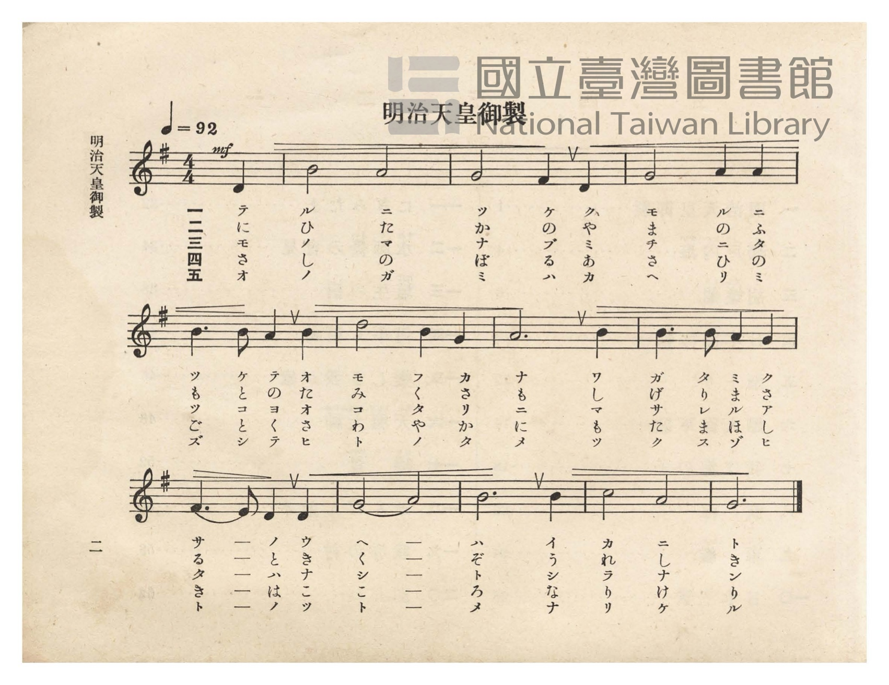
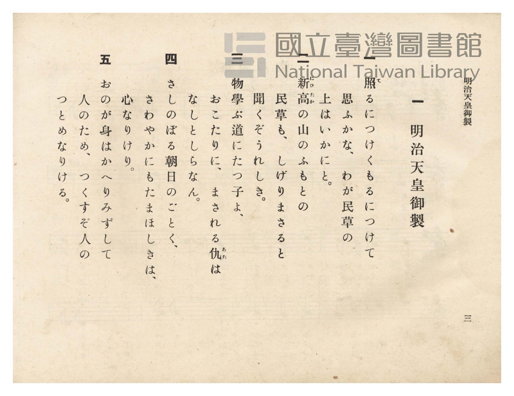

# 明治天皇御製

> Re:Shōka 使用 AI 協助辨識與重建樂譜，可能會有錯誤。歡迎回報。

- **鋼琴伴奏版**：<br><audio controls src="meiji_tenno_gyosei.mp3"></audio>
- **NEUTRINO 歌聲合成版**：<br><audio controls src="meiji_tenno_gyosei_neutrino.mp3"></audio>

- 詞：明治天皇御製
- 臺灣總督府《公學校唱歌》第六學年用（昭和十五年，索書號 523.37 4322-4）

## 說明

原書資訊與歌詞全文（對應 P006.jpg–P007.jpg，原書 pp. 1–3）：
調性與拍號：ト長調（G 大調）4/4 拍（弱起 1 拍），速度 ♩=92
版本考證：本課採用與 1915 年《公學校唱歌集》第五學年第八課〈明治天皇御製〉相同之曲調，
歌詞則擴充為五首御製，其中第二首「新高の山のふもとの民草も、しげりまさると聞くぞうれしき」
為明治 36 年（1903 年）明治天皇詠臺灣玉山（新高山）與臺灣人民之御製，第三、五首則亦見於
《新定兒童唱歌》第六學年之〈明治天皇御製〉。


## 歌詞

```text
一
照（て）るにつけくもるにつけて思ふかな、わが民草の上はいかにと。

二
新高（にひたか）の山のふもとの民草も、しげりまさると聞くぞうれしき。

三
物學ぶ道にたつ子よ、おこたりに、まされる仇（あた）はなしとしらなん。

四
さしのぼる朝日のごとく、さわやかにもたまほしきは、心なりけり。

五
おのが身はかへりみずして人のため、つくすぞ人のつとめなりける。
```

## ABC

<div class="abc-score" data-abc-src="meiji_tenno_gyosei.abc" aria-label="五線譜載入中"></div>

[下載 ABC 原始檔](meiji_tenno_gyosei.abc)

## TMD 檔案連結

- [主旋律 TMD 檔案](meiji_tenno_gyosei.tmd) [[在 TMD Studio 編輯](https://tmdlang.github.io/Tmd-TS/#tmd=s7IKdvYPcrWy4qpTUCpJTLdSSM7PyUlNLsnMz7PKzk9PzM7Ojy_OyM9OVIKrKMvPKc1NtUovSkxJjTdDiBfnlxYlp1oVJ2fk5-fEl6RWlCTl52ejy8cXJKanWgUYGCDpLCjKL0vNS8wD6i4oyswrSU0Ba0coSC3LTEkFSRcnJ-bFl6UWZaZlpqYgOSm1qBjkYqgVJUWJecXJRZkFIG8gVOUXlWTkA51dkFFplZFZXJJflJmcmBOfnZiH5LuSjFSg5yDSlejCmbkFQLsTc5DNzEzPzLPKzc9LKgWGE4ZESWJmOdDJ-WlpmclgjVpaCs9m9D3btPvpkpXPZ7U_3bfwxeK9ClpaXIq2CpZGXPa2Cu5cNib6JnYgk16snPd-zyxM9WBrXrTvet64-PmOvc_nLn66a87jhq6nrWuert3xbMHCp1M2Plvb87ih-_maNU9b1wIFn-7c8nzKivd7Op7NWPt0Us_T3sYnu6YABd_v6Xm-ZdGz2TtezJyvYGpkrGdsrmBibGSka_J-T6cSF5e-loIttQCXgoLC0775IMs2t79Y0fWiox3oSqAfn7aueDatHei4pxt6n7V3KoBSh15WQfqjhslApjmICXQnRKtCQYGegiFQxhjoQGDggAx9sWr_s4blIOO6e4H-AIo-bu54OXU7UBxoqLvC0yXLwcxOYLgqANWAbNqz8cXW7QqGEC7QoJ6XDfOf7lqm8GjmSltgPABNfd7Z8WzOmhcNzS_WgiwCsVdteta3EBiOQKsUDC0NTRWAIYgZ7i9nt0GCHhTEkKAHRcNqoPbHDcAIQI_Nxw2dz2fveDqh58nO7mezN4Gd2gNyATR0OtufTd7ytLX1edMuoIkvl02DaAMFSeu2JzvWgm3qAYo_buh5Nm3Dy9UzHjeue7pxI5B83Lj1cVPT48YVQPazDRNf9HaCuA2NjxunP26c9Lip63HjvseNUx83dQPVvGic97ix_zGIbHvc1ANW0_u4oRccGE27IA5XMDYD-RoYhIaWBsYQZieyn16sXABNmX2dQEeAkhzYTWB2JzDkILJPdu0COgjoY7hnQN7Y0Ql0HNSTne1Pdi17saz72bQ9IBcAwxlo0NN1s562Tnq-einWJA40DlcIP25o4gIZ82RHA9g_rcuBLnvcuAzoJrDvVz9uXPK4cSIoAIAhhCKy7FnDXFBANgIFV4ECrwkYSD3Q4Gxc92QHMBTXP25sASsA6loBt2sXJBrB_gdbB5Td9LhxPlAlyF5qxhLMd52QpLsSGCCPG7e9bJwMthRo45Knayc8buoAGws0ECg-H2zyarAIxPweoBVPdoNy4uNGoHuAOQnoSKDXVoFtATpv-uMmoMiqx02TYTY-nT0bHDtA7SA1QL_sARrybM7cZ9OXgrlTwBr7wbYArQAGLyygQF4GOgxo9W6oL4B2NTQ-3d8MtgLotokgEh6YUyAWAcWBxva82AX0F9BtQKN2gBXvf9w4C2zOMmDaAqsBerARbC8wHoEhNhMYaDApoMgKkCzCImDKaQJZQHk5BwUKWvpcXL6pmVmZIal5efnulfnFqZlWAZmJefkONbqGNdUg2xRsLLTswAxsJa0COE80vFjYo6CBXGIpaCsAs96G_ufrG3TgpaUmFv1AJ4DMrlEwUNCF4-rctFoF03ggqwZojC4YGkHpGqAFEJY5SAFUFUwMpAqEa8Cm-hjWKIDkYfhxcxtY9ePm1VD1j5u74eY-bm6BiTZtBJProeKL4KpB-iB6oDYYodnQCFIB1NO4CaancT7ChkaYbcAoBtsAshEkvg9VvHErwgZjdD-AXANyVR_cVfOQ_NAFF50GJkG2g8QbUXz8uGk_wgYTdD9MhbpqOoqrYH7YAw8lsEmNTVBxkC6IapDfIXqgNpii2dC0Ct0PTWuQ_AALscfN_WA5aJg2z4CLg_RD_QbOe7gT564ecOI0IS01QlKdMTgtgdg1CqZQu0E8UGqrgadImCiqLrAaeCqEpS1QyoKkQkQYIFIXKAQRvoXFJEQOmhah4QSKP4j_oakUnhqBhRY0FlbAUxM0DTSC4hwiBw5XWDxDdcDkQLEOUj0JalMXNH1C1cNTJcJPm4HsFch-AorA4hVkJyS-QDpg6R-RbkGqQakdxF8Dy2FN4DQOT53AMhrJT6huB_EgNoFcA8lhIB2wHA6Rg6VRSMoC-QdYpiN8C0-lj5t2QXVsh8VTMygcQG7vgLsblGqhOQjIW4jiJ2iOBscKSNVOIAaHHsQcAql1Ryc4tQLbbaSkVnBJqKtgFg8pDrGUiZCcBStLESnWBEMNTBcIgspipDQMj6c98DBYBg0DRM6ElQ4gUVjcQEJiCTRksJe9sNAFQbD7kVI0RB3YXmAKAMVaL0QXOC1g2NsIKw8hcQ0t85t64CKwcg2kFmQSFntB6RscwzD_glMdOE-CZLZj9S-yHyBqQKIr4WphORokCsshaPaCUzvETRD_gtIRsDEEdS2IxrC3CdkPwAYDVBReEzRORFKLXKog2QtK-1D3I8UvLDUjpX1k_6KmfGjYgPM6JARAtShMLXJ-hNhby8Wla6eA3v5QAIopcwEA)]
- [鋼琴伴奏 TMD 檔案](meiji_tenno_gyosei_piano.tmd) [[在 TMD Studio 編輯](https://tmdlang.github.io/Tmd-TS/#tmd=s7IKdvYPcrWy4qpTUCpJTLdSSM7PyUlNLsnMz7PKzk9PzM7Ojy_OyM9OVIKrKMvPKc1NtTJDiBTnlxYlp-JSD5GNL0hMT7UKMDAw0wUS5gjpgqL8stS8xDygASWJmeWJefHpQIGivPyi-PTUvNSixByE2tSyzJRUkMqCoszcxKLK-JT8ZKBb8kqQXJdaVAxyfEFmYl5-fGJRUWJeeiqqkvyikoz89KLEgoxKq4zM4pL8oszkxJz47MQ8JFeXZAB1WaWmlCYnggJDiUtLS-HZjL5nm3Y_XbLy-az2p_sWvli89_2ejpfde55P2PJkz5anS_ufd3a839OpoKXFpWirYGnEZW-r4M5lY6JvYgcy98XKee_3zMI0BGzpi_ZdzxsXP9-x9_ncxU93zXnc0PW0dc3TtTueLVj4dMrGZ2t7Hjd0P1-z5mnrWqDg051bnk9ZAbT82Yy1Tyf1PO1tfLJrClDw_Z6e51sWPZu948XM-QqmRsZ6xuYKJsZGRromQGcpcXF55pUU5VsFgIImyMOhxqCmmksBCGwstOzAjBqF6tyCWgVDBV0wNILSNQrGUBYIgtg1CiYYamC6QNAAJMJVi2KjD7KNJmg2xitEG8YqmMYDadP4WJBpEBEoBbQPyDDBocIAYpdvamZWZkhqXl6-e2V-cWomwqO6hpg-BTkRhqtz02qBRqN4FdNj5iAFUFXIQQTCNWBTfQxrFEDyMPy4uQ2s-nHzaqj6x83dcHMfN7fARJs2gsn1UPFFcNUgfRA9UBuM0GxoBKkA6mncBNPTOB9hQyPMtseN68A2gGwEie9DFW_cirDBGN0PINeAXNUHd9U8JD90wUWngUmQ7SDxRhQfP27aj7DBBN0PU6Gumo7iKpgf9sBDCWxSYxNUHKQLohrkd4geqA2maDY0rUL3Q9MaJD_AQuxxcz9YDhqmzTPg4iD9UL9xQRMQJKEYg6MfkidMocpBPFACqYEnIkS-QdYFVgNPOLDkAEoMkISDcDYiQYA8jXAgLPAhctDkA_UaKMghToYmLHgCetwECkJQkK2AJwBotDWCogkiBw4KWNRAdcDkQBEFUj0JalMXNElB1cMTEsJPm4HsFch-AorAogJkJySIQTpgSRaR1ECqQQkUxF8DyxRN4GQJT1CPG6cg-QnV7SAexCaQayCZAqQDlikhcrBkBUkMIP88btyN8C08YT1u2gXVsR0WT82gcAC5vQPublBCgyZ6IG8hip-gmRAcKyBVO4EYHHoQc2AJDFze6CqYxUMKHSwlDyT9klc4w5MdPGj3wJ29DOpsRPqH5UGQKCw4IY5fAvUM9hIOFiAgCHY_UiKEqAPbC4w0UED3QnSBow_D3kZYqQOJHmjJ2tQDF4GVHiC1IJOw2AtKkuBIgfkXnFDA2Qgksx2rf5H9AFEDEl0JVwvLhCBRWKJGsxecQCFugvgXFPWPGydDXQuiMextQvbD40ZYtoGXt40TkdQiFwRI9oKSK9T9SPELS4BIyRXZv6iJFRo24OwJCQFQXQVTi5yFIPbirIhB9T-iIkY0AAzAEFSxw-t0zFoenwjUHGRxcJMBvQkB14GhBC4ANQpVJQGHkNJE0bVTALeIFIAM9FCK9gEqxSpuhEPcGIc40BFYxU3B4spcAA)]

## 分析

```text
================================================================================
📊 TMD Song Profile: [ 明治天皇御製 ]
================================================================================
⏱  Duration:       0:31 (31.3s), 12 measures total
🎼 Key & Tempo:    首調基準 G, != 92.0 BPM, <4/4>
   - 分析範圍：      由實際發聲的音符與和弦推測調性；播放脈絡另行呈現
🎤 人聲音域:    D4 (MIDI 62) – D5 (MIDI 74) [跨度: 12 個半音 / 1.0 個八度, 難度: easy]
   - 最低音:  D4 in [MeijiTennoGyosei #1 @ m.1, 0:01]
   - 最高音: D5 in [MeijiTennoGyosei #1 @ m.6, 0:13]
   - 適合: soprano, mezzo-soprano, contralto, tenor, baritone, bass
🏛  結構:      MeijiTennoGyosei (31.3s)
⚡ 編曲密度:        Peak 1 軌道同時演奏
🗝  調性診斷：       G 大調（純淨自然大調，未偵測到可信轉調）
   - 風格氣質:    純淨自然大調（陽光明朗、易唱易記，無明顯調外色彩）
   - 轉調歷程:    全曲維持單一推測調性（未偵測到可信轉調）
   - 核心骨幹音:  A, B, G, D, F#
   - 調性數值:    G 大調 [相關度: 0.69, 穩定度: Moderate, 自然音純度: 100.0%]
   - 候選調性 (K-S): G 大調 (0.69), D 大調 (0.62), B 小調 (0.60)
   - 五度圈歷程:   +2
   - 各段落調性細節:
     • [MeijiTennoGyosei #1]: D 調性不明確 (r: 0.63, 自然音純度: 95.6%, 調外音: C)

  [ 五度圈游移軌跡 ]
               C  
         F            G  
      Bb              [D ]*
      Eb               A  
         Ab           E  
            Db       B  
               F# 
     (* = active key center)

  [ 十二半音累積音高分佈 ]
     C  : ████                       4.2%
     C# :                            0.0%
     D  : ███████████               12.5%
     D# :                            0.0%
     E  : █                          1.0%
     F  :                            0.0%
     F# : █████                      5.2%
     G  : ████████████████████      22.9%
     G# :                            0.0%
     A  : ████████████████████████  27.1%
     A# :                            0.0%
     B  : ████████████████████████  27.1%
--------------------------------------------------------------------------------
Assignment 軌道音域：
  - Piano         : D4 – D5 (12 個半音 / 1.0 個八度, 33 個音符)
================================================================================
```


## 原書掃描頁






