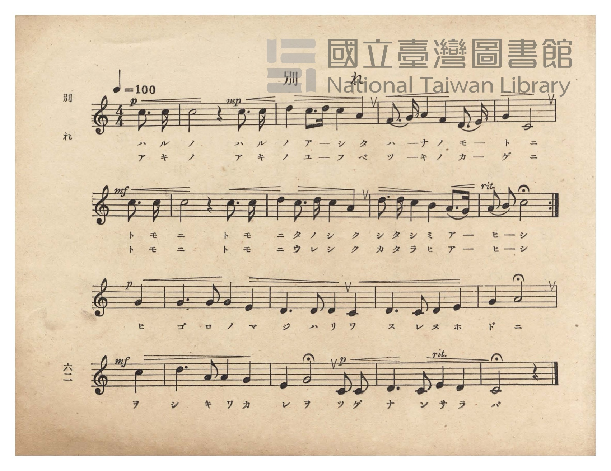
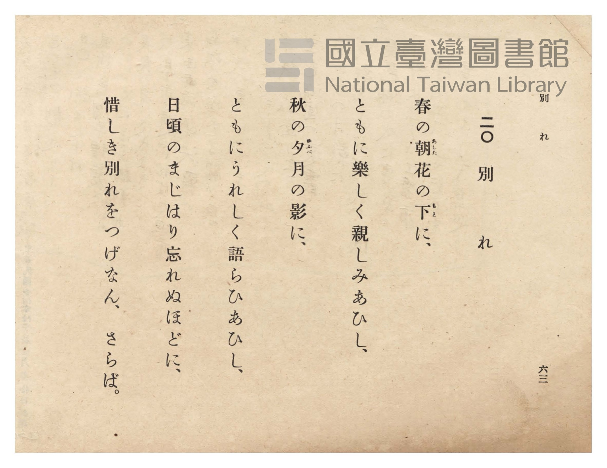

# 別れ

> Re:Shōka 使用 AI 協助辨識與重建樂譜，可能會有錯誤。歡迎回報。

<audio controls src="wakare.mp3"></audio>

- 詞：文部省
- 曲：文部省
- 臺灣總督府《公學校唱歌》第六學年用（昭和十五年，索書號 523.37 4322-4）

## 說明

原書資訊與歌詞全文（對應 P066.jpg、P067.jpg，原書 pp. 62–63）：
調性與拍號：ハ長調（C 大調）4/4 拍（弱起一拍），速度 ♩=100
曲式結構：第 1–2 行（前 8 小節）譜下印有上下兩行片假名歌詞，第 2 行末附反覆記號（:||）；
第 3–4 行（後 8 小節）譜下印單行片假名歌詞。


## 跨冊／重複收錄參照

> 同曲（畢業惜別歌〈別れ〉「春のあしたの花の陰…」；《公學校唱歌》與《新定兒童唱歌》第六學年共用教材）

- **[同曲]** 《新定兒童唱歌》尋常科第六學年用（2020.006.0847.0006）：[**〈別れ〉**](../../../shintei_jido_shoka/grade_6_2020.006.0847.0006/4_19_wakare/index.md)（`C` / `4/4` — [原始 TMD](../../../shintei_jido_shoka/grade_6_2020.006.0847.0006/4_19_wakare/wakare.tmd)）
- 總表：[跨冊重複與同名歌曲總索引](../../../duplicate_songs.md)

## 歌詞

```text
春の朝（あした）花の下（もと）に、
ともに楽しく親しみあひし、
秋の夕（ゆふべ）月の影に、
ともにうれしく語らひあひし、
日頃のまじはり忘れぬほどに、
惜しき別れをつげなん、さらば。
```

## ABC

```abc
X:1
T:別れ
C:曲：文部省
M:4/4
L:1/16
Q:1/4=100
K:C
V:V1 name="Piano" snm="Pia"
[V:V1]
!p! z4 z4 z4 c3 c | !mp! c8 z4 c3 c | d4 c3 d c4 A4 | F3 G A4 F4 D3 E |
w: 1.~ハ ル | ノ ハ ル | ノ ア ー シ タ | ハ ー ナ ノ モ ー
w: 2.~ア キ | ノ ア キ | ノ ユ ー フ ベ | ツ ー キ ノ カ ー
!mf! G4 C8 c3 c | c8 z4 c3 c | d4 c3 d c4 A4 | d3 d c4 B4 A3 G |
w: 1.~ト ニ ト モ | ニ ト モ | ニ タ ノ シ ク | シ タ シ ミ ア ー
w: 2.~ゲ ニ ト モ | ニ ト モ | ニ ウ レ シ ク | カ タ ラ ヒ ア ー
!p! A2 B2 c8 G4 | G6 G2 G4 E4 | D6 D2 D4 C4 | D6 C2 D4 E4 |
w: 1.~ヒ ー シ ヒ | ゴ ロ ノ マ | ジ ハ リ ワ | ス レ ヌ ホ
w: 2.~ヒ ー シ ヒ | ゴ ロ ノ マ | ジ ハ リ ワ | ス レ ヌ ホ
!mf! G4 A8 c4 | d6 A2 A4 G4 | !p! E4 G8 C2 C2 | D6 C2 E4 D4 |
w: 1.~ド ニ ヲ | シ キ ワ カ | レ ヲ ツ ゲ | ナ ン サ ラ
w: 2.~ド ニ ヲ | シ キ ワ カ | レ ヲ ツ ゲ | ナ ン サ ラ
C8 z4 z4 |
w: 1.~バ
w: 2.~バ
```

## TMD 檔案連結

- [主旋律 TMD 檔案](wakare.tmd) [[在 TMD Studio 編輯](https://tmdlang.github.io/Tmd-TS/#tmd=s7IKdvYPcrWy4qpTUCpJTLdSSM7PyUlNLsnMz7PKzk9PzM7Ojy_OyM9OVIKrKMvPKc1NtUovSkxJjTdDiBfnlxYlp1oVJ2fk5-fEl6RWlCTl52ejy8cXJKanWgUYmCHpLCjKL0vNS8wD6i4oyswrSU0Ba0coSC3LTEkFSRcnJ-bFl6UWZaZlpqYgOSm1qBjkYqgVJUWJecXJRZkFIG8gVOUXlWTkA51dkFFplZFZXJJflJmcmBOfnZiH5LuSjFSg59KKMlPzUoozMgvQZUDeLk2EGKylpfC0Y-njph4FLS0uRVsFQwMDLntbBWcuGxN9EzuQxhcr573fM-vZtPaXzSuez2kEG_Zs9iYMsRftu543Ln6-Y-_zuYuf7przuKHraeuap2t3PFuw8OmUjc_W9jxu6H6-Zs3T1rVAwac7tzyfsuL9no5nM9Y-ndTztLfxya4pQMH3e3qeb1n0bPaOFzPnK5gaGesZmyuYGBsZ6Zq839OpxMWlr6VgSy3ApaCg8LRvPsiyze0vVnS96GgHuhLo3aetK4BeAzru6YbeZ-2dCqCY1ssqSH_c0AhkmoOYQHdCtCoUFOgpmBk9aphsZgx0IjBUQMa-WLX_WcNykIHdvUCfAEUfN_e_nLodKA401lnh6ZLlYGYnMJAVgGpAdu3Z-GLr9ic7GsBcoEE9LxvmP921TOHRzJW2oFgBGgsM9qd7-p9vnfBseTfQTGBoKhgCbTZSeLGwB2REZ6-ChcLTDf3P1zcAjXixds6THd1Pezc8m9P5ZEcXiN26EqjyeWf708b2pxN6Ib4FBTnQILAhz-asfjmz5Wl_74tlbS9WzAA7vcOqpgbsoNkgJyAASJMx0HYTmO37erDa_nTaOkxLHzc0cYF9NGPp48Z1z-bMBRrwuLHpceP0x41AOztfdG0EigMNAIk3AcWBaaXzceNqYBSAtAH5YNHVz5buBevpf7FsFZixH2zKJhAbovT58m6gSU-XTAWb1Pa4cevjxp1Aw57NAVq47uleoD0Ypj5ubAPmCKjBq-Y9bgJaDTQS1eBn05e-XNAMNONx477HjTMeN65_3NT1dP8MsM41jxt3P25ciTD7WfMcsHm9kNz2uGnS48YljxuB5KrHTZOBih43TgXbswEUNEANlKdvKFDQ0ufiCk_MTiwCllmZiXn5DjUGNdXguLQxNNOyA7Ow5StQDAPTIzDyFDSQU6eCtoIxNJ7BTKCQDjyPaGIxB-gAkB01CgYKumCITlcX1CoYxoGZQKoGxkZAuMJcNJVGMJVQQSAfrtkMStcomIBpU7gIhA9UDSaNgSpMYcagWVydm4ZiIdgjPoY1CvFQBeg0MJ9D6dVAYx8396EZSEjd46ZFUPE9QPZ2uOh-uGcQOoEqmrvg5sFNaEaYAFLdARfvRnMLTA6kA-ozIzw-g7msaS1-n-FQ97h5GZK7p8JFZyL5rAXJ72sxfda0GtlnTZuI9Bn-FL6rB5LC-5cCSz9QJINKwN3bQKU1uAQEluLIBaICsDgkMrnjTMakp2CoKmRJcxRFpkBFIBZIFMNeUP6CpXBEEsYMNkTiRAo-JHWwZAiKEuTEuR7uTpgoSCWSiub5cLWoiXMSlA2SgalGRCJIFsnNwMRJjpthyW4NTjdDkxXIzc0rMWwn180ECtZOcLIjKiHB4g4EQWwY3xjuB0hJBoEgNowPK89QVYBEYXyEGTBTYakOBpHLQJT007QFxedrwSQiu8-Dm_y4aQeKSlAB9rh5FZyPHBc7UVSuAZM9cP5shMrmTrgoZvaHFQ1IKWdIuBZvmnk6ezbxaQZeroAgKEph0QovCOBRj5y8QBBcHQNpEMZMODBdMHFgOYemH716R04yyBkGUsYjAhSWESEBBgpM1OBBBBionoCU_yCVsDoQIrcZLLcVzodlaJDKCWgmoddxyMllsLu0lotL104B0rBTALKUuQA)]
- [鋼琴伴奏 TMD 檔案](wakare_piano.tmd) [[在 TMD Studio 編輯](https://tmdlang.github.io/Tmd-TS/#tmd=s7IKdvYPcrWy4tLSUnjasfRxU8_7PR0vu_c8n7DlyZ4tT5f2P-_seL-nU0FLi0vRVsHQwIDL3lbBmcvGRN_EjqtOQenFynnv98x6Nq39ZfOK53MalUBiz2ZvwhB70b7reePi5zv2Pp-7-OmuOY8bup62rnm6dsezBQufTtn4bG3P44bu52vWPG1dCxR8unPL8ykrgA55NmPt00k9T3sbn-yaAhR8v6fn-ZZFz2bveDFzvoKpkbGesbmCibGRka4J0IlKXFyeeSVF-VYBmYl5-UEeDjUGNdVcCkBgY2imZQdm1ShU56bVKhjFKejCoRkUg6AplK5RMEYTgUFDKK5RMEIThemAideARZGhARpdw1WL4mYfZDeboDk5XiHaKDdWwSRewTAeZHa8gmk8UMw0PhYiAFQAkQMJg-WjDWOBVhlArAlPzE4sSsUfNujug9HVBbUKhpAgA1JAs5GDD0VhLppKeEBDBYF8uGZYmNcomIBpU7gIhA8LSWOgClgsoIcoOGiQLAR7xMewRiEeqgCdftzcD6VXA4193NyHZiAhdY-bFkHF9wDZ2-Gi--GeQegEqmjugpsHN6EZYQJIdQdcvBvNLTA5kA6oz4zw-Azmsqa1-H2GQ93j5mVI7p4KF52J5LMWJL-vxfRZ02pknzVtItJn0NSHM1WRnqCgqpAlzVEUmQIVgVggUQx7QckdXhDAUxSmLxBpBck3SOpgqQIUQshpZT3cnTBRkEokFc3z4WpR08okKBskA1ONCFOQLJKbgWmFHDfDUsEanG6GxjLIzc0rMWwn183QVIBc3oLYMD6sdEUtd0FsGB9WNmCWzDA-wgyYqbAkA4PI5QlK5DdtQXH2WjCJyDrz4CY_btqBohJUGDxuXgXnIwfkThSVa8BkD5w_G6GyuRMuipmVYNkMKdqHhGuhEU5BXQyul4A09epjRHwjJ1VIYYcIDVgWgPgWFBKofkP4FlRgQgpCkEpYZQCR2wyW2wrnw7ISSOUENJPQC3vkuB7sLkVrfOBo5IAaKuDGCiRWIa0XSAsG1AICFcnAdg1QHCRlEgtqNUAYwHYPpMUDlYfqQW47oZmGbhBMI3JTCtMghKugFEQjWBfUBIgIarMMSEAdiuYofA06WDAQaNPp2imAW48KQAYkiKN9gPJIPCMwT5kLAA)]

## 分析

```text
================================================================================
📊 TMD Song Profile: [ 別れ ]
================================================================================
⏱  Duration:       0:40 (40.8s), 17 measures total
🎼 Key & Tempo:    首調基準 C, != 100.0 BPM, <4/4>
   - 分析範圍：      由實際發聲的音符與和弦推測調性；播放脈絡另行呈現
🎤 人聲音域:    C4 (MIDI 60) – D5 (MIDI 74) [跨度: 14 個半音 / 1.2 個八度, 難度: moderate]
   - 最低音:  C4 in [Wakare #1 @ m.5, 0:10]
   - 最高音: D5 in [Wakare #1 @ m.3, 0:04]
   - 適合: soprano, mezzo-soprano, contralto, tenor, baritone, bass
🏛  結構:      Wakare (40.8s)
⚡ 編曲密度:        Peak 1 軌道同時演奏
🗝  調性診斷：       C 大調（純淨自然大調，未偵測到可信轉調）
   - 風格氣質:    純淨自然大調（陽光明朗、易唱易記，無明顯調外色彩）
   - 轉調歷程:    全曲維持單一推測調性（未偵測到可信轉調）
   - 核心骨幹音:  C, D, G, A, E
   - 調性數值:    C 大調 [相關度: 0.83, 穩定度: High, 自然音純度: 100.0%]
   - 候選調性 (K-S): C 大調 (0.83), G 大調 (0.62), A 小調 (0.60)
   - 五度圈歷程:   +0
   - 各段落調性細節:
     • [Wakare #1]: C 大調 (r: 0.83, 自然音純度: 100.0%)

  [ 五度圈游移軌跡 ]
              [C ]*
         F            G  
      Bb               D  
      Eb               A  
         Ab           E  
            Db       B  
               F# 
     (* = active key center)

  [ 十二半音累積音高分佈 ]
     C  : ████████████████████████  36.9%
     C# :                            0.0%
     D  : ███████████████           22.5%
     D# :                            0.0%
     E  : █████                      7.0%
     F  : ██                         2.9%
     F# :                            0.0%
     G  : ██████████                15.6%
     G# :                            0.0%
     A  : ████████                  12.7%
     A# :                            0.0%
     B  : ██                         2.5%
--------------------------------------------------------------------------------
Assignment 軌道音域：
  - Piano         : C4 – D5 (14 個半音 / 1.2 個八度, 66 個音符)
================================================================================
```


## 原書掃描頁






